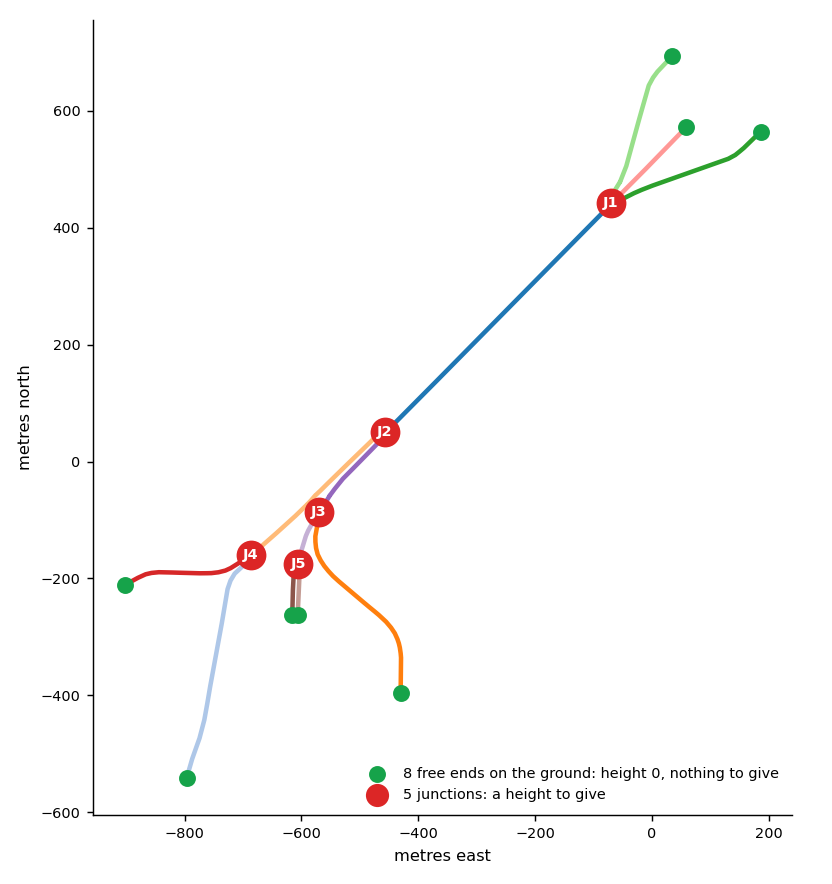
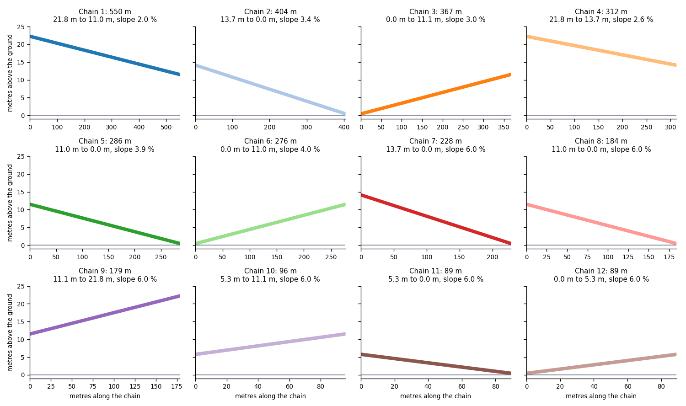
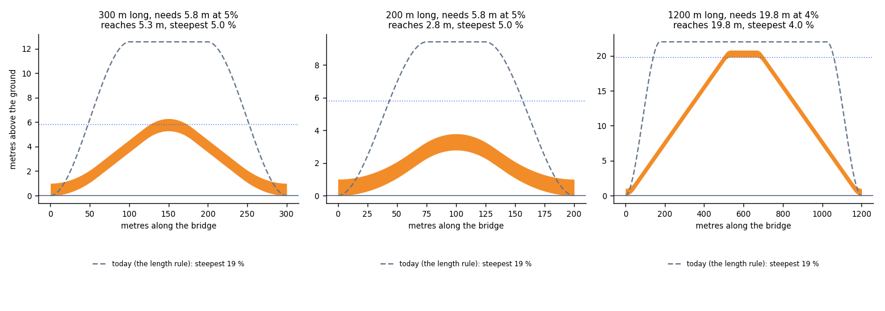

# The height of a bridge from the design rules

Date: 2026-11-10. Status: built as an option (2026-11-11): `parameters.height_rule: "design"` in the [bridge profile](bridge_profile_edit.md). The default is still the length rule, so no page changes unless the profile asks. The documentation came first. This note replaces the heights that the engine guesses from the length of a bridge with the heights that bridge
design rules give. It uses no measured data of one bridge.

## Summary

- A bridge deck has no height of its own. Its height is the result of **vertical alignment design**: the deck must clear what it crosses, the road must not be steeper than its grade limit,
  the grade changes must be rounded by vertical curves that suit the design speed, and the two ends must meet the road at its height.
- The engine today does not follow these rules. It gives a bridge a height from its length (5 m to 22 m). It rises at an average slope of 12.5 % and at 18.75 % at the steepest point. Its curves are five to ten
  times sharper than the curves of design practice at 50 km/h. A bridge over a road needs 5.8 m, and the engine gives a bridge of 300 m a height of 12.6 m.
- The proposal is to find the height of each chain from its **clearance**, the length of its **ramps** from a **design grade**, and the **vertical curves** from a **design speed**. The result is a list of
  points of vertical intersection (PVI) with curve lengths. This is the standard form of a vertical alignment in road design, and it is also the form of the `points` and `curves` in the proposal of
  [the input profile](bridge_profile_edit.md).
- Each rule below says where it comes from and how well I could verify it. Some values (the maximum grade of each road class) I could not verify. The note says so, and they are settings.

## The design rules

**1. Clearance of a bridge over a road**

- Value: 16 ft (4.9 m) for a freeway and an arterial, 14 ft (4.3 m) for other roads. Add 6 in (0.15 m) for a new surface. So 5.0 m
- Status: Found in a state manual
- Source: [FDOT bulletin RDB10-10](https://www.fdot.gov/docs/default-source/content-docs/roadway/bulletin/RDB10-10.pdf), [TxDOT: vertical clearance](https://www.txdot.gov/manuals/des/rdw/chapter-4--basic-design-criteria/4-8-vertical-alignment/4-8-6-vertical-clearance.html)

**2. Clearance over a railway**

- Value: 23 ft (7.0 m) to 23 ft 6 in (7.2 m) above the top of the rail. The railway can ask for more
- Status: Found in three state manuals
- Source: [Illinois](https://my.ilga.gov/ftp/JCAR/AdminCode/092/092015000C01600R.html), [NCDOT](https://connect.ncdot.gov/projects/Roadway/Roadway%20Design%20Manual/08-12.%20%20Guide%20for%20Paving%20Shoulders%20Under%20Bridges.pdf.pdf), [TxDOT](https://www.txdot.gov/manuals/rrd/rho/exhibit_a_and_pse_design/exhibit_a_design-i1005859/guidelines_on_projects_with_overpasses-i1006139.html)

**3. Clearance over navigable water**

- Value: Set by the authority of the waterway. There is no general value
- Status: Not researched
- Source: The user gives it

**4. Depth of the structure**

- Value: A steel plate girder is about span ÷ 25 deep (slab and girder). A steel box girder is span ÷ 20 to ÷ 25 for a simple span and ÷ 25 to ÷ 35 for a continuous one. A concrete structure: not confirmed
- Status: Found in secondary sources
- Source: [Mead & Hunt](https://meadhunt.com/?p=63129), [a textbook excerpt](https://ingenieriasismica.utpl.edu.ec/sites/default/files/publicaciones/UCG-ES-00536.pdf), [lecture notes](https://www.scribd.com/document/392377472/Design-of-Box-Girder-Bridges)

**5. Maximum grade**

- Value: It depends on the road class, the terrain and the design speed. The maximum value must be used rarely and is not a target. A bridge has no limit of its own. It follows the road
- Status: The rule is found. **The numbers of the tables are not**. They are settings
- Source: [TxDOT: grades](https://www.txdot.gov/manuals/des/rdw/chapter-4--basic-design-criteria/4-8-vertical-alignment/4-8-1-grades.html), [Kentucky summary of the AASHTO Green Book](https://kp.uky.edu/?p=23524)

**6. Least grade on a long bridge**

- Value: At least 0.5 % so that water runs off
- Status: Found in one state manual
- Source: [Iowa DOT: vertical alignment](https://iowadot.gov/design-manual/chapter-2-alignments/2c-vertical-alignment)

**7. Low point on a bridge**

- Value: A sag curve must not put its low point on a bridge
- Status: Found in one state manual
- Source: Iowa DOT, same page

**8. A vertical curve**

- Value: `L = K × A`. `A` is the change of grade in percent. The preferred least length is about 3 × the design speed (in mph and feet), which is 0.6 × V (V in km/h, L in metres). It is not a design control if the sight distance is met
- Status: Found
- Source: [TxDOT: vertical curves](https://www.txdot.gov/manuals/des/rdw/chapter-4--basic-design-criteria/4-8-vertical-alignment/4-8-2-vertical-curves.html), [LibreTexts: vertical curves](https://eng.libretexts.org/Bookshelves/Civil_Engineering/Fundamentals_of_Transportation/07:_Geometric_Design/7.05:_Vertical_Curves)

**9. `K` from the stopping sight distance `S`**

- Value: Crest: `K = S² ÷ 658`. Sag: `K = S² ÷ (120 + 3.5 S)`. `S = 0.278 V t + V² ÷ (254 × a ÷ 9.81)`, with `t` = 2.5 s and `a` = 3.4 m/s² (the AASHTO values)
- Status: **Derived, and checked**: the formulas give 247 ft per percent at 70 mph, and 473 (crest) and 260 (sag) at 85 mph. The search results have 247 at 70 mph (a worked example) and 473 and 260 at 85 mph (the TxDOT table). A test keeps this
- Source: TxDOT, LibreTexts

**10. The ends**

- Value: A deck meets the approach road at its height. The roads that meet at a node have the same height there
- Status: Principle

What I could not verify: the numbers of the maximum grade for each road class, the clearance over water, and the depth of a concrete structure. The numbers in the maximum-grade tables of the AASHTO Green Book and of the
Canadian TAC guide (Vancouver uses the BC supplement) must be read from the books by the person who sets the defaults.

## The model

The engine finds the height `z(x)` of each chain, with `x` the distance along the chain. The symbols are in the formulas below.

| Symbol | Meaning |
|---|---|
| `ℓ` | The length of the chain, in metres |
| `P` | The top of the chain: the height that its deck must reach, in metres above the ground |
| `g` | The design grade, as a fraction (0.05 is 5 %) |
| `V` | The design speed, in km/h |

### 1. The top `P` of a chain

The top is what the deck must clear, plus the depth of the structure. For each obstacle `k` under the chain, with a clearance `c_k` and a width `w_k` (the span):

```text
depth_k = max( 0.8 m, w_k ÷ 25 )
P_k     = c_k + depth_k
P       = max over k of P_k
```

A road of 20 m has `c` = 5.0 m (rule 1) and a depth of 0.8 m, so `P` = 5.8 m. A railway has `c` = 7.2 m (rule 2). A navigable river has the clearance that the user gives.

### 2. The ramps

The ramp rises at the design grade `g` from the ground. A deck of top `P` needs a ramp of `P ÷ g` metres, plus half a sag curve at the foot:

| Height | Grade 4 % | Grade 5 % | Grade 6 % | Grade 8 % |
|---|---|---|---|---|
| 5.8 m | 145 m | 116 m | 97 m | 72 m |
| 10 m | 250 m | 200 m | 167 m | 125 m |
| 20 m | 500 m | 400 m | 333 m | 250 m |

This is why a bridge over a wide river is long. A short chain cannot reach a high `P`. The engine must say this and not hide it (see "The checks").

### 3. The vertical curves

At each change of grade, a parabolic vertical curve of length `L = max(K × A, 0.6 V)`, with `A` in percent. `K` is for a crest (the grade decreases) or a sag (the grade increases):

```text
S       = 0.278 × V × 2.5 + V² ÷ (254 × 3.4 ÷ 9.81)        the stopping sight distance, in metres
K_crest = S² ÷ 658
K_sag   = S² ÷ (120 + 3.5 × S)
```

| Design speed | Stopping sight distance | K, crest | K, sag | Least curve length |
|---|---|---|---|---|
| 30 km/h | 31 m | 1.5 | 4.2 | 18 m |
| 40 km/h | 46 m | 3.2 | 7.5 | 24 m |
| 50 km/h | 63 m | 6.1 | 11.7 | 30 m |
| 60 km/h | 83 m | 10.4 | 16.7 | 36 m |
| 70 km/h | 104 m | 16.5 | 22.4 | 42 m |
| 80 km/h | 128 m | 25.0 | 28.9 | 48 m |
| 100 km/h | 183 m | 50.9 | 44.1 | 60 m |

For a 5 % ramp at 50 km/h: the sag curve at the foot is 11.7 × 5 = 58 m long, and the crest curve at the top is 6.1 × 5 = 30 m long. The curve is a parabola. For a curve of length `L` that joins a
grade `g1` to a grade `g2`, with `u` the distance from its start:

```text
z(u) = z_start + g1 × u + (g2 − g1) ÷ (2 L) × u²
```

### 4. The profile

The profile is a list of PVI `[x, z]` with a curve length at each one. For a chain with both ends on the ground and a deck that reaches `P`:

```text
PVI 1: [0, 0]                  start of the chain, on the ground, no curve
PVI 2: [Lf ÷ 2, 0]             the foot of the first ramp, sag curve of length Lf
PVI 3: [Lf ÷ 2 + P ÷ g, P]     the top of the first ramp, crest curve of length Lt
PVI 4: [ℓ − Lf ÷ 2 − P ÷ g, P] the top of the second ramp, crest curve of length Lt
PVI 5: [ℓ − Lf ÷ 2, 0]         the foot of the second ramp, sag curve of length Lf
PVI 6: [ℓ, 0]                  end of the chain, on the ground
```

The flat top needs a length of at least one crest curve, `ℓ − 2 × (Lf ÷ 2 + P ÷ g) ≥ Lt`. If the chain is shorter, the two ramps meet at one crest, with a change of grade of `2g`, and the highest point of the deck is
lower than the tangent point by `A × L ÷ 800` (A in percent, L in metres). The deck then reaches less than `P`. For a chain with a node that is not on the ground, the height at the node comes from the lowest
profile that keeps the grade limit from all ground ends and all given heights (the same shortest-path search as step 4 of the guide, with the grade `g`).

### 5. The checks

The engine says what is wrong and does not choose:

| Case | Result |
|---|---|
| The chain is too short to reach `P` at the grade `g` | Warning. It names the chain, `P`, the height that it reaches, and the length that it needs. The engine draws the highest deck that it can |
| A curve is longer than the space between two PVI | Warning. The curves are shortened and the message says that the speed is too high for this length |
| The grade is above the maximum grade of the road class | Error, when the user gives the grade |
| A level deck (a flat top with no grade) | Warning for a bridge longer than 76 m: the deck has no drainage. The least grade is 0.5 % (rule 6) |
| A sag curve whose low point is on the bridge | Warning (rule 7) |

## How many heights a profile needs

A profile is fixed by the heights at its **nodes**.

- A node on the ground (a free end) has height 0. The data gives it. There is nothing to give.
- Every other node (a junction, where chains meet) needs **one height**.
- Between two nodes, a chain is a straight grade from the height at one end to the height at the other, with a vertical curve at each change of grade.
- One more height is needed for each high point or low point that the deck must have between its two nodes, above or below the straight grade (for example, the flat top of a bridge over a road).
  This is one number, the top `P`.

| Bridge | Nodes | On the ground | Heights to give |
|---|---|---|---|
| A bridge over a road (one chain) | 2 | 2 | 1: the top `P` |
| The Granville Bridge (12 chains) | 13 | 8 | **5**: one for each junction. The other 8 node heights are 0. One more height for each chain that needs a high point between its nodes |

The grade limit sets how high a junction can be. From a ground end, a deck can rise at most `g` metres for each metre of distance. So the highest height at a junction is `g × (the shortest distance along the
chains to a ground end)`. A chain between two junctions can differ in height by at most `g × its length`. If the given heights keep this rule, no chain is steeper than `g`.

### The Granville Bridge: the nodes

`docs/img/bridge-height/granville_nodes.py` finds the nodes of the 12 chains and calculates these distances from the real chain lengths. It uses no measured heights.



| Junction | Chains that meet | Distance to the nearest ground end | Highest height at 5 % | at 6 % | at 8 % | Height of today's engine |
|---|---|---|---|---|---|---|
| J1 | 1, 5, 6, 8 | 184 m | 9.2 m | 11.0 m | 14.7 m | 22.0 m |
| J2 | 1, 4, 9 | 363 m | 18.2 m | 21.8 m | 29.1 m | 22.0 m |
| J3 | 3, 9, 10 | 185 m | 9.2 m | 11.1 m | 14.8 m | 22.0 m |
| J4 | 2, 4, 7 | 228 m | 11.4 m | 13.7 m | 18.2 m | 22.0 m |
| J5 | 10, 11, 12 | 89 m | 4.4 m | 5.3 m | 7.1 m | 11.2 m |

Today's engine gives J1 and J3 a height of 22 m. They are 184 m and 185 m from the ground, so this is a grade of 12 %. With a design grade of 5 %, J1 and J3 can be 9.2 m high. With 8 %, they can be 14.7 m.
The engine gives these heights with its rule (a ramp of 8 m for 1 m of height), and it does not look at the grade of the road class.

### The Granville Bridge: a profile from 5 heights

This is an **example**. Each junction has the highest height that a grade of 6 % allows (and not more than 22 m). The heights are J1 11.0 m, J2 21.8 m, J3 11.1 m, J4 13.7 m and J5 5.3 m. Each chain is a straight grade
between the heights of its two nodes.



| Chain | Length | Height at the first end | Height at the last end | Slope |
|---|---|---|---|---|
| 1 | 550 m | 21.8 m | 11.0 m | 2.0 % |
| 2 | 404 m | 13.7 m | 0.0 m | 3.4 % |
| 3 | 367 m | 0.0 m | 11.1 m | 3.0 % |
| 4 | 312 m | 21.8 m | 13.7 m | 2.6 % |
| 5 | 286 m | 11.0 m | 0.0 m | 3.9 % |
| 6 | 276 m | 0.0 m | 11.0 m | 4.0 % |
| 7 | 228 m | 13.7 m | 0.0 m | 6.0 % |
| 8 | 184 m | 11.0 m | 0.0 m | 6.0 % |
| 9 | 179 m | 11.1 m | 21.8 m | 6.0 % |
| 10 | 96 m | 5.3 m | 11.1 m | 6.0 % |
| 11 | 89 m | 5.3 m | 0.0 m | 6.0 % |
| 12 | 89 m | 0.0 m | 5.3 m | 6.0 % |

What this example is, and what it is not:

- **It is not data.** The 5 heights are a choice. A designer chooses each junction height from what that junction must clear. The rules ask the user for it (see "The data that the engine needs").
- **No chain is steeper than 6 %.** This follows from the rule above. The chains next to the ground are at exactly 6 %.
- **The vertical curves are not drawn.** They round the change of grade at the nodes. They are part of the profile (step 3).
- **No chain has a high point in the middle.** The main span (chain 1) is a straight grade of 2 %. If it must be higher in the middle, it needs one more height.
- **The number of heights is small.** The profile of the whole bridge is 5 numbers, plus one for each high point. The measured profile of urbanstyle for the same bridge has 82 grade points on its 12 axes. That is a fit of
  measurements and not the least number that a design needs.

## What the rules give, and what the engine gives today

`docs/img/bridge-height/design_rules.py` is a prototype in Python. It is not the engine. The figure shows a bridge over a road of 20 m (`P` = 5.8 m), a design speed of 50 km/h and a design grade of 5 %,
for three lengths. The dashed line is the profile of today's engine for the same length.



| Bridge | The design rules | Today's engine |
|---|---|---|
| 300 m, over a road (`P` = 5.8 m) | The deck reaches 5.3 m. The steepest slope is 5.0 % | The deck is 12.6 m high. The steepest slope is 18.7 % |
| 200 m, over a road | The deck reaches 2.8 m, **less than the 5.8 m that it needs**. The engine must warn | The deck is 9.4 m high, with no warning |
| 1200 m, over a river (`P` = 19.8 m, 4 % grade: an example input) | The deck reaches 19.8 m. The steepest slope is 4.0 % | The deck is 22 m high. The steepest slope is 18.7 % |

The shortest chain that reaches 5.8 m at 5 % and 50 km/h is 321 m. This is a result of the rules and not a measurement.

- **The height is the clearance, and the length of the ramps follows.** Today the height follows the length of the bridge. A long bridge over dry land is not high in practice, and a short bridge over a railway must be.
- **The slope is the design grade.** Today the average is 12.5 % and the steepest point is 18.75 %, higher than the maximum grade of any road class.
- **The curves follow the design speed.** The curve of today's engine at the foot of a ramp has a `K` of about 0.1 × H metres per percent, for example 1.3 for H = 12.6 m. The design `K` at 50 km/h is 6.1 (crest) and 11.7 (sag).

## The data that the engine needs

| Data | Where it comes from |
|---|---|
| Which roads cross under the bridge, and their width | The level solver of roadstyle already finds where one road crosses another. The width comes from the lanes of the crossed road |
| A railway or water under the bridge | Not in a table of roads. The user gives them (`bridge_crossings`: the position or a road id, the kind, the clearance, and the width), or a layer of the map gives them |
| The design speed and the grade | Settings, with one default for each road class. They are **not decided**: see "Open decisions" |
| The ground ends | Free ends, as today |

With no obstacle known, the engine needs an assumed one. The proposal: `P = 5.0 m + depth` for a span of the chain length up to 100 m, and the engine says that the height is assumed.
The old rule (5 m to 22 m, by length) has no basis in the design rules. The proposal retires it, and keeps `bridge_heights` and `bridge_height_col` for a known height.

## Open decisions

Each one has the recommendation of this note.

1. **Retire the length rule?** Yes. It changes the look of every bridge in every page, so it is a change with a release note. The goldens change.
2. **The design speed and the grade for each road class.** Recommended: one default, 50 km/h and 5 %, for every road, and a setting for each class. The table of the maximum grades must be read from the local standard before
   there is a table for each class.
3. **Where the obstacles come from.** The roads that cross come from the level solver. Rail and water come from a table that the user gives, first.
4. **The depth of the structure.** `max(0.8 m, w ÷ 25)`, the value of a steel plate girder. A setting.
5. **A level top.** A top with no grade has no drainage. Recommended: a top has a grade of 0.5 % or a crest. This changes the flat top of every long bridge.
6. **The unknown obstacle.** The assumed top of 5.8 m, with a warning.
7. **The format.** The input is a profile that a person edits: the nodes, their heights, and interior control points. The engine writes it and reads it back, and the curves are calculated from the design speed (the proposal of [the input profile](bridge_profile_edit.md)).

## The order of the work

1. **Documentation first** (this note). The guide gets new pages when the code exists.
2. The engine: the top from the clearance, the ramps from the grade, the curves from the speed, the checks. Tests: `K` for 70 mph and 85 mph equal the TxDOT table; the slope is never above the grade; a deck over a
   road reaches 5.8 m; a short chain gives the warning; the profile has continuous heights at a node; a page with no obstacle data is unchanged by the assumed top (a golden).
3. The page: it reads the same pieces. The Height box shows the top and where it comes from.
4. The guide: "How the height of a 3D bridge is calculated" is rewritten for the new rules. The old rule moves to a page of changes.

### Regenerate the figure and the tables

```bash
python docs/img/bridge-height/design_rules.py     # the tables, the example and the figure
```

## What was built (2026-11-11)

The rules of this note are in `bridge_fill.rs` (the heights, the points, the curve lengths), `bridge_curve.rs` (K, the curve length, the height along a chain) and `decks.rs` (the maker and its warnings). The guide
[The bridge profile](../guides/bridge-profile.md#the-design-rules-and-the-curve-design) says how to use them. What the build decided, for each open decision above:

1. **Retire the length rule?** Not yet. `height_rule: "design"` is an option; the length rule is the default. Retiring it changes every bridge in every page, and the design rules cannot replace it before the engine knows what a bridge crosses.
2. **Speed and grade.** 50 km/h and 5 % for every road. There is no table for each road class: the tables of the maximum grade were not read from a standard.
3. **Obstacles.** None are read. The engine assumes a top: clearance 5.0 m plus the depth `max(0.8 m, span ÷ 25)`, with the span the length of the chain and at most 100 m (6.1 m to 9.0 m). Give the heights of your nodes where a bridge crosses something that needs more. The crossings of the level solver, a railway and water are not used.
4. **Depth of the structure.** `max(0.8 m, span ÷ 25)`, constants in `bridge_fill.rs`.
5. **A level top.** The rule gives a top longer than 76 m a crest with a grade of 0.5 % on each side. A level top that a person gives is a warning.
6. **The unknown obstacle.** The assumed top, with no warning for each chain; the warning is for a chain between two ground ends that is too short to reach it.
7. **The format.** The nodes, their heights, interior points with `curve_m`, and the parameters. The engine writes the curve lengths into the profile, so the maker and the page need no rule.

Not built: the maximum grade of a road class (an error above it), the clearance over a railway and over water, and the crossings from the level solver (the warning for two decks that cross uses the lines of the chains).
