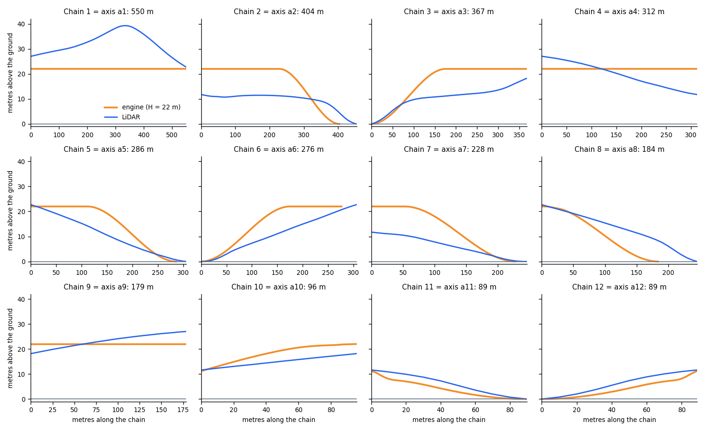
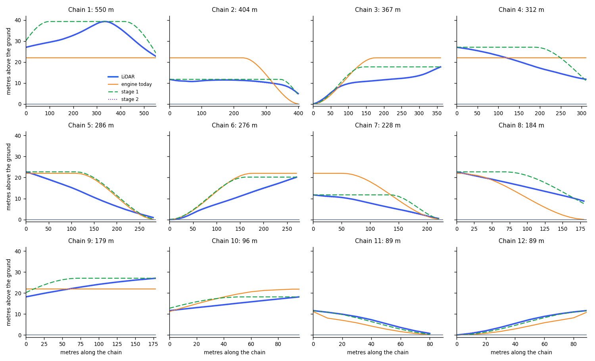

# The bridge profile: roadstyle and urbanstyle, and an edit step

Date: 2026-11-10. Status: proposal. Nothing is built. The documentation comes first: this note is the spec, and the code waits for approval.
This note is about the profile of a group of 3D bridges: how [the engine](../guides/bridge-height.md) makes it, how urbanstyle makes the profile of the same bridge,
and a proposal for an edit step.

## Summary

- The two projects use the same design. A program makes a **profile** of the bridge, and another program **draws** the bridge from the profile only.
- The two profiles are in different forms. roadstyle makes a list of short deck pieces with a lift from 0 to 1 and one height H for the whole group. urbanstyle makes one JSON
  file for each bridge, with a height line `[s, z]` in metres for each axis and a `source` and a `method` for each value.
- On the Granville Bridge, the engine finds the same 12 chains as urbanstyle finds axes, with the same OSM ways. The heights are different. The engine gives all 12 chains the same top
  (22 m). The LiDAR gives 39 m on the main span and 11.6 m to 27 m on the ramps.
- **The proposal keeps the current approach and adds an optional input in front of it.** With no input, the output is the same as today. The input is a **height line for a chain**
  (`points` and `curves`, as in urbanstyle's `heights` section). A prototype on the Granville Bridge shows that heights alone are not enough: the shape of the line is the limit.

## How roadstyle makes the profile

Read [How the height of a 3D bridge is calculated](../guides/bridge-height.md). In short:

1. The engine joins the bridge roads into groups and chains. A free end is a node where one bridge road ends.
2. A group has one height H, from its length (5 m up to 60 m, 22 m from 600 m) or from `bridge_heights` or `bridge_height_col`.
3. The lift at a node is `min(1, distance to the nearest free end ÷ (8 × H))`. The lift along a chain is a smooth curve between the two end lifts.
4. The engine writes a list of deck pieces (GeoJSON, source `decks`). Each piece has `__rs_lift0`, `__rs_lift1`, `__rs_s0`, `__rs_s1` and `__rs_full`.
5. The page reads the pieces, adds the ground height, and draws the mesh.

## How urbanstyle makes the profile

The code is `src/urbanstyle/bridge_profile.py`. The notes are `docs/notes/bridge-profile.md` and `docs/notes/bridge-heights.md` of urbanstyle.

**The file.** `urbanstyle bridge` writes one `<name>.bridge.json` for each bridge. Its format is `urbanstyle.bridge/1`. The values are in metres, in the UTM zone of the bridge.
The file holds:

| Part | Content |
|---|---|
| `deck` | The outline (from OSM `man_made=bridge`, or made from the lanes), the thickness (1.8 m) and the parapet (1.1 m) |
| `axes` | One axis for each chain of road ways between two junction nodes. An axis has `ways`, `line`, `length_m`, `ends`, `vertical` and `sections` |
| `axes[].vertical` | `points` (`[s, z]`: the grade points), `curves` (the length of the vertical curve at each point), `samples` (`[s, z]` every 10 m), `source`, `method`, `rule` |
| `axes[].sections` | The bands across the deck (lanes, paths) for each length of the axis where the cross-section does not change |
| `connectors`, `paths`, `piers` | The paths from lane to lane at a fork, the paths on the deck, and the piers |
| `heights` | The known heights: a few numbers (see "Edit" below) |

Every value has a `source` and a `method`: `mapped`, `measured`, `derived` or `chosen`. The scripts make the file. Nobody edits it by hand. The 3D model reads only the file.

This is the vertical profile of axis a1 (the main span) in the measured profile of the Granville Bridge. The list `samples` has 56 items. `points` and `curves` are the fit of the LiDAR stations.

```json
"vertical": {
  "points": [[0.0, 27.02], [160.0, 31.06], [220.0, 33.66], "... 9 points"],
  "curves": [0.0, 54.0, 54.0, 27.0, 18.0, 18.0, 27.0, 54.0, 0.0],
  "samples": [[0.0, 27.02], [10.0, 27.29], [20.0, 27.56], "... 56 samples"],
  "source": "City of Vancouver LiDAR 2022", "method": "derived"
}
```

**The height rule, with no measurement.**

1. A node on the ground has height 0. A node is on the ground when a road that is not a bridge also uses it. (A path does not count.)
2. For each node, D is the shortest distance along the bridge roads to a node on the ground.
3. The height is `h = min(27 m, 0.05 × D)`.

At a node where branches meet, D is the smallest distance through any branch, so all branches have the same height there. This is the rule of roadstyle too, with other numbers.

**The measured heights.** `urbanstyle bridge-measure` reads LiDAR tiles. At a station every 10 m along each axis, the deck top is the 25 % quantile of the deck returns, and the ground is the median of
the ground and water returns within 30 m. The profile stores the height of the deck top above one smooth reference ground. On the Granville Bridge, 340 stations on 12 axes are measured.

**Edit: the `heights` section.** A person, LiDAR or a survey can add known heights. The model pulls the deck to them. The rule fills in everywhere else.

```json
"heights": {
  "n21918825": {"deck_m": 9.0, "source": "manual", "method": "chosen"},
  "a2": {"mid_m": 6.5, "source": "manual", "method": "chosen"},
  "a1": {"points": [[0, 27.0], [340, 39.0], [550, 22.7]], "curves": [0, 60, 0],
         "source": "City of Vancouver LiDAR 2022", "method": "measured"}
}
```

| Key | Meaning |
|---|---|
| `n<id>` (an OSM node) | `deck_m`: the height of the deck at that node. Every axis that ends there takes it |
| `a<k>` (an axis) | `mid_m`: the height at the middle of the axis |
| `a<k>` (an axis) | `points` and `curves`: the height line of the axis, with a vertical curve at each inside point |

## The two profiles side by side

| | roadstyle (the engine) | urbanstyle |
|---|---|---|
| Unit of the profile | A deck piece: 2.5 m on a ramp, long on a flat part | An axis, with a height line `[s, z]` |
| Height | `H × lift`: one H for the group, a lift from 0 to 1 | `z` in metres, for each axis |
| Group height | From the length (5 m to 22 m), or one value for the group | None. The rule gives each node its own height, to 27 m |
| Ramp | 8 m of ramp for 1 m of height (12.5 %) | A grade of 5 % |
| Curve | A smooth minimum and a smoothstep between the end lifts | Straight grades, with a vertical curve (60 m by default) at each point |
| Ground node | A free end: a node where one bridge road ends | A node that a road that is not a bridge also uses |
| The landing | Stops at the end of the OSM bridge way | Continues on fill along the next OSM roads to the next junction (150 m at most) |
| Measured heights | Not read | LiDAR, in the `heights` section |
| Edit | `bridge_heights`, `bridge_height_col`, `bridge_decks`, `rsSetBridgeHeight`: H of a group, and the numbers of the rule | The `heights` section: a node, the middle of an axis, or the points of an axis |
| Source of a value | Not kept | `source` and `method` for each value |
| Who draws | The page reads the pieces | The 3D model reads only the file |
| Terrain | The page adds the ground height from the terrain | A flat map (ground z = 0), or elevations where the profile has `ground_elev` |

## The Granville Bridge, side by side

The data is in `docs/img/bridge-height/`: the 41 edges of the bridge group, and the LiDAR heights of the 12 axes (copied from urbanstyle's measured profile). The generator is `granville_vs_lidar.py`.
The engine's group has 12 chains. Each chain has the same OSM ways as one axis of urbanstyle: 12 of 12.



| Chain | Axis of urbanstyle | Length (engine, urbanstyle) | Highest deck, engine | Highest deck, LiDAR |
|---|---|---|---|---|
| 1 | a1 | 550 m, 550 m | 22.0 m | 39.3 m |
| 2 | a2 | 404 m, 454 m | 22.0 m | 11.7 m |
| 3 | a3 | 367 m, 368 m | 22.0 m | 18.2 m |
| 4 | a4 | 312 m, 312 m | 22.0 m | 27.1 m |
| 5 | a5 | 286 m, 306 m | 22.0 m | 22.7 m |
| 6 | a6 | 276 m, 306 m | 22.0 m | 22.7 m |
| 7 | a7 | 228 m, 246 m | 22.0 m | 11.7 m |
| 8 | a8 | 184 m, 246 m | 22.0 m | 22.7 m |
| 9 | a9 | 179 m, 179 m | 22.0 m | 27.0 m |
| 10 | a10 | 96 m, 96 m | 22.0 m | 18.2 m |
| 11 | a11 | 89 m, 90 m | 11.2 m | 11.6 m |
| 12 | a12 | 89 m, 89 m | 11.2 m | 11.6 m |

What the comparison shows:

- **The structure is right.** The engine and urbanstyle find the same chains, the same junction nodes and the same ground ends. The ramps of the engine rise from the ground at the same places.
  Where the height depends on the distance to the ground only (chains 11 and 12), the engine is within 0.4 m of the LiDAR.
- **One H is too simple here.** The main span is 17 m lower in the engine than in the LiDAR. The ramps of chains 2 and 7 are 10 m higher. The height of a ramp follows what it crosses, not
  the length of the group. A group of 3061 m always gets the largest H.
- **The ends are not the same.** Five LiDAR axes are 18 m to 62 m longer (chains 2, 5, 6, 7 and 8), because urbanstyle continues each landing on fill. The engine stops at the OSM bridge way.
- **The grade is not the same.** The engine rises 1 m in 8 m. The rule of urbanstyle rises 1 m in 20 m. The LiDAR ramps are steeper at the start and flatter later: on chain 3, the deck rises 10 m in the first 100 m.

## Where an edit step can go

The engine makes the profile in five steps (see the guide). An edit can enter at four places.

| | Where | What the user gives | Risk |
|---|---|---|---|
| A | The engine, before it cuts a chain into pieces | The height of a node (`deck_m`), the top of a chain (`top_m`), or a height line for a chain (`points`, `curves`) | The engine keeps all rules by itself. The engine needs a way to name a chain |
| B | The engine, as a file | A profile file in the format of urbanstyle (`urbanstyle.bridge/1`), matched to the chains by the OSM ways | A converter from `[s, z]` to lifts |
| C | The page, after the engine | `rsSetBridgeHeight` for one chain, or a new call for a height line | The page keeps the lifts of the pieces. It cannot change the ramp |
| D | The pieces, between the engine and the page | A program that changes `__rs_lift0`, `__rs_lift1`, `__rs_base` and `__rs_height` | The program must keep the six rules of the guide. A mistake shows as a step or a gap |

The proposal below is place A, with the file form of place B as a converter.

## The proposal

### What does not change

- The groups, the chains and the free ends (steps 1 and 2 of the guide).
- The rule for the height of a group and the rule for the lift at a node (steps 3 and 4), for every chain that has no input.
- The profile format: the same deck pieces with the same properties. The page does not change, except for the points in "The page".
- A page made with no input has the same pieces as today. A test keeps this (the goldens do not change).

### The input: a height line for a chain

The height line of a chain is `z(x)`: the height of the deck above the ground at the distance `x` metres from the first end of the chain. It is the same idea as the `vertical` of an axis in urbanstyle.

```python
rs.render_dashboard(edges, view_3d=True, bridge_profile={
    "8043974233675410214": {                       # the id of one road of the chain (chain 1, the main span), as bridge_heights does
        "points": [[0, 27.02], [160, 31.06], [220, 33.66], [310, 38.77], [340, 39.27], [360, 38.63], [390, 36.62], [490, 27.41], [550.46, 22.72]],   # [x, z]
        "curves": [0, 54, 54, 27, 18, 18, 27, 54, 0],      # the length of the vertical curve at each point (optional; 0 is a corner)
        "source": "City of Vancouver LiDAR 2022", "method": "measured",     # optional: kept in the table
    },
})
```

| Key | Meaning |
|---|---|
| The key of the dictionary | The id of one road of the chain. Any road of the chain names it |
| `points` | `[x, z]` pairs in order of `x`. The first `x` is 0 and the last `x` is the length of the chain. `z` is in metres, 0 or more |
| `curves` | The length of the vertical curve at each point, in metres. 0 gives a corner. The default is all 0 |
| `from` | Optional. `[longitude, latitude]` of the end where `x` is 0. The engine takes the end of the chain that is within 5 m of it. Without `from`, `x` is 0 at the first end that the table shows |
| `source`, `method` | Optional text. `method` is `measured`, `derived` or `chosen`. They go in the table and in the Height box |

The same dictionary can be a JSON file: `bridge_profile="profile.json"`. The look option is `bridges.profile`, as `bridges.heights` is for `bridge_heights`.

**The table.** To write the input, the user needs to know the chains. `rs.bridge_table(edges)` returns one row for each chain: the chain number, the group, the ids of its roads, its length, the
longitude and latitude of its first and its last end, the group height H, the lift at each end, and the `source` and `method` of its height line, when it has one. The table of the Granville Bridge
in the guide is this table.

### The changed formulas

**A chain with a height line.** The height `z(x)` is the straight line through the points. At an inside point `i` with a curve length `c > 0`, the line is rounded. Let `g1` and `g2` be the slopes
before and after the point. For `x` from `s_i − c/2` to `s_i + c/2`, with `u = x − (s_i − c/2)`:

```text
z(x) = (z_i − g1 × c/2) + g1 × u + (g2 − g1) ÷ (2c) × u²
```

The chain's own top is `P = max z`, and the lift is `lift(x) = z(x) ÷ P`. The deck pieces of the chain have `__rs_full = P`. The underside is `P × lift(x) = z(x)`, so the picture shows the line.
(On terrain, the formula of step 6 is the same, with H = P.)

**A chain with no height line.** The formulas of step 5 do not change. Two inputs change.

- The height at an end node is the height that a height line gives there, when a chain with a line meets this node. Without a line, it is `H × (the node lift)`, as today.
- The chain's top is `P = max(H, the height at its first end, the height at its last end)`, in place of H. Then `lift_head = z_head ÷ P`, `lift_tail = z_tail ÷ P` and `R = P × g`.

If no chain at the node has a line, P = H, and the result is the same as today.

**The pieces.** A chain with a height line is cut every `line_step_m` along the whole chain (10 m by default, a new key of `bridge_decks`) and at each point. The main span of the Granville Bridge (550 m) has
2 pieces today and about 55 pieces then.

### The rules, errors and warnings

The six rules of the guide still hold, with two changes: the end lifts of two chains at a node agree in **metres** (`z`) and not in lift, and the height at a free end is 0 unless the line says
otherwise. The engine says what is wrong and does not choose:

| Case | Result |
|---|---|
| Two heights at one node: the end `z` of two chains differ by more than 0.1 m | Error. It names the node (longitude and latitude), the two chains and the two heights |
| The `points` are not in order of `x`, `x` is outside 0 to the length of the chain, or a `z` is below 0 | Error |
| The first `x` is not 0 or the last `x` is not the length of the chain (within 1 m) | Error |
| Two curves overlap: `c_i ÷ 2 + c_(i+1) ÷ 2` is more than the distance between the points | Error |
| All `z` are 0 | Error |
| Two entries for roads of one chain | Error |
| An id that no road has | Error |
| An id of a road that is not a 3D bridge | Warning |
| `view_3d` is false | Warning, as for `bridge_heights` |
| A line and `bridge_heights` for the same group | The line is for a chain and `bridge_heights` is for the group. The group H is used by the chains with no line |

A free end with `z > 0` is a landing on fill (the OSM bridge way ends in the air). The engine allows it. The page must close the end of the deck down to the ground: see "The page".

### The page

- The page reads the same pieces. It does not change for a height line.
- A deck end with `lift > 0` is blunt today (a wall as high as the deck is thick). For a landing on fill, the page draws the sides down to the ground, as urbanstyle does.
- The Height box shows the top `P` of a chain with a line, with its `source` and `method`, and does not let the user change it (`rsSetBridgeHeight` on a group with lines gives an error that names the chains).
  This is an open decision (see below).
- `rsBridgeGroups()` lists the chains with `source` and `method`.

### What the prototype shows on the Granville Bridge

`docs/img/bridge-height/granville_proposed.py` is a prototype in Python of the changed formulas. It is not the engine. For each chain, the input of stage 1 is the LiDAR height at the two ends and the
highest LiDAR height. The input of stage 2 is the grade points of the LiDAR fit. The table shows the largest difference to the LiDAR stations of the chain.



| Chain | Input of stage 1: first end, last end, top | Largest error today | Largest error, stage 1 | Largest error, stage 2 |
|---|---|---|---|---|
| 1 | 27.0 m, 22.7 m, 39.3 m | 17.3 m | 10.0 m | 0.2 m |
| 2 | 11.7 m, 4.4 m, 11.7 m | 11.3 m | 2.5 m | 0.2 m |
| 3 | 0.0 m, 18.2 m, 17.7 m | 10.9 m | 7.0 m | 0.2 m |
| 4 | 27.1 m, 11.8 m, 27.1 m | 10.2 m | 9.8 m | 0.1 m |
| 5 | 22.7 m, 0.7 m, 22.7 m | 8.9 m | 9.5 m | 0.3 m |
| 6 | 0.0 m, 20.7 m, 20.2 m | 9.7 m | 8.9 m | 0.3 m |
| 7 | 11.7 m, 0.2 m, 11.7 m | 11.8 m | 6.3 m | 0.3 m |
| 8 | 22.7 m, 8.3 m, 22.7 m | 9.5 m | 5.7 m | 0.2 m |
| 9 | 18.2 m, 27.0 m, 27.0 m | 5.0 m | 4.9 m | 0.1 m |
| 10 | 11.6 m, 18.2 m, 18.2 m | 4.8 m | 3.4 m | 0.0 m |
| 11 | 11.6 m, 0.1 m, 11.6 m | 3.0 m | 0.9 m | 0.2 m |
| 12 | 0.0 m, 11.6 m, 11.6 m | 3.0 m | 0.9 m | 0.2 m |

- **Stage 1 is not enough.** The heights at the ends and the top of a chain remove part of the error, but the largest error stays at about 9 m to 10 m on chains 1, 4, 5 and 6. Chain 5 is a little worse than
  today. A real ramp is a straight line from the top down to the ground, and the profile of the engine is a flat top with a ramp of 1 m in 8 m. The shape is the limit, and not only the heights.
- **A height line is enough.** With the grade points of the LiDAR fit, the largest error is 0.3 m. This is partly expected, because the points are the fit of the same stations. It shows that the
  format can carry the real shape. It is not a test of the measurement.
- **Some free ends are above the ground.** The engine has a free end (lift 0) at the last end of chains 2 and 8. The LiDAR height there is 4.4 m and 8.3 m, because the OSM bridge way ends before
  the bridge does, and the deck goes on to the street on fill. Only a height line (or a node height) can say this.

### The order of the work

1. **Documentation first** (this note). The guide gets the new pages only when the code exists.
2. The engine: the look option, the table, the formulas, the errors. Tests: a line of two points; the rounded corner; the continuity of the pieces; two heights at a node; a rule chain that meets
   a line chain; a free end with `z > 0`; every error of the table; **no input gives the same pieces as today**; the Granville Bridge with the LiDAR points (largest error 0.5 m).
3. The page: the landing on fill, the Height box, `rsBridgeGroups()`.
4. A converter from an urbanstyle profile to this input, outside the engine: it matches the axes to the chains by the OSM ways (12 of 12 on the Granville Bridge).
5. The guide: a how-to page "Give a bridge its own height line", the row in "Every parameter", and a change of "What can change a profile".

### Decisions that are open

Each decision has the recommendation of this note.

1. **Input.** A height line for a chain. Recommended, because stage 1 is not enough. A height for a node or for the middle of a chain is not an input. It is derived from the lines.
2. **Name of a chain.** The id of one road of the chain, with `from` for the direction. The table shows the ends.
3. **The Height box on a chain with a line.** Show the top and the `source`. Do not change it. The other choice is to scale the line; this hides the measurement.
4. **The landing on fill.** The page draws the sides down to the ground.
5. **`line_step_m`.** 10 m, as the stations of urbanstyle.
6. **The tolerance at a node.** 0.1 m.
7. **The urbanstyle converter.** Yes, outside the engine.
8. **Where the file is kept.** "One rule for every path" says the page, the tiles and the editor must read the same data. A profile that belongs to the area could be kept with the area, in duckOSM. This is for later.
9. **The landing of the engine.** The engine stops at the OSM bridge way. urbanstyle continues the landing on fill to the next junction (150 m at most). A height line with `z > 0` at the end says what urbanstyle does, with no change to the rule.

### Regenerate the figures and the tables

```bash
python docs/img/bridge-height/granville_vs_lidar.py     # the comparison, and its table
python docs/img/bridge-height/granville_proposed.py     # the prototype, and its table
```
