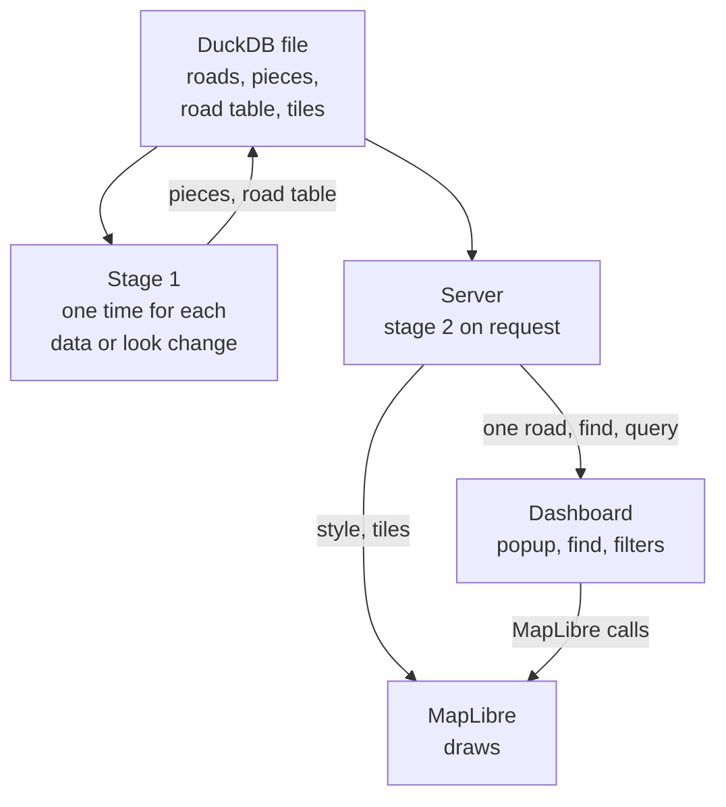

# The data in DuckDB, served on request

Date: 2026-10-23. Status: a proposal, not built. It needs the two stages and the road table of the design phase
([Architecture of the Rust version](../rust/architecture.md#the-three-stages-and-the-one-call)).

Kaveh's decision on the version: "it is not important we are using duckdb 1.5 at the moment, we can easily move to version 2
especially in rust version". The design therefore uses DuckDB 2.0.

## The idea

Today a map puts its road data into the page (GeoJSON, or a PMTiles archive with a side table), writes it as files (way B), or
makes it in the browser from a roads file (way C). This proposal keeps the data in a DuckDB file on a server. The page gets only
the rules, the tiles in view and the road that you click. It is way C, but on a server.

DuckDB 2.0 (released 2026-10-21, a long-term support version) has a server mode, Quack: one DuckDB serves many clients over HTTP.

*Stage 1 writes the pieces and the road table into the DuckDB file. The server cuts each tile when MapLibre asks for it, keeps
it in a cache table, and answers the dashboard's questions with SQL.*

## Why

| Benefit | Today | With the data in DuckDB |
|---|---|---|
| One source of truth, always current | each change (a level fix, a new night of flows) needs a new page or a new tile export | the next request shows the change |
| Color by any column at run time | only the options that are in the style; `rs.can` says no to others, because `restyle` is not built | the server computes the colors by SQL, or joins the flows of a time to the roads, and gives new tiles |
| Search and queries over all roads | way A needs the side table in the page; way C cannot search | `rs.find` and `rs.query` are SQL on the server |
| Large areas | a browser takes at most 200,000 roads (`MAX_ROADS`); Stockholm county has 456,813 driving edges | the browser holds only the tiles in view |
| A small page | Monaco's GeoJSON style is 23.2 MB | the style is the rules only (Monaco: 0.09 MB) |
| One page for many maps | one file for each area, mode or time | the area, the mode, the time and the filters are parameters of the requests |

The cost is a running server, and a delay for the first request of each tile and each click. A tile at a high zoom is fast
(Tartu, natively: 0.03 s for the 9 tiles of a zoom-15 view), the server keeps the tiles that it made, and MapLibre keeps them too.
So only the first request for a tile costs time. The offline ways (the default page, way A) stay for a map that must work with no
server.

## The data in the DuckDB file

The names are a proposal.

| Table | Content | Written by |
|---|---|---|
| the roads (duckOSM's `<mode>.edges`) | the roads as they are today | duckOSM |
| `visualization.edge_levels` | the drawing levels, as today | the level step |
| `roadstyle.looks` | each look (its JSON) and its hash | stage 1 |
| `roadstyle.pieces` | stage 1's drawing sources (`simple`, `slots`, `decks`): the geometry and the drawing values of each piece, the road's row, the look hash. Stage 1 can also save them as GeoParquet, the second file format of the stage border, which DuckDB reads directly | stage 1 |
| `roadstyle.road_table` | the fields of each road, keyed by its row and `edge_id` (the road table of the design phase) | stage 1 |
| `roadstyle.tiles` | the tile cache: the look hash, the data version, `z`, `x`, `y`, the tile bytes | the server |

The data version is the hash of the edges and of their levels (as `edge_levels_meta.edge_hash` is today). A tile is valid only
for its look hash and its data version.

## The requests

| Request | Answer | For |
|---|---|---|
| `GET /style?look=<hash>` | the style: the rules, with the tile address of this look | MapLibre, the dashboard |
| `GET /tiles/<look>/<z>/<x>/<y>` | one vector tile: from the cache, else cut and stored | MapLibre |
| `GET /road/<edge_id>` | the fields of one road | the popup (`engine.props`) |
| `GET /find?text=...` | the edge ids of the roads that match | the search (`rs.find`) |
| `POST /query` | the edge ids of the roads that match the conditions | `rs.query`, the filters |
| `POST /restyle` | a new look hash and its style, for a new color column, ramp or range | `engine.restyle` (planned in the contract) |

MapLibre asks for tiles by URL, so the tile request is HTTP in every case. The other requests can also go to DuckDB's Quack
directly, if the browser can be a Quack client.

## Decisions to make

1. **When stage 1 runs.** Recommended: one time for each change of the data or of the look, in a job that writes `pieces` and
   `road_table`. A color by a column is an expression on a property (decision 8 of the plan), so a new color often needs no new
   pieces, only a new style.
2. **The tile cache.** In the table `roadstyle.tiles`. A change of the data version or of the look makes the old rows invalid.
   Open: a limit of its size, and the removal of old rows.
3. **The protocol.** Recommended first: a small HTTP server in Rust, on the facade crate, with the requests above. DuckDB 2.0's
   Quack can then serve the SQL requests directly, when the browser can use it.
4. **The move to DuckDB 2.0.** duckOSM, the Python stack, the Rust crates and the browser move together, because a 2.0 file does
   not open in 1.5. The Rust side first, as Kaveh said.
5. **The dashboard's engine port.** `engine.props` exists. `engine.find`, `engine.query` and `engine.restyle` are new, and the
   dashboard uses them when the page gives them.

## To check before the build

- Can a browser be a Quack client (duckdb-wasm with DuckDB 2.0)? If not, the server answers all requests over HTTP.
- Do duckdb-wasm and DuckDB's `spatial` extension have a 2.0 version, for the browser path of `writeRoads`?
- The time of a tile that is not in the cache, and the server's memory, on Stockholm county.
- Who can use the server: the access control and the hosting.
- The level editor: its edits go to the server, which writes the levels and makes the changed tiles invalid.

## Sources

- [DuckDB's major 2.0 release turns the database management system into a full-fledged server (AlternativeTo)](https://alternativeto.net/news/2026/10/duckdb-s-major-2-0-release-turns-the-database-management-system-into-a-full-fledged-server/)
- [DuckDB previews v2.0 plan to stabilize Quack server mode (RuntimeWire)](https://runtimewire.com/article/duckdb-v2-server-mode-embedded-analytics)
- [Beyond Embedded: How DuckDB v2.0 Shifts Architecture toward Distributed Network Capabilities (InfoQ)](https://www.infoq.com/news/2026/08/duckdb-v2-distributed/)
