# roadstyle as a Rust library: the design and the migration plan

**Status:** agreed 2026-10-23: decisions 1 to 8 as recommended, decision 9 open. Built: P0, P1, P2 (the crates), and step 1 of P5. It continues [One Rust engine for roadstyle](rust_engine.md)
(steps 1 and 3 are done) and uses [The style in a config file](style_config.md) and
[A general core: roads, items, and views](core_model_and_views.md). The decisions are in
[Decisions](#decisions).

## Summary

roadstyle has one reference implementation, in Python (version 0.24.3, about 11,000 lines of Python, a 1,688-line page template and
about 500 tests). A Rust crate, `roadstyle-rs` (5,582 lines), already makes the style and the vector tiles of the simple mode, and it
has the level solver. duckosm-rust's browser page and the GeoLibre plugin use it through WebAssembly. The rest of roadstyle is only in
Python.

This plan makes one Rust library with a pure core and adapters around the core. The core has three independent parts: the road
model, the look (the typed config) and the engine. The adapters read and write files and connect the core to Rust, JavaScript and
Python. A typed render model (the drawing numbers of each road, the objects attached to roads and one order for the whole map)
replaces the `__rs_*` properties that Python and Rust bake today. The plan has seven phases. Python roadstyle stays the reference until the last phase: a change in the Rust output is
correct only when it is byte for byte equal to the output of Python.

## Contents

1. [What exists today](#what-exists-today)
2. [The architecture](#the-architecture)
3. [The crates](#the-crates)
4. [The data flow of one map](#the-data-flow-of-one-map)
5. [The render model](#the-render-model): the numbers of each road, the objects on roads, the order of the map
6. [Input and output formats](#input-and-output-formats)
7. [The interaction contract](#the-interaction-contract): what a dashboard reads and changes at run time
8. [The config: the look](#the-config-the-look)
9. [The public API](#the-public-api)
10. [Efficiency](#efficiency)
11. [The migration plan](#the-migration-plan)
12. [The parity checklist](#the-parity-checklist)
13. [Quality](#quality)
14. [Decisions](#decisions)
15. [Found during the inventory](#found-during-the-inventory)

## What exists today

### Python roadstyle (version 0.24.3)

Line counts from `wc -l` at commit `337cf37`.

| Part | Files | Lines | What it does | Heavy dependencies |
|---|---|---|---|---|
| Web renderer | `render_web.py` | 3,837 | `render(...)`, 76 parameters: bakes the `__rs_*` properties, builds the MapLibre style, fills the page template | geopandas, shapely |
| Page template | `static/web_template.html`, `popup.js`, `popup.css` | 1,688 + 30 | The page: controls, legend, popups, Street View, Google 3D, the 29 `window.rs*` functions and 13 `rs:*` events | MapLibre 5.24.0 (vendored) |
| Entry point | `render.py` | 184 | `render_edges(...)`, 21 parameters: data styler, filters, settings scope, dispatch to web, folium or lonboard | |
| Stylers | `stylers.py`, `style.py`, `colors.py`, `legend.py` | 482 + 99 + 120 + 110 | Data-driven color and width (`ClassStyler`, `CategoricalStyler`, `NumericStyler`, `ColorTableStyler`), color ramps, folium legends | branca, matplotlib, mapclassify |
| Config | `_settings.py`, `config.py`, `palettes.py`, `basemaps.py`, `data/` | 343 + 113 + 173 + 315 | Palettes (4) and profiles (2) in YAML, the merge of user files and `settings=`, base-map providers | pyyaml |
| Levels | `levels.py`, `level_area.py`, `levels_store.py`, `level_editor.py` | 816 + 320 + 197 + 506 | The drawing-order solver, the level-area folder workflow, DuckDB storage, the editor server | scipy (HiGHS), ortools, shapely |
| Export | `export.py`, `tiles.py`, `emit.py`, `fastjson.py` | 290 + 213 + 249 + 98 | `export_style` (style.json + XYZ or PMTiles), `export_inline`, `export_look`, the embedded PMTiles, the Leaflet spec | mapbox-vector-tile, pmtiles, duckdb |
| Pages | `pages.py`, `templates/*.html` | 114 + 615 | `render_dashboard`, `render_report`, `render_street_view`: sidebars on the `rs*` API | |
| Other backends | `render_folium.py`, `render_lonboard.py`, `controls.py`, `interactive.py` | 124 + 147 + 126 + 191 | folium and lonboard maps | folium, lonboard |
| Data model | `edges.py`, `validate.py`, `filters.py`, `overlays.py` | 370 + 62 + 54 + 115 | `RoadEdges`, readers (file, GeoJSON, Arrow, DuckDB), validation, filters, `Overlay` | geopandas |
| Tools | `cli.py`, `mcp_server.py`, `snapshot.py`, `studio/` | 223 + 194 + 106 + 533 | The `roadstyle` and `roadstyle-levels` programs, the MCP server, PNG screenshots, the Streamlit studio | playwright, streamlit, osmnx |

The tests: 26 files, about 500 test functions (213 in `tests/test_render_web.py`). They are behavior tests on dicts, HTML and JS.
There is no golden test against Rust in `tests/`.

### Rust today (`rust/`, commit `337cf37`)

| Crate | Module | Lines | Content |
|---|---|---|---|
| `roadstyle-rs` | `lib.rs` | 185 | `make_parts`, `make_style` (the style as one JSON text), `make_tiled` (the style and its tiles), `MAX_ROADS` = 200,000 |
| | `read`, `geom` | 113 + 220 | GeoParquet (WKB lines) to features, WKB, area and centroid |
| | `roads`, `simple`, `slots` | 378 + 317 + 466 | The `__rs_*` properties, the casing pieces, the names and the one-way arrows |
| | `features`, `overlays` | 111 + 258 | The base-map layers and `edge_attach` |
| | `layers` | 987 | The road layers and the expression builders (`Model::from_look`) |
| | `props` | 223 | The typed sources `roads` and `simple` (one copy of each key name) |
| | `tiles` | 593 | The vector tiles on request (MVT 2.1) |
| | `planner` | 146 | `metadata["roadstyle:planner"]` |
| | `levels/` | 1,484 | `compute`: the tags rule and the solver (least span first, then push-relabel min-cost flow) |
| | `main.rs` | 101 | The native program (timings) |
| `roadstyle-wasm` | `lib.rs` | 102 | `makeStyle`, `Tiler` (`style`, `tile`, `props`), `memoryBytes`, the allocator that grows in large steps |
| | `js/` | 148 | `roads_sql.js`, `features_sql.js`: the SQL that duckdb-wasm runs to write the inputs |

Facts that the plan must use:

- The engine reads one input file, `look.json` (63 KB). Python writes it (`tools/make_spike_fixture.py` of geolibre-roadstyle,
  mapstyle's `render_map(_export=...)`). It holds Python's internal tables: `settings`, `args`, `theme`, `config`, `styles`,
  `roads_model`, `slots`, `features`, `interaction`. It has no version and no schema.
- The scope of the engine is the simple mode with stored levels (`layers.rs:506`): no 3D decks, no metre widths, no items, no
  full mode (`simple=False`).
- Errors are `Result<_, String>` (about 25 places). There are no features, no threads and no benchmarks.
- The golden tests compare SHA-256 hashes with the output of geolibre-roadstyle's port (commit `0806ac2`, with building rule C).
  That port was compared with Python's output in geolibre-roadstyle (`spike/test_compare.py`). This repository has no golden
  test from Python yet. The branch `rust-colors` adds the first one (`tests/make_goldens.py`, not committed).
- No CI job runs `cargo`.

### Work in progress (the plan includes it and does not do it again)

| Work | Where | Content | State on 2026-10-23 |
|---|---|---|---|
| Task 1: data-driven color and width, the legend | main checkout, branch `rust-colors` (session roadstyle-rs) | `tests/colors.rs` against Python's `export_inline` for `color_by`, `colors`, `cmap`, `vmin`, `vmax`, `width_by`, `color_table`, `color_options`, `color_active`, `legend`; `cmaps.json` (the branca and matplotlib ramps) | not committed; no Rust module yet |
| Task 2: one shared dashboard JS module | branch `claude/dashboard-js-5ddf3e` (session roadstyle-dashboard-js) | 20 ES modules in `src/roadstyle/static/dashboard/`, entry `rsDashboard(map, options)`; the template loses 1,650 lines | not committed |
| Task 3: the look resolution in Rust | after task 1, same session | Rust makes the look from the palette, the profile and the settings | not started |
| Tiles follow `tiles.py` (step 2) | branch `rust-tiles`, `89d8bff` | One `roads` source with source layers, zooms 6 to 15, buffer 80, simplification below the last zoom | not merged |
| Tile speed | branch `rust-tile-speed`, `17f51c1` | The bytes of a value are made once | being merged; conflicts with `rust-tiles` in `tiles.rs` |

### The users

| User | Uses | How | Pinned at |
|---|---|---|---|
| duckosm-rust (`crates/duckosm-core`) | `roadstyle-rs::levels` only | Cargo git dependency | `900b43e` |
| duckosm-rust browser page | `roadstyle-wasm`: `Tiler`, `memoryBytes` | `build.sh` builds the module; `map_worker.js`; a copy of `look.json` and of the two SQL files | `900b43e` |
| GeoLibre plugin (geolibre-roadstyle) | `roadstyle-wasm`: `makeStyle` | `build.py` builds the module (branch `use-roadstyle-rs`); at build time it runs Python roadstyle and mapstyle to make 64 looks | `900b43e` |
| mapstyle | Python: `render_edges`, `render_report`, `Overlay`, `export_style`, `export_inline`, `load_area_levels`, `palette_to_dict` | Python import | `roadstyle>=0.24.2` |
| Python users (16 projects) | `render_edges` (75 calls), `Overlay` (82 calls), `render_street_view` (1), `render_dashboard` (1) | Python import; 45 calls use `backend="web"`, 4 use folium, 1 lonboard | various |
| Page scripts of users | `rsColor`, `rsHighlight`, `rsFocus`, `rsSelect`, `rsSetColorField`, `rsSetOverlay`, `rs:select` | JS in the page | |

About 27 of the keywords carry most of the use: `backend`, `name`, `tooltip`, `basemap`, `palette`, `basemaps`, `boundary`,
`arrows`, `overlays`, `filter_control`, `color_options`, `road_popup`, `color_by`, `cmap`, `vmin`, `vmax`, `legend`, `colors`,
`color_active`, `road_tooltip`, `street_view`, `street_view_key`, `google_3d`, `color_table`, `labels`, `hover_color`, `select_color`.

## The architecture

### The choice: a pure core with adapters around it

The core has no I/O. It has three parts, and two of them are independent inputs of the third:

- **The road model** (`roadstyle-model`): the roads as columns, their geometry, the column map, the validation.
- **The look** (`roadstyle-look`): the typed, versioned config: palettes, profiles, settings and the map options that change the style.
- **The engine** (`roadstyle-engine`, `roadstyle-tiles`, `roadstyle-levels`): pure functions from (roads, look) to the style,
  the tiles and the levels.

The adapters are around the core. Each one connects the core to one thing outside:

- **Readers and writers** (`roadstyle-io`): GeoParquet, Arrow, GeoJSON, DuckDB, the style file, the tile folder, PMTiles, the HTML page.
- **Bindings**: WebAssembly and JavaScript (`roadstyle-wasm`), Python (`roadstyle-py`).
- **The dashboard module** (JavaScript): a separate front-end package. It reads only the style and its `roadstyle:*` metadata. It
  does not call the engine.

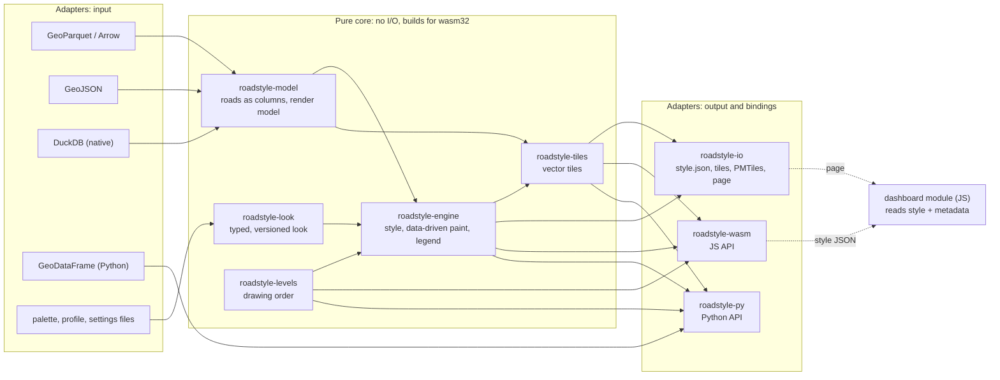

*The core in the middle has no arrow to a file, a database or a browser. The model and the look do not point at each other.*

### Rules of the layers

1. A dependency points into the core, never out of it. `roadstyle-engine` does not know Parquet, Python or JavaScript.
2. `roadstyle-model` and `roadstyle-look` do not depend on each other. Data-driven color needs both the values of a column and
   the look, so it is a function of the engine, not of the look.
3. The core builds for `wasm32-unknown-unknown` with no features. A CI job checks this (see [Quality](#quality)).
4. The engine is single-thread by default. The feature `parallel` adds rayon for the native build.
5. The page options (popups, Street View, controls) do not go into the engine. The engine copies the few that the style must
   carry into its metadata (`roadstyle:interaction`). The other options go to the dashboard module.
6. One copy of each rule. The worker SQL, the palettes and the profiles each have one file, and each user takes them from one
   commit of this repository.

### The alternatives that I did not choose

| Alternative | Why not |
|---|---|
| A strict stack: data, then config, then engine, then interface (each layer uses only the layer under it) | The config does not need the data, and the data does not need the config. A stack makes one depend on the other with no reason. It also puts the readers (Parquet, DuckDB) under the engine, so the WebAssembly build carries them. |
| One crate with modules and feature flags (today's `roadstyle-rs`) | It works for one user. With three users it has costs: duckosm-core takes Parquet and Arrow to get only the level solver; a change in one module rebuilds all; the public API is every `pub` item. The crate split is cheap now (5,600 lines) and expensive later. |
| Many small crates (one per module: `slots`, `simple`, `overlays`, ...) | These modules change together for one style change. More crates give more version bumps and more `Cargo.toml` files, and no user needs them alone. |
| The engine builds the page (HTML) | The page is interaction, not style. Three pages exist (the Python page, the duckosm-rust page, the GeoLibre plugin) and each has its own frame. The dashboard module serves all three. The page writer is a small adapter in `roadstyle-io`. |
| Keep `look.json` as Python's internal tables | Each Python refactor can break the Rust users, and no test shows it. A typed, versioned look with a schema stops this. |
| A full rewrite of Python roadstyle in Rust at once | No reference during the work, and 16 Python projects wait. Part by part, with Python as the reference, each part can ship alone. |

### What stays in Python

| Stays in Python | Why |
|---|---|
| The folium and lonboard backends (`render_folium.py`, `render_lonboard.py`, `controls.py`, `interactive.py`, `legend.py`) | They are Python objects for notebooks. They can take the resolved colors and widths from Rust (one call for each distinct class key, see `vectorize_style_resolution.md`). |
| The GeoDataFrame front-end: `render_edges` and its keywords, `RoadEdges`, `Overlay` | The Python API does not change. It converts the GeoDataFrame to Arrow and calls Rust. |
| `WebMap` (`.html`, `.save`, `_repr_html_`), `snapshot`, the Streamlit studio, the MCP server, the notebook helpers | They are tools around a page. They need Python, a browser or the network. |
| The level editor server (`level_editor.py`) and the folder workflow (`level_area.py`) | They are a local tool with an HTTP server and files. They call the Rust solver when it is at parity. |
| `emit.py` (the Leaflet spec and `roadstyle.js`) | It is the old Leaflet output. It stays as it is, or it is removed in a later major version. |

## The crates

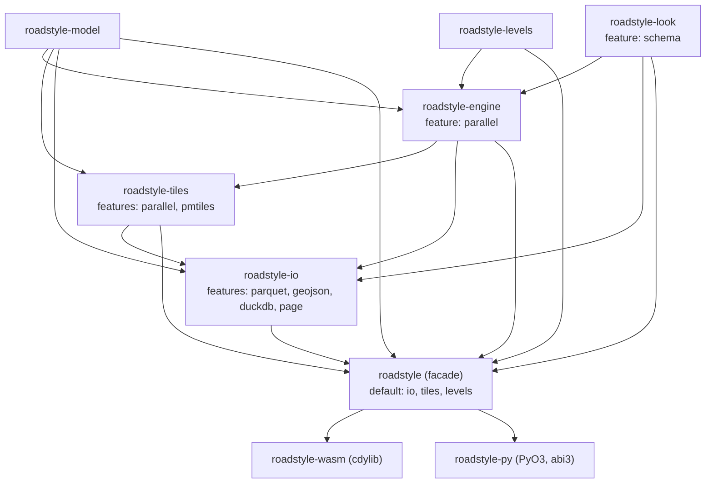

*Each arrow is a Cargo dependency. `roadstyle-levels` has no dependency on the other crates, so duckosm-core can take it alone.
The engine uses it to compute the numbers when the caller gives none.*

| Crate | Content (from today's modules) | Dependencies | Builds for wasm32 |
|---|---|---|---|
| `roadstyle-model` | `RoadTable` and `FeatureTable` (columns over Arrow arrays), `Geometry` (one coordinate buffer with offsets), the render model (`RoadDraw`, `Levels`, `End`, `Attachment`, `DrawKey`), `ColumnMap` and its presets, `RoadSource`, validation, `MAX_ROADS` | arrow-array, arrow-schema | yes |
| `roadstyle-look` | `Look` (the typed config), the bundled palettes and profiles, the resolution, the JSON schema (feature `schema`) | serde, serde_json, schemars (optional) | yes |
| `roadstyle-levels` | `levels/` as it is today: `LevelEdges`, `compute`, `Method`, `Row` | rstar, sha2 | yes |
| `roadstyle-engine` | `roads`, `simple`, `slots`, `layers`, `overlays`, `features`, `planner`, `geom`; the `LevelPlan` rules, the piece generators, `order` (the sort key and the layer planner), linear referencing for attachments; data-driven color and width, the legend, the simplification | model, look, levels, serde_json, rstar, indexmap; rayon (optional) | yes |
| `roadstyle-tiles` | `tiles`: the MVT encoder, the tile index, tiles on request, a tile cache; the PMTiles writer (feature `pmtiles`) | model, engine; rayon (optional) | yes |
| `roadstyle-io` | the readers of [Input and output formats](#input-and-output-formats) (GeoParquet, Arrow IPC, GeoJSON, FlatGeobuf, CSV, DuckDB), the style writer (streamed), the tile folder, PMTiles, the page writer (feature `page`, with the dashboard bundle) | parquet (snap), arrow-ipc, flatgeobuf, csv, duckdb: each optional | yes, without `duckdb` |
| `roadstyle` | The facade: re-exports and the `Map` builder. The only crate that a Rust user adds. | all above | yes |
| `roadstyle-wasm` | The JS API (`makeStyle`, `Tiler`, `resolveLook`, `memoryBytes`), the allocator | roadstyle (features `io/parquet`, `tiles`) | only |
| `roadstyle-py` | The Python module `roadstyle._engine` | roadstyle, pyo3, arrow (pyarrow interface) | no |

The JavaScript packages:

| Package | Content | Source |
|---|---|---|
| `roadstyle-wasm` (npm) | The WebAssembly module, the wasm-bindgen glue, `roads_sql.js`, `features_sql.js`, the TypeScript types | `rust/roadstyle-wasm/` |
| `roadstyle-dashboard` (npm) | The ES modules of task 2, `dashboard.css`, `popup.css` | `src/roadstyle/static/dashboard/` |

The CLI: the native program `main.rs` becomes a benchmark tool (`rust/roadstyle/examples/bench.rs`). The user CLI stays the
Python `roadstyle` program, which calls Rust. A Rust CLI with the same flags is a later step, when a user without Python asks for it.

### Which user takes which crate

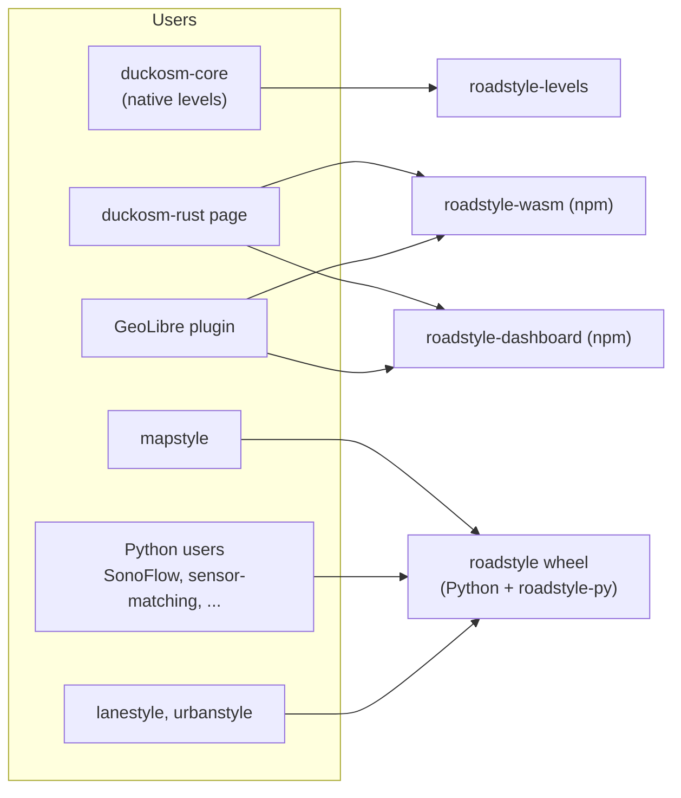

*The browser users take the npm packages. The Python users take one wheel and see no Rust.*

### Feature flags

| Flag | Crate | Effect | Default |
|---|---|---|---|
| `parallel` | engine, tiles | rayon: sources and tiles on all cores | off |
| `pmtiles` | tiles | The PMTiles archive writer | off in the crate, on in the facade |
| `parquet` | io | GeoParquet and Parquet reader (snap; zstd with `zstd`) | on |
| `geojson` | io | GeoJSON and NDJSON reader | on |
| `ipc` | io | Arrow IPC stream reader | on |
| `fgb` | io | FlatGeobuf reader | off |
| `csv` | io | CSV with WKT reader | off |
| `proj` | io | Transform from another CRS to EPSG:4326 (pure Rust) | off |
| `duckdb` | io | DuckDB reader for `<mode>.edges` and `visualization.edge_levels` (native only) | off |
| `page` | io | The HTML page writer with the dashboard bundle | off |
| `schema` | look | `Look::json_schema()` | off |

### Errors

Each crate has one error enum (`thiserror`), `#[non_exhaustive]`. The facade has `roadstyle::Error`, which holds each of them.
Each error says what is wrong, where (a column, a key path, a feature id) and what to do.

| Error | Examples |
|---|---|
| `DataError` | missing column `highway`; column `layer` has type `List`, expected integer or text; feature 812 has no line; 230,114 roads, the limit is 200,000 |
| `LookError` | `roads.width.major`: expected a map of zoom to px, found a number; unknown palette `ambr` (the names are `amber`, `carto`, `highsat`, `mono`); look version 3, this engine reads 1 and 2 |
| `EngineError` | a view names palette `x` that the look does not have |
| `TileError` | zoom 23 is past the last zoom 16 |
| `IoError` | Parquet file is not readable; the DuckDB file has no `visualization.edge_levels` (give the `rs.save_levels` command) |

In JavaScript, an error is a thrown `Error` with `name` = the kind (`LookError`) and a `path` property. In Python, each error is a
subclass of `ValueError` (`roadstyle.LookError(ValueError)`), so `except ValueError` in user code still works.

## The data flow of one map

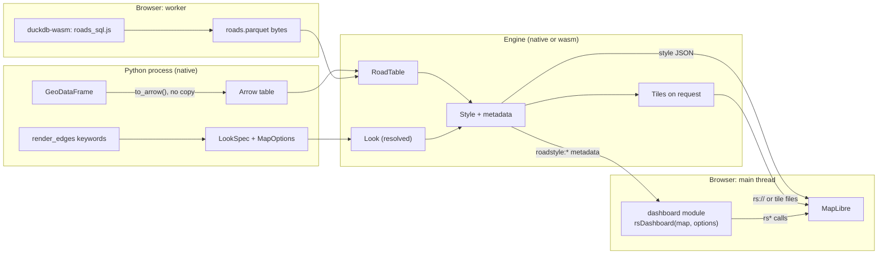

*The engine is the same code in both places. In the browser it runs in a worker, and the main thread only draws.*

The steps:

1. **Input.** Python gives an Arrow table (no copy from pyarrow). The browser gives the Parquet bytes that duckdb-wasm writes.
2. **Model.** The reader maps the columns (`ColumnMap`: `highway_col`, `edge_id_col`, `tunnel_col`, ...), checks them and makes a
   `RoadTable`.
3. **Look.** `Look::resolve` merges the palette, the profile and the settings, and adds the map options that change the style.
4. **Style.** The engine makes the layers, the sources and the metadata.
5. **Output.** Inline (the sources in the style, `export_inline`), tiled (`Tiler`, tiles on request), or files (`export_style`,
   the page).
6. **Page.** MapLibre draws the style. The dashboard module reads the metadata and adds the controls.

## The render model

The render model is the set of values that the engine draws from: the drawing numbers of each road, the objects that belong to a
road, and the order of all layers of the map. It is the core of roadstyle, and today it has no type. Python bakes it as about 40
`__rs_*` properties (`render_web.py`), and the crate copies these properties (`roads.rs`, `simple.rs`, `slots.rs`). This section makes
it one typed model in `roadstyle-model`, with the rules in `roadstyle-engine`. The specification of the numbers stays
[Divided casing and one band](levels_split_casing.md). This section does not change it.

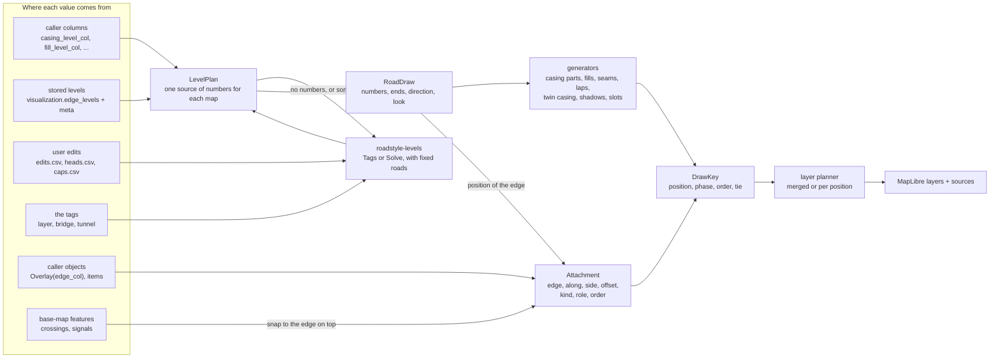

*Each value has one source. Every piece (a casing part, a fill, a name, a lane, a sign) gets one DrawKey, and one planner turns the keys into layers.*

### Words

| Word | Meaning |
|---|---|
| **edge** | one row of the input: one line with one direction |
| **road** | both directions of one segment. The solver works on roads, and the result is copied to each edge of the road |
| **position** | a drawing number. A higher position is drawn later. 0 is the ground |
| **piece** | one feature that the engine draws: a casing part, a fill, a fill half, a seam, a lap, a shadow, a name slot, an attached object |
| **attachment** | an object that belongs to an edge and is drawn at the place of that edge |
| **role** | the name of a style in the profile (`lane`, `divider`, `sign`), which an attachment names (`overlay_styles.md`) |
| **draw key** | the place of a piece in the order of the map |

### The numbers and ends of a road: `RoadDraw`

`RoadDraw` holds one row for each edge, as columns:

| Field | Type | Meaning | Default |
|---|---|---|---|
| `edge_id` | `EdgeId` (`i64`, or text for other schemas) | the id of the edge | required |
| `class` | dictionary text, and `is_link` | the road class (`highway` without `_link`) | the fallback style |
| `geometry` | a line in the coordinate buffer | the edge's line | required |
| `levels` | `Levels { casing_start, casing_main, casing_end, fill: i16 }` | the four positions | see the rules below |
| `ends` | `[End; 2]`, `End { head_m: Option<f32>, cap: Cap }`, `Cap = Round, Square, Flat` | the head length and the shape of each end | `head_m` of the profile (5 m), `Round` |
| `direction` | `directed: Option<bool>`, `oneway: Option<bool>`, `driving: Option<bool>` | two lanes or one line; the arrow | null: as today (`directed` null = directed, `oneway` null = no twin) |
| `structure` | `tag_level: i8`, `bridge: bool`, `tunnel: bool` | the look (deck, tunnel) and the Bridges and Tunnels switches; not the order | 0, false, false |
| `look` | `access`, `width_m`, the data-driven paint (task 1) | the colors and widths of this edge | none |
| derived | `twin`, `single_line`, `split` | found by the engine: the reverse edge, a pair drawn as one line, two different caps | |

The engine derives the pieces from `RoadDraw` with the rules of today: three casing parts (start head, main, end head), or two
halves for a short road (one cut, `short_road_heads.md`), or one piece when the three numbers are equal; seams of 0.5 m and laps
of 2 m at each cut; one casing for a two-way pair (`twin_casing = "one"`); fill halves when the two caps differ; bridge shadows;
tunnel gap and dashes.

### Where the numbers come from: `LevelPlan`

```rust
pub enum LevelPlan {
    Given(LevelColumns),                       // the caller's columns (casing_level_col, fill_level_col, ...)
    Stored { table: LevelColumns, meta: LevelMeta }, // visualization.edge_levels and edge_levels_meta
    Compute { method: Method, params: SolveParams, edits: Edits },  // Tags, or Solve with the rule rows
    Partial { given: LevelColumns, method: Method, params: SolveParams, edits: Edits }, // some roads given, the rest solved
}
```

The rules:

1. **One source of numbers for one map.** The positions are a ranking for the whole network: a number of one road means something
   only against the numbers of the roads that it meets or crosses. Thus all numbers of one map come from one solve or one stored
   table (`levels_split_casing.md`, section 12.1). The engine does not mix two sources by a default.
2. **Some numbers given, the rest computed.** The caller gives the numbers of some roads. These roads are held (`fixed`: all four
   numbers of a whole road), and the solver computes the others with them as bounds. Python has this as `solve_levels(fixed=...)`
   (the editor's local solve). It is the only way to mix: a road with no number is never drawn at 0 without a message.
3. **The ends are not the numbers.** For each end, the first source that has a value wins: the user's edit (`heads.csv`,
   `caps.csv`), the caller's column (`head_start_m_col`, `cap_start_col`, ...), the solver's result (the square cap at the dead end of
   a two-way road, `auto_ends` when asked), the profile (`head_m`, round).
4. **Edits are rules, not numbers.** An edit adds a row to the solver's input or switches one off (`enabled = false` removes the same
   row of `pairs.csv`). It never sets a number. The Rust solver has no edits today (`levels/mod.rs:3`), and P4 adds them.
5. **Stored numbers are checked.** The engine compares the stored parameters (`method`, `head_m`, `band_dist`, `margin`,
   `max_level`, `band_source`, `order_source`, `min_positions`), the number of edges and the edge hash. An edge with no stored row is
   an error, as in Python's `levels_db`. (The worker SQL of today joins with `LEFT JOIN`, and a missing row becomes 0.)
6. **One normalization.** A value that is not a number is an error with `Given` and `Stored` (Python reads it as 0 today: P0 lists this
   as a difference to decide). A float is rounded half to even. The main casing number is never above the fill, and each head is lowered
   to the fill. A reversed edge has its start and end swapped.
7. **The source is in the style.** The metadata `roadstyle:levels` holds the method, the edge hash, the version and the pairs that the
   solver gave up, so a page can show where the numbers come from.

### Objects that belong to a road: `Attachment`

Today four mechanisms put objects on roads: the slots (names and arrows), `Overlay(edge_col=...)`, `items=` (metre-wide lines), and
`edge_attach` (the base map's crossings and traffic signals, by distance). Each one carries its edge in its own way. `edge_items.md`
asks for one mechanism. The model is one type:

```rust
pub struct Attachment {
    pub edge: EdgeId,     // the edge that it belongs to
    pub at: Along,        // Geometry(given) | Whole | At { m } | Span { from_m, to_m }: metres along the edge
    pub side: Side,       // Center | Right | Left, of the edge's direction
    pub offset_m: f32,    // from the side
    pub kind: Kind,       // Line | Fill | Circle | Icon | Text
    pub role: RoleId,     // a style of the profile: "lane", "divider", "sign", "sensor", "bus_stop"
    pub order: i16,       // inside the position: the lower is drawn first
    pub phase: Phase,     // OverFill (default) | WithCasing
    pub row: u32,         // the row of its data, for the popup
}
```

- **What it gets from its edge.** The position (the edge's fill number), the tunnel look, the filters (hiding a road hides its
  objects) and the selection (a click selects the road too, unless the role says `interactive: false`). Every piece carries the
  same edge label (`__rs_edge`, and `__rs_edge2` for both directions of a pair).
- **The place.** `Geometry` is today's case: the caller gives the line, polygon or point. `At`, `Span`, `Side` and `offset_m` are new:
  the engine cuts the edge's line at the metres (linear referencing) and moves the result to the side. A sensor at 40 m on the right,
  a bus stop at the end, a lane marking from 10 m to 60 m need no geometry from the caller. An object on one lane of a two-way road
  follows the lane's offset in pixels (the expression of the road), not a fixed number of metres.
- **Built in.** The slots are attachments that the engine makes: a name is `Text` on a `Span` (an even slot), an arrow is `Icon` on
  a `Span` (an odd slot). The base map's crossings and traffic signals become attachments when they are snapped to the edge that is
  drawn on top (`edge_attach`).
- **New kinds of objects need no change of the core.** A new object is a new role: a style entry in a profile (its `kind` and its
  paint values) and a palette key for its color. The five kinds are a closed list in the core. A sixth kind is a change of the core
  and of the layer planner.
- **Errors.** An edge id that is not among the roads is an error with the count and the first ids, as in Python today.

### The order of the whole map: `DrawKey`

Every piece has one key, `DrawKey { position, phase, order, tie }`. The order of the map is the order of the keys:

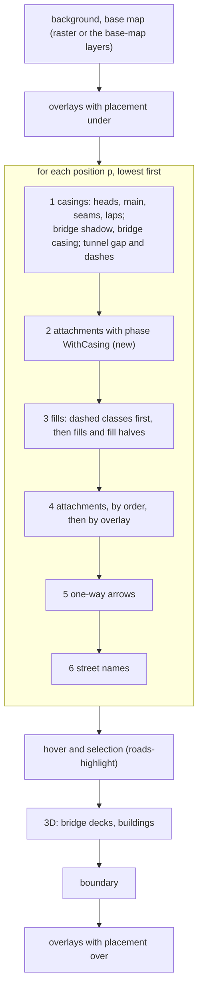

*At one position every casing is under every fill. A higher position is over the whole of a lower one, casing included.*

MapLibre orders the layers by their place in the list, and the features of one layer by `line-sort-key` (or `symbol-sort-key`). A
sort key works only inside one layer. Thus the layer planner turns the keys into layers in one of two ways:

| Plan | Layers | Sort key | Today |
|---|---|---|---|
| **Merged** (`simple=True`, the default) | one line layer for every line piece of every position (`roads-simple`); the other kinds in their own layers | `2p` for a casing (+0.25 bridge, -0.1 shadow, +0.1 tunnel dashes), `2p - 0.5` for a dashed fill, `2p + 1` for a fill, `2p + 1 + 0.01 order` for a line attachment, + `1e-8 edge` | Python and Rust |
| **Per position** (`simple=False`) | for each position, a casing layer, a fill layer, the attachment layers, an arrow layer and a name layer, in the order of the diagram | constant | Python only; not ported (decision 2) |

The key formula is one function in `roadstyle-engine` (`order::sort_key`), and both plans use it. Today it is written two times
(`_simple_pieces` in Python, `simple.rs` in Rust).

The limits of the merged plan, as in Python today:

- Only line pieces share the one layer. A polygon, a circle, an icon or a text attachment is in a layer of its own above the whole
  road layer. Thus it does not go under a road at a higher position (Python: only metre-wide line items are pieces of the road layer;
  Rust: no item at all yet, `__rs_k = 5` is read and never made).
- The names and the arrows are one layer each, above all roads. A name of a road under a bridge can show on the bridge.
- A later improvement can split the merged layer at the positions that have such attachments (a filter on the sort key), with one
  more layer for each such position. It is new behavior: see decision 8.

## Input and output formats

### All inputs become one form

Each reader is an adapter that gives Arrow record batches. The model makes one `RoadTable` from them (the columns of `RoadDraw`,
plus the other columns for popups as dictionary or plain arrays), and a `FeatureTable` for the base map and the overlays. The engine
reads only these two types.

```rust
pub trait RoadSource {
    fn schema(&self) -> SchemaRef;
    fn next_batch(&mut self) -> Option<Result<RecordBatch, DataError>>;
}
pub fn read_roads(src: impl RoadSource, map: &ColumnMap) -> Result<RoadTable, DataError>;
```

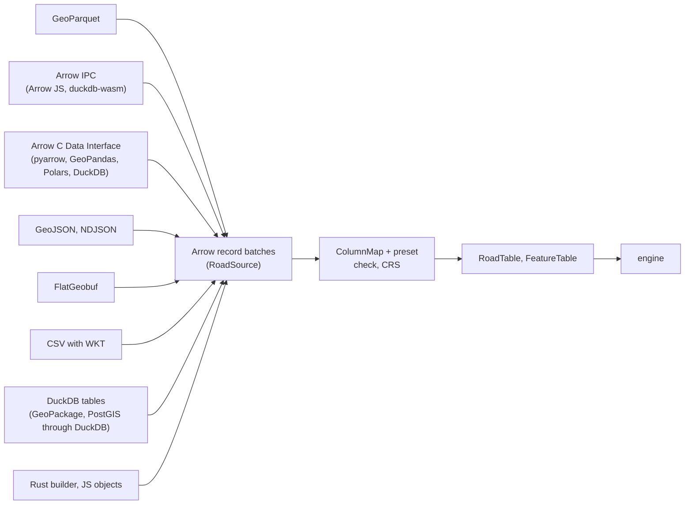

*Every format ends as Arrow batches, so the column map and the checks are written once.*

| Input | Adapter | Feature | Native | WebAssembly | Python | No copy of the columns |
|---|---|---|---|---|---|---|
| GeoParquet (WKB or GeoArrow geometry) | `io::parquet` | `parquet` (default) | yes | yes | yes | no: one decode |
| Arrow C Data Interface (pyarrow, GeoPandas `to_arrow`, Polars, DuckDB) | `roadstyle-py`, `io::arrow` | core | yes | no | yes | yes |
| Arrow IPC stream (Arrow JS, duckdb-wasm) | `io::ipc` | `ipc` | yes | yes | yes | one copy into the module, then yes |
| GeoArrow native coordinates | model | core | yes | yes | yes | yes |
| WKB column | `geom::wkb` | core | yes | yes | yes | no: one decode |
| GeoJSON, newline-delimited GeoJSON | `io::geojson` (a streamed parse, no JSON tree) | `geojson` | yes | yes | yes | no |
| FlatGeobuf (with a box filter) | `io::fgb` (`flatgeobuf` crate, pure Rust) | `fgb` | yes | yes | yes | no |
| CSV with a WKT column | `io::csv` | `csv` | yes | yes | yes | no |
| DuckDB table or query | `io::duckdb` (DuckDB's Arrow interface) | `duckdb` | yes | through duckdb-wasm and Arrow IPC or Parquet | through Python's duckdb | yes natively |
| GeoPackage, PostGIS | through DuckDB (`spatial`, `postgres` extensions) or GeoPandas | `duckdb` | yes | no | yes | no |
| Rust values, JS objects | `RoadTableBuilder`, `Tiler.fromRows` | core | yes | yes | no | Rust yes, JS no |
| GeoDataFrame | `to_arrow()`, then the C Data Interface | Python | | | yes | WKB decode only |

**Large areas.** The reader takes batches (for example 65,536 rows), maps and checks each one, adds it to the columns and frees it:
the peak is the table and one batch, not a JSON tree. A box filter reads only the rows in an area (FlatGeobuf's index, the bounding
box columns of GeoParquet 1.1). The engine itself needs the whole table, because the twins, the chains of the slots, the levels and
the camera are global. The output streams: the style is written source by source, and the tiles are made on request.

**Memory of each path.** Arrow C Data: the columns are not copied, and only WKB is decoded into the coordinate buffer. Arrow IPC in a
browser: one copy into the module. GeoParquet and the other files: one decode, and the file bytes are freed after it. GeoJSON: one
streamed pass. P4 measures each path on Tartu.

### Schemas: the column map and its presets

`ColumnMap` names the column of each field of `RoadDraw` (the Python keywords `highway_col`, `edge_id_col`, `tunnel_col`, `bridge_col`,
`layer_col`, `directed_col`, `driving_col`, `access_col`, the level and end columns). A preset is a `ColumnMap` with a conversion:

| Preset | Class | Id | Bridge, tunnel, layer | Direction | Conversion |
|---|---|---|---|---|---|
| `duckosm` | `highway` | `edge_id` (BIGINT hash) | `bridge`, `tunnel`, `layer` | `oneway`, `is_directed`, `has_arrows` | the levels from `visualization.edge_levels` |
| `osmnx` | `highway` | `(u, v, key)` | `bridge`, `tunnel`, `layer` | `oneway`, `reversed` | a list cell becomes its first value that is not null (`_flatten_osmnx`); a warning for an edge that is both bridge and tunnel |
| `overture` | `class` (`subclass = link` gives `is_link`) | `id` (text) | `road_flags` (`is_bridge`, `is_tunnel`), `level_rules` | `access_restrictions` (to check) | a flag on a part of a segment (`between`) splits the segment at that part |
| `gmns` | `facility_type`, through a class table | `link_id` | none | `directed` | the class table is part of the preset |
| `nvdb` | to define with fetching-sweden-data | | | | |
| own table | the keywords | the keywords | the keywords | the keywords | none |

A missing column is an error that names the preset, the column and the nearest names in the table. A column of the wrong type is an
error that names the type found.

**Geometry.** A road is a LineString or a MultiLineString. A MultiLineString is one piece, as in Python today, and it gets no heads.
The base map, the overlays and the attachments take every geometry type. **The CRS.** The model is in EPSG:4326. The Python
front-end transforms with GeoPandas, as today (`validate.to_wgs84`). A Rust reader reads the CRS of the file: EPSG:4326 or OGC:CRS84
is read, another CRS is an error, or it is transformed with the feature `proj` (pure Rust, so it builds for WebAssembly).

### Outputs

| Output | Made by | Native | WebAssembly | Python |
|---|---|---|---|---|
| MapLibre style with the sources in it (`export_inline`, `makeStyle`) | engine, `io` | yes | yes | yes |
| Style with vector sources, and tiles on request (`Tiler`) | tiles | yes | yes | yes |
| A tile folder (`tiles/{z}/{x}/{y}.pbf`), a sprite (`export_style`) | `io` | yes | no | yes |
| A PMTiles file | tiles, feature `pmtiles` | yes | yes (bytes) | yes |
| The HTML page | `io`, feature `page` | yes | no | yes |
| The data for folium: GeoJSON with the paint of each edge | engine (`bake`) | yes | yes | yes |
| The data for lonboard: casing and fill color (RGBA) and width of each edge, as Arrow arrays | engine (`paint_arrays`) | yes | yes | yes, as numpy arrays with no copy |
| The legend: `metadata["roadstyle:color_options"]` | engine (task 1) | yes | yes | yes |
| The level rows (for `visualization.edge_levels`) | levels | yes | yes | yes |

## The interaction contract

The interaction contract is everything that a dashboard can read from the rendered output and change in it at run time. It has
three users: the Python page (the dashboard bundle in one HTML file), duckosm-rust's page (ES modules, the engine in a worker) and the
GeoLibre plugin (ES modules on GeoLibre's map). Today the contract is not written down. The dashboard module (task 2, branch
`claude/dashboard-js-5ddf3e`, 19 files, 1,684 lines) reads 3 metadata keys, about 20 `__rs_*` properties and layer ids that start
with `roads`. It changes the map with 7 kinds of calls and has 31 `rs*` functions (29 of them on `window`), with no types and no version,
and 15 `rs:*` events with names that clash (`rs:viewchange` is the 3D button, `rs:viewselect` is the View menu).

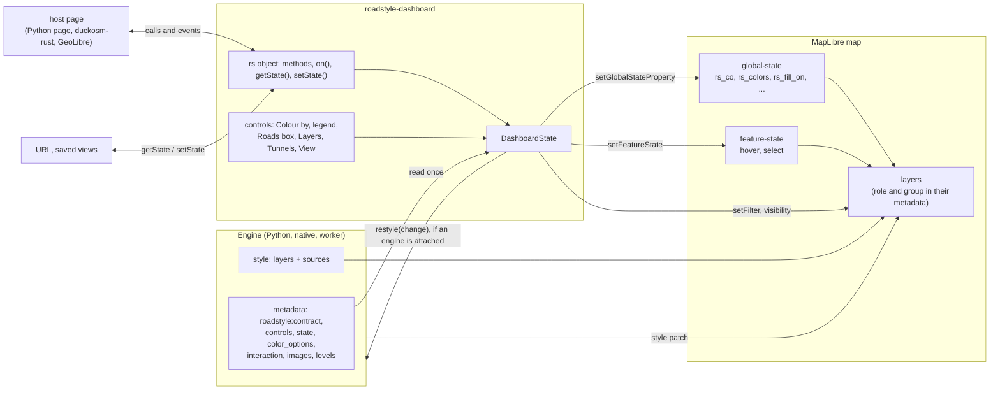

*The engine writes the contract into the style. The dashboard keeps one state and changes the map only through MapLibre's own calls. Only a change that needs new data goes back to the engine.*

### The output: what the engine writes for the dashboard

The style carries a version, `metadata["roadstyle:contract"] = 1`, and each key below has a JSON schema
(`contract.schema.json`, made from the Rust types in `roadstyle-model::contract`). The TypeScript types of the npm packages are made
from the same schema.

| Key | Content | Today |
|---|---|---|
| `roadstyle:contract` | the version of this contract | new |
| `roadstyle:interaction` | the popup fields, the tooltip fields, the hover delay | Python export, Rust |
| `roadstyle:color_options` | `[{name, prop, legend}]`, and the active option | Python export, Rust; the active option is new (the legend is correct only for option 0 today) |
| `roadstyle:controls` | what the engine knows and the controls show: the classes and their swatches, the access kinds and their counts, the tunnel look (palettes, colors, steps), the views, the arrow image and rules | new: today Python gives these as `rsDashboard` options, and the Rust users have none |
| `roadstyle:state` | each global state name and its start value (`rs_co`, `rs_colors`, `rs_base`, `rs_fill_on`, `rs_palette`, `rs_ov_<n>`, `rs_tun_*`) | new: today the names are written in the JS and in `render_web.py` |
| `roadstyle:images` | the images to add (`oneway`) | Rust |
| `roadstyle:levels` | the source of the numbers (see the render model) | new |
| `roadstyle:planner`, `roadstyle:planner_skipped` | the route planner's graphs | Rust |
| layer `metadata["roadstyle:group"]`, `["roadstyle:over"]` | the group of a layer (`roads`, or an overlay's name) | Rust |
| layer `metadata["roadstyle:role"]` | `casing`, `fill`, `item`, `arrows`, `labels`, `highlight`, `deck`, `base` | new |

The rules:

1. **Layers are found by their role and group, not by their id.** The ids change with the plan (`roads-fill-lv3`) and a host can add a
   prefix (duckosm-rust adds `rs-`, GeoLibre renames the layers). Today `filter.js` takes every layer whose id starts with `roads`.
   Until the layers have roles, the option `prefix` (for example `"rs-"`) tells the dashboard the prefix of the roads style's source
   and layer ids in the map; the names inside the style (`source-layer`, metadata) do not have it.
2. **Public and internal.** Public for a host: the metadata keys above, the layer roles and groups, the data columns (`edge_id`, the
   class column and every column kept in the tiles), and the anchor layer `roads-highlight`. Internal (between the engine and the
   dashboard of the same version, checked by a test): the `__rs_*` properties that the dashboard reads (`__rs_edge`, `__rs_edge2`,
   `__rs_edges`, `__rs_cls`, `__rs_lvl`, `__rs_tunnel`, `__rs_bridge`, `__rs_access`, `__rs_k`, `__rs_fl`, `__rs_ord`, `__rs_arw`, the
   slot fields), the feature ids, and the layer ids.
3. **The ids.** A feature's id is its row in the table (the roads source), or the row times 24 plus the piece (the `simple` source),
   because feature state needs small numbers. With tiles and the simple mode, the `simple` source has `promoteId: "__rs_edge"`, so the
   glow of a road is the feature state of its row (the engine's road tiles have no lines). The public API takes the edge id
   (`edge_id`, as text, so a 64-bit hash stays exact), and the dashboard maps it to the row. The engine port `props` takes the row
   today; it takes the edge id when the map from edge id to row is in the contract.
4. **The state stays live.** For a page with a dashboard, the engine writes `["global-state", name]` in the expressions (`state: live`).
   For a static style (`export_style`, a plain MapLibre app, RustGIS), it writes the start values (`state: baked`). Today the Rust engine
   always bakes them, so the Colour by menu, `rsColor`, the road fill switch and the Tunnels box do nothing on its style
   (`dashboard_module.md`).

### The state model

`DashboardState` is one object. Each control changes it, and the dashboard applies a change with the cheapest mechanism:

| Control | State | Mechanism | Needs the engine again |
|---|---|---|---|
| hover, click, select | `selection` | `feature-state` (`hover`, `select`) on the road, its pieces, its decks and its items | no |
| highlight a set of roads | `highlight` | `feature-state` | no |
| Colour by, an option that the style has | `colorBy` | global state `rs_co` | no |
| `rsColor` groups, the base groups | `colors`, `colorBase` | global state `rs_colors`, `rs_base` (edge to color) | no |
| Colour by, a column that the style does not have, a new ramp, `vmin`, `vmax`, `width_by` | `colorBy` | `restyle`: new paint expressions and a new legend | yes |
| the legend | from `colorBy` | the DOM, from `roadstyle:color_options` | no (yes with a new column) |
| classes, Bridges, Tunnels, access kinds, a set of ids | `filter` | `setFilter` on every layer of a road, through one function (`_applyRoadFilters`) | no |
| an overlay on or off | `overlays` | layer visibility | no |
| an overlay's color option | `overlays` | global state `rs_ov_<n>` | no |
| the road fill on or off | `roadFill` | global state `rs_fill_on` | no |
| the tunnel look (strength, color, palette, dash ratio) | `tunnel` | global state `rs_tun_*` | no |
| a palette that a view names | `palette` | global state `rs_palette` (the style has a copy of the colors for each such palette) | no; another palette: yes |
| another profile (widths, zooms) | | a new style (`setStyle`) | yes |
| a view | `view` | `setState` with the view's part of the state | no |
| the base map | `basemap` | the raster source and layer made again | no |
| 2D or 3D | `view3d` | the camera pitch and the deck layers | no |
| Street View, Google 3D | `streetView`, `google3d` | the windows and Google's API | no |
| the side panel | `panel` | the DOM | no |
| the camera | `camera` | `jumpTo` | no |
| the one-way arrows | | `setData` on the `arrows` source after each move | no |
| a level edit | | the engine solves again; `updateData` (inline) or a new tile generation | yes |

### The runtime API

`rsDashboard(map, options)` returns one object. The Python page sets `window.rs` to it. The dashboard module already returns it
(branch `claude/dashboard-js-5ddf3e`), with one method, `setStyle`; the other methods below go on the same object. `style: null` is
allowed: the roads come later, with `setStyle`.

```ts
type EdgeId = string;
interface DashboardState {
  v: 1;
  selection: EdgeId | null;
  highlight: EdgeId[];
  colorBy: string;                                   // the name of a color option
  colors: { color: string; ids: EdgeId[] }[];        // rsColor
  filter: { classes: string[] | null; bridges: boolean; tunnels: boolean; access: string[]; ids: EdgeId[] | null };
  overlays: Record<string, { visible: boolean; colorBy?: string }>;
  roadFill: boolean;
  tunnel: { strength: number; toward: string; palette: string; ratio: [number, number] };
  palette: string;
  view: string | null;
  basemap: string;
  view3d: boolean;
  camera: { center: [number, number]; zoom: number; pitch: number; bearing: number };
  streetView: { mode: "off" | "window" | "panel"; spot?: { edge: EdgeId; m: number } };
  google3d: boolean;
  panel: boolean;
}
interface Dashboard {
  readonly contract: number;
  setStyle(style: object): void;                     // a late or a new roads style: the page adds its sources and layers first;
                                                     // the controls stay, the menu and the legend are made again, the selection is cleared
  select(id: EdgeId | null): void;
  highlight(ids: EdgeId[]): void;
  focus(ids: EdgeId[]): void;
  query(where: Record<string, unknown>): EdgeId[];
  find(text: string): EdgeId[];
  props(id: EdgeId): Record<string, unknown> | null;
  setColorBy(name: string): void;
  color(groups: DashboardState["colors"] | null): void;
  setFilter(filter: Partial<DashboardState["filter"]>): void;
  setOverlay(name: string, visible: boolean): void;
  setTunnelStyle(look: Partial<DashboardState["tunnel"]>): void;
  setView(name: string): void;
  setBasemap(key: string): void;
  getState(): DashboardState;
  setState(change: Partial<DashboardState>): void;   // a saved view, a URL
  can(change: Partial<DashboardState>): boolean;     // false when the change needs an engine and none is attached
  on(event: DashboardEvent, fn: (e: unknown) => void): () => void;  // returns the function that removes it
  destroy(): void;
}
type DashboardEvent = "select" | "deselect" | "hover" | "state" | "filter" | "color" | "overlay" | "tunnel"
                    | "view" | "view3d" | "basemap" | "streetview" | "google3d";
```

- **Events.** `on()` takes the names above. The event `state` gives each change as the part of the state that changed. The old
  `document` events (`rs:select`, `rs:filterchange`, ...) are sent too, for one minor version.
- **Saved views and URLs.** `getState()` gives the whole state, and `setState()` takes a part of it. A URL keeps the part that differs
  from the start state (`#rs=` and the JSON in base64url). A view of `views=` is a named part of the state, so the View menu calls
  `setState`.
- **The old names.** `window.rsSelect`, `window.rsSetColorField` and the other `window.rs*` functions stay as aliases of the object's methods for
  one minor version, with one warning in the console. Then they go. A name that starts with `_` is not public, also when the Python page
  makes it a global.

### When the dashboard needs the engine again

Some changes need new data or new expressions: a color column that the style does not have, a new ramp or range, `width_by`, another
palette or profile, a level edit. The dashboard asks for them through a port, so that it does not depend on WebAssembly:

```js
rsDashboard(map, {style, prefix: "rs-", engine: {
  props: (row) => worker.props(row),            // one road's properties on request: a click, rsSelect, the tooltip (built)
  restyle: (change) => worker.restyle(change),  // a Promise of a StylePatch (planned)
}});
```

- `Tiler.restyle(change)` in `roadstyle-wasm` gives a `StylePatch`: the new paint and filter expressions of each layer role, the new
  `roadstyle:color_options` entry with its legend and, when the tiles must change, a new tile generation (`rs://<generation>/...`, as
  duckosm-rust's page does today with a new worker for each style). The worker keeps the roads table, so it computes the categories,
  the ramp and the legend from the column without a new read.
- A color by a column is an expression on a property that is in the source (`["get", column]` in a `match` or an `interpolate`), so
  only the paint changes. For this, the column must be in the tiles (`keep`). Python bakes a color column for each option today
  (`__rs_fill__<i>`); the expression form is new behavior (decision 8).
- **The Python page has no engine.** It shows only the options that it has in the style. `can()` returns false for a change that needs
  the engine, and the control does not show that choice. Nothing changes without a message.
- **duckosm-rust's page and the GeoLibre plugin** attach the worker's `restyle`.

### The inventory of shared variables

The tables below list every variable that the engine, the dashboard and the page share at commit `686fe4c` (branch
`claude/dashboard-js-5ddf3e`, which includes `rust-engine`). These commands make the name lists again:

```bash
git grep -ohE '"rs_[a-z0-9_]+"|rs_ov_' -- src rust | tr -d '"' | sort -u          # the global state: 12 names
git grep -ohE '__rs_[A-Za-z0-9_]+' -- src rust | sort -u                           # the properties: 66 names
git grep -ohE 'roadstyle:[a-z_]+' -- src rust | sort -u                            # the metadata keys
git grep -ohE '__[A-Z][A-Z0-9_]+__' -- src/roadstyle/static/web_template.html | sort -u   # the page placeholders
git grep -nE 'localStorage|--rs-' -- src/roadstyle/static                          # the stored keys and the CSS variables
```

In P3 these tables move to `docs/reference/contract.md`, and a test (`tests/test_contract_names.py`) runs the same searches and fails
when the code has a name that the reference does not have, or the reverse.

#### The page and control variables

"Run time" says whether a page can change the value after it opens. "Gap" marks a value that a page cannot change today and that the
contract makes changeable (or a value that is not used).

| Variable | Type, default | Set in | Read by | Run time | API |
|---|---|---|---|---|---|
| `name` (title) | text, `"roadstyle"` | `render` keyword; look `args.name`; style `name` | page title, host panel | no | |
| `style` | the style object, or null (the roads come later) | `rsDashboard` option | every control | yes | `setStyle`; `restyle` (planned) |
| `prefix` | text, `""` | `rsDashboard` option | every control that finds a roads layer or source | no | |
| `engine.props` | `(row) => Promise<props>` | `rsDashboard` option | `select.js` (click, `rsSelect`, the tooltip, the twin `__rs_edge2`) | | the engine port |
| `engine.restyle` | `(change) => Promise<StylePatch>` | `rsDashboard` option | the controls that need the engine | | the engine port (planned) |
| `basemaps`, `basemap` | keys, `DEFAULT_SWITCHER`, `"voyager"` | `render`; `rsDashboard` option (`BASEMAPS`) | `basemap.js` | yes | `rsSetBasemap`; `rs:basemapchange`; `window.RS_BASEMAPS` |
| `basemap_switcher` | bool, true | `render`; option | `basemap.js` | no | |
| `api_key` | text | `render`, `set_api_key` | the base-map URL | no | |
| `zoom_readout` | bool, true | `render`; option | `zoom.js` | no | |
| `pitch`, `bearing`, `max_pitch` | numbers, none, none, 70 | `render`; `defaults.json` camera | the map | the camera: yes; `max_pitch`: no | gap: no getter or setter of the camera (only `rsFocus`) |
| `pitch_3d` | number, 55 | `defaults.json`; option | `view3d.js` | yes | `rsSetView3D`; `rs:viewchange` |
| `view_3d` (bridge decks) | bool, false | `render`; look `args.view_3d` | engine (deck layers) | no: the decks are in the style or not | |
| 3D buildings | an overlay (`roadstyle:group` = `buildings 3D`) | engine (mapstyle features) | the Layers box only when Python gives `overlays` | gap: a Rust style has no overlay list for the dashboard | `rsSetOverlay` |
| `find_control` | bool, false | `render`; option | `find.js` | no | `rsFind` |
| find fields | the popup fields, and `edge_id_col` and `edge_ref` (`_ID_KEYS`) | `road_popup`, `edge_id_col` | `find.js` | no | `rsFind` |
| `edge_id_col` | text, `"edge_id"` | `render`; option | `find.js`, `select.js` | no | |
| `road_popup` | false, null (every field) or fields; `DEFAULT_ROAD_POPUP` | `render`; `roadstyle:interaction.popup`; option | `select.js`, `find.js` | gap | |
| `popup_mode` | `"popup"` or `"panel"` | `render`; option | `panel.js` and every docked control | no | |
| `road_tooltip`, `tooltip` | false, true or fields | `render`; look `args.tooltip`; `roadstyle:interaction.tooltip` | `select.js` | gap | |
| `hover_delay_ms` | ms, 300 | `render`; `roadstyle:interaction`; option; `_TIP_DELAY` | `select.js`, `overlays.js` | gap | |
| `copy_field` | text, `"edge_id"` | look `args.copy_field` (mapstyle passes it) | folium only | gap: not used by the web page | |
| `hover_color` | color, `selection.hover` (`#b388ff`) | `render`; the palette | engine: a literal in each highlight expression | gap: fixed in the style; `__HOVER_COLOR__` is replaced (`render_web.py:3784`) but the template has no such placeholder | new: `rs_hover` |
| `select_color` | color, `selection.select` (`#7c4dff`) | `render`; the palette; option (Google 3D line) | engine (literal), `google3d.js` | gap: fixed in the style | new: `rs_select` |
| the glow | `selection.opacity` 0.85, `glow_opacity` 0.35 (palette); the width of the fill (simple mode) | the palette | engine (`_simple_color(glow=...)`) | gap: fixed | new: `rs_glow` |
| `filter` | `{on, col, classes, swatches, palettes, bridges, tunnels, access}`, off | `render` (`filter_control`, `filter_col`, `access_col`); option | `filter.js`, `views.js` | yes | `rsSetClasses`, `rsSetBridges`, `rsSetTunnels`, `rsSetAccess`, `rsGetAccess`, `rsFilter`; `rs:filterchange`; `window.RS_CLASSES`, `RS_CLASS_COL`, `RS_CLASS_COLORS`, `RS_ACCESS` |
| access colors | `access.private`, `bus`, `pedestrian`, `delivery` (palette) | the palette | engine (`__rs_access` colors) | no | |
| `color_options` | `[{name, prop, legend}]` | `render`; `roadstyle:color_options`; option | `color.js`, `legend.js`, `views.js` | the choice: yes; a new option: `restyle` | `rsSetColorField`; `rs:colorchange`; `window.RS_COLOR_OPTIONS` |
| the legend | `{title, kind, entries}` or `{title, kind, ramp, vmin, vmax}` | the data styler (`bake_color_options`) | `legend.js` | follows the option | gap: the metadata does not give the active option |
| `color_active` | index or name, 0 | `render`; option | `color.js` | yes | `rs_co` |
| host colors | `[{color, ids}]` | the host page | the fill and item expressions | yes | `rsColor`, `rsColorBase`; `rs:colorchange` |
| `road_fill` | `{on, paint}`, on | `render`; option | `color.js` | yes | `rsSetRoadFill`; `rs:roadfillchange` |
| `overlays` | `[{label, source, layers, popup, tooltip, interactive, under, base, select, color, visible, popup_window}]` | `render` (`Overlay`); option | `core.js`, `overlays.js`, `filter.js`, `select.js` | visibility, color: yes | `rsSetOverlay`; `rs:overlaychange`; `window.RS_OVERLAYS` |
| `overlay_control`, `overlay_popup` | bool, true | `render`; option | `overlays.js` | no | |
| `items`, `items_popup` | `{label, popup, layer}` or null | `render`; option | `select.js` | no | |
| `tunnel` | `{layers, control, strength, palette, palettes, ratio, ratios, toward, towards, to, steps}` | `render` (`tunnel_control`) and the look (`tunnels`) | `tunnel.js`, `arrows.js` | yes | `rsSetTunnelStyle`; `rs:tunnelchange`; `window.RS_TUNNEL_PALETTES`, `RS_TUNNEL_TOWARDS` |
| the bridge look | casing color and width, shadow, deck (look `bridges`) | the look | engine | no | |
| `views` | `{name: {setting: value}}` | `render`; option | `views.js` | yes | `rsSetView`; `rs:viewselect`; `window.RS_VIEWS` |
| `palette` (views) | text | `render`; views | engine (`rs_palette`) | yes, among the palettes that the views name | `rsSetView` |
| `arrows`, `labels` | bool, true | `render`; look `args` | engine | gap: no switch at run time (a visibility change is enough) | |
| `arrow_icon`, `arrow_color`, `arrow_rules` | the look (`arrows`, `labels.base_size`) | option | `arrows.js` | no | |
| `street_view` | `"window"`, true, false | `render`; option | `streetview.js`, `svspot.js` | yes | `rsSetStreetView`; `rs:streetviewchange` |
| Street View mode | `"linked"` or classic | `localStorage` `rs-street-view-mode` | `streetview.js` | yes | the window's buttons |
| `street_view_key` | text, `GOOGLE_MAPS_KEY` | `render`; option | `streetview.js`, `google3d.js` | no | |
| Street View spot and marker | `{edge, m}` | the click; the host | `svspot.js` | yes | `rsSetStreetViewMarkerAt`, `rsSetStreetViewMarker`, `rsStreetViewStep`, `rsGetStreetViewSpot`; `rs:streetviewmove`, `rs:streetviewspot` |
| `google_3d` | bool, false | `render`; option | `google3d.js` | yes | `rsSetGoogle3D`; `rs:google3dchange` |
| the place of the two windows | `{left, top, width, height}` | `localStorage` `rs-street-view-window:<path>`, `rs-google-3d-window:<path>` | `float.js` | yes | |
| `side_panel_html`, `host_panel_width` | HTML, 320 px | `render` | the page, `panel.js` | open or closed: yes | `rsPanelShow`; `localStorage` `rs-host-panel:<path>` |
| `--rs-side` | CSS length | `panel.js` | `dashboard.css` (the controls on the right move with the panel) | yes | |
| the theme of the page (light, dark) | none on the map page; `data-theme` on the sidebars of `render_dashboard` and `render_report` | `templates/*.html` | the sidebars | the sidebars: yes | gap: `dashboard.css` and `popup.css` have literal colors and one CSS variable (`--rs-side`) |
| `simple`, `tiles`, `fill_layers` | the mode and the road fill layer ids | `render`; option | `core.js`, `select.js`, `svspot.js` | no | |
| `compress`, `data_maxzoom`, `data_tolerance` | | `render` | engine | no | |
| `boundary` | the outline | `render` | engine | no | |
| page self-checks | `window.__rs_gz`, `window.__rs_tiles` | `_INFLATE_JS`, `_TILES_JS` | the page's banner | | |
| `window.map` | the map | the page | the level editor, host scripts | | |
| URL parameters | none today | | | | new: `#rs=` (`getState`, `setState`) |

#### The global state `rs_*`

The style reads each one with `["global-state", name]` (`_gs()` in `render_web.py`, `gs()` in `layers.rs`). In P3 the engine lists them
with their start values in `roadstyle:state`.

| Name | Type | Start value | Values | Read by | Set by | API |
|---|---|---|---|---|---|---|
| `rs_co` | integer | `color_active` | 0 to the number of options - 1 | the fill pieces and items (`match` on the option) | Colour by menu, views | `rsSetColorField`; `rs:colorchange` |
| `rs_colors` | object: edge index to color | `{}` | colors | the fills, items, end caps, attached overlays (`_painted`) | host page | `rsColor`; `rs:colorchange` |
| `rs_base` | object: edge index to color | `{}` | colors | the same, under `rs_colors` | host page | `rsColorBase` |
| `rs_fill_on` | bool | `road_fill` | | the fill pieces' opacity | road fill switch, views | `rsSetRoadFill`; `rs:roadfillchange` |
| `rs_ov_<i>` | object: feature id to color | `{}` | colors | the paint of overlay `i` | host page | `rsColor(..., overlay)` |
| `rs_palette` | text | the start palette | the palettes that the views name | each color that differs between these palettes (`__rs_fill@<palette>` and the paint values) | View menu | `rsSetView`; `rs:viewselect` |
| `rs_tun_strength` | number | `tunnel_strength` (60) | 0 to 100 (`steps`) | each tunnel color | Tunnels box | `rsSetTunnelStyle`; `rs:tunnelchange` |
| `rs_tun_toward` | color | `tunnel_toward` (Sand `#d6cfc4`) | `towards`, or any `#rrggbb` | the same | Tunnels box | the same |
| `rs_tun_two` | bool | the palette has two colors | | the tunnel casing | Tunnels box | the same |
| `rs_tun_c0`, `rs_tun_c1` | colors | `tunnel_palettes[tunnel_palette]` | the palettes | the tunnel casing dash and gap | Tunnels box | the same |
| `rs_tun_ratio` | `[dash, gap]` | `tunnel_casing_dash` (`[1, 1]`) | `ratios` | the tunnel casing dash layer | Tunnels box | the same |
| new: `rs_hover`, `rs_select` | colors | `selection.hover`, `selection.select` | colors | every highlight expression | host page | `setSelectionStyle` |
| new: `rs_glow` | number | `selection.glow_opacity` | 0 to 1 | the simple-mode glow | host page | `setSelectionStyle` |

With `state: baked` (the export, RustGIS), the engine writes the start values in place of these expressions.

#### The feature properties `__rs_*`

66 names. None is public for a host page: a host reads the data columns and the API. "Dashboard" marks the names that the dashboard
reads (the internal contract between the engine and the dashboard of the same version). "Leaflet" marks the names of the Leaflet spec
(`emit.to_spec`, `static/roadstyle.js`). Each one goes into a typed field of the render model, and the engine writes the property only
when a layer reads it.

| Names | Meaning | Written by | Read by | Kind | Replaced by |
|---|---|---|---|---|---|
| `__rs_fill`, `__rs_w`, `__rs_op`, `__rs_dash`, `__rs_casing`, `__rs_cw`, `__rs_cop`, `__rs_class` | the class style of the edge: fill color, width, opacity, dash, casing color, casing width, casing opacity, class | `stylers.bake_props`, `roads.rs` | engine layers, `color.js` (`__rs_fill`), Leaflet | dashboard (`__rs_fill`), Leaflet | `RoadDraw.class` + the look; the layer expressions read the class |
| `__rs_fill__<i>` (`__rs_fill__1`, ...), `__rs_fill@<palette>`, `__rs_fill__b`, `__rs_color` | the fill of color option `i`, of a palette of a view, the twin's fill (end caps), the `color_table` column | `bake_color_options`, `_merge_palettes`, `render.py` | engine, `color.js` | dashboard (`__rs_fill__<i>`) | `RoadDraw.look` paint columns (task 1) |
| `__rs_cl`, `__rs_fl`, `__rs_cs`, `__rs_ce` | the casing (main), fill, casing start and casing end numbers | `_mark_levels`, `roads.rs` | engine | internal | `RoadDraw.levels` |
| `__rs_hs`, `__rs_he`, `__rs_cap`, `__rs_cap0`, `__rs_cap1`, `__rs_split` | the head lengths, the cap of both ends, of each end, two different ends | `render` (the head columns), `_mark_caps` | engine | internal | `RoadDraw.ends` |
| `__rs_band` | always 0 since the positions | `_mark_levels` | engine | internal | removed |
| `__rs_twoway`, `__rs_oneway`, `__rs_dup`, `__rs_twin`, `__rs_pair` | two directions, the arrow, the second edge of a single-line pair, the edge of the shared casing, the shared casing | `_mark_twoway`, `_mark_single_line`, `_mark_twin_casing` | engine, `arrows.js`, `svspot.js` (`__rs_twoway`), `select.js` (`__rs_dup`) | dashboard (`__rs_twoway`, `__rs_dup`) | `RoadDraw.direction` and the derived `twin`, `single_line` |
| `__rs_bridge`, `__rs_tunnel`, `__rs_access`, `__rs_lvl` | the bridge look, the tunnel look, the access kind, the tag level of an attached item | `_mark_lvl`, `access_col`, `_edge_overlay` | engine, `filter.js` (`__rs_access`, `__rs_lvl`) | dashboard (`__rs_access`, `__rs_lvl`) | `RoadDraw.structure`, `RoadDraw.look.access` |
| `__rs_cls` | the class column of the edge on every piece, name and arrow (for the class filter) | `_mark_cls`, `roads.rs`, `slots.rs` | `filter.js` | dashboard | the edge label: the dashboard reads the class through the edge |
| `__rs_edge`, `__rs_edge2`, `__rs_edges` | the edge label: the edge's row, the twin's row, the rows of a shadow or a deck | every generator | `core.js`, `filter.js`, `select.js`, `arrows.js`, the level editor | dashboard | the edge label of each piece (render model) |
| `__rs_k`, `__rs_s` | the kind of piece (0 casing, 1 fill, 2 shadow, 3 tunnel gap, 4 tunnel dash, 5 item) and its sort key | `_simple_pieces`, `simple.rs` | engine, `core.js`, `svspot.js` (`__rs_k`) | dashboard (`__rs_k`) | `DrawKey` |
| `__rs_main`, `__rs_seam`, `__rs_lap`, `__rs_stub`, `__rs_nocase` | the main casing piece, a seam, a lap, an end stub, an end cap with no casing ring | `_casing_parts`, `simple.rs`, `_twin_ends` | engine | internal | the piece generators |
| `__rs_wm`, `__rs_cm`, `__rs_twm` | the width, the casing and the pair width in metres (over cos of the latitude) | `_mark_width_m` | engine | internal | `RoadDraw.look.width_m` |
| `__rs_ord`, `__rs_ov`, `__rs_item`, `__rs_ic`, `__rs_iwm`, `__rs_iom`, `__rs_imz`, `__rs_pick` | an attached object's order, its overlay, its row, color, width and offset in metres, minzoom, and "pick it as itself" | `_edge_overlay`, `_item_pieces`, `_road_items` | engine, `select.js` (`__rs_pick`) | dashboard (`__rs_pick`) | `Attachment` |
| `__rs_arw` | the number of an arrow slot (for the export's thinning) | `_annotation_slots`, `slots.rs` | engine | internal | the slot attachments |
| `__rs_base`, `__rs_height`, `__rs_casing_slab`, `__rs_chain` | a 3D deck's base and height, its casing slab, its chain | `_bridge_decks` | engine, `select.js` (`__rs_casing_slab`) | dashboard (`__rs_casing_slab`) | the deck generator |
| `__rs_fc_`, `__rs_fc_frame`, `__rs_fc_i`, `__rs_fc_id`, `__rs_fc_wkb` | not properties: temporary names in the DuckDB query of `fastjson.py` | `fastjson.py` | | internal | removed (the Rust readers) |
| `__rs_gz`, `__rs_tiles` | not properties: the page's self-check globals (`window.__rs_gz`, `window.__rs_tiles`) | `_INFLATE_JS`, `_TILES_JS` | the page's banner | page | the page writer |
| `__rs_fill__` | the prefix of `__rs_fill__<i>` in the code | | | | |

#### The gaps that the contract closes

1. The hover color, the select color and the glow are literals in the style: the global states `rs_hover`, `rs_select`, `rs_glow` and
   `setSelectionStyle`. The dead `__HOVER_COLOR__` replacement goes.
2. `select_color` is also a `rsDashboard` option (the Google 3D line): the dashboard reads it from `roadstyle:controls`.
3. The legend has no active option in the metadata: `roadstyle:color_options` gets it.
4. A Rust style has no overlay list for the Layers box (the 3D buildings, the base-map layers): `roadstyle:controls.overlays`.
5. The camera has no getter or setter: `camera` in the state.
6. The popup fields, the tooltip fields and the hover delay are fixed: `popup`, `tooltip`, `hoverDelay` in the state.
7. Arrows and names cannot be switched off at run time: `labels` and `arrows` in the state (layer visibility).
8. `copy_field` is in the look's `args` but the web page does not use it: a copy button in the popup, or remove it from the web
   contract (P0 decides with the parity list).
9. The map page has no light and dark theme, and `dashboard.css` and `popup.css` have literal colors: CSS variables `--rs-*` from a
   `ui` section of the palette (open point 3 of `style_config.md`), and `data-theme` on the page.
10. There are no URL parameters: `#rs=` with `getState` and `setState`.

## The config: the look

### One name for each thing

| Name | Meaning |
|---|---|
| **palette** | Only colors (`data/palettes/<name>.yaml`) |
| **profile** | All values that are not colors: widths by zoom, zoom ranges, dashes, caps, the tunnel look (`data/profiles/<name>.yaml`) |
| **settings** | Overrides from `roadstyle.json`, `$ROADSTYLE_CONFIG`, `use_settings(...)`, `render_edges(settings=...)` |
| **map options** | The keywords of one map that change the style (`arrows`, `labels`, `view_3d`, `boundary`, the column names, ...) |
| **page options** | The keywords of one map that change only the page (`road_popup`, `street_view`, `filter_control`, ...) |
| **look** | The result of the resolution: one typed, versioned value that the engine reads |

### The resolution

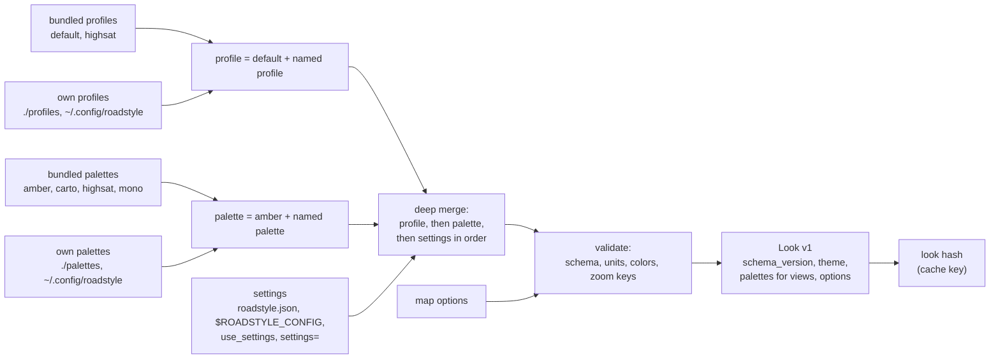

*The defaults are the bundled `default` profile and `amber` palette. A user file states only what it changes.*

The rules:

1. The merge is the merge of `_settings.py` today: the named profile over `default`, the named palette over `amber`, the palette over
   the profile, then each settings source in order (lowest first: `~/.config/roadstyle/roadstyle.json`, `./roadstyle.json`,
   `$ROADSTYLE_CONFIG`, `use_settings`, `settings=`). The old keys (`_OLD_*` tables) are read with a deprecation warning, as today.
2. Validation after the merge. An unknown key is an error with its path and the nearest known key. Today an unknown key is
   ignored without a message.
3. The file reading is an adapter. The core resolves from values (JSON text or Rust structs). The browser gives the files that it
   has. The bundled palettes and profiles are in the crate (made from the YAML files when the crate builds).
4. The look has `schema_version` (an integer, starts at 1). The engine reads version N and N-1. A change that removes or renames
   a key increments the version.
5. The JSON schema of the look is published with each release (`look.schema.json`). An editor can check a user file with it.
6. One copy of the bundled files: `src/roadstyle/data/` until phase 5. Then the files move into `rust/roadstyle-look/data/`, and
   Python reads the bundled values from the engine.

### The typed look

```rust
pub struct Look {
    pub schema_version: u32,
    pub profile: String,                 // the names, for the page and the cache
    pub palette: String,
    pub roads: RoadLook,                 // classes (group, order, minzoom, width, casing, dash), widths by zoom, split, links, caps
    pub casing: CasingLook,
    pub labels: LabelLook,
    pub arrows: ArrowLook,
    pub bridges: BridgeLook,
    pub tunnels: TunnelLook,
    pub selection: SelectionLook,
    pub data: DataLook,                  // no-data color, opacities of data maps
    pub overlays: OverlayLook,
    pub boundary: BoundaryLook,
    pub background: Background,
    pub access: AccessColors,
    pub palettes: IndexMap<String, PaletteColors>, // the palettes that views name (`__rs_fill@mono`)
    pub tiles: TileLook,                 // zooms 6 to 15, extent 4096, buffer 80 (defaults.json)
    pub camera: CameraLook,              // pitch_3d 55, max_pitch 70
    pub options: StyleOptions,           // the map options: columns, arrows, labels, view_3d, boundary, head_m, ...
}
```

Each struct derives `Serialize`, `Deserialize`, `Default` (the bundled values) and `JsonSchema` (feature `schema`), and has
`#[serde(deny_unknown_fields)]`. A color is a `Color` type (it parses `#rrggbb`, `#rrggbbaa`, `rgba(...)`), not a text. A zoom
table is `ZoomTable` (sorted zoom keys).

## The public API

### Rust

```rust
use roadstyle::{io, Look, LookSpec, Map, MapOptions};

let look = Look::resolve(&LookSpec::new("default", "amber"))?;          // the bundled profile and palette
let roads = io::parquet::read_roads(&bytes, &io::ColumnMap::default())?; // RoadTable
let map = Map::new(&roads, &look, MapOptions { arrows: true, labels: true, ..Default::default() })?;

let style: String = map.style_json()?;              // export_inline: the sources in the style
let tiled = map.tiled("rs://roads/")?;              // the style with vector sources, and the tiles
let bytes: Vec<u8> = tiled.tile("roads", 14, 8800, 4700);
io::write_style_dir(&map, "out/", io::TileFormat::Pmtiles)?;  // export_style
```

The level solver alone (duckosm-core):

```rust
use roadstyle_levels::{LevelEdges, Method, compute};
let mut edges = LevelEdges::default();
edges.add(0, edge);                                 // rank 0 = driving
let levels = compute(&edges, Method::Solve)?;
```

### JavaScript

The JS API of today stays the same through phase 3, so the two users do not break. The new form takes one options object:

```js
import init, { Tiler, resolveLook, memoryBytes } from "roadstyle-wasm";
await init();
const look = resolveLook({ profile: "default", palette: "amber", settings: {} });  // JSON text
const tiler = new Tiler(roadsParquet, look, { features, name: "Tartu", prefix: "rs://1/", keep: ["name"] });
const style = JSON.parse(tiler.style());
// in the main thread
import { rsDashboard } from "roadstyle-dashboard";
const map = new maplibregl.Map({ container: "map", style });
rsDashboard(map, { style, street_view: "window" });
```

### Python

The API does not change. `render_edges(gdf, ...)` keeps its 21 keywords, the web keywords and the result type `WebMap`. Inside, it
calls `roadstyle._engine` for each part that is at parity (see the phases).

### Stability rules

| Item | Rule |
|---|---|
| Version numbers | One version for all crates, the wheel and the npm packages (lockstep), the same as Python roadstyle. A release has one tag. |
| Before 1.0 | A minor version (0.x to 0.y) can break the API. A patch version cannot. The CHANGELOG lists each break and what to change. |
| Public API | The `roadstyle` facade, the JS API of `roadstyle-wasm`, `rsDashboard` and the `rs*` functions, the Python API, the look schema, the `roadstyle:*` metadata keys. The inner crates are published, but their API follows the facade and can change in a minor version. |
| The look schema | `schema_version` is separate. The engine reads N and N-1. |
| The output | A change of the style or of the tiles is a change of behavior: a new golden, a CHANGELOG line, and the same change in Python first while Python is the reference. |
| Deprecation | A removed keyword or JS function gives a warning for one minor version, then an error. |
| Rust version (MSRV) | The Rust version of duckosm-rust's toolchain, written in `rust-toolchain.toml` and in CI. |

## Efficiency

### Numbers today (native release build, peak resident memory from `/usr/bin/time`)

| Area | Roads | Output | Memory | Time | Source |
|---|---|---|---|---|---|
| Monaco | 13,298 | style | 196 MB | 0.7 s | `rust_engine.md` |
| Tartu | 63,965 | style | 1.13 GB | 5.1 s | `rust_engine.md` |
| Tartu | 63,965 | tiles (`make_tiled`) | 1.01 GB | | `rust_engine.md` |
| Tartu | | tiles: the last zoom, after step 2 | 18.8 MB, 313 tiles | | branch `rust-tiles` |
| Burnaby | 157,808 | style | | 6.2 s | the session brief (not in a file of the repository) |
| Burnaby | 157,808 | tiles of one 3 x 3 view, zoom 12 | | 0.8 s (slowest tile 0.17 s) | branch `rust-tile-speed` |
| Burnaby | 79,199 | levels (solve) | | 3.1 s native, 5.2 s wasm | duckosm-rust `docs/levels.md` |

Tartu uses about 17 KB for each road natively. The browser module used 0.65 to 0.77 times the native peak in earlier
measurements. `MAX_ROADS` = 200,000 is an estimate from Tartu only.

### Targets

| Measure | Today | Target | How |
|---|---|---|---|
| Memory for each road, tiled path | about 16 KB (Tartu tiles) | 4 KB or less | the columnar model, dictionary text, no GeoJSON tree on the tiled path |
| Stockholm county (456,813 driving edges) in a browser tab | not possible (over `MAX_ROADS`) | the first view in less than 10 s, peak less than 2.5 GB | the same, then measure and raise `MAX_ROADS` |
| Tartu style, native | 5.1 s | 2 s | the columnar model; `parallel` for the sources |
| One tile on request | 0.17 s (slowest, Burnaby) | 50 ms | the tile cache, the bytes of a value made once (`rust-tile-speed`) |
| WebAssembly against native | 1.7 times (levels) | 2 times or less in every stage | the same code; measure each stage |
| Python `render_edges` on 50,000 edges, lonboard | 2.0 s for the style (`vectorize_style_resolution.md`) | 0.2 s | one Rust resolution for each distinct class key |

### How

1. **Columns, not features.** `RoadTable` keeps each property as one Arrow array, not a map per road. Text columns are dictionary
   arrays: one copy of each class name, color and road name. This is the open item of step 3 ("each text value is its own string").
2. **Geometry in one buffer.** All coordinates are in one `Vec<[f64; 2]>` with an offset for each road (the GeoArrow layout). The
   coordinates stay `f64`, for parity with Python.
3. **No copy from Python.** pyarrow gives the table through the Arrow C data interface (`arrow::pyarrow`). geopandas `to_arrow()`
   gives WKB, and the reader decodes it once.
4. **In the browser, one copy.** The Parquet bytes go from duckdb-wasm into the module once. The worker keeps the tables, and the
   main thread gets only the style and the tiles.
5. **The tiled path makes no GeoJSON.** The tile index reads the columns. Only `export_inline` writes GeoJSON, and it streams it
   source by source (as `make_style` does today).
6. **Typed metadata and slots.** The base map, the slots and the layer list stop being `serde_json::Value` trees. The layer list
   stays JSON at the edge, when it is written.
7. **Caches.** The resolved look is cached by its hash. The tiles are cached by (source, z, x, y) with a byte limit (LRU). No
   other cache before a measurement asks for it.
8. **Threads.** Native only, feature `parallel`: the sources in parallel, the tiles in parallel. The solver stays single-thread
   (its stages depend on each other).
9. **The browser limits.** A wasm32 module has at most 4 GB of memory, and a tab can get less. The module must stay under
   `MAX_ROADS`, and the error says to use a smaller area or the tiled path. The allocator grows the memory in large steps (16 to
   256 MB), because each small step is slow in Edge on Windows.

## The migration plan

### Today and the target

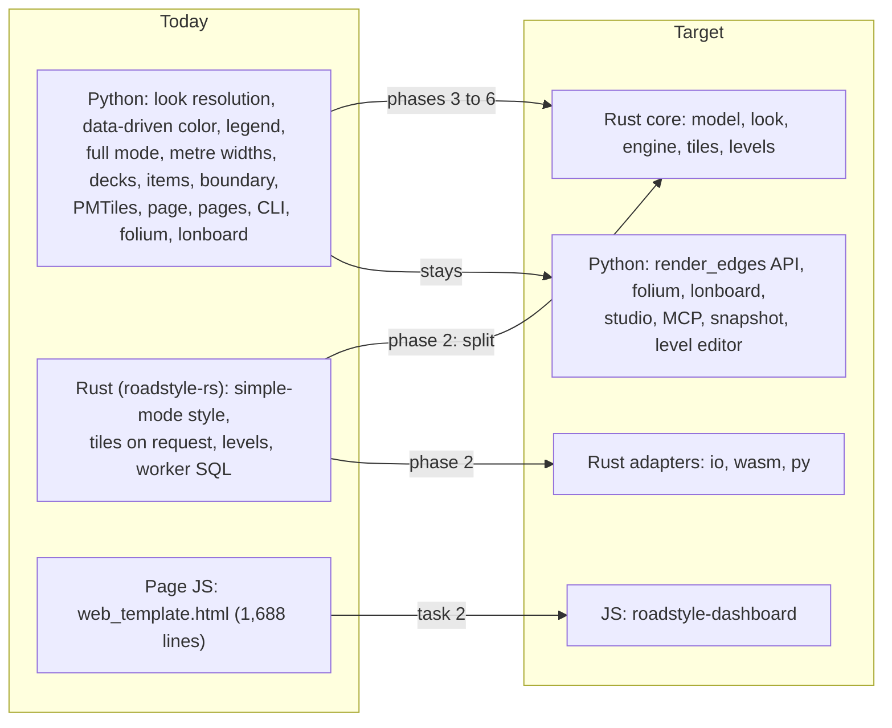

*Everything that makes a style or a tile moves to Rust. Python keeps its API and its notebook tools.*

### The phases

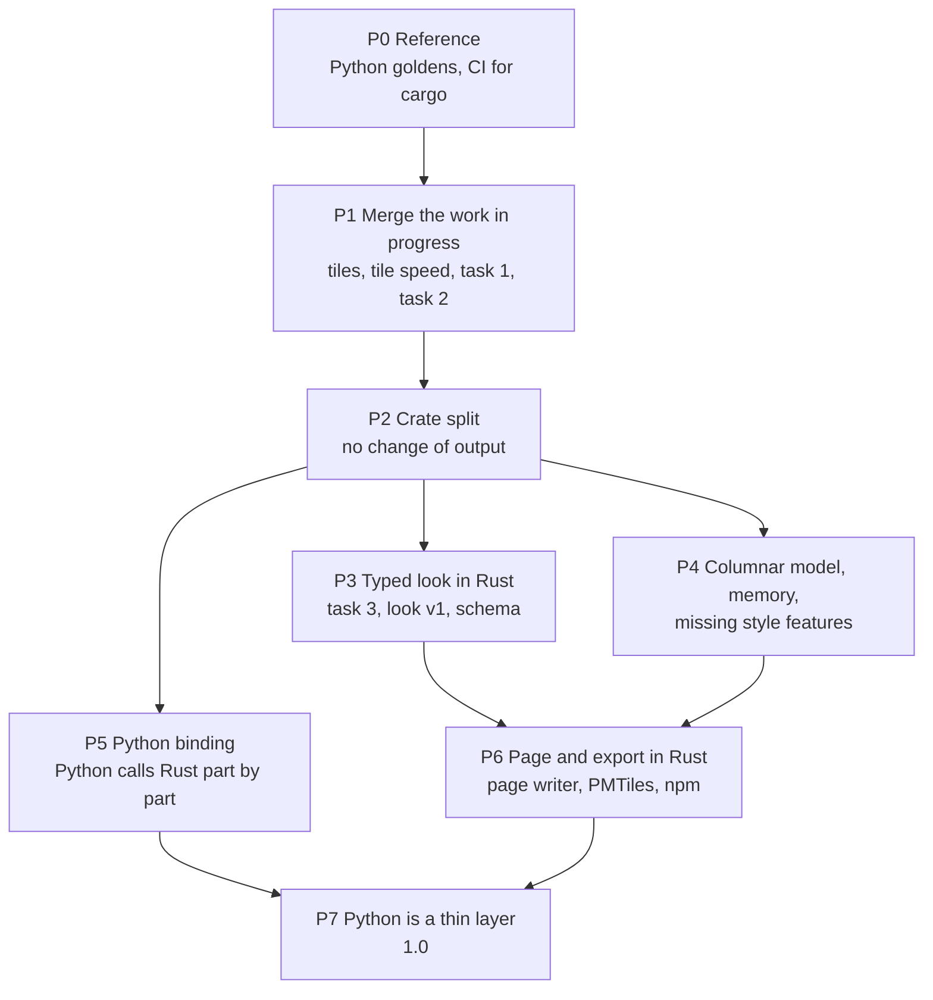

*After the crate split (P2), P3, P4 and P5 run at the same time in different crates.*

#### P0: the reference

- **Content.** Commit `tests/make_goldens.py` (from `rust-colors`) as the one generator. It writes, from Python, the goldens for
  Monaco, Tartu and the Södermalm sample: `export_inline` (the style), `export_style` (style.json and the tiles), `compute_levels`
  (tags and solve) and the look. The golden files are gzipped. The large ones go to the GitHub pre-release `rust-test-data`, and the
  repository keeps their SHA-256. A CI job runs `cargo test --offline`, `cargo clippy` and the wasm32 build.
- **Golden test.** The Rust output today against the Python goldens. Each difference is in a list, with a cause and a decision.
- **Benchmark.** `bench` (from `main.rs`) for Monaco and Tartu: time and peak memory of each stage, in a table in this file.
- **First user.** The roadstyle-rs session.
- **Exit.** CI is green. The list of differences from Python is empty, or each item has a decision.
- **Risk.** glibc's `cos` and `hypot` differ between machines (see `tests/test_render_web.py:1898`). Mitigation: the goldens come from
  one machine type (Linux x86_64), and the Rust code rounds where Python rounds (`py_round`).

#### P0: result (2026-10-23)

**The goldens.** `rust/roadstyle-rs/tests/make_goldens.py` is the one generator (Python roadstyle 0.24.3 from `src/`). For Monaco
(13,298 roads), the Södermalm sample (4,563 driving edges, with duckOSM's solved levels) and Tartu (64,828 roads) it writes the roads-only
style of `export_inline`, the tiles of `export_style` (the 3 x 3 tiles around the centre at zooms 12, 14 and 15) and the levels (the tags
rule; the solve with duckOSM's level-area defaults, not for Tartu: Python's solve needs too much memory there). The files over 1 MB and
Tartu's inputs are on the pre-release `rust-test-data` (`goldens-1.tar`, 42.5 MB); `tests/get_goldens.sh` gets them and checks their
SHA-256. The colour cases and the looks of tasks 1 and 3 come from the same script. `tests/areas.rs` compares the engine with them.

**Differences found and fixed** (the engine now does what Python does):

| Difference | Fix |
|---|---|
| The slots wrote `__rs_arw` before `__rs_cls` | Python's order (task 1) |
| A tile had the features within its buffer | `tiles.py`: a feature is in the tiles its box touches; the buffer is for the clipping only |
| The ids of `simple` were `16 x edge + piece`, the slots had none | `tiles.py`: a feature's id is its index in its source |
| A tile kept only the properties the layers read | `tiles.py`'s `tile_props`: every `__rs_*` property and `keep`; all the properties of a whole layer (the slots) |
| A line shorter than half a tile unit stayed at the last zoom | `tiles.py`: it is left out at every zoom |

After these fixes, every golden tile of the three areas has the same features, ids, properties and geometry as Python's (decoded), and
the styles are the same below the top level, key order included, except the items below.

**Differences that stay, each with its cause and a decision:**

| Difference | Cause | Decision |
|---|---|---|
| The nearest road of a slot: 4 slots of Monaco, 10 of Tartu, none of Södermalm (and 2 or 3 of them get a twin `__rs_edge2` as a result) | Each is the two directions of one way, with the same line: the slot's middle is at distance 0 from both. GEOS's `STRtree.nearest` takes the one its tree reaches first; the engine the lower index. "The higher index" does not match either (8 differ on Monaco then) | Keep. The two edges are one way; the name and the arrow are the same. An exact copy needs GEOS's tree (its build and its search) |
| The solve of Monaco: 8 of 13,298 rows | Python's LP (OR-tools) and the engine's min-cost flow take different answers among equal best ones: both have 0 hard rules broken, 0 stack parts not lifted, 16 order wishes not kept, 9 numbers. Södermalm is equal in all rows | Keep: equal quality by roadstyle's own rules |
| The bytes of a tile | Python's encoder (mapbox_vector_tile) writes a negative integer as `int_value` and a float with no fraction as an integer; the engine writes `sint_value` and a double. MapLibre reads the same numbers | Keep: the tests compare decoded tiles, not bytes |
| No Python solve golden for Tartu | Python's solve needs more memory than the machine can give | Keep: Monaco and Södermalm cover the solve; Tartu has the tags rule |
| The base map in tiles (`export_style`): Python writes the points and polygons whole, the engine clips the polygons | Not in the goldens (the export goldens have no base map) | Open: P4, with the base map in the export goldens |

**The benchmark** (`main.rs --bench`, native release build, 2026-10-23):

| Stage | Monaco: ms | in use after, MB | peak in it, MB | Tartu: ms | in use after, MB | peak in it, MB |
|---|---|---|---|---|---|---|
| Read the roads | 43 | 38 | 41 | 210 | 185 | 198 |
| Mark the roads (colours, pairs, levels) | 152 | 74 | 82 | 825 | 361 | 404 |
| Pieces (`simple`) | 85 | 126 | 128 | 508 | 711 | 719 |
| Names and arrows (`slots`) | 111 | 134 | 138 | 658 | 764 | 788 |
| Base map | 24 | 143 | 145 | 196 | 871 | 881 |
| Roads source | 8 | 143 | 144 | 25 | 871 | 874 |
| Layers | 58 | 145 | 149 | 83 | 874 | 887 |
| The text of the sources | 39 | 177 | 177 | 225 | 1,134 | 1,134 |
| Whole process (`/usr/bin/time`) | 550 | | 194 (resident) | 2,890 | | 1,128 (resident) |

**CI.** `.github/workflows/rust.yml`: on each push to `main` or `rust-engine` that changes `rust/` or roadstyle's data, and on pull
requests: the goldens from the pre-release, `cargo test --offline --release`, `cargo clippy -D warnings`, the wasm32 build. Each night
and by hand: the ignored Tartu goldens. Clippy: the `.into()` calls of `&str` are gone; `needless_range_loop` and `type_complexity` are
allowed in the crate (ported numeric code).

#### P1: merge the work in progress

- **Content.** `rust-tile-speed`, then `rust-tiles` (they conflict in `tiles.rs`), task 1 (`rust-colors`), task 2 (the dashboard
  module). duckosm-rust and geolibre-roadstyle pin the new commit and delete their copies of `look.json` and of the SQL.
- **Golden test.** The tiles against Python's `tiles.py` output (from P0). Task 1 against `export_inline` with each data keyword.
  Task 2: the 24 screenshots of `style_config.md` are the same.
- **Exit.** One branch `rust-engine` with all four. The two Rust users build from it.
- **Risk.** Three branches edit `rust/roadstyle-rs/src`. Merge one at a time, in the order above.

#### P2: the crate split

- **Content.** A move of files, with no change of behavior: the crates of [The crates](#the-crates). `Result<_, String>` becomes the
  error enums. `main.rs` becomes `examples/bench.rs`.
- **Golden test.** The same hashes as before the move.
- **Benchmark.** The wasm module size before and after (no growth of more than 2 %).
- **Exit.** `cargo build --target wasm32-unknown-unknown -p roadstyle --no-default-features` passes. duckosm-core depends on
  `roadstyle-levels` only.
- **Risk.** It touches every file in `rust/`. It must run when no other branch edits `rust/`: a freeze of one day, after P1.

#### P3: the typed look in Rust (task 3)

- **Content.** `roadstyle-look`: the structs, the bundled files, `Look::resolve`, the schema. A reader of today's `look.json`
  (version 0), so the users can move one at a time. `resolveLook` in `roadstyle-wasm`. The `palette` view row
  (`_merge_palettes`) in Rust. The output side of the interaction contract: `roadstyle:contract`, `roadstyle:controls`,
  `roadstyle:state`, the layer roles, and `state: live` (the global state kept in the expressions). The inventory of shared variables
  moves to `docs/reference/contract.md`, with `tests/test_contract_names.py`.
- **Golden test.** For 4 palettes x 2 profiles x the settings fixtures of `tests/test_settings_overrides.py`, the look from Rust is
  equal to the look from Python. The style from the Rust look is equal to the style from the Python look.
- **First user.** The GeoLibre plugin: `build.py` stops running Python and mapstyle to make the 64 looks.
- **Exit.** No user reads Python's internal tables (`render_web.CONFIG`, `ROAD_Z`, `_settings.theme()`) to make a look.
- **Risk.** mapstyle changes the settings by mode (`mode_settings`). Its looks go into the golden set.

#### P4: the columnar model, memory, and the missing style features

- **Content.** `RoadTable` over Arrow, dictionary text, typed slots and base map, the column map and the presets (`highway_col`,
  `edge_id_col`, `tunnel_col`, `bridge_col`, `layer_col`, `cap_col`), the readers of the format table. The render model: `RoadDraw`,
  `LevelPlan` (with `fixed` roads and the edit rows in `roadstyle-levels`), `Attachment` for the slots, `items`, `Overlay` from user
  data and `edge_attach`, `DrawKey` and the one sort-key function. Then the style features that only Python has: metre widths
  (`width_m_col`, `width_m_zoom`, `casing_m`, `casing_min_px`), 3D bridge decks (`view_3d`), `boundary`, `access_col` colors,
  `include` and `exclude`, levels computed when no level columns are given.
- **Golden test.** The hashes do not change for the model work. Each new feature gets its golden from Python.
- **Benchmark.** The targets of [Efficiency](#efficiency). Measure Stockholm county in Chrome and Edge, then set `MAX_ROADS`.
- **First user.** duckosm-rust's page (larger areas).
- **Risk.** The model work and the feature work both edit `roadstyle-engine`. The model API comes first, in one small change.

#### P5: the Python binding

**State (2026-10-23):** step 1 is done. `rust/roadstyle-py` makes `roadstyle._rust` (`make_style`, `make_look`, `Tiler`; abi3, the GIL is free
while Rust works). `roadstyle._engine` has the switch, and `export_inline(engine="rust")` gives the same style as Python for the 7 cases of
`tests/test_engine_parity.py` (Rust 0.12 s, Python 0.57 s on 1,373 roads). Next: the tiles of `export_style`, `compute_levels`, the look of
`render_edges`, the wheels with maturin.

- **Content.** `roadstyle-py` (PyO3, maturin, abi3 wheels for Linux x86_64 and aarch64, macOS, Windows). Python calls Rust part by
  part, in this order: the style of `export_inline`, the tiles (`tiles.py`), the levels (`compute_levels`), the look
  (`_settings.theme()`), the data stylers. An explicit switch `engine="python"` or `engine="rust"` (also `ROADSTYLE_ENGINE`) selects the
  engine. A part that Rust does not have gives an error with `engine="rust"`. It does not change to Python without a message.
- **Golden test.** The full pytest suite runs two times, one time with each engine. A new test, `tests/test_engine_parity.py`,
  compares the two outputs byte for byte for each fixture and each keyword in the parity checklist.
- **Benchmark.** `render_edges` on 5,000, 50,000 and 456,813 edges, with each engine.
- **First user.** SonoFlow (nightly pages).
- **Risk.** Wheels for each platform make the release longer. maturin's GitHub action builds them.

#### P6: the page and the export in Rust

- **Content.** The page writer in `roadstyle-io` (feature `page`): the HTML frame, the dashboard bundle, the style, the page options,
  the gzip of the sources (`compress`), the host panel. `export_style` (style.json, XYZ tiles, PMTiles, sprite). The three page
  sidebars (`dashboard.html`, `report.html`, `street_view.html`) as static files. The npm packages. The runtime API of the
  interaction contract: the `rs` object, `getState` and `setState`, the events, the aliases of the old names, the engine port
  and `Tiler.restyle`.
- **Golden test.** The page from Rust is equal to the page from Python, for the reference pages of `docs/build_maps.py`.
- **First user.** mapstyle (`export_style`, `render_report`).
- **Exit.** `render_web.render` only converts its keywords and calls Rust.

#### P7: Python is a thin layer

- **Content.** Remove the Python code of each part that is at parity for one minor version with no difference. scipy, ortools,
  mapbox-vector-tile and pmtiles leave the dependencies. Version 1.0.
- **Exit.** Python roadstyle has the API, folium, lonboard and the tools. The Rust goldens become the reference.

### Parallel work without two sessions in one file

| Lane | Phase | Owns these files | Waits for |
|---|---|---|---|
| A: reference and CI | P0 | `tests/make_goldens.py`, `rust/*/tests/`, `.github/workflows/rust.yml` | |
| B: work in progress | P1 | the branches of each task, as today | A for the goldens |
| C: the look | P3 | `rust/roadstyle-look/`, `rust/roadstyle-wasm/src/look.rs` | P2 |
| D: model, render model and memory | P4 | `rust/roadstyle-model/`, `rust/roadstyle-io/`, `rust/roadstyle-levels/` (fixed roads, edits) | P2 |
| E: style features | P4 | `rust/roadstyle-engine/` | D for the model API |
| F: Python binding | P5 | `rust/roadstyle-py/`, `src/roadstyle/_engine.py`, `tests/test_engine_parity.py` | P2 |
| G: page, export and the runtime API | P6 | `rust/roadstyle-io/src/page.rs`, `rust/roadstyle-tiles/src/pmtiles.rs`, `src/roadstyle/static/dashboard/`, `rust/roadstyle-wasm/src/restyle.rs` | task 2, C |

Rules:

1. One session for each lane. A lane edits only its own files.
2. A change of the API of another crate is a small change of its own, reviewed first, and the other lane rebases on it.
3. Each lane works on a branch from `origin/main` (or from `rust-engine` until P1 is merged), and checks
   `git log origin/main..<branch>` before a push.
4. Nothing goes to `main`, PyPI, crates.io or npm before a person tries the pages and gives an OK.

## The parity checklist

States: **done** (Rust makes the same output today), **look** (Rust reads the value from `look.json`, which Python makes;
the resolution moves in P3), **task 1**, **task 2**, **task 3** (in progress), **P*n*** (planned in phase *n*), **check** (not known:
the P0 golden run decides), **Python** (stays in Python), **internal** (not ported).

### `render_web.render`: 76 parameters

| # | Parameter | State | Note |
|---|---|---|---|
| 1 | `gdf` | done for GeoParquet; P5 for a GeoDataFrame | |
| 2 | `palette` | look; task 3 | |
| 3 | `highway_col` | done | the engine's column map (`ColumnMap`): the user's names in the data and the road layers |
| 4 | `filter_col` | done | |
| 5 | `styler` | P5 | a Python object; the binding converts it |
| 6 | `basemap` | done | the dashboard module (task 2, `src/roadstyle/static/dashboard/`) |
| 7 | `basemaps` | done | the dashboard module (task 2, `src/roadstyle/static/dashboard/`) |
| 8 | `name` | done | |
| 9 | `offset_frac` | look | |
| 10 | `width_frac` | look | |
| 11 | `offset_zoom` | done | the same style as Python (`tests/test_engine_parity.py`) |
| 12 | `tunnel_col` | done | the engine's column map (`ColumnMap`): the user's names in the data and the road layers |
| 13 | `bridge_col` | done | the engine's column map (`ColumnMap`): the user's names in the data and the road layers |
| 14 | `layer_col` | done | the engine's column map (`ColumnMap`): the user's names in the data and the road layers |
| 15 | `edge_id_col` | done | the engine's column map (`ColumnMap`): the user's names in the data and the road layers |
| 16 | `road_fill` | done | the same style as Python (`tests/test_engine_parity.py`) |
| 17 | `cap_col` | done | the same style as Python (`tests/test_engine_parity.py`) |
| 18 | `cap_start_col` | done | |
| 19 | `cap_end_col` | done | |
| 20 | `casing_level_col` | done | with stored levels; without them the engine computes them, as `render` (`compute_levels`, solve) |
| 21 | `fill_level_col` | done | as 20 |
| 22 | `casing_start_col` | done | |
| 23 | `casing_end_col` | done | |
| 24 | `head_m` | done | the same style as Python (`tests/test_engine_parity.py`) |
| 25 | `head_start_m_col` | done | |
| 26 | `head_end_m_col` | done | |
| 27 | `directed_col` | done | |
| 28 | `driving_col` | done | |
| 29 | `width_m_col` | P4 | no metre widths in Rust |
| 30 | `width_m_zoom` | P4 | |
| 31 | `casing_m` | P4 | |
| 32 | `casing_min_px` | P4 | |
| 33 | `pitch` | done | the export gives the same style as Python; the page: the dashboard module |
| 34 | `bearing` | done | the export gives the same style as Python; the page: the dashboard module |
| 35 | `max_pitch` | done | the export gives the same style as Python; the page: the dashboard module |
| 36 | `view_3d` | P4 | no bridge decks in Rust (building extrusion is done) |
| 37 | `arrows` | done | the same style as Python (`tests/test_engine_parity.py`) |
| 38 | `labels` | done | the same style as Python (`tests/test_engine_parity.py`) |
| 39 | `filter_control` | done | the dashboard module (task 2, `src/roadstyle/static/dashboard/`) |
| 40 | `find_control` | done | the dashboard module (task 2, `src/roadstyle/static/dashboard/`) |
| 41 | `overlay_control` | done | the dashboard module (task 2, `src/roadstyle/static/dashboard/`) |
| 42 | `overlay_popup` | done | the dashboard module (task 2, `src/roadstyle/static/dashboard/`) |
| 43 | `access_col` | done | the same style as Python (`tests/test_engine_parity.py`) |
| 44 | `side_panel_html` | P6 | the page writer |
| 45 | `host_panel_width` | P6 | |
| 46 | `basemap_switcher` | done | the dashboard module (task 2, `src/roadstyle/static/dashboard/`) |
| 47 | `zoom_readout` | done | the dashboard module (task 2, `src/roadstyle/static/dashboard/`) |
| 48 | `road_popup` | done | the same style as Python (`tests/test_engine_parity.py`) |
| 49 | `road_tooltip` | done | the same style as Python (`tests/test_engine_parity.py`) |
| 50 | `hover_delay_ms` | done | the same style as Python (`tests/test_engine_parity.py`) |
| 51 | `data_maxzoom` | done | the same style as Python (`tests/test_engine_parity.py`) |
| 52 | `data_tolerance` | done | the same style as Python (`tests/test_engine_parity.py`) |
| 53 | `popup_mode` | done | the export gives the same style as Python; the page: the dashboard module |
| 54 | `street_view` | done | the dashboard module (task 2, `src/roadstyle/static/dashboard/`) |
| 55 | `street_view_key` | done | the dashboard module (task 2, `src/roadstyle/static/dashboard/`) |
| 56 | `google_3d` | done | the dashboard module (task 2, `src/roadstyle/static/dashboard/`) |
| 57 | `tooltip` | done | the alias of `road_tooltip` |
| 58 | `hover_color` | done | the overlays too |
| 59 | `select_color` | done | the overlays too |
| 60 | `boundary` | P4 | |
| 61 | `color_options` | done | task 1 (`colors.rs`); the same style as Python |
| 62 | `color_active` | done | task 1 (`colors.rs`); the same style as Python |
| 63 | `views` | P3 (palette rows); task 2 (menu) | |
| 64 | `overlays` | done for base-map overlays and `edge_attach`; P4 for `Overlay` from user data | |
| 65 | `items` | P4 | |
| 66 | `items_popup` | P4; task 2 | |
| 67 | `compress` | P6 | |
| 68 | `tunnel_control` | done | the dashboard module (task 2, `src/roadstyle/static/dashboard/`) |
| 69 | `tiles` | done (tiles on request); P6 (PMTiles in the page) | |
| 70 | `simple` | done for `True`; `False` is not ported (decision 2) | |
| 71 | `minzoom` | done | the same style as Python (`tests/test_engine_parity.py`) |
| 72 | `legend` | done | task 1 (`colors.rs`); the same style as Python |
| 73 | `api_key` | P6 | the base-map URL |
| 74 | `_edges` | Python | the level editor's update in place |
| 75 | `_palette_copy` | internal | replaced by the Rust palette merge (P3) |
| 76 | `_export` | internal | the Rust export is the API |

### `render_edges`: 21 parameters

| # | Parameter | State | Note |
|---|---|---|---|
| 1 | `gdf` | P5 | |
| 2 | `backend` | Python | `"web"` calls Rust; `"folium"` and `"lonboard"` stay |
| 3 | `palette` | task 3 | |
| 4 | `highway_col` | P4 | |
| 5 | `include` | P4 | |
| 6 | `exclude` | P4 | |
| 7 | `match_links` | P4 | |
| 8 | `style` | P5 | |
| 9 | `color_by` | task 1 | |
| 10 | `colors` | task 1 | |
| 11 | `cmap` | task 1 | `cmaps.json`: branca and matplotlib ramps at 9 stops |
| 12 | `vmin` | task 1 | |
| 13 | `vmax` | task 1 | |
| 14 | `width_by` | task 1 | |
| 15 | `color_table` | task 1 | |
| 16 | `color_key` | task 1 | |
| 17 | `color_col` | task 1 | |
| 18 | `settings` | task 3 | |
| 19 | `profile` | task 3 | |
| 20 | `api_key` | P6 | |
| 21 | `levels_db` | P5 | the DuckDB reader (feature `duckdb`) |

### The pages, the export, the CLI and the other API

| Item | State | Note |
|---|---|---|
| `render_dashboard`, `render_report`, `render_street_view`, `sidebar_html` | P6 | the sidebars are static files on the `rs*` API |
| `export_inline` | done | `make_style` |
| `export_style` (XYZ, PMTiles, sprite, popup files) | P6 | |
| `export_look` | P3 | |
| `compute_levels(method="tags")` | done | equal rows to duckosm-rust; P5 connects it to Python |
| `compute_levels(method="solve")`, `level_input`, `solve_levels` | done for the default call; check for `edits`, `fixed`, `max_positions` | Tartu: 64,828 of 64,828 rows equal to roadstyle (duckosm-rust `tools/compare_levels.py`) |
| `auto_ends`, `casing_parts` | check | |
| `save_levels`, `load_levels`, `stored_levels`, area levels | Python; P5 for the DuckDB reader | |
| `level_area` (`roadstyle-levels make`, `solve`), `level_editor` (`edit`) | Python | they call the Rust solver after P5 |
| `use_settings`, palettes API (`register_palette`, `load_palette`, `save_palette`, `palette_to_dict`, `palette_from_dict`) | task 3 | |
| Basemaps (`BASEMAPS`, `get_basemap`, `register_basemap`, `set_api_key`) | P3 | the list moves into the look |
| Stylers (`ClassStyler`, `CategoricalStyler`, `NumericStyler`, `ColorTableStyler`, `build_styler`, `color_by*`) | task 1 (the style); P5 (the Python classes call Rust) | |
| `resolve`, `base_style`, `selection_style`, `normalize_highway` | P3 | |
| Edges (`RoadEdges`, `as_edges`, `load_edges`, `from_geojson`, `from_arrow`, `from_duckdb`, `is_directed`) | Python front-end; P4 for the readers | |
| `Overlay` | Python front-end; P4 for the engine | |
| `to_spec`, `to_geojson`, `to_html`, `to_iframe`, `save`, `save_spec`, `load_spec` | Python | the Leaflet output |
| `snapshot`, `make_legend`, `BaseLayerSwitcher` | Python | |
| `roadstyle` CLI (input, `-o`, `-f` web/folium/rsjs/spec/geojson, `--palette`, `--basemap`, `--tooltip`, `--include`, `--exclude`, `--color-by`, `--colors`, `--cmap`, `--vmin`, `--vmax`, `--width-by`, `--page`, `--panel-width`, `--no-resize`, `--layout`, `--view-3d`, `--pitch`, `--bearing`, `--no-arrows`, `--no-labels`, `--no-filter`, `--no-basemap-switcher`, `--tiles`, `--no-compress`, `--highway-col`, `--layer`) | Python | it calls Rust through `render_edges` |
| `roadstyle studio`, `roadstyle-mcp` | Python | |
| The `window.rs*` API (29 functions) and the `rs:*` events | task 2 (the module keeps each name); P6 (the `rs` object, the old names as aliases for one minor version) | |

## Quality

### Tests

| Kind | What | Where |
|---|---|---|
| Unit | Each crate: the expression builders, the merge of the look, the MVT encoder, the solver stages | `rust/<crate>/src` (`#[cfg(test)]`) |
| Golden | The Rust output against the Python output, byte for byte, for Monaco, Tartu and Södermalm, for each keyword of the parity checklist | `rust/roadstyle/tests/`, generator `tests/make_goldens.py` |
| Property | `proptest`: a tile decodes to the input geometry within half a tile unit; the levels keep each casing under the fill of each higher road that crosses it; the merge of the look is the same for any split of one settings source into two | `rust/<crate>/tests/` |
| Contract names | Each `rs_*`, `__rs_*`, `roadstyle:*`, `localStorage` key and `--rs-*` variable in the code has a row in `docs/reference/contract.md`, and each row has a name in the code | `tests/test_contract_names.py` |
| Cross-language | The same fixture through native Rust, WebAssembly (Node, `wasm-bindgen-test`) and the Python binding gives the same SHA-256 | CI |
| Browser | The page in Chromium with Playwright: the layers load, a click shows the popup, the controls work (as `tests/test_web_smoke.py` does today) | `tests/` |

### Benchmarks

- `examples/bench.rs`: each stage (read, look, sources, layers, tiles) with its time and the peak memory, for Monaco, Tartu and
  Burnaby. The results go into a table in this file at each release.
- `criterion` for the hot functions: the tile encoder, the expression builders, the solver.
- CI records the peak memory of Monaco and fails when it increases by more than 10 %. CI records the time but does not fail on it,
  because the GitHub runners are not steady.

### CI (GitHub Actions)

| Job | When | Steps |
|---|---|---|
| `rust` | each push | `cargo fmt --check`, `cargo clippy -D warnings`, `cargo test --offline`, the wasm32 build with no default features, the size of the module |
| `parity` | each push | pytest with `engine="rust"`, `tests/test_engine_parity.py` |
| `tartu` | each night | the `--ignored` goldens with the inputs from the pre-release |
| `release` | a tag | crates.io (in the order model, look, levels, engine, tiles, io, roadstyle), PyPI wheels (maturin), npm |

### Docs (Diátaxis)

| Kind | Pages |
|---|---|
| Tutorial | "Your first map from Rust"; "Your first map in a browser worker" |
| How-to | Use roadstyle in a worker; Use your own palette or profile; Show a large area with tiles; Use the Rust engine from Python |
| Reference | rustdoc for each crate; the look schema (`look.schema.json`) as a table; the JS API; `docs/reference/parameters.md` made from the parity checklist |
| Explanation | This file; `rust_engine.md`; `levels_split_casing.md` |

### Examples

`rust/roadstyle/examples/`: `style.rs` (a GeoParquet file to style.json), `tiles.rs` (a tile server on request), `bench.rs`.
`examples/dashboard_rust/` (task 2): a page on `roadstyle-wasm` and `roadstyle-dashboard`.

## Decisions

Decisions 1 to 8 were agreed on 2026-10-23, each as recommended. Decision 9 is open; the recommendation is first.

| # | Decision | Decided (2026-10-23) | Not chosen |
|---|---|---|---|
| 1 | The crates | The nine crates of [The crates](#the-crates) | Keep one crate with feature flags |
| 2 | Full mode (`simple=False`) | It is not ported. Its one user (SonoFlow `viz/daily.py:179`) needs "change the color of each road from a property in the page": the dashboard module gets that call, and full mode is retired | Port full mode to Rust (more layers, more goldens) |
| 3 | The look file | Look v1: typed and versioned; the engine reads today's file as version 0 for one minor version | Keep today's file |
| 4 | Unknown keywords | A warning for one minor version, then an error (today `**kwargs` ignores them; see below) | An error at once |
| 5 | The Python package | One wheel `roadstyle` with the engine in it (maturin, abi3) | A pure Python `roadstyle` and a separate `roadstyle-engine` wheel |
| 6 | npm | Publish `roadstyle-wasm` and `roadstyle-dashboard` after P3 | Users keep building from a commit |
| 7 | Versions | One version for all crates and packages, the same as Python roadstyle | A version for each crate |
| 8 | New behavior of the render model (placement along an edge with side and offset, the split of the merged layer, an icon kind, a color by a column as an expression) | Made once, in Rust, after P5; Python gets it through the binding. Its golden is the Rust output after a review of the pages | Make it in Python first (the reference), then port it |

| # | Open decision | Recommendation | The other choice |
|---|---|---|---|
| 9 | The runtime API of the dashboard | One typed `rs` object from `rsDashboard`, with `getState`, `setState` and `on()`; the `window.rs*` names as aliases for one minor version | Keep the `window.rs*` functions as the API |

## Found during the inventory

These are not part of the plan. Each one is a separate fix.

1. **`theme=` is ignored without a message.** `render_edges` has no `theme` keyword since 0.24.0 (`style_config.md`), and
   `render_web.render(**_ignore)` drops it. SonoFlow passes it (`viz/chains.py:124`, `viz/daily.py:168`), and the scan counts 28 calls
   in 8 projects.
2. **`__HOVER_COLOR__`** is replaced in `render_web.py:3784`, but `web_template.html` has no such placeholder.
3. **`docs/design/style_config.md`** still names `data/themes/default.yaml`. The files are `data/profiles/` and `data/palettes/`.
4. **`docs/reference/parameters.md`** shows defaults that the code resolves from the profile (`offset_frac` 0.28, `cmap` `"viridis"`,
   `pitch` 0) as if they were the keyword defaults (`None`).
5. **The Burnaby style time (6.2 s)** of the brief is not in any file of the repository. P0 measures it again.
6. **A stored level row that is missing becomes 0 in the browser.** `roads_sql.js` joins `visualization.edge_levels` with a
   `LEFT JOIN`, and `mark_levels` reads null as 0. Python's `levels_db` stops with an error for the same case.
7. **Two fill numbers in Rust's `edge_attach`.** It picks the edge on top by the raw `fill_level` column (`overlays.rs:50`), but
   `edge_overlay` draws the object at `__rs_fl`, the number after the swap and the lowering. The two can differ when the input has a
   casing number above its fill number.
8. **Superseded design notes.** `levels_and_looks.md` (the three bands) and `draw_order_per_edge.md` (`band_col`, `order_col`,
   `line-sort-key = lvl * 1000 + order`) describe rules that `levels_split_casing.md` section 12 removed. `render` rejects `band_col` and
   `order` (`render_web.py:2859`).
