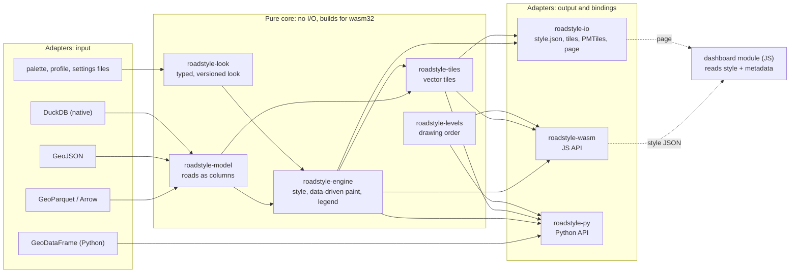
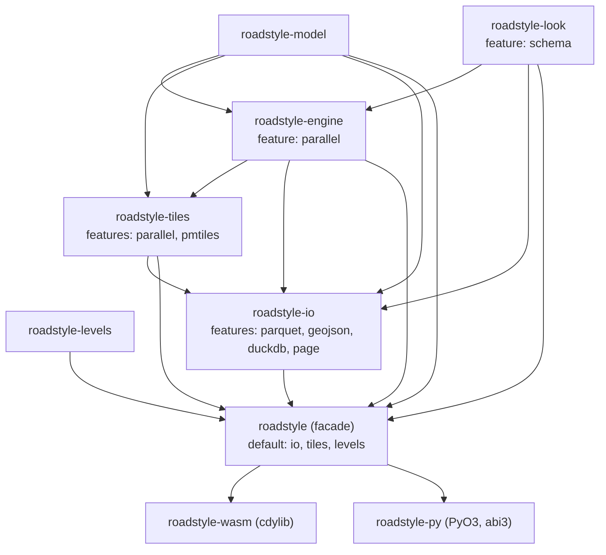
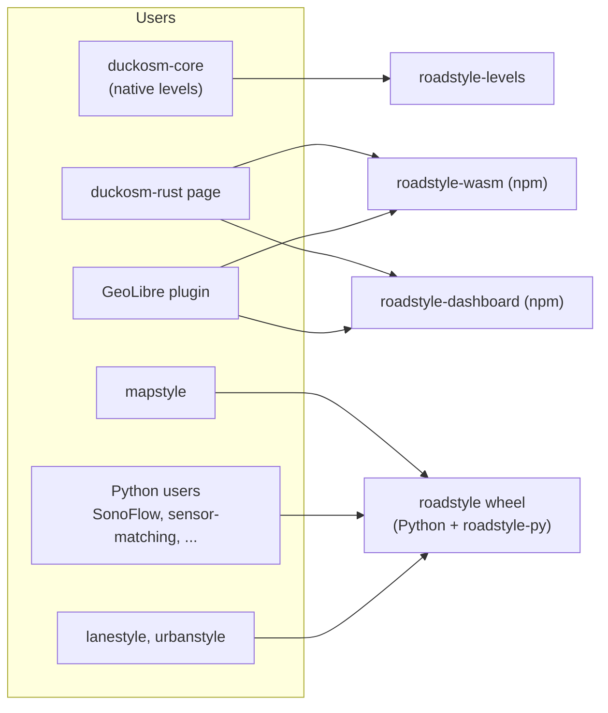
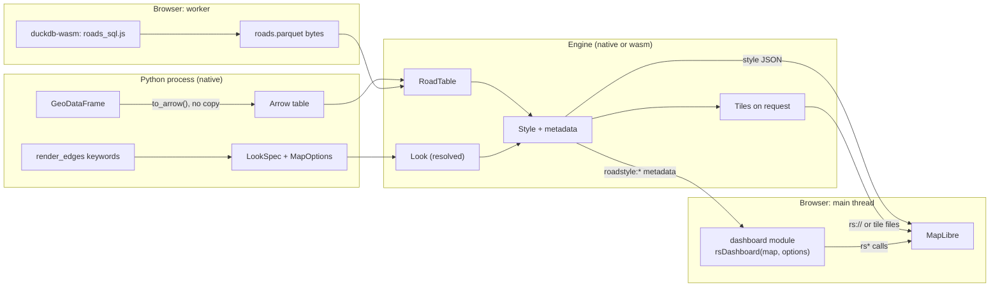
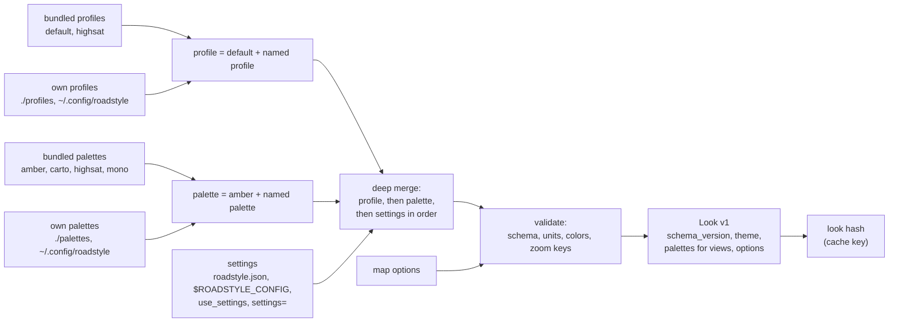
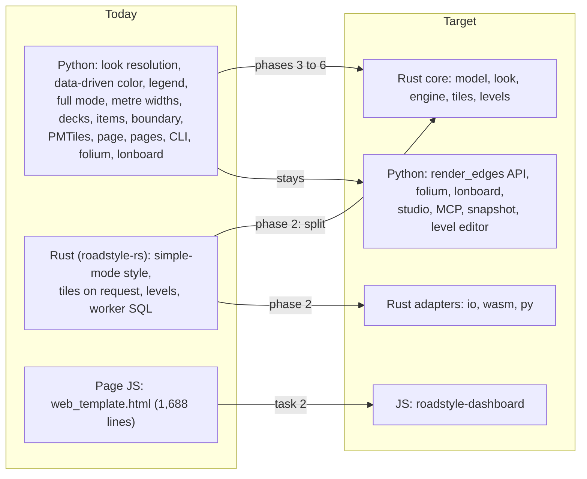
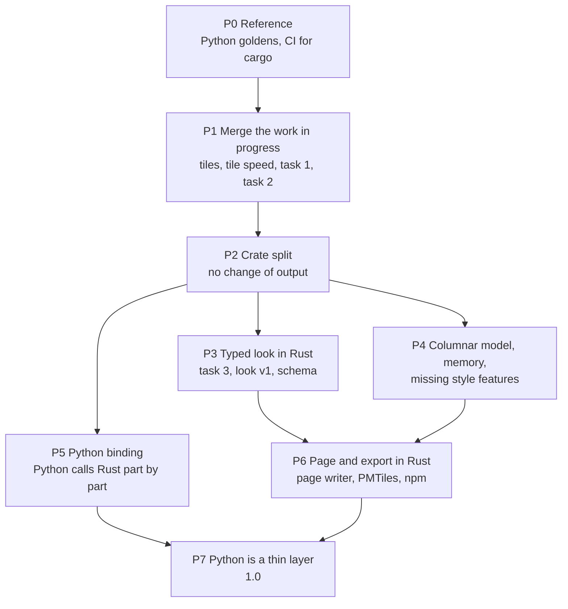

# roadstyle as a Rust library: the design and the migration plan

**Status:** proposal, 2026-10-23. Nothing in this document is built. It continues [One Rust engine for roadstyle](rust_engine.md)
(steps 1 and 3 are done) and uses [The style in a config file](style_config.md) and
[A general core: roads, items, and views](core_model_and_views.md). The decisions that are open are in
[Decisions that are open](#decisions-that-are-open).

## Summary

roadstyle has one reference implementation, in Python (version 0.24.3, about 11,000 lines of Python, a 1,688-line page template and
about 500 tests). A Rust crate, `roadstyle-rs` (5,582 lines), already makes the style and the vector tiles of the simple mode, and it
has the level solver. duckosm-rust's browser page and the GeoLibre plugin use it through WebAssembly. The rest of roadstyle is only in
Python.

This plan makes one Rust library with a pure core and adapters around the core. The core has three independent parts: the road
model, the look (the typed config) and the engine. The adapters read and write files and connect the core to Rust, JavaScript and
Python. The plan has seven phases. Python roadstyle stays the reference until the last phase: a change in the Rust output is
correct only when it is byte for byte equal to the output of Python.

## Contents

1. [What exists today](#what-exists-today)
2. [The architecture](#the-architecture)
3. [The crates](#the-crates)
4. [The data flow of one map](#the-data-flow-of-one-map)
5. [The config: the look](#the-config-the-look)
6. [The public API](#the-public-api)
7. [Efficiency](#efficiency)
8. [The migration plan](#the-migration-plan)
9. [The parity checklist](#the-parity-checklist)
10. [Quality](#quality)
11. [Decisions that are open](#decisions-that-are-open)
12. [Found during the inventory](#found-during-the-inventory)

## What exists today

### Python roadstyle (version 0.24.3)

Line counts from `wc -l` at commit `337cf37`.

| Part | Files | Lines | What it does | Heavy dependencies |
|---|---|---|---|---|
| Web renderer | `render_web.py` | 3,837 | `render(...)`, 76 parameters: bakes the `__rs_*` properties, builds the MapLibre style, fills the page template | geopandas, shapely |
| Page template | `static/web_template.html`, `popup.js`, `popup.css` | 1,688 + 30 | The page: controls, legend, popups, Street View, Google 3D, the 29 `window.rs*` functions and 13 `rs:*` events | MapLibre 5.24.0 (vendored) |
| Entry point | `render.py` | 184 | `render_edges(...)`, 21 parameters: data styler, filters, settings scope, dispatch to web, folium or lonboard | |
| Stylers | `stylers.py`, `style.py`, `colors.py`, `legend.py` | 482 + 99 + 120 + 110 | Data-driven color and width (`ClassStyler`, `CategoricalStyler`, `NumericStyler`, `ColorTableStyler`), color ramps, folium legends | branca, matplotlib, mapclassify |
| Config | `_settings.py`, `config.py`, `palettes.py`, `basemaps.py`, `data/` | 343 + 113 + 173 + 315 | Palettes (4) and profiles (2) in YAML, the merge of user files and `settings=`, base-map providers | pyyaml |
| Levels | `levels.py`, `level_area.py`, `levels_store.py`, `level_editor.py` | 816 + 320 + 197 + 506 | The drawing-order solver, the level-area folder workflow, DuckDB storage, the editor server | scipy (HiGHS), ortools, shapely |
| Export | `export.py`, `tiles.py`, `emit.py`, `fastjson.py` | 290 + 213 + 249 + 98 | `export_style` (style.json + XYZ or PMTiles), `export_inline`, `export_look`, the embedded PMTiles, the Leaflet spec | mapbox-vector-tile, pmtiles, duckdb |
| Pages | `pages.py`, `templates/*.html` | 114 + 615 | `render_dashboard`, `render_report`, `render_street_view`: sidebars on the `rs*` API | |
| Other backends | `render_folium.py`, `render_lonboard.py`, `controls.py`, `interactive.py` | 124 + 147 + 126 + 191 | folium and lonboard maps | folium, lonboard |
| Data model | `edges.py`, `validate.py`, `filters.py`, `overlays.py` | 370 + 62 + 54 + 115 | `RoadEdges`, readers (file, GeoJSON, Arrow, DuckDB), validation, filters, `Overlay` | geopandas |
| Tools | `cli.py`, `mcp_server.py`, `snapshot.py`, `studio/` | 223 + 194 + 106 + 533 | The `roadstyle` and `roadstyle-levels` programs, the MCP server, PNG screenshots, the Streamlit studio | playwright, streamlit, osmnx |

The tests: 26 files, about 500 test functions (213 in `tests/test_render_web.py`). They are behavior tests on dicts, HTML and JS.
There is no golden test against Rust in `tests/`.

### Rust today (`rust/`, commit `337cf37`)

| Crate | Module | Lines | Content |
|---|---|---|---|
| `roadstyle-rs` | `lib.rs` | 185 | `make_parts`, `make_style` (the style as one JSON text), `make_tiled` (the style and its tiles), `MAX_ROADS` = 200,000 |
| | `read`, `geom` | 113 + 220 | GeoParquet (WKB lines) to features, WKB, area and centroid |
| | `roads`, `simple`, `slots` | 378 + 317 + 466 | The `__rs_*` properties, the casing pieces, the names and the one-way arrows |
| | `features`, `overlays` | 111 + 258 | The base-map layers and `edge_attach` |
| | `layers` | 987 | The road layers and the expression builders (`Model::from_look`) |
| | `props` | 223 | The typed sources `roads` and `simple` (one copy of each key name) |
| | `tiles` | 593 | The vector tiles on request (MVT 2.1) |
| | `planner` | 146 | `metadata["roadstyle:planner"]` |
| | `levels/` | 1,484 | `compute`: the tags rule and the solver (least span first, then push-relabel min-cost flow) |
| | `main.rs` | 101 | The native program (timings) |
| `roadstyle-wasm` | `lib.rs` | 102 | `makeStyle`, `Tiler` (`style`, `tile`, `props`), `memoryBytes`, the allocator that grows in large steps |
| | `js/` | 148 | `roads_sql.js`, `features_sql.js`: the SQL that duckdb-wasm runs to write the inputs |

Facts that the plan must use:

- The engine reads one input file, `look.json` (63 KB). Python writes it (`tools/make_spike_fixture.py` of geolibre-roadstyle,
  mapstyle's `render_map(_export=...)`). It holds Python's internal tables: `settings`, `args`, `theme`, `config`, `styles`,
  `roads_model`, `slots`, `features`, `interaction`. It has no version and no schema.
- The scope of the engine is the simple mode with stored levels (`layers.rs:506`): no 3D decks, no metre widths, no items, no
  full mode (`simple=False`).
- Errors are `Result<_, String>` (about 25 places). There are no features, no threads and no benchmarks.
- The golden tests compare SHA-256 hashes with the output of geolibre-roadstyle's port (commit `0806ac2`, with building rule C).
  That port was compared with Python's output in geolibre-roadstyle (`spike/test_compare.py`). This repository has no golden
  test from Python yet. The branch `rust-colors` adds the first one (`tests/make_goldens.py`, not committed).
- No CI job runs `cargo`.

### Work in progress (the plan includes it and does not do it again)

| Work | Where | Content | State on 2026-10-23 |
|---|---|---|---|
| Task 1: data-driven color and width, the legend | main checkout, branch `rust-colors` (session roadstyle-rs) | `tests/colors.rs` against Python's `export_inline` for `color_by`, `colors`, `cmap`, `vmin`, `vmax`, `width_by`, `color_table`, `color_options`, `color_active`, `legend`; `cmaps.json` (the branca and matplotlib ramps) | not committed; no Rust module yet |
| Task 2: one shared dashboard JS module | branch `claude/dashboard-js-5ddf3e` (session roadstyle-dashboard-js) | 20 ES modules in `src/roadstyle/static/dashboard/`, entry `rsDashboard(map, options)`; the template loses 1,650 lines | not committed |
| Task 3: the look resolution in Rust | after task 1, same session | Rust makes the look from the palette, the profile and the settings | not started |
| Tiles follow `tiles.py` (step 2) | branch `rust-tiles`, `89d8bff` | One `roads` source with source layers, zooms 6 to 15, buffer 80, simplification below the last zoom | not merged |
| Tile speed | branch `rust-tile-speed`, `17f51c1` | The bytes of a value are made once | being merged; conflicts with `rust-tiles` in `tiles.rs` |

### The users

| User | Uses | How | Pinned at |
|---|---|---|---|
| duckosm-rust (`crates/duckosm-core`) | `roadstyle-rs::levels` only | Cargo git dependency | `900b43e` |
| duckosm-rust browser page | `roadstyle-wasm`: `Tiler`, `memoryBytes` | `build.sh` builds the module; `map_worker.js`; a copy of `look.json` and of the two SQL files | `900b43e` |
| GeoLibre plugin (geolibre-roadstyle) | `roadstyle-wasm`: `makeStyle` | `build.py` builds the module (branch `use-roadstyle-rs`); at build time it runs Python roadstyle and mapstyle to make 64 looks | `900b43e` |
| mapstyle | Python: `render_edges`, `render_report`, `Overlay`, `export_style`, `export_inline`, `load_area_levels`, `palette_to_dict` | Python import | `roadstyle>=0.24.2` |
| Python users (16 projects) | `render_edges` (75 calls), `Overlay` (82 calls), `render_street_view` (1), `render_dashboard` (1) | Python import; 45 calls use `backend="web"`, 4 use folium, 1 lonboard | various |
| Page scripts of users | `rsColor`, `rsHighlight`, `rsFocus`, `rsSelect`, `rsSetColorField`, `rsSetOverlay`, `rs:select` | JS in the page | |

About 27 of the keywords carry most of the use: `backend`, `name`, `tooltip`, `basemap`, `palette`, `basemaps`, `boundary`,
`arrows`, `overlays`, `filter_control`, `color_options`, `road_popup`, `color_by`, `cmap`, `vmin`, `vmax`, `legend`, `colors`,
`color_active`, `road_tooltip`, `street_view`, `street_view_key`, `google_3d`, `color_table`, `labels`, `hover_color`, `select_color`.

## The architecture

### The choice: a pure core with adapters around it

The core has no I/O. It has three parts, and two of them are independent inputs of the third:

- **The road model** (`roadstyle-model`): the roads as columns, their geometry, the column map, the validation.
- **The look** (`roadstyle-look`): the typed, versioned config: palettes, profiles, settings and the map options that change the style.
- **The engine** (`roadstyle-engine`, `roadstyle-tiles`, `roadstyle-levels`): pure functions from (roads, look) to the style,
  the tiles and the levels.

The adapters are around the core. Each one connects the core to one thing outside:

- **Readers and writers** (`roadstyle-io`): GeoParquet, Arrow, GeoJSON, DuckDB, the style file, the tile folder, PMTiles, the HTML page.
- **Bindings**: WebAssembly and JavaScript (`roadstyle-wasm`), Python (`roadstyle-py`).
- **The dashboard module** (JavaScript): a separate front-end package. It reads only the style and its `roadstyle:*` metadata. It
  does not call the engine.



*The core in the middle has no arrow to a file, a database or a browser. The model and the look do not point at each other.*

### Rules of the layers

1. A dependency points into the core, never out of it. `roadstyle-engine` does not know Parquet, Python or JavaScript.
2. `roadstyle-model` and `roadstyle-look` do not depend on each other. Data-driven color needs both the values of a column and
   the look, so it is a function of the engine, not of the look.
3. The core builds for `wasm32-unknown-unknown` with no features. A CI job checks this (see [Quality](#quality)).
4. The engine is single-thread by default. The feature `parallel` adds rayon for the native build.
5. The page options (popups, Street View, controls) do not go into the engine. The engine copies the few that the style must
   carry into its metadata (`roadstyle:interaction`). The other options go to the dashboard module.
6. One copy of each rule. The worker SQL, the palettes and the profiles each have one file, and each user takes them from one
   commit of this repository.

### The alternatives that I did not choose

| Alternative | Why not |
|---|---|
| A strict stack: data, then config, then engine, then interface (each layer uses only the layer under it) | The config does not need the data, and the data does not need the config. A stack makes one depend on the other with no reason. It also puts the readers (Parquet, DuckDB) under the engine, so the WebAssembly build carries them. |
| One crate with modules and feature flags (today's `roadstyle-rs`) | It works for one user. With three users it has costs: duckosm-core takes Parquet and Arrow to get only the level solver; a change in one module rebuilds all; the public API is every `pub` item. The crate split is cheap now (5,600 lines) and expensive later. |
| Many small crates (one per module: `slots`, `simple`, `overlays`, ...) | These modules change together for one style change. More crates give more version bumps and more `Cargo.toml` files, and no user needs them alone. |
| The engine builds the page (HTML) | The page is interaction, not style. Three pages exist (the Python page, the duckosm-rust page, the GeoLibre plugin) and each has its own frame. The dashboard module serves all three. The page writer is a small adapter in `roadstyle-io`. |
| Keep `look.json` as Python's internal tables | Each Python refactor can break the Rust users, and no test shows it. A typed, versioned look with a schema stops this. |
| A full rewrite of Python roadstyle in Rust at once | No reference during the work, and 16 Python projects wait. Part by part, with Python as the reference, each part can ship alone. |

### What stays in Python

| Stays in Python | Why |
|---|---|
| The folium and lonboard backends (`render_folium.py`, `render_lonboard.py`, `controls.py`, `interactive.py`, `legend.py`) | They are Python objects for notebooks. They can take the resolved colors and widths from Rust (one call for each distinct class key, see `vectorize_style_resolution.md`). |
| The GeoDataFrame front-end: `render_edges` and its keywords, `RoadEdges`, `Overlay` | The Python API does not change. It converts the GeoDataFrame to Arrow and calls Rust. |
| `WebMap` (`.html`, `.save`, `_repr_html_`), `snapshot`, the Streamlit studio, the MCP server, the notebook helpers | They are tools around a page. They need Python, a browser or the network. |
| The level editor server (`level_editor.py`) and the folder workflow (`level_area.py`) | They are a local tool with an HTTP server and files. They call the Rust solver when it is at parity. |
| `emit.py` (the Leaflet spec and `roadstyle.js`) | It is the old Leaflet output. It stays as it is, or it is removed in a later major version. |

## The crates



*Each arrow is a Cargo dependency. `roadstyle-levels` has no dependency on the other crates, so duckosm-core can take it alone.*

| Crate | Content (from today's modules) | Dependencies | Builds for wasm32 |
|---|---|---|---|
| `roadstyle-model` | `RoadTable` (columns over Arrow arrays), `Geometry` (one coordinate buffer with offsets), `ColumnMap`, `Source` and `Props` (from `props`), validation, `MAX_ROADS` | arrow-array, arrow-schema | yes |
| `roadstyle-look` | `Look` (the typed config), the bundled palettes and profiles, the resolution, the JSON schema (feature `schema`) | serde, serde_json, schemars (optional) | yes |
| `roadstyle-levels` | `levels/` as it is today: `LevelEdges`, `compute`, `Method`, `Row` | rstar, sha2 | yes |
| `roadstyle-engine` | `roads`, `simple`, `slots`, `layers`, `overlays`, `features`, `planner`, `geom`, data-driven color and width, the legend, the simplification | model, look, serde_json, rstar, indexmap; rayon (optional) | yes |
| `roadstyle-tiles` | `tiles`: the MVT encoder, the tile index, tiles on request, a tile cache; the PMTiles writer (feature `pmtiles`) | model, engine; rayon (optional) | yes |
| `roadstyle-io` | `read` (GeoParquet), GeoJSON, DuckDB (feature `duckdb`, native only), the style writer (streamed), the tile folder, PMTiles, the page writer (feature `page`, with the dashboard bundle) | parquet (snap), duckdb (optional) | yes, without `duckdb` |
| `roadstyle` | The facade: re-exports and the `Map` builder. The only crate that a Rust user adds. | all above | yes |
| `roadstyle-wasm` | The JS API (`makeStyle`, `Tiler`, `resolveLook`, `memoryBytes`), the allocator | roadstyle (features `io/parquet`, `tiles`) | only |
| `roadstyle-py` | The Python module `roadstyle._engine` | roadstyle, pyo3, arrow (pyarrow interface) | no |

The JavaScript packages:

| Package | Content | Source |
|---|---|---|
| `roadstyle-wasm` (npm) | The WebAssembly module, the wasm-bindgen glue, `roads_sql.js`, `features_sql.js`, the TypeScript types | `rust/roadstyle-wasm/` |
| `roadstyle-dashboard` (npm) | The ES modules of task 2, `dashboard.css`, `popup.css` | `src/roadstyle/static/dashboard/` |

The CLI: the native program `main.rs` becomes a benchmark tool (`rust/roadstyle/examples/bench.rs`). The user CLI stays the
Python `roadstyle` program, which calls Rust. A Rust CLI with the same flags is a later step, when a user without Python asks for it.

### Which user takes which crate



*The browser users take the npm packages. The Python users take one wheel and see no Rust.*

### Feature flags

| Flag | Crate | Effect | Default |
|---|---|---|---|
| `parallel` | engine, tiles | rayon: sources and tiles on all cores | off |
| `pmtiles` | tiles | The PMTiles archive writer | off in the crate, on in the facade |
| `parquet` | io | GeoParquet and Parquet reader (snap; zstd with `zstd`) | on |
| `geojson` | io | GeoJSON reader | on |
| `duckdb` | io | DuckDB reader for `<mode>.edges` and `visualization.edge_levels` (native only) | off |
| `page` | io | The HTML page writer with the dashboard bundle | off |
| `schema` | look | `Look::json_schema()` | off |

### Errors

Each crate has one error enum (`thiserror`), `#[non_exhaustive]`. The facade has `roadstyle::Error`, which holds each of them.
Each error says what is wrong, where (a column, a key path, a feature id) and what to do.

| Error | Examples |
|---|---|
| `DataError` | missing column `highway`; column `layer` has type `List`, expected integer or text; feature 812 has no line; 230,114 roads, the limit is 200,000 |
| `LookError` | `roads.width.major`: expected a map of zoom to px, found a number; unknown palette `ambr` (the names are `amber`, `carto`, `highsat`, `mono`); look version 3, this engine reads 1 and 2 |
| `EngineError` | a view names palette `x` that the look does not have |
| `TileError` | zoom 23 is past the last zoom 16 |
| `IoError` | Parquet file is not readable; the DuckDB file has no `visualization.edge_levels` (give the `rs.save_levels` command) |

In JavaScript, an error is a thrown `Error` with `name` = the kind (`LookError`) and a `path` property. In Python, each error is a
subclass of `ValueError` (`roadstyle.LookError(ValueError)`), so `except ValueError` in user code still works.

## The data flow of one map



*The engine is the same code in both places. In the browser it runs in a worker, and the main thread only draws.*

The steps:

1. **Input.** Python gives an Arrow table (no copy from pyarrow). The browser gives the Parquet bytes that duckdb-wasm writes.
2. **Model.** The reader maps the columns (`ColumnMap`: `highway_col`, `edge_id_col`, `tunnel_col`, ...), checks them and makes a
   `RoadTable`.
3. **Look.** `Look::resolve` merges the palette, the profile and the settings, and adds the map options that change the style.
4. **Style.** The engine makes the layers, the sources and the metadata.
5. **Output.** Inline (the sources in the style, `export_inline`), tiled (`Tiler`, tiles on request), or files (`export_style`,
   the page).
6. **Page.** MapLibre draws the style. The dashboard module reads the metadata and adds the controls.

## The config: the look

### One name for each thing

| Name | Meaning |
|---|---|
| **palette** | Only colors (`data/palettes/<name>.yaml`) |
| **profile** | All values that are not colors: widths by zoom, zoom ranges, dashes, caps, the tunnel look (`data/profiles/<name>.yaml`) |
| **settings** | Overrides from `roadstyle.json`, `$ROADSTYLE_CONFIG`, `use_settings(...)`, `render_edges(settings=...)` |
| **map options** | The keywords of one map that change the style (`arrows`, `labels`, `view_3d`, `boundary`, the column names, ...) |
| **page options** | The keywords of one map that change only the page (`road_popup`, `street_view`, `filter_control`, ...) |
| **look** | The result of the resolution: one typed, versioned value that the engine reads |

### The resolution



*The defaults are the bundled `default` profile and `amber` palette. A user file states only what it changes.*

The rules:

1. The merge is the merge of `_settings.py` today: the named profile over `default`, the named palette over `amber`, the palette over
   the profile, then each settings source in order (lowest first: `~/.config/roadstyle/roadstyle.json`, `./roadstyle.json`,
   `$ROADSTYLE_CONFIG`, `use_settings`, `settings=`). The old keys (`_OLD_*` tables) are read with a deprecation warning, as today.
2. Validation after the merge. An unknown key is an error with its path and the nearest known key. Today an unknown key is
   ignored without a message.
3. The file reading is an adapter. The core resolves from values (JSON text or Rust structs). The browser gives the files that it
   has. The bundled palettes and profiles are in the crate (made from the YAML files when the crate builds).
4. The look has `schema_version` (an integer, starts at 1). The engine reads version N and N-1. A change that removes or renames
   a key increments the version.
5. The JSON schema of the look is published with each release (`look.schema.json`). An editor can check a user file with it.
6. One copy of the bundled files: `src/roadstyle/data/` until phase 5. Then the files move into `rust/roadstyle-look/data/`, and
   Python reads the bundled values from the engine.

### The typed look

```rust
pub struct Look {
    pub schema_version: u32,
    pub profile: String,                 // the names, for the page and the cache
    pub palette: String,
    pub roads: RoadLook,                 // classes (group, order, minzoom, width, casing, dash), widths by zoom, split, links, caps
    pub casing: CasingLook,
    pub labels: LabelLook,
    pub arrows: ArrowLook,
    pub bridges: BridgeLook,
    pub tunnels: TunnelLook,
    pub selection: SelectionLook,
    pub data: DataLook,                  // no-data color, opacities of data maps
    pub overlays: OverlayLook,
    pub boundary: BoundaryLook,
    pub background: Background,
    pub access: AccessColors,
    pub palettes: IndexMap<String, PaletteColors>, // the palettes that views name (`__rs_fill@mono`)
    pub tiles: TileLook,                 // zooms 6 to 15, extent 4096, buffer 80 (defaults.json)
    pub camera: CameraLook,              // pitch_3d 55, max_pitch 70
    pub options: StyleOptions,           // the map options: columns, arrows, labels, view_3d, boundary, head_m, ...
}
```

Each struct derives `Serialize`, `Deserialize`, `Default` (the bundled values) and `JsonSchema` (feature `schema`), and has
`#[serde(deny_unknown_fields)]`. A color is a `Color` type (it parses `#rrggbb`, `#rrggbbaa`, `rgba(...)`), not a text. A zoom
table is `ZoomTable` (sorted zoom keys).

## The public API

### Rust

```rust
use roadstyle::{io, Look, LookSpec, Map, MapOptions};

let look = Look::resolve(&LookSpec::new("default", "amber"))?;          // the bundled profile and palette
let roads = io::parquet::read_roads(&bytes, &io::ColumnMap::default())?; // RoadTable
let map = Map::new(&roads, &look, MapOptions { arrows: true, labels: true, ..Default::default() })?;

let style: String = map.style_json()?;              // export_inline: the sources in the style
let tiled = map.tiled("rs://roads/")?;              // the style with vector sources, and the tiles
let bytes: Vec<u8> = tiled.tile("roads", 14, 8800, 4700);
io::write_style_dir(&map, "out/", io::TileFormat::Pmtiles)?;  // export_style
```

The level solver alone (duckosm-core):

```rust
use roadstyle_levels::{LevelEdges, Method, compute};
let mut edges = LevelEdges::default();
edges.add(0, edge);                                 // rank 0 = driving
let levels = compute(&edges, Method::Solve)?;
```

### JavaScript

The JS API of today stays the same through phase 3, so the two users do not break. The new form takes one options object:

```js
import init, { Tiler, resolveLook, memoryBytes } from "roadstyle-wasm";
await init();
const look = resolveLook({ profile: "default", palette: "amber", settings: {} });  // JSON text
const tiler = new Tiler(roadsParquet, look, { features, name: "Tartu", prefix: "rs://1/", keep: ["name"] });
const style = JSON.parse(tiler.style());
// in the main thread
import { rsDashboard } from "roadstyle-dashboard";
const map = new maplibregl.Map({ container: "map", style });
rsDashboard(map, { style, street_view: "window" });
```

### Python

The API does not change. `render_edges(gdf, ...)` keeps its 21 keywords, the web keywords and the result type `WebMap`. Inside, it
calls `roadstyle._engine` for each part that is at parity (see the phases).

### Stability rules

| Item | Rule |
|---|---|
| Version numbers | One version for all crates, the wheel and the npm packages (lockstep), the same as Python roadstyle. A release has one tag. |
| Before 1.0 | A minor version (0.x to 0.y) can break the API. A patch version cannot. The CHANGELOG lists each break and what to change. |
| Public API | The `roadstyle` facade, the JS API of `roadstyle-wasm`, `rsDashboard` and the `rs*` functions, the Python API, the look schema, the `roadstyle:*` metadata keys. The inner crates are published, but their API follows the facade and can change in a minor version. |
| The look schema | `schema_version` is separate. The engine reads N and N-1. |
| The output | A change of the style or of the tiles is a change of behavior: a new golden, a CHANGELOG line, and the same change in Python first while Python is the reference. |
| Deprecation | A removed keyword or JS function gives a warning for one minor version, then an error. |
| Rust version (MSRV) | The Rust version of duckosm-rust's toolchain, written in `rust-toolchain.toml` and in CI. |

## Efficiency

### Numbers today (native release build, peak resident memory from `/usr/bin/time`)

| Area | Roads | Output | Memory | Time | Source |
|---|---|---|---|---|---|
| Monaco | 13,298 | style | 196 MB | 0.7 s | `rust_engine.md` |
| Tartu | 63,965 | style | 1.13 GB | 5.1 s | `rust_engine.md` |
| Tartu | 63,965 | tiles (`make_tiled`) | 1.01 GB | | `rust_engine.md` |
| Tartu | | tiles: the last zoom, after step 2 | 18.8 MB, 313 tiles | | branch `rust-tiles` |
| Burnaby | 157,808 | style | | 6.2 s | the session brief (not in a file of the repository) |
| Burnaby | 157,808 | tiles of one 3 x 3 view, zoom 12 | | 0.8 s (slowest tile 0.17 s) | branch `rust-tile-speed` |
| Burnaby | 79,199 | levels (solve) | | 3.1 s native, 5.2 s wasm | duckosm-rust `docs/levels.md` |

Tartu uses about 17 KB for each road natively. The browser module used 0.65 to 0.77 times the native peak in earlier
measurements. `MAX_ROADS` = 200,000 is an estimate from Tartu only.

### Targets

| Measure | Today | Target | How |
|---|---|---|---|
| Memory for each road, tiled path | about 16 KB (Tartu tiles) | 4 KB or less | the columnar model, dictionary text, no GeoJSON tree on the tiled path |
| Stockholm county (456,813 driving edges) in a browser tab | not possible (over `MAX_ROADS`) | the first view in less than 10 s, peak less than 2.5 GB | the same, then measure and raise `MAX_ROADS` |
| Tartu style, native | 5.1 s | 2 s | the columnar model; `parallel` for the sources |
| One tile on request | 0.17 s (slowest, Burnaby) | 50 ms | the tile cache, the bytes of a value made once (`rust-tile-speed`) |
| WebAssembly against native | 1.7 times (levels) | 2 times or less in every stage | the same code; measure each stage |
| Python `render_edges` on 50,000 edges, lonboard | 2.0 s for the style (`vectorize_style_resolution.md`) | 0.2 s | one Rust resolution for each distinct class key |

### How

1. **Columns, not features.** `RoadTable` keeps each property as one Arrow array, not a map per road. Text columns are dictionary
   arrays: one copy of each class name, color and road name. This is the open item of step 3 ("each text value is its own string").
2. **Geometry in one buffer.** All coordinates are in one `Vec<[f64; 2]>` with an offset for each road (the GeoArrow layout). The
   coordinates stay `f64`, for parity with Python.
3. **No copy from Python.** pyarrow gives the table through the Arrow C data interface (`arrow::pyarrow`). geopandas `to_arrow()`
   gives WKB, and the reader decodes it once.
4. **In the browser, one copy.** The Parquet bytes go from duckdb-wasm into the module once. The worker keeps the tables, and the
   main thread gets only the style and the tiles.
5. **The tiled path makes no GeoJSON.** The tile index reads the columns. Only `export_inline` writes GeoJSON, and it streams it
   source by source (as `make_style` does today).
6. **Typed metadata and slots.** The base map, the slots and the layer list stop being `serde_json::Value` trees. The layer list
   stays JSON at the edge, when it is written.
7. **Caches.** The resolved look is cached by its hash. The tiles are cached by (source, z, x, y) with a byte limit (LRU). No
   other cache before a measurement asks for it.
8. **Threads.** Native only, feature `parallel`: the sources in parallel, the tiles in parallel. The solver stays single-thread
   (its stages depend on each other).
9. **The browser limits.** A wasm32 module has at most 4 GB of memory, and a tab can get less. The module must stay under
   `MAX_ROADS`, and the error says to use a smaller area or the tiled path. The allocator grows the memory in large steps (16 to
   256 MB), because each small step is slow in Edge on Windows.

## The migration plan

### Today and the target



*Everything that makes a style or a tile moves to Rust. Python keeps its API and its notebook tools.*

### The phases



*After the crate split (P2), P3, P4 and P5 run at the same time in different crates.*

#### P0: the reference

- **Content.** Commit `tests/make_goldens.py` (from `rust-colors`) as the one generator. It writes, from Python, the goldens for
  Monaco, Tartu and the Södermalm sample: `export_inline` (the style), `export_style` (style.json and the tiles), `compute_levels`
  (tags and solve) and the look. The golden files are gzipped. The large ones go to the GitHub pre-release `rust-test-data`, and the
  repository keeps their SHA-256. A CI job runs `cargo test --offline`, `cargo clippy` and the wasm32 build.
- **Golden test.** The Rust output today against the Python goldens. Each difference is in a list, with a cause and a decision.
- **Benchmark.** `bench` (from `main.rs`) for Monaco and Tartu: time and peak memory of each stage, in a table in this file.
- **First user.** The roadstyle-rs session.
- **Exit.** CI is green. The list of differences from Python is empty, or each item has a decision.
- **Risk.** glibc's `cos` and `hypot` differ between machines (see `tests/test_render_web.py:1898`). Mitigation: the goldens come from
  one machine type (Linux x86_64), and the Rust code rounds where Python rounds (`py_round`).

#### P1: merge the work in progress

- **Content.** `rust-tile-speed`, then `rust-tiles` (they conflict in `tiles.rs`), task 1 (`rust-colors`), task 2 (the dashboard
  module). duckosm-rust and geolibre-roadstyle pin the new commit and delete their copies of `look.json` and of the SQL.
- **Golden test.** The tiles against Python's `tiles.py` output (from P0). Task 1 against `export_inline` with each data keyword.
  Task 2: the 24 screenshots of `style_config.md` are the same.
- **Exit.** One branch `rust-engine` with all four. The two Rust users build from it.
- **Risk.** Three branches edit `rust/roadstyle-rs/src`. Merge one at a time, in the order above.

#### P2: the crate split

- **Content.** A move of files, with no change of behavior: the crates of [The crates](#the-crates). `Result<_, String>` becomes the
  error enums. `main.rs` becomes `examples/bench.rs`.
- **Golden test.** The same hashes as before the move.
- **Benchmark.** The wasm module size before and after (no growth of more than 2 %).
- **Exit.** `cargo build --target wasm32-unknown-unknown -p roadstyle --no-default-features` passes. duckosm-core depends on
  `roadstyle-levels` only.
- **Risk.** It touches every file in `rust/`. It must run when no other branch edits `rust/`: a freeze of one day, after P1.

#### P3: the typed look in Rust (task 3)

- **Content.** `roadstyle-look`: the structs, the bundled files, `Look::resolve`, the schema. A reader of today's `look.json`
  (version 0), so the users can move one at a time. `resolveLook` in `roadstyle-wasm`. The `palette` view row
  (`_merge_palettes`) in Rust.
- **Golden test.** For 4 palettes x 2 profiles x the settings fixtures of `tests/test_settings_overrides.py`, the look from Rust is
  equal to the look from Python. The style from the Rust look is equal to the style from the Python look.
- **First user.** The GeoLibre plugin: `build.py` stops running Python and mapstyle to make the 64 looks.
- **Exit.** No user reads Python's internal tables (`render_web.CONFIG`, `ROAD_Z`, `_settings.theme()`) to make a look.
- **Risk.** mapstyle changes the settings by mode (`mode_settings`). Its looks go into the golden set.

#### P4: the columnar model, memory, and the missing style features

- **Content.** `RoadTable` over Arrow, dictionary text, typed slots and base map, the column map (`highway_col`, `edge_id_col`,
  `tunnel_col`, `bridge_col`, `layer_col`, `cap_col`). Then the style features that only Python has: metre widths (`width_m_col`,
  `width_m_zoom`, `casing_m`, `casing_min_px`), 3D bridge decks (`view_3d`), `boundary`, `access_col` colors, `items`,
  `Overlay` from user data, `include` and `exclude`, levels computed when no level columns are given.
- **Golden test.** The hashes do not change for the model work. Each new feature gets its golden from Python.
- **Benchmark.** The targets of [Efficiency](#efficiency). Measure Stockholm county in Chrome and Edge, then set `MAX_ROADS`.
- **First user.** duckosm-rust's page (larger areas).
- **Risk.** The model work and the feature work both edit `roadstyle-engine`. The model API comes first, in one small change.

#### P5: the Python binding

- **Content.** `roadstyle-py` (PyO3, maturin, abi3 wheels for Linux x86_64 and aarch64, macOS, Windows). Python calls Rust part by
  part, in this order: the style of `export_inline`, the tiles (`tiles.py`), the levels (`compute_levels`), the look
  (`_settings.theme()`), the data stylers. An explicit switch `engine="python"` or `engine="rust"` (also `ROADSTYLE_ENGINE`) selects the
  engine. A part that Rust does not have gives an error with `engine="rust"`. It does not change to Python without a message.
- **Golden test.** The full pytest suite runs two times, one time with each engine. A new test, `tests/test_engine_parity.py`,
  compares the two outputs byte for byte for each fixture and each keyword in the parity checklist.
- **Benchmark.** `render_edges` on 5,000, 50,000 and 456,813 edges, with each engine.
- **First user.** SonoFlow (nightly pages).
- **Risk.** Wheels for each platform make the release longer. maturin's GitHub action builds them.

#### P6: the page and the export in Rust

- **Content.** The page writer in `roadstyle-io` (feature `page`): the HTML frame, the dashboard bundle, the style, the page options,
  the gzip of the sources (`compress`), the host panel. `export_style` (style.json, XYZ tiles, PMTiles, sprite). The three page
  sidebars (`dashboard.html`, `report.html`, `street_view.html`) as static files. The npm packages.
- **Golden test.** The page from Rust is equal to the page from Python, for the reference pages of `docs/build_maps.py`.
- **First user.** mapstyle (`export_style`, `render_report`).
- **Exit.** `render_web.render` only converts its keywords and calls Rust.

#### P7: Python is a thin layer

- **Content.** Remove the Python code of each part that is at parity for one minor version with no difference. scipy, ortools,
  mapbox-vector-tile and pmtiles leave the dependencies. Version 1.0.
- **Exit.** Python roadstyle has the API, folium, lonboard and the tools. The Rust goldens become the reference.

### Parallel work without two sessions in one file

| Lane | Phase | Owns these files | Waits for |
|---|---|---|---|
| A: reference and CI | P0 | `tests/make_goldens.py`, `rust/*/tests/`, `.github/workflows/rust.yml` | |
| B: work in progress | P1 | the branches of each task, as today | A for the goldens |
| C: the look | P3 | `rust/roadstyle-look/`, `rust/roadstyle-wasm/src/look.rs` | P2 |
| D: model and memory | P4 | `rust/roadstyle-model/`, `rust/roadstyle-io/` | P2 |
| E: style features | P4 | `rust/roadstyle-engine/` | D for the model API |
| F: Python binding | P5 | `rust/roadstyle-py/`, `src/roadstyle/_engine.py`, `tests/test_engine_parity.py` | P2 |
| G: page and export | P6 | `rust/roadstyle-io/src/page.rs`, `rust/roadstyle-tiles/src/pmtiles.rs`, `src/roadstyle/static/dashboard/` | task 2, C |

Rules:

1. One session for each lane. A lane edits only its own files.
2. A change of the API of another crate is a small change of its own, reviewed first, and the other lane rebases on it.
3. Each lane works on a branch from `origin/main` (or from `rust-engine` until P1 is merged), and checks
   `git log origin/main..<branch>` before a push.
4. Nothing goes to `main`, PyPI, crates.io or npm before a person tries the pages and gives an OK.

## The parity checklist

States: **done** (Rust makes the same output today), **look** (Rust reads the value from `look.json`, which Python makes;
the resolution moves in P3), **task 1**, **task 2**, **task 3** (in progress), **P*n*** (planned in phase *n*), **check** (not known:
the P0 golden run decides), **Python** (stays in Python), **internal** (not ported).

### `render_web.render`: 76 parameters

| # | Parameter | State | Note |
|---|---|---|---|
| 1 | `gdf` | done for GeoParquet; P5 for a GeoDataFrame | |
| 2 | `palette` | look; task 3 | |
| 3 | `highway_col` | P4 | Rust reads the column `highway` |
| 4 | `filter_col` | done | |
| 5 | `styler` | P5 | a Python object; the binding converts it |
| 6 | `basemap` | task 2 | the page |
| 7 | `basemaps` | task 2 | |
| 8 | `name` | done | |
| 9 | `offset_frac` | look | |
| 10 | `width_frac` | look | |
| 11 | `offset_zoom` | look | |
| 12 | `tunnel_col` | P4 | Rust reads `tunnel` |
| 13 | `bridge_col` | P4 | Rust reads `bridge` |
| 14 | `layer_col` | P4 | Rust reads `layer` |
| 15 | `edge_id_col` | P4 | |
| 16 | `road_fill` | done | state `rs_fill_on` |
| 17 | `cap_col` | P4 | |
| 18 | `cap_start_col` | done | |
| 19 | `cap_end_col` | done | |
| 20 | `casing_level_col` | done | with stored levels; without them, P4 (the solver is in Rust) |
| 21 | `fill_level_col` | done | as 20 |
| 22 | `casing_start_col` | done | |
| 23 | `casing_end_col` | done | |
| 24 | `head_m` | done | |
| 25 | `head_start_m_col` | done | |
| 26 | `head_end_m_col` | done | |
| 27 | `directed_col` | done | |
| 28 | `driving_col` | done | |
| 29 | `width_m_col` | P4 | no metre widths in Rust |
| 30 | `width_m_zoom` | P4 | |
| 31 | `casing_m` | P4 | |
| 32 | `casing_min_px` | P4 | |
| 33 | `pitch` | task 2; P6 | |
| 34 | `bearing` | task 2; P6 | |
| 35 | `max_pitch` | task 2; P6 | |
| 36 | `view_3d` | P4 | no bridge decks in Rust (building extrusion is done) |
| 37 | `arrows` | done | |
| 38 | `labels` | done | |
| 39 | `filter_control` | task 2 | |
| 40 | `find_control` | task 2 | |
| 41 | `overlay_control` | task 2 | |
| 42 | `overlay_popup` | task 2 | |
| 43 | `access_col` | P4 (colors); task 2 (rows) | |
| 44 | `side_panel_html` | P6 | the page writer |
| 45 | `host_panel_width` | P6 | |
| 46 | `basemap_switcher` | task 2 | |
| 47 | `zoom_readout` | task 2 | |
| 48 | `road_popup` | done (metadata); task 2 | |
| 49 | `road_tooltip` | done (metadata) | |
| 50 | `hover_delay_ms` | done (metadata) | |
| 51 | `data_maxzoom` | check | |
| 52 | `data_tolerance` | check | |
| 53 | `popup_mode` | task 2 | |
| 54 | `street_view` | task 2 | |
| 55 | `street_view_key` | task 2 | |
| 56 | `google_3d` | task 2 | |
| 57 | `tooltip` | done | the alias of `road_tooltip` |
| 58 | `hover_color` | look | `__HOVER_COLOR__` is replaced, but the template has no such placeholder |
| 59 | `select_color` | look | |
| 60 | `boundary` | P4 | |
| 61 | `color_options` | task 1 | |
| 62 | `color_active` | task 1 | |
| 63 | `views` | P3 (palette rows); task 2 (menu) | |
| 64 | `overlays` | done for base-map overlays and `edge_attach`; P4 for `Overlay` from user data | |
| 65 | `items` | P4 | |
| 66 | `items_popup` | P4; task 2 | |
| 67 | `compress` | P6 | |
| 68 | `tunnel_control` | task 2 | |
| 69 | `tiles` | done (tiles on request); P6 (PMTiles in the page) | |
| 70 | `simple` | done for `True`; see decision 2 for `False` | |
| 71 | `minzoom` | check | |
| 72 | `legend` | task 1 | |
| 73 | `api_key` | P6 | the base-map URL |
| 74 | `_edges` | Python | the level editor's update in place |
| 75 | `_palette_copy` | internal | replaced by the Rust palette merge (P3) |
| 76 | `_export` | internal | the Rust export is the API |

### `render_edges`: 21 parameters

| # | Parameter | State | Note |
|---|---|---|---|
| 1 | `gdf` | P5 | |
| 2 | `backend` | Python | `"web"` calls Rust; `"folium"` and `"lonboard"` stay |
| 3 | `palette` | task 3 | |
| 4 | `highway_col` | P4 | |
| 5 | `include` | P4 | |
| 6 | `exclude` | P4 | |
| 7 | `match_links` | P4 | |
| 8 | `style` | P5 | |
| 9 | `color_by` | task 1 | |
| 10 | `colors` | task 1 | |
| 11 | `cmap` | task 1 | `cmaps.json`: branca and matplotlib ramps at 9 stops |
| 12 | `vmin` | task 1 | |
| 13 | `vmax` | task 1 | |
| 14 | `width_by` | task 1 | |
| 15 | `color_table` | task 1 | |
| 16 | `color_key` | task 1 | |
| 17 | `color_col` | task 1 | |
| 18 | `settings` | task 3 | |
| 19 | `profile` | task 3 | |
| 20 | `api_key` | P6 | |
| 21 | `levels_db` | P5 | the DuckDB reader (feature `duckdb`) |

### The pages, the export, the CLI and the other API

| Item | State | Note |
|---|---|---|
| `render_dashboard`, `render_report`, `render_street_view`, `sidebar_html` | P6 | the sidebars are static files on the `rs*` API |
| `export_inline` | done | `make_style` |
| `export_style` (XYZ, PMTiles, sprite, popup files) | P6 | |
| `export_look` | P3 | |
| `compute_levels(method="tags")` | done | equal rows to duckosm-rust; P5 connects it to Python |
| `compute_levels(method="solve")`, `level_input`, `solve_levels` | done for the default call; check for `edits`, `fixed`, `max_positions` | Tartu: 64,828 of 64,828 rows equal to roadstyle (duckosm-rust `tools/compare_levels.py`) |
| `auto_ends`, `casing_parts` | check | |
| `save_levels`, `load_levels`, `stored_levels`, area levels | Python; P5 for the DuckDB reader | |
| `level_area` (`roadstyle-levels make`, `solve`), `level_editor` (`edit`) | Python | they call the Rust solver after P5 |
| `use_settings`, palettes API (`register_palette`, `load_palette`, `save_palette`, `palette_to_dict`, `palette_from_dict`) | task 3 | |
| Basemaps (`BASEMAPS`, `get_basemap`, `register_basemap`, `set_api_key`) | P3 | the list moves into the look |
| Stylers (`ClassStyler`, `CategoricalStyler`, `NumericStyler`, `ColorTableStyler`, `build_styler`, `color_by*`) | task 1 (the style); P5 (the Python classes call Rust) | |
| `resolve`, `base_style`, `selection_style`, `normalize_highway` | P3 | |
| Edges (`RoadEdges`, `as_edges`, `load_edges`, `from_geojson`, `from_arrow`, `from_duckdb`, `is_directed`) | Python front-end; P4 for the readers | |
| `Overlay` | Python front-end; P4 for the engine | |
| `to_spec`, `to_geojson`, `to_html`, `to_iframe`, `save`, `save_spec`, `load_spec` | Python | the Leaflet output |
| `snapshot`, `make_legend`, `BaseLayerSwitcher` | Python | |
| `roadstyle` CLI (input, `-o`, `-f` web/folium/rsjs/spec/geojson, `--palette`, `--basemap`, `--tooltip`, `--include`, `--exclude`, `--color-by`, `--colors`, `--cmap`, `--vmin`, `--vmax`, `--width-by`, `--page`, `--panel-width`, `--no-resize`, `--layout`, `--view-3d`, `--pitch`, `--bearing`, `--no-arrows`, `--no-labels`, `--no-filter`, `--no-basemap-switcher`, `--tiles`, `--no-compress`, `--highway-col`, `--layer`) | Python | it calls Rust through `render_edges` |
| `roadstyle studio`, `roadstyle-mcp` | Python | |
| The `window.rs*` API (29 functions) and the 13 `rs:*` events | task 2 | the dashboard module keeps each name |

## Quality

### Tests

| Kind | What | Where |
|---|---|---|
| Unit | Each crate: the expression builders, the merge of the look, the MVT encoder, the solver stages | `rust/<crate>/src` (`#[cfg(test)]`) |
| Golden | The Rust output against the Python output, byte for byte, for Monaco, Tartu and Södermalm, for each keyword of the parity checklist | `rust/roadstyle/tests/`, generator `tests/make_goldens.py` |
| Property | `proptest`: a tile decodes to the input geometry within half a tile unit; the levels keep each casing under the fill of each higher road that crosses it; the merge of the look is the same for any split of one settings source into two | `rust/<crate>/tests/` |
| Cross-language | The same fixture through native Rust, WebAssembly (Node, `wasm-bindgen-test`) and the Python binding gives the same SHA-256 | CI |
| Browser | The page in Chromium with Playwright: the layers load, a click shows the popup, the controls work (as `tests/test_web_smoke.py` does today) | `tests/` |

### Benchmarks

- `examples/bench.rs`: each stage (read, look, sources, layers, tiles) with its time and the peak memory, for Monaco, Tartu and
  Burnaby. The results go into a table in this file at each release.
- `criterion` for the hot functions: the tile encoder, the expression builders, the solver.
- CI records the peak memory of Monaco and fails when it increases by more than 10 %. CI records the time but does not fail on it,
  because the GitHub runners are not steady.

### CI (GitHub Actions)

| Job | When | Steps |
|---|---|---|
| `rust` | each push | `cargo fmt --check`, `cargo clippy -D warnings`, `cargo test --offline`, the wasm32 build with no default features, the size of the module |
| `parity` | each push | pytest with `engine="rust"`, `tests/test_engine_parity.py` |
| `tartu` | each night | the `--ignored` goldens with the inputs from the pre-release |
| `release` | a tag | crates.io (in the order model, look, levels, engine, tiles, io, roadstyle), PyPI wheels (maturin), npm |

### Docs (Diátaxis)

| Kind | Pages |
|---|---|
| Tutorial | "Your first map from Rust"; "Your first map in a browser worker" |
| How-to | Use roadstyle in a worker; Use your own palette or profile; Show a large area with tiles; Use the Rust engine from Python |
| Reference | rustdoc for each crate; the look schema (`look.schema.json`) as a table; the JS API; `docs/reference/parameters.md` made from the parity checklist |
| Explanation | This file; `rust_engine.md`; `levels_split_casing.md` |

### Examples

`rust/roadstyle/examples/`: `style.rs` (a GeoParquet file to style.json), `tiles.rs` (a tile server on request), `bench.rs`.
`examples/dashboard_rust/` (task 2): a page on `roadstyle-wasm` and `roadstyle-dashboard`.

## Decisions that are open

My recommendation is first in each row.

| # | Decision | Recommendation | The other choice |
|---|---|---|---|
| 1 | The crates | The nine crates of [The crates](#the-crates) | Keep one crate with feature flags |
| 2 | Full mode (`simple=False`) | Do not port it. Its one user (SonoFlow `viz/daily.py:179`) needs "change the color of each road from a property in the page", so add that call to the dashboard module and retire full mode | Port full mode to Rust (more layers, more goldens) |
| 3 | The look file | Look v1: typed and versioned; the engine reads today's file as version 0 for one minor version | Keep today's file |
| 4 | Unknown keywords | A warning for one minor version, then an error (today `**kwargs` ignores them; see below) | An error at once |
| 5 | The Python package | One wheel `roadstyle` with the engine in it (maturin, abi3) | A pure Python `roadstyle` and a separate `roadstyle-engine` wheel |
| 6 | npm | Publish `roadstyle-wasm` and `roadstyle-dashboard` after P3 | Users keep building from a commit |
| 7 | Versions | One version for all crates and packages, the same as Python roadstyle | A version for each crate |

## Found during the inventory

These are not part of the plan. Each one is a separate fix.

1. **`theme=` is ignored without a message.** `render_edges` has no `theme` keyword since 0.24.0 (`style_config.md`), and
   `render_web.render(**_ignore)` drops it. SonoFlow passes it (`viz/chains.py:124`, `viz/daily.py:168`), and the scan counts 28 calls
   in 8 projects.
2. **`__HOVER_COLOR__`** is replaced in `render_web.py:3784`, but `web_template.html` has no such placeholder.
3. **`docs/design/style_config.md`** still names `data/themes/default.yaml`. The files are `data/profiles/` and `data/palettes/`.
4. **`docs/reference/parameters.md`** shows defaults that the code resolves from the profile (`offset_frac` 0.28, `cmap` `"viridis"`,
   `pitch` 0) as if they were the keyword defaults (`None`).
5. **The Burnaby style time (6.2 s)** of the brief is not in any file of the repository. P0 measures it again.
