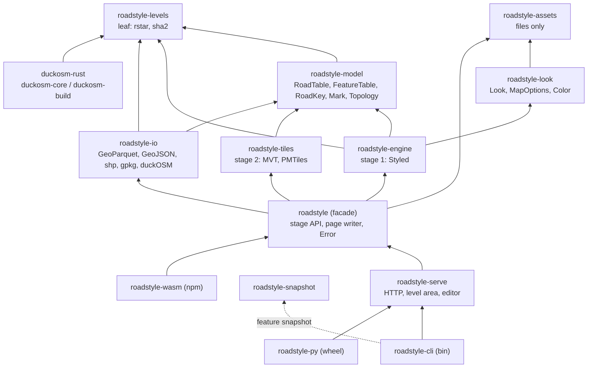
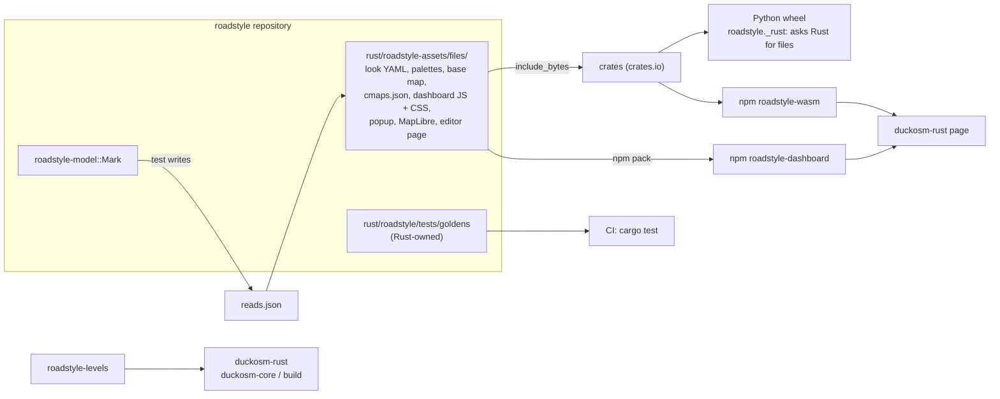
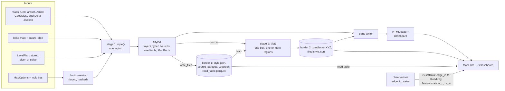

# roadstyle in Rust: the target architecture

**Status:** approved by the owner, 2026-10-24 (sections 1 and 2, the decisions (a) to (l), and the order of section 4: the phases T0 to
T7). Drafted by a reviewer, checked by the main session (the dependency claims against `origin/rust-engine`). The re-plan of the
work toward it is the coordinator's.

**Base.** roadstyle at `0b2724d` (branch `r7` = `rust-engine`), 12 crates, 17,531 lines of Rust. duckosm-rust at `bc7c9c8`. Some work
landed after `0b2724d` on `origin/rust-engine` (`e8f0b17`, 24 commits): the `FeatureTable` of R10 (steps 1, 2, 5, 6) and the error enums
of `roadstyle-look` (`3e366ee`) and `roadstyle-io` (`8eda6cb`). The roadstyle coordinator gave more facts on 2026-10-24. Section 3
and section 4 use them, and each place says so.

**Sources.** `docs/design/rust_library.md` (the plan), `rust_engine.md`, `review_checklist.md`, the three audits
(`audit_2026-10-23.md`, `audit_2026-10-24.md`, `audit_2026-10-24b.md`), the fourth review (`audit_2026-10-24c.md`), and the
code: `rust/Cargo.toml`, the public items of each crate, `roadstyle-model`, the facade, the engine, the two bindings, the dashboard
folder, `cargo tree -p roadstyle --depth 1`, and duckosm-rust's `crates/duckosm-core/Cargo.toml` and `crates/duckosm-wasm/build.sh`.

## Contents

0. [The rules of this document](#0-the-rules-of-this-document)
1. [The decisions that are hard to reverse](#1-the-decisions-that-are-hard-to-reverse): (a) to (l)
2. [The target crate graph and module layout](#2-the-target-crate-graph-and-module-layout)
3. [The gap list](#3-the-gap-list)
4. [The order of work](#4-the-order-of-work)
5. [What the owner decides](#5-what-the-owner-decides)
6. [Appendix: the Python shape that is still in the Rust side](python_shape_left.md)

## 0. The rules of this document

The owner's two requirements:

1. "The aim is make this rust version the real and main library instead of python version. [...] I don't want because wrong design of
   its python version we have the same issues in rust version." Thus a Python form is not a reason to keep a Rust form. The Python
   package becomes a thin binding.
2. "Change design and architecture is hard and has cost, so I prefer in this stage do the best so it doesn't need to redesign in
   future." Thus each decision below states its cost now and its cost later.

**The fixed contracts.** Only these stay as they are, because other projects read or write them:

| Contract | Owner | What is fixed |
|---|---|---|
| The edge id | duckOSM | `edge_id` is a BIGINT content hash. Every join keeps it Int64. |
| The road columns | duckOSM | `highway`, `bridge`, `tunnel`, `layer`, `oneway`, `is_directed`, `osm_id`, `source`, `target`, `name`, the mode tables |
| The stored levels | duckOSM with roadstyle's solver | `visualization.edge_levels` and `edge_levels_meta` (`edge_hash`, `method`, the parameters, `roadstyle_version`) |
| The observations | sensor-matching, SonoFlow | hourly flow per directed edge, keyed by `edge_id`, in `areas/<area>/observations/` |
| The border formats | open standards | GeoJSON, GeoParquet (WKB), MVT 2.1, PMTiles v3 |

Everything else can change: the `__rs_*` names, `look.json` version 0, the Python internal tables, the layer ids, the `window.rs*`
names (after one minor version of aliases), and every Rust signature before 1.0.

**Decisions that are already made and that this document does not open again:** two public stages; simple mode is the one drawing
approach; live data joins by the row (`rs.setData`, feature state); mapstyle merges into roadstyle; every part moves to Rust after P7;
folium and lonboard stay thin Python wrappers.

## 1. The decisions that are hard to reverse

Each section has the same parts: the question, the options with their cost now and later, what the code does today, the
recommendation, and what the worldwide service needs from it.

### (a) The crate graph and the direction of the dependencies

**Question.** Which crates exist, and which crate can depend on which?

| Option | Cost now | Cost later |
|---|---|---|
| A. Keep the 12 crates of today and fix only the bad edges | Small | The page writer, the level editor and the level-area files stay in the facade (2,004 lines). Each user of the facade builds them. The assets stay in the Python tree, so no crate can be published (N25). |
| B. A pure core, one assets crate, thin adapters and programs (below) | Medium: moves, no new logic | Low. Each crate has one job, and each user takes only what it needs. |
| C. Fewer crates: one core crate with modules | Medium | High. duckosm-core gets Arrow and Parquet for 43 lines of levels (D2). The plan rejected this in decision 1. |

**Today.** `roadstyle-levels` depends on `roadstyle-model` (Arrow) only for `flags.rs` (N26). `roadstyle-io` depends on
`roadstyle-levels` only for `edge_hash`. The facade has `page.rs`, `page_options.rs`, `level_area.rs` and `level_editor.rs`.
`roadstyle-py` depends on `roadstyle-cli` for `serve`, and with it on headless Chrome and a C SQLite (N17: 170 crates against 107).
`roadstyle-rs` (213 lines) is the old name of the facade, with the tests and `main.rs`. `default-members` builds the CLI and the snapshot
crate in each `cargo test`, with fat LTO (D1: 195 crates against 112). `roadstyle-tiles` depends only on the model, which is correct.
`roadstyle-look` does not depend on the model, which is correct. mapstyle's look is already in `roadstyle-look/src/basemap.rs` (382
lines), its reader in `roadstyle-io/src/duckosm.rs`, and its layers in `roadstyle-engine/src/features.rs` and `overlays.rs`.

**Recommendation: B.** The rules:

1. **The core** (`roadstyle-levels`, `roadstyle-model`, `roadstyle-look`, `roadstyle-engine`, `roadstyle-tiles`) has no I/O, no
   file format and no knowledge of a caller. It builds for `wasm32-unknown-unknown` with no features.
2. **`roadstyle-levels` is a leaf.** Its only dependencies are `rstar` and `sha2`. `flags.rs` moves into it, and the model re-exports
   it (N26). duckosm-rust depends on it alone (17 crates).
3. **Arrow stays a required dependency of the model.** An optional Arrow feature in the model is not
   necessary when `roadstyle-levels` is a leaf: no user that needs "no Arrow" depends on the model. An optional Arrow gives two forms
   of `RoadTable` and two code paths (review pattern 3).
4. **`roadstyle-tiles` depends only on the model.** It does not know the engine. Thus the tiler can take any `FeatureTable`, also the
   tables of many regional builds (see (l)).
5. **`roadstyle-assets`** is a new small crate. It holds every file that a crate builds in: the profiles, the palettes, the base-map
   YAML, the icons and patterns, `cmaps.json`, `basemaps.json`, `defaults.json`, the sprite, the dashboard JS and CSS, the popup files,
   the vendored MapLibre and the level editor's page. It exports them as `&'static [u8]` by name. It is the one copy (see (g)).
6. **The facade `roadstyle`** has the stage API, the page writer (feature `page`, on by default) and `roadstyle::Error`. The page
   writer stays a module of the facade, not a crate: it is about 600 lines, and the CLI, Python and wasm all need it.
7. **`roadstyle-serve`** (on branch `n28-editor`, not landed) gets the HTTP server, `level_area.rs` and `level_editor.rs` from the
   facade, and the CSV and JSON forms of the level area (N10, N28). The CLI and the Python binding depend on it. The Python binding
   does not depend on the CLI.
8. **Programs:** `roadstyle-cli` (the one `roadstyle` program, N31) and `roadstyle-snapshot` (headless Chrome, an optional feature of
   the CLI). The MCP server is a subcommand of the CLI (`roadstyle mcp`), not a crate.
9. **`roadstyle-rs` is deleted.** Its tests go to `rust/roadstyle/tests/`, `main.rs` goes to `rust/roadstyle/examples/bench.rs`.
   This needs duckosm-rust to depend on `roadstyle-levels` first (see (k)).
10. **mapstyle has no crate of its own.** The base map shares the sort-key order, `edge_attach` (crossings snapped to the road on top),
    the look resolution and the stage-1 output with the roads. A separate crate needs the engine's internal order as a public API.
    Its parts stay where they are today: the look in `roadstyle-look::basemap`, the tables in `roadstyle-model::feature_table`, the
    reader in `roadstyle-io::duckosm`, the layers in `roadstyle-engine::features` and `overlays`. Its data files move to
    `roadstyle-assets`. No `basemap` feature flag now; add one only if the wasm size measurement asks for it.



*An arrow means "depends on". The core is the five crates at the bottom. Nothing in the core points at io, assets or a binding.*

**What the worldwide service needs.** A tiler that does not know the engine (rule 4), and a levels crate that a regional build job
(duckosm-rust) can take alone (rule 2). Both are in B.

### (b) The road table

**Question.** What is the road table in memory, what is a row id, which columns are the contract, how does live data join, and how
does the table split by region?

| Option | Cost now | Cost later |
|---|---|---|
| A. Arrow arrays for the input columns, a typed struct of columns (`RoadDraw`) for the values that the engine computes | Medium: the engine reads fields, not `"__rs_*"` keys | Low. No copy of user columns from pyarrow or DuckDB. The engine values are plain `Vec`s. |
| B. Own Rust structs for everything (convert Arrow at the read) | Medium | One copy of every user column. Each new input column type needs code. |
| C. Arrow for everything, also the computed values | High: Arrow builders in the hot loops | The engine code is hard to read, and no user reads the computed values as Arrow. |

**Today.** `RoadTable` = column names + `Vec<ArrayRef>` + `Lines` (one coordinate buffer). A row is a `usize` index. A column is found by
a name scan (`table.rs:245`), and `ColumnMap` renames the columns in and out (engine `lib.rs:333-414`, R6). The computed values are
`Props(Vec<(&'static str, Value)>)` with a global intern `Mutex` (R17). `edge_id` stays Int64 in the model (N1 done); the JSON writers
write an integer past 2^53 as text. The road table output is one typed `TableRow` (props, mid, bbox, line) with two encoders (N4). Live
data: `rs.setData(table, {key})` joins by `edge_id` (default) or by the row, and sets the feature state `rs_c` and `rs_w` on the row
(`promoteId: "__rs_edge"`).

**Recommendation: A.**

1. **Input columns stay Arrow.** They go to the popup, the road table and the tiles (`keep`) with no copy.
2. **`ColumnMap` resolves one time to column indexes** (`Roles { class: usize, edge_id: Option<usize>, ... }`). No rename in or out
   (R6 part 3). Missing column: a `DataError` that names the preset, the column and the nearest names.
3. **`RoadDraw`**: one struct of `Vec`s with the engine values: class index (`u16`), levels (`[i16; 4]`), ends, flags (a bit set:
   bridge, tunnel, oneway, directed, driving), twin (`Option<u32>`), access (`u8`). It is made one time from the roles and the
   `LevelPlan`. The stages read fields. `Props` and the intern table go (R17).
4. **The row id is a type: `RoadKey(u64)`**, made from `(table: u32, row: u32)` as `table << 32 | row`. For one build, `table` is 0, so
   the key is the row of today and nothing changes in the output. The key stays below 2^53 while `table` is below 2^21, so JavaScript
   holds it exactly and MapLibre takes it as a feature id. Decide this now: it is the one change that the worldwide service needs in
   the model, and it costs one type today.
5. **The contract columns** are the duckOSM names of section 0. Each other column passes through. A column that the engine needs and
   that the input does not have is an error, or it has a documented default (for example `layer` 0).
6. **Live data joins by `edge_id`.** The page keeps a map `edge_id -> RoadKey` from the road table and sets the feature state on the
   key. The key `"row"` stays for tables with no id. The observation files of sensor-matching and SonoFlow join with no change.
7. **The facts of a map** (classes, positions, flags, the dash set, the bounds) are one typed `MapFacts` in the stage-1 output (R9).

**What the worldwide service needs.** The `table` part of `RoadKey` is the region. The road table is written as one file for each
region, sorted by key, with an index file (region, box, row count, `edge_hash`). The page loads the regions in view. See (l).

### (c) The property model

**Question.** How does the engine name what it writes on each feature, and what do the GeoJSON, the tiles and the dashboard carry?

| Option | Cost now | Cost later |
|---|---|---|
| A. A table of string constants (`const EDGE: &str = "__rs_edge"`) | Small | The values stay `serde_json::Value`. A typo in a new name is still possible in the tests and in JS. |
| B. A typed `enum Mark` in the model, with `name()`, `kind` (piece, deck, slot, table) and "read by the page"; the values are fields of `RoadDraw` and of the piece types; JSON only in the writers | Medium | Low. One list, made into the dashboard's declaration by a test. |
| C. Keep the literals | None | 270 literals in 10 engine files, 60 names; a typo compiles (N30). |

**Today.** 270 `"__rs_` literals (engine 260). `reads.json` in the dashboard folder declares what the page reads (pieces, decks, slots,
table), and the model builds it in from the Python tree (`props.rs:149`, N25: the core knows its caller). The tiles keep every
`__rs_*` (R1). The decks and slots parts of `reads.json` are not applied.

**Recommendation: B.**

1. `roadstyle-model::mark::Mark` is the one list of the names. Each variant has its kind and a flag "the page reads it".
2. `reads.json` is made from `Mark` (a test writes it and fails when the file differs). The model does not read a page file.
3. **What a feature carries.** A road piece: its `RoadKey` (the feature id and `promoteId`), the piece kind, the class index, the
   position, and only the marks that a layer expression or the page reads. User columns stay in the road table. A user column goes
   into the pieces only when an expression reads it (a colour by that column) or the caller names it in `keep`.
4. **What the road table carries.** The user columns, the table marks, the middle point, the box and (for the arrows) the line.
5. **What the dashboard reads.** The `roadstyle:*` metadata, the road table and the declared marks. Nothing else (see (h)).
6. The names stay `__rs_*` until the enum exists. A shorter name is then a one-line change, but it changes the goldens. Do it at P7
   with the other byte changes, or not at all.

**What the worldwide service needs.** Small tiles: no user columns on the pieces, only the key and the declared marks.

### (d) The options and the look

**Question.** Are the map options and the look typed, with defaults and errors for unknown keys, and who owns the look files?

| Option | Cost now | Cost later |
|---|---|---|
| A. Typed `MapOptions` and typed `LookData` sections (serde, `deny_unknown_fields`, `Default`), JSON in and out for the bindings | Medium: 62 `args[...]` reads and 10 `Value` fields change | Low. Typos are errors in every binding. A JSON schema comes from the types. |
| B. Keep `Value` and check the keys against a list | Small | Two copies of the key list (the list and the readers). Values are still checked late. |
| C. A Rust builder API, and each binding maps its own keywords | Medium | Three option parsers again (D7). |

**Today.** `Look` holds `LookData` with 10 `Value` fields (`settings`, `args`, `theme`, `config`, `styles`, `slots`, `roads_model`,
`features`, `oneway_image`, `interaction`) and three typed parts (`RoadLook`, `SlotLook`, `DeckLook`). `look::Options` has `args:
Value`. The engine reads 41 keyword names as text (N32, R16). The CLI turns every unknown `--option` into a keyword. Colours are text,
parsed by three parsers; `"#fff"` panics (D4). The YAML files are in `src/roadstyle/data/` (the Python tree).

**Recommendation: A.**

1. **Three option types, one for each consumer.** `Look` is the resolved style (palette, profile, settings). `MapOptions` is what a
   caller chooses for one map and what changes stage 1. `PageOptions` (already typed in `page.rs`, R3) has the page keys. Stage 2 has
   its own `TileOptions` in `roadstyle-tiles`. A value that the profile gives is `Option<T>`: `None` means "the profile's value".
2. **The look lane's proposal for `MapOptions`** (2026-10-24): small structs, one for each job, with defaults, Rust names with no
   `_col`, an unknown key as `roadstyle_look::Error::Options` with the nearest key. Accept it, with these changes:
   - **The crate: `roadstyle-look`.** The proposal says that the look depends on the model. It does not: `roadstyle-look` depends only
     on serde, serde_json, yaml-rust2, base64, flate2 and crc32fast (`origin/rust-engine`). The engine depends on the look, and the
     bindings reach it through the facade. Options in the model make the data crate a config crate. Keep the model free
     of options.
   - **`simple` goes.** Simple mode is the one drawing approach (decision 2, R5). `MapOptions` has no field for it. Only the Python
     binding keeps `simple=False` as an error until 0.27.0.
   - **`Output` is split.** It mixes three stages. `name`, `state` (live or static) and `live_data` change the stage-1 style: they stay
     in `MapOptions.output`. `export` (keep a `roads` source) and `data_maxzoom` / `data_tolerance` (the GeoJSON source options) are
     choices of the style writer: they go to `SourceMode::Inline { export, maxzoom, tolerance }` of `write_style` ((f)). `tiles {keep,
     layers}` is stage 2: it goes to `TileOptions`.
   - **`levels` as an enum** (`Stored | Tags | Solve | Given`) in place of today's `levels` key and the `*_level_col` keys: accept.
     The enum is the choice; the stored rows come with the data (`Inputs`, (f)); the level columns stay in `Columns.levels`.
   - **`interaction` is split.** The popup and tooltip fields change stage 1 (the road table keeps those columns), and so do the hover
     and select colours (the highlight paint): they stay. `hover_delay_ms` is a page key: it goes to `PageOptions`.
   - **`base_map` is split the same way.** The modes and the layers' interaction change the style; `box_layout` is a page key.
   - **No host-private fields** (group 10). A field that names a host (duckOSM, GeoLibre, SonoFlow) makes the core know its caller
     (rule 1). A host key that changes the style becomes a general option with a general name; a host key that changes only the page
     goes to `PageOptions` or stays in the host.
   - **The Python names.** The Python binding maps `render_edges`' keywords to `MapOptions`, with the old names as aliases in the
     binding only. The engine reads `opts.color.by`, not `args["color_by"]`.
3. **Unknown key: an error** with its path and the nearest known key, in Rust, the CLI and wasm. Python keeps decision 4 (one minor
   version with a warning) in its own keyword check, then passes only known keys (see question Q3).
4. **`LookData` sections** become structs: `RoadLook`, `CasingLook`, `LabelLook`, `ArrowLook`, `BridgeLook`, `TunnelLook`,
   `SelectionLook`, `BaseMapLook`, `TileLook`, `CameraLook` (the plan's list). A colour is one `Color` type with one parser (D4).
5. **serde for the bindings.** wasm and Python pass JSON text, as today. No new dependency (`pythonize`, `serde-wasm-bindgen`) until a
   measurement shows that JSON text costs time.
6. **The look files belong to Rust.** They move to `roadstyle-assets`. Python reads a bundled palette through the binding. One copy.
7. **Versions.** `schema_version` stays; the engine reads N and N-1. A rename or removal of a key increments it. `look.schema.json`
   is made from the types (feature `schema`, `schemars`) and published with each release.

**What the worldwide service needs.** One look for all regions: the look is resolved one time and given to each regional build, and its
hash goes into the metadata, so that the regional archives can be checked as one map.

### (e) The errors

**Question.** One error type for each crate, or one for the facade only?

| Option | Cost now | Cost later |
|---|---|---|
| A. One enum for each crate, and `roadstyle::Error` in the facade with a variant for each | Medium: 158 to 164 `Result<_, String>` | Low. A binding maps a variant to a Python class or a JS name. |
| B. One error type for all crates (in the model) | Small | Each crate depends on the error crate. A new cause in one crate changes all. |
| C. `String` or `anyhow` | None | No caller can act on a kind. The plan's Python classes (`LookError(ValueError)`) are not possible. |

**Today.** `roadstyle-look` and `roadstyle-io` have one enum each (on `origin/rust-engine`), `roadstyle-snapshot` has one,
`roadstyle-levels` and `roadstyle-cli` have one on `n28-editor` (green CI, not landed). Not started: model, engine, tiles, facade. The
pattern: one enum per crate, `Display`, hand-written `From`, no `thiserror`. The engine's messages name Python (`engine="python"`) and
"the plugin" (rule 1, minor).

**Recommendation: A, with the pattern that exists.**

1. The variant is the contract: Python maps it to a subclass of `ValueError`, JS to an `Error` with `name`. The message text is not a
   contract.
2. Add a field only where a caller acts on it: the column name of a missing column, the key path of a bad look key. No general
   `context` field.
3. `#[non_exhaustive]` on each enum.
4. No panic on input data. A test feeds the bad inputs of D4 and N19 (`"#fff"`, a 3D line, a multibyte colour text).
5. The engine's messages do not name a binding. The binding adds its own advice.

**What the worldwide service needs.** A regional build job must know if an error is in the data (skip the road, log it) or in the
options (stop). The `DataError` and `LookError` kinds give this.

### (f) The public API

**Question.** What is public, what are the stage borders, and what are the stability rules?

| Option | Cost now | Cost later |
|---|---|---|
| A. Two stage functions with typed input and output, a page writer, the readers and the levels; the engine modules `pub(crate)` | Medium: the bindings change their calls | Low. The stability rules can hold for a small surface. |
| B. Keep `pub use roadstyle_engine::*` | None | About 135 engine items are public (N24). Each refactor is a break. |
| C. One `Map` builder object that hides the stages | Medium | The stage borders (files) are the owner's requirement; a builder hides them. |

**Today.** The facade re-exports the whole engine. Stage 2 has five entry points (`make_tiled`, `tiled_of`, `tile_made`, `tile_files`,
`tile_files_with`), and `make_tiled` reads keywords that no caller sets (N21). Three style builders exist (`Sources::write_style`,
`Sources::style`, and the write-then-parse in `tile_stage`; D3, N29). Before the change, Tartu `make_tiled` takes 1.9 to 2.1 s with a
peak of 354 MB (coordinator). `tile_stage` takes `at: &Value`. The page border is `page_from(RoadTable, &Look, &Options, given)`.

**Recommendation: A.** The API, in outline:

```rust
// stage 1: roads + look -> the style, its sources and the road table (typed, in memory)
pub fn style(roads: RoadTable, look: &Look, opts: &MapOptions, more: Inputs) -> Result<Styled, Error>;
// Inputs: base-map FeatureTables, the planner rows, the LevelPlan (stored, given, or solve)
impl Styled {
    pub fn write_style(&self, w: impl Write, sources: SourceMode) -> Result<(), Error>; // Inline{export, maxzoom, tolerance} | Files | Tiled(at)
    pub fn write_files(&self, dir: &Path, format: Format) -> Result<Vec<FileInfo>, Error>; // GeoJSON or GeoParquet, road_table.parquet
    pub fn road_table(&self) -> &RoadTableOut;
    pub fn facts(&self) -> &MapFacts;
    pub fn restyle(&self, look: &Look) -> Result<Styled, Error>;                       // a view's palette, no new solve
}
// stage 2: stage-1 output (borrowed or from files) -> tiles
pub fn tile(input: TileInput<'_>, o: &TileOptions) -> Result<Tiled, Error>;             // TileInput::Styled(&Styled) | Files(dirs)
impl Tiled {
    pub fn tile(&self, z: u8, x: u32, y: u32) -> Bytes;
    pub fn each(&self, bounds: Bounds) -> impl Iterator<Item = (TileId, Bytes)>;
    pub fn write_pmtiles(&self, w: impl Write + Seek) -> Result<(), Error>;
    pub fn write_xyz(&self, dir: &Path) -> Result<(), Error>;
    pub fn write_style(&self, w: impl Write) -> Result<(), Error>;
}
// the page: a writer over a stage output, not a third style stage
pub fn page(map: PageInput<'_>, look: &Look, page: &PageOptions, given: &Given) -> Result<String, Error>; // Styled or Tiled
pub use roadstyle_io::read;    // read::path(), read::geoparquet(), read::arrow_stream(), ...
pub use roadstyle_levels as levels;
```

1. **One style writer** streams a skeleton with no source data, and for each source writes the data inline, a file name or a tile URL
   (D3, N29, D11). `write_style`, the tiled style, the page and the export use it.
2. **One stage-2 input reader**: `TileInput::Files` reads the stage-1 GeoParquet (or GeoJSON) with the same typed reader as stage 1
   (D12). Stage 2 never parses a JSON tree of a whole source.
3. **The border formats.** Stage 1 writes `style.json` (with `roadstyle:contract`, `roadstyle:tiles`, `roadstyle:columns`), one file for
   each source (GeoParquet by default, GeoJSON on request) and `road_table.parquet`. Stage 2 reads exactly these. The file names and
   the saved metadata keys are part of the public contract and have a version.
4. **`page_from`** stays as a one-call helper: it calls `style` and `page`. The page writer takes `Styled`, so a caller that has stage 1
   does not run it again.
5. **Internal:** every engine module is `pub(crate)`. A test that needs an inner function uses `#[doc(hidden)] pub mod testing`.
6. **Stability.** Public: the facade, `roadstyle-levels`, the JS API of `roadstyle-wasm`, `rsDashboard`, the Python API, the look schema,
   the `roadstyle:*` metadata, the border files. The other crates are published (they are dependencies) but their docs say "internal,
   follows the facade". One version for all (decision 7). Before 1.0 a minor version can break; after 1.0 only a major version.

**What the worldwide service needs.** `TileInput::Files` with many directories (one for each region), and `Tiled::each` over a box, so
that one stage-2 run can make the tiles of a region border from the files of two regions.

### (g) The bindings and the asset ownership

**Question.** What do the Python binding, the wasm binding and the CLI share, and how do Python and npm get the files that Rust owns?

| Option | Cost now | Cost later |
|---|---|---|
| A. One facade function for each binding entry; the facade parses options, formats and plans; the bindings convert types only | Medium | Low. A new option is one change in the facade. |
| B. Each binding composes the stages (today) | None | Three copies of each composition; they differ already (D7: `duckosm_plan` keys differ). |

**Today.** The Python binding has about 25 entries, and 10 of them have no caller in `src/` (N24). `duckosm_plan`, `LookCols` and
`format()` are in both bindings, and the CLI parses options a third time (D7). The crates build in 37 files from
`src/roadstyle/...` (N25), so no crate can be published. duckosm-rust's `build.sh` clones roadstyle and copies `static/dashboard/`,
`popup.css`, `popup.js`, `roads_sql.js` and `features_sql.js`.

**Recommendation: A.**

1. A binding function converts its arguments (JSON text, Arrow C stream, bytes), calls one facade function, and converts the result.
   It has no `if` on an option. The review checklist gets this as pattern 9.
2. The facade has `MapOptions::from_json`, `Format::parse`, `duckosm::plan`, `LookCols::from_slice` (D7).
3. **Rust owns** the look YAML, the palettes, the base-map files, `cmaps.json`, `basemaps.json`, `reads.json` (made from `Mark`), the
   dashboard JS and CSS, the popup files, the vendored MapLibre, the level editor page and the goldens. They live in one folder:
   `rust/roadstyle-assets/files/`. `cargo package` includes them.
4. **Python** gets no copy. The wheel has the Rust module; Python asks it for a file (`_rust.asset("palettes/amber.yaml")`) or, better,
   for the parsed value. folium and lonboard get their colours and widths from the engine (`paint_arrays`).
5. **npm.** `roadstyle-wasm`: the module, the glue, `roads_sql.js`, `features_sql.js`, the TypeScript types. `roadstyle-dashboard`: the
   ES modules, the CSS, `index.d.ts`, packed from `rust/roadstyle-assets/files/dashboard/`.
6. **One bundler.** The Rust page writer bundles the dashboard. `render_web.py`'s bundler goes at P7 (N13 remainder).
7. **One CLI** with the Rust grammar (N31; the coordinator says the plan on `n28-editor` has it). The Python entry point `roadstyle`
   runs the Rust CLI through the binding. The CLI reads any input by its file extension (`read::path`, N18).



*Each file has one place. Python, npm and duckosm-rust take it from there, at one version.*

**What the worldwide service needs.** A static site with no server: the page, the dashboard and the wasm module come from the npm
packages (or the same files at one version), with no Python step in the build.

### (h) The dashboard contract

**Question.** What exactly does a page read from the engine's output and change at run time, and where does the dashboard code live?

| Option | Cost now | Cost later |
|---|---|---|
| A. A versioned contract: metadata keys with a JSON schema made from Rust types, the road table, the feature-state names, the global-state names, the events; layers found by role | Medium | Low. A host (Python page, duckosm-rust, GeoLibre, a worldwide page) needs only the contract. |
| B. The hidden contract of today (names in JS, Rust and Python) | None | Each rename breaks a host with no message (review pattern 6). |

**Today.** `roadstyle:contract = 1`, `roadstyle:interaction`, `roadstyle:color_options`, `roadstyle:controls` (the facts of the look and
the layer ids: `pick`, `simple`, `fill_layers`, the overlays' layers), `roadstyle:state`, `roadstyle:images`, `roadstyle:sources` (the
road roles only; R7 landed at `0b2724d`), `roadstyle:arrows`, `roadstyle:live` (`rs_c`, `rs_w`). The page keywords are one
`RS_OPTIONS` object. The `rs` object has `getState`, `setState`, `on`, `can`, `link`, `setData`, `clearData`; the `window.rs*` names
are aliases. The removal of the id prefix (`prefix: "rs-"`) waits on a branch. The dashboard reads 13 `__rs_*` names. `index.d.ts` is
written by hand.

**Recommendation: A.**

1. **The parts of the contract:** (1) the `roadstyle:*` metadata keys; (2) the road table (format and columns, see (b)); (3) the
   feature-state names on a `RoadKey` (`hover`, `select`, `rs_c`, `rs_w`); (4) the global-state names in `roadstyle:state`; (5) the
   layer roles and groups; (6) the `rs` methods and events.
2. **The types are Rust structs** in `roadstyle-engine::contract`, with serde. A test checks that each style of the golden set has
   valid metadata against `contract.schema.json`, and that `index.d.ts` names each key. Generated TypeScript is a later step.
3. **Layers by role only.** The prefix removal lands; then no JS finds a layer by its id.
4. **The version.** The dashboard reads `roadstyle:contract`. A newer version than it knows is an error on the console and in
   `rsDashboard`'s result, not a silent wrong map.
5. **The engine writes facts, the page writes options.** `roadstyle:controls` has only what the engine knows (classes, swatches,
   access kinds, layer ids). The page keywords stay in `RS_OPTIONS` (rule 5).
6. **The dashboard JS is package data of Rust** (see (g)). The full-look branches go (N16, D8).

**What the worldwide service needs.** The road table as chunks: the dashboard's `RoadTable` port gets a key and loads the chunk of that
key's region on request. `roadstyle:live` gets `minzoom`: the first zoom where roads have keys (see (l)). Feature state works on the
`RoadKey`, which is unique over all regions.

### (i) Tests and benchmarks

**Question.** What is the reference after P7, and how is speed and memory measured?

| Option | Cost now | Cost later |
|---|---|---|
| A. Rust-owned goldens (blessed), structure summaries, a few unit tests where the rewrites happen, `examples/bench.rs` with stage times and peak memory | Medium | Low. A change of output is a reviewed bless. |
| B. Byte parity with Python as the reference (today's rule) | None | Python is deleted at P7, so the reference goes. Every Python-only quirk (`pyjson`, `py_round`) stays forever. |

**Today.** 33 end-to-end goldens from Python 0.24.3, changed in the test by `as_decided` (N27). Branch `n27` makes them from Python one
last time and deletes `as_decided`. The engine has 2 unit tests for 5,960 lines (D5). No benchmark (D9). CI runs `cargo test --release`
with fat LTO.

**Recommendation: A.**

1. **After `n27`:** `ROADSTYLE_BLESS=1` writes the goldens. Each golden is a structure summary, a hash of the paint and layout of each
   layer, and a hash of the whole output (agreed by the roadstyle-rs lane and the levels lane).
2. **Parity with Python** becomes "the same picture and the same structure": the Python suite checks that each keyword reaches the
   same Rust call and that the page loads. No byte comparison after P7.
3. **Unit tests before rewrites** (D5): `ev`, `twin_pairs`, `mitre_ends`, `ColumnMap`, the sort key, the colour parser.
4. **Areas:** Monaco on each push, Tartu each night. A larger area only with the owner's OK.
5. **Benchmarks:** `rust/roadstyle/examples/bench.rs` (each stage: time and peak memory, Monaco and Tartu), a table in the docs at each
   release. `criterion` in `rust/roadstyle/benches/` only for the hot functions (tile encode, sort key, style writer). CI fails when the
   Monaco peak grows by more than 10 %; it records the time and does not fail on it.
6. **Cross-language:** one fixture through native, wasm (Node) and Python gives the same hash.
7. **CI cost (D1):** the CLI and the snapshot crate leave `default-members`; LTO moves to a `[profile.dist]` for the wheels and wasm.
   Measured on `n28-editor` (look lane): a new `cargo test` build went from 195 crates, 324 s and 1.1 GB to 113 crates, 58 s and 564 MB.

**What the worldwide service needs.** A memory number per road for each stage, measured, not estimated. `MAX_ROADS` and the region
size come from it.

### (j) Parallelism and memory

**Question.** Where do threads run, how does a large area fit, and what about the 4 GB WebAssembly limit?

| Option | Cost now | Cost later |
|---|---|---|
| A. rayon behind a native-only `parallel` feature, in the embarrassingly parallel parts; stage 1 for each region; stage 2 for each tile | Small to medium | Low. The output is the same with and without threads. |
| B. Threads in every stage | High | Non-deterministic order; the goldens need sorting rules. |
| C. No threads | None | A planet build is slow; the tile archive is the longest step. |

**Today.** No `parallel` feature, no rayon. `MAX_ROADS` = 200,000 is an estimate from Tartu. `Tiles::archive` calls `tile()` for each
tile, and each tile goes through the 64 MB cache (D9). The tiles of one area are made in memory.

**Recommendation: A.**

1. **`parallel` (native only)**: the tiles of an archive or an XYZ folder, and the writes of the sources. The solver stays single-thread.
   A test checks that the output with `parallel` is byte for byte the output without it.
2. **wasm threads** (as duckosm-rust's `pkg-threads`) are a later option; nothing in the API depends on them.
3. **Stage 1 runs on one region.** The twins, the slots, the levels and the camera are global for one road network. A region is that
   network. Stage 1 never needs two regions at one time.
4. **Stage 2 streams.** It reads the stage-1 files of a box, makes the tiles of that box and writes them. The PMTiles writer writes the
   tiles to the file as they come and the directory at the end. The archive path does not use the request cache.
5. **The browser.** wasm32 has at most 4 GB, and a tab can get less. The browser makes stage 1 only for an area under a measured
   `MAX_ROADS`; a larger area uses stage-2 tiles made before. The design does not depend on wasm memory64.
6. **The memory of each road in the browser (added 2026-10-24).** The measured base:

   | What | Area | Roads | Memory | For each road |
   |---|---|---|---|---|
   | The wasm module after `makeSources` and `tileSources`, with the base map, in Node (`roadstyle-wasm/bench.mjs`) | Monaco | 13,298 | 110 MiB (19 MiB at the start) | 7.0 KiB |
   | the same | Tartu | 64,828 | 213 MiB | 3.1 KiB |
   | The map worker's wasm in the duckosm-rust page, after the draw (desktop Chromium) | Burnaby, all networks | 151,770 | 796 MiB | 5.4 KiB |
   | the same | Burnaby, one network | 62,453 | 418 MiB | 6.9 KiB |
   | The whole tab of that page | Monaco, Tartu | 13,298, 64,828 | 1,077 MiB, 2,050 MiB | about 1,000 MiB + 14 KB |

   A phone tab of 1.5 GB thus draws about 40,000 roads. Most of a road's memory in the tab is outside the wasm module: the road
   table and the sources as JavaScript values, and MapLibre's tile data. **The target** after T3's `Mark` (a piece and a tile carry
   only the declared marks, R1) and the lean road table (its user columns stay Arrow; the page parses only the rows in view): the
   wasm module at most 3 KiB for each road, and the tab at most 1,000 MiB + 7 KB for each road, so that a 1.5 GB phone tab draws
   about 75,000 roads (Tartu with room). `bench.mjs` and the page measure it at each release, with `examples/bench.rs` for the native
   stages; `MAX_ROADS` follows the measured tab number.

**What the worldwide service needs.** Rules 3 and 4: no API that keeps the planet in memory.

### (k) The duckosm-rust border

**Question.** What does duckosm-rust take from roadstyle, and how?

| Option | Cost now | Cost later |
|---|---|---|
| A. duckosm-rust depends on `roadstyle-levels` only (no Arrow); its page takes the npm packages (until 1.0: the same files from `roadstyle-assets` at one pinned commit) | Small, in both repositories | Low |
| B. Keep `roadstyle-rs` (the whole facade) as a git dependency, and copy from the Python tree | None | duckosm-core builds Arrow and Parquet for 43 lines (98 against 49 crates; 17 after N26). Each move of a roadstyle file breaks `build.sh`. |

**Today.** `duckosm-core/Cargo.toml:21`: `roadstyle-rs` at git `aba5884`, used only by `levels.rs` (43 lines). `build.sh` clones roadstyle
at `ROADSTYLE_COMMIT`, builds `roadstyle-wasm`, and copies the dashboard, the popup and the two SQL files. `roadstyle-levels` writes
`ROADSTYLE_VERSION = "0.24.2"` into `edge_levels_meta`, but the crate is 0.25.0 (D13).

**Recommendation: A.**

1. `duckosm-build` (U5 moves `levels.rs` out of core) depends on `roadstyle-levels` at one git rev. Then `roadstyle-rs` goes.
2. `ROADSTYLE_VERSION = env!("CARGO_PKG_VERSION")` (D13).
3. `build.sh` copies from one folder (`rust/roadstyle-assets/files/`) with one file list. After the npm publish it takes the two npm
   packages at one version.
4. **The shared row contracts** are the ones of section 0. roadstyle's `ColumnMap` preset `duckosm` names them; `roads_sql.js` (one
   copy, in `roadstyle-wasm/js/`) selects them. A roadstyle test reads a duckOSM Monaco file through the preset.

**What the worldwide service needs.** duckosm-rust is the regional build job: it makes each region's network and levels with
`roadstyle-levels`, and roadstyle's stages 1 and 2 make the map from them.

### (l) The worldwide service

**Question.** What must be decided now, so that a planet map with an id and a live colour for each road is possible later without a
redesign?

The target (later): every road has its own key, so a page can colour single roads from live data; regional builds are joined into one
PMTiles; keys only at high zoom, with merged roads below; the road table split by region or tile; no server (object storage and range
requests).

| Part | Decide now | Build later |
|---|---|---|
| The key | `RoadKey(u64)` = `region << 32 \| row`, below 2^53 ((b)) | the region registry (a number for each regional build) |
| The join | live data joins by `edge_id`; the road table maps `edge_id` to the key ((b), (h)) | the per-region `edge_id` index files |
| The tiler | `roadstyle-tiles` does not know the engine; stage 2 takes many stage-1 directories and a box ((a), (f)) | the planet tile walk, the join of regional archives |
| The zoom rule | `TileOptions` has a key zoom: at and above it, pieces with keys; below it, merged lines with no key; `roadstyle:live.minzoom` says it | the merge step (join the lines of one class, position and name in a tile) |
| The road table | one file for each region, sorted by key, with an index file ((b)) | chunks by tile at the key zoom; the dashboard loads the chunks in view |
| Memory | stage 1 per region, stage 2 per box, no whole-planet API ((j)) | the parallel tile walk on many machines |
| The look | one resolved look with its hash in each archive's metadata ((d)) | a check that every regional archive has the same look hash |

**Border tiles.** A tile on a region border has roads of two regions. Two ways: (1) make the border tiles from the files of both
regions (stage 2 with two directories); (2) decode the two tiles and merge their layers. Way 1 is simpler and uses code that exists.
Recommendation: way 1. An edge that crosses the border is in both regional builds. If the duckOSM hash is the same in both, stage 2
keeps one copy by `edge_id`. This depends on how duckOSM cuts a region (question Q5).

**Not now:** the merge step, the planet walk, the registry, the object-storage layout. They add code with no user today.



*One map through the two stages. The two borders are files in open formats. The page is a writer over either stage output.*

## 2. The target crate graph and module layout

Lines today are at `0b2724d` (`wc -l` of `src/`). Lines in the target are estimates.

| Crate | Responsibility | Public types | Depends on | Lines today → target |
|---|---|---|---|---|
| `roadstyle-levels` | the drawing positions: the tags rule, the solver, the level-area input; the yes/no tag rule (`flags`); `edge_hash` | `LevelEdges`, `LevelEdge`, `Options`, `Method`, `Levels`, `Row`, `Edit`, `AreaInput`, `Error`, `flags::*` | rstar, sha2 | 2,555 → 2,300 (CSV and JSON to `roadstyle-serve`) |
| `roadstyle-model` | the tables and the keys: `RoadTable` (Arrow + `Lines`), `FeatureTable`, `RoadKey`, `Roles`, `Mark`, `Topology`, the line helpers | `RoadTable`, `FeatureTable`, `RoadKey`, `Roles`, `Mark`, `Topology`, `geom::line`, `Error` | levels, arrow-array, arrow-schema, rstar | 1,104 → 1,700 (with the 421 lines of `feature_table.rs`) |
| `roadstyle-look` | the typed look and options: resolution, palettes, profiles, base-map look, colour ramps, `Color`, schema | `Look`, `LookSpec`, `MapOptions`, `Color`, `Ramp`, `BaseMap`, `Error` | assets, serde, serde_json, yaml-rust2, base64, flate2 | 1,512 → 2,000 (typed sections) |
| `roadstyle-engine` | stage 1: `RoadDraw`, `LevelPlan`, pieces, slots, decks, overlays, base-map layers, the sort key, layers, colours, the contract types | `style`, `Styled`, `MapFacts`, `contract::*` (all other modules `pub(crate)`) | model, look, levels, serde_json, indexmap, rstar | 5,960 → 5,500 in smaller files (D14) |
| `roadstyle-tiles` | stage 2: clip, simplify, MVT, PMTiles, the tile cache, the key-zoom rule | `Tiles`, `TileOptions`, `TileId`, `pmtiles::Writer` | model, flate2, rstar; rayon (feature `parallel`) | 1,100 → 1,300 (`each`, streaming archive) |
| `roadstyle-assets` | the files: look YAML, base map, ramps, dashboard, popup, MapLibre, editor page | `get(name) -> &[u8]`, `list()` | none | 0 → 50, plus the files |
| `roadstyle-io` | readers and writers of the border formats: GeoParquet, Arrow C stream, GeoJSON, Shapefile, GeoPackage (feature `gpkg`), duckOSM, CRS, one WKB module | `read::*`, `write::*`, `duckosm::*`, `Error` | model, levels, parquet, arrow, shapefile, proj4rs, i_overlay; rusqlite (feature) | 1,410 → 1,300 (N19, N20) |
| `roadstyle` (facade) | the stage API, the style writer, the page writer (feature `page`), `Error` | `style`, `tile`, `page`, `Styled`, `Tiled`, `Format`, `Error`, re-exports | engine, tiles, io, levels, assets | 2,004 → 1,300 (editor and area out) |
| `roadstyle-serve` | the local HTTP server, the level-area folder, the level editor's answers | `serve`, `Area`, `Editor`, `Error` | roadstyle, httparse | 0 → 1,100 (on `n28-editor`) |
| `roadstyle-snapshot` | a PNG of a page through headless Chrome | `snapshot`, `Camera`, `Shot`, `SnapshotError` | headless_chrome | 180 → 180 |
| `roadstyle-cli` | the one `roadstyle` program, with `mcp` | `run(args)` | serve; snapshot (feature) | 542 → 700 (with the MCP subcommand) |
| `roadstyle-py` | the Python module `roadstyle._rust` | one function for each facade entry | roadstyle, serve, pyo3 | 519 → 300 |
| `roadstyle-wasm` | the browser module | one function for each facade entry, `Tiler`, `LevelArea` | roadstyle | 432 → 350 |
| `roadstyle-rs` | deleted | | | 213 → 0 |

The engine's files after D14: `exprs.rs` (width, offset, metre curves), `eval.rs`, `layers/` (`road_layers` in parts), `pieces.rs`,
`cuts.rs`, `mitre.rs`, `slots.rs`, `decks.rs`, `overlays.rs` (base-map overlays), `items.rs` (edge items), `features.rs`, `colors.rs`,
`palettes.rs`, `planner.rs`, `contract.rs`, `order.rs` (the one sort key). No file over 600 lines.

## 3. The gap list

Every open item of the four audits, with the decision that closes it. "Done" and the state are from `0b2724d`, with the corrections of
the coordinator (marked *C*).

| Item | State | Closed by |
|---|---|---|
| R1 | partly: the tiles keep every `__rs_*`; decks and slots of `reads.json` not applied | (c) `Mark` with "read by the page"; the tiles keep only declared marks |
| R4 | partly: `twin_pairs` rounds through text | (b) the twins from `Topology` |
| R6 | parts 1 and 2 landed (*C*); part 3 open: `ColumnMap` renames in and out | (b) `Roles` as column indexes |
| R7 | landed at `0b2724d`: roles in the metadata, `controls.pick` (*C*); the prefix removal waits on a branch | (h) item 3 |
| R9 | partly: about 12 scans for the filter panel, bounds made 4 times | (b) `MapFacts` |
| R10 | landed on `origin/rust-engine`, steps 1, 2, 5, 6 (*C*); step 4 (caller overlays as tables) proposed not to do | done; step 4 not needed |
| R12 | partly: `make_parts` solves on each call | (f) `Inputs` takes a `LevelPlan`; the caller keeps the `Levels` |
| R16 | part 1 landed (`Look::resolve`, `from_json`) (*C*); typed `LookData` not started | (d) |
| R17 | partly: the intern `Mutex` | (b) `RoadDraw` fields; (c) `Mark`; the intern table goes |
| R20 | open, waits for the duckosm-rust freeze | (k) |
| R21, D6 | open: `substring`, `class_key`, `merged`, `varint`, `length` in 2 to 4 copies | (a) `model::geom::line`; the levels crate keeps its own (it is a leaf) |
| N5 | partly: piece properties as `Val::Json` | (c) typed pieces, JSON only in the writer |
| N15 | open: the empty `Src::Roads` mark | (f) the new `Styled` keeps the roads out of the source list |
| N16, D8 | open (on a branch): full-look leftovers in JS and Rust | (h) item 6; dead code in phase T4 |
| N17 | `roadstyle-serve` on `n28-editor` (*C*) | (a) item 7 |
| N18 | open: the CLI reads only GeoParquet | (g) item 7, `read::path` |
| N19 | open: 3D lines are dropped with no message | (b), (e) item 4: one WKB module |
| N20 | open: Shapefile and GeoPackage go through GeoJSON text | (b): one `from_features` |
| N21, D7 | not started (*C*) | (f), (g) |
| N22 | open: four tile walks, the export files in Python | (f) `Tiled::each`, `write_xyz`, `write_pmtiles` |
| N23 | open, security: no HTML escape in the dashboard | not a design item; phase T0 |
| N24 | not started (*C*) | (f) item 5 |
| N25 | not started (*C*) | (a) item 5, (g) item 3 |
| N26, D2 | open | (a) items 2 and 9, (k) |
| N27 | in progress on `n27` (*C*) | (i) item 1 |
| N28 | open: the editor writes ids as text into Parquet, answers JSON text | (a) item 7: the forms move to `roadstyle-serve`; ids Int64 |
| N29, D3, D11 | open: three style builders, write-then-parse (*C*: the D3+N29 proposal is one streaming writer on a skeleton, also for `page_from`) | (f) item 1 |
| N30 | not started (*C*) | (c) |
| N31 | decision: the plan on `n28-editor` has the Rust grammar (*C*) | (g) item 7 |
| N32 | not started (*C*) | (d) |
| N33 | open: dead code (`props::Source`, `Tiles::add_typed`, `Tiles::props`, `makeLook`) | (f); `Tiles::props` after duckosm-rust stops calling it (R20) |
| D1 | open | (i) item 7 |
| D4 | open: colour parse panics | (d) item 3, (e) item 4 |
| D5 | open | (i) item 3 |
| D9 | open | (i) item 5, (j) item 4 |
| D10 | open | (c): the read set goes into the piece writer |
| D12 | open | (f) item 2 |
| D13 | open | (k) item 2 |
| D14 | not started (*C*) | (a), section 2; after D5 |
| Errors | look, io on `origin/rust-engine`; levels, CLI on `n28-editor`; not started: model, engine, tiles, facade (*C*) | (e) |
| `pyjson`, `py_round` | not started (*C*) | (i) item 2; at P7, with one bless |

No open item is without a decision. Items that are not needed any more: R10 step 4, and `Tiles::props` (after R20).

## 4. The order of work

The order puts the type changes at the crate borders before the moves inside the crates, so that each signature changes one time.
Each phase must not break the fixed contracts of section 0, and each phase ends with the goldens green.

| Phase | What it changes | It must not break | The check |
|---|---|---|---|
| **T0** Safety | N23 (escape), D1 (slim test build), D13 (version), D4 (one colour parser), N19 (one WKB reader) | the page output; the duckOSM ids | CI green; the goldens are equal, except D4's one colour rule (mix half up), which moves 3 of 8 mapstyle digests by 1 in one channel: one reviewed bless; a test with `"#fff"` and a 3D line |
| **T1** The reference | `n27` lands (goldens from Python one last time, `as_decided` deleted); bless mode with structure summaries and hashes; D5 unit tests; `examples/bench.rs` with Monaco and Tartu numbers | nothing changes in the output | `cargo test` green; a bench table in the docs |
| **T2** The crate graph | `flags` into `roadstyle-levels` (N26); `roadstyle-assets` with every built-in file (N25); `roadstyle-serve` lands (N17, N28: Int64 ids); the CLI and the Python binding depend on serve, not on each other | the output bytes; the paths that duckosm-rust's `build.sh` copies (keep the old paths as a copy for one release, or change `build.sh` in the same week) | `cargo tree -p roadstyle-levels` has no Arrow (17 crates); `cargo package --list` passes for each crate; wasm size within 2 % |
| **T3** Types at the borders | the error enums: levels and CLI (from `n28-editor`), then model, tiles, engine, facade; `MapOptions` (N32) and the typed `LookData` sections (R16); `RoadKey` and `Roles` (R6 part 3); `Mark` (N30) and the removal of the intern table (R17) | the goldens; the Python keywords; a look of version 0 still reads | 0 `Result<_, String>` in public signatures; 0 `args["` reads; 0 `"__rs_` literals outside `mark.rs`; the goldens equal |
| **T4** The public API | one style writer (D3, N29, D11); one stage 2 (N21, D7, D12, N15); `Tiled::each`, `write_xyz`, `write_pmtiles` and the export files in Rust (N22); the facade surface (N24); dead code (N33, N16, D8) | the border files and their names; the `rs` API | the facade has the API of (f) and no `pub use roadstyle_engine::*`; `_engine.py` loses its tile walk; Tartu tiled peak under 354 MB |
| **T5** Inside the engine | the splits (D14, R21, D6); `MapFacts` (R9); `LevelPlan` as an input (R12); twins from `Topology` (R4); the read set in the piece writer (D10, R1, N5); the prefix removal (R7 rest) | the goldens | no file over 600 lines; bench: no stage slower by more than 5 % |
| **T6** P7 | Python is thin (the style code of `render_web.py`, `levels.py`, `tiles.py`, `stylers.py` goes); one CLI (N31); the removal of `pyjson` and `py_round` with one bless; the npm packages; duckosm-rust on `roadstyle-levels` and the npm packages (D2, R20); `roadstyle-rs` deleted | the fixed contracts; the Python API names | the Python suite green on the thin package; duckosm-rust's `e2e.py` green; the owner's OK on the pages |
| **T7** After P7 | A1 to A5 (the CLI, MCP, studio, snapshots, editor in Rust); then, for the worldwide service: the region registry, stage 2 over many regions, the key zoom and the merge step, the road-table chunks | the contract version (a new key needs a new version) | a two-region test (Monaco split in two) gives the same tiles as one build, except the keys |

**The items that the coordinator holds today, and their phase:**

| Item | Phase | Why there |
|---|---|---|
| N32 (typed `MapOptions`) | T3 | it changes every `args[...]` read; do it with the error enums, one signature change |
| N30 / R6 part 3 (`Mark`, `Roles`) | T3 | the engine reads fields after this; the T5 splits move typed code, not literals |
| N25 (assets) | T2 | it is a move with no logic; it unblocks `cargo package` and the npm packing |
| N24 (the facade surface) | T4 | the new stage API must exist before the old items become `pub(crate)` |
| N21 + D7 (one stage 2, shared helpers) | T4 | after the error enums (T3), so the new functions have their final signatures |
| D14 / R7 splits | T5 | after the D5 unit tests (T1) and after the typed names (T3) |
| The error enums | T3 (levels and CLI can land in T2 from `n28-editor`) | the first change of each public signature |
| The mapstyle crate placement | decided in (a) item 10: no crate; the files move in T2 | no code moves, only data files |

## 5. What the owner decides

Two decisions needed the owner. Both were decided on 2026-10-24, as recommended. The rest are set by this document, with the owner's
rules, and change only on the owner's objection.

| # | Decision | Decided (2026-10-24) |
|---|---|---|
| Q1 | **Approve the target (sections 1 and 2) and the order (section 4).** After the approval, the coordinator re-plans the lanes toward it, and no held item starts before its phase. | Approved. |
| Q2 | **duckosm-rust after its freeze** (D2, U5, R20): duckosm-build depends on `roadstyle-levels` only, and `build.sh` copies from `roadstyle-assets`. When: in phase T6 (with P7), or earlier, as soon as T2 makes the assets crate? | In T6, in one duckosm-rust session. Until then, roadstyle keeps the old file paths, so the page build does not break. |

Set by this document (no question, because the owner's rule "the Rust version is the real library, independent of Python" decides them):

- After P7 the Rust output can differ in bytes from Python 0.24 (`pyjson` and `py_round` go, later another MVT encoder), with one
  reviewed bless and the "same picture and same structure" check.
- An unknown key is an error at once in Rust, the CLI and wasm. Python keeps one minor version of warnings for its 16 projects.
- npm: `roadstyle-wasm` and `roadstyle-dashboard` are published at 1.0. Before that, the users take the files at one commit.
- crates.io: all 13 crates are published at 1.0 (the core crates are dependencies), with only the facade and `roadstyle-levels`
  documented as public.
- Worldwide: road keys from zoom 14 (`TileOptions.key_zoom`, changeable per build). An edge that crosses a region border goes into both
  regional builds, whole; stage 2 keeps one copy by `edge_id`. duckOSM gets a check that the hash is the same in both builds when the
  regional builds start.

I checked the vocabulary of this document against known rulings and high-risk patterns only, not against the official ASD-STE100
Part 2 dictionary.

## Appendix

[The Python shape that is still in the Rust side](python_shape_left.md): file:line and counts of each kind, grouped by the
held item that removes it.
