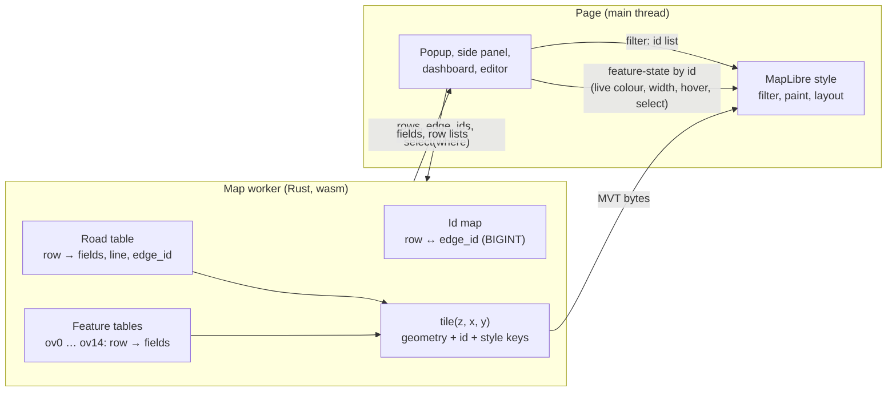

# The tile contract: tiles draw, the data layer knows

Status: design, 2026-10-27. No library code yet. Branch `design-tile-contract`, from `rust-engine` at `cfa80c2`.

This note separates the data of a road from its tiles. A tile then has only what MapLibre needs to draw it. All other data stays
in the map worker and the page gets it by id. The note gives the contract, the id, how the tile keys come from the style, the data
layer API, the CI checks, the expressions and a plan in phases. The decisions for Kaveh are in the last section.

Measurements: Burnaby, the tilted view (pitch 60, zoom 14), headless Chromium with software GL. Files: `.claude/tile-lag/` of the
workspace (`RESULT.md`, `ANALYSIS.md`, `one-feature/`, `expr/`) and [tile_speed.md](tile_speed.md).

## Why

On Burnaby, the tilted view takes 2.15 s from the jump to an idle map. `tile()` in the worker is 0.35 s of it. MapLibre's parse and
layout of the 30 tiles (5.9 MB, 115k features) is 1.4 s. In the road layer `simple`, the properties are 2.19 MB and the lines are
0.75 MB. Four keys of each road piece (`__rs_edge2`, `__rs_cls`, `lvl`, `__rs_access`) go only to the dashboard, not to the style.
The sort key `__rs_s` has a different value on almost each piece (49k values).

Two facts from the measurements decide the design:

1. MapLibre's time follows the features that it draws and the data-driven expressions that it calculates for them. A feature that
   no layer draws costs little (option A, now in `rust-engine`).
2. The road layer's expressions are most of the road cost. With all the paint and layout values of the road layer made constant,
   the view takes 0.77 s, not 1.42 s (the `expr/` test, below). Smaller tiles alone give less.

The contract therefore has two parts: small tiles, and small expressions.

## 1. The contract

A feature in a tile has these items only:

- its geometry, clipped to the tile and its buffer;
- its id: the MVT feature id, a small number (section 2);
- the keys that a style layer on its tile layer reads at the zoom of the tile (section 3).

All other data is in the **data layer**: the road table and the feature tables in the map worker, with the id as their row. The
page gets a value by id from the worker. The page never reads a property of a tile feature that the style does not read.



Who reads what:

| Reader | Reads from the tile | Reads from the data layer | How it reaches the map |
|---|---|---|---|
| Style (filter, paint, layout) | the style keys, `["id"]` | nothing | |
| Popup, tooltip | the id of the feature under the pointer | `fields(rows, names)` | |
| Side panel, Street View, Google 3D | the id | the fields, `roadLines(rows)` | |
| Dashboard filters (class, access, bridges, tunnels, modes, `rsFilter`) | nothing | `select(where)` gives the rows that show | a filter clause on `["id"]` |
| Live colours and widths (`rs.setData`) | nothing | `rowsOf(edgeIds)` for the join | feature-state `rs_c`, `rs_w` by id |
| Hover and selection glow | the id | the twin row for a pair | feature-state `hover`, `select` by id |
| Level editor | the id | the road table (`RS_SIDE`), `relevel` | new tiles of the changed roads |
| Base-map popup (`ov4`: `osm_id`, `kind`, `name`) | the id | `features(layer, rows, names)` | |

Much of this is already true. The popup and the side panel read `RoadTable` (`core.js`). The live colours and the glow are
feature-state by road row (`color.js`, `live.js`). The changes are the dashboard filters, the base-map popup, the id and the rule that
decides the keys.

## 2. The id

**The id of a road piece is its road's row.** It is `RoadKey` (`roadstyle-model/src/key.rs`): `table << 32 | row`, and for one build
the table is 0, so the id is the row. All pieces of one road (its casing pieces, halves, seams and fill) have the same id. A
feature-state on the id then applies to the whole road, and the paint expression decides which piece shows it (for example, only the
fill reads `rs_c`).

- **MVT id, not `promoteId`.** Now the pieces have no MVT id, and the source promotes the property `__rs_edge`. The contract writes
  the row as the MVT feature id and removes `__rs_edge` from the tile. The MVT spec says that an id "SHOULD" be unique in a layer, not
  "MUST". MapLibre accepts the same id on more than one feature: that is how `promoteId` works now. The page reads `f.id`, not
  `f.properties.__rs_edge` (`select.js`, `core.js`, `arrows.js`; `level_editor.js` already reads `f.id` first).
- **Base-map features.** The id of a feature of `ov0` to `ov14` is its row in its feature table (as now). The id spaces of the tile
  layers are different: a page never mixes them.
- **Slots (names and arrows).** The id of a slot is the row of its road, the same as its pieces.
- **The limit 2^53.** JavaScript holds an integer exactly only below 2^53. A row is a `u32`. A `RoadKey` stays below 2^53 while the
  table is below 2^21 (`RoadKey::TABLES`, a test checks it). duckOSM's `edge_id` is a BIGINT hash and is often above 2^53. Thus an
  `edge_id` is never a feature id and never a JavaScript `Number`. The data layer gives it as a `BigInt64Array`. The JSON road table
  already writes a number above 2^53 as text (`JsSafe`, `roadstyle-model/src/table.rs`), but then one column has two types. The new
  API gives one type.
- **The id map.** The data layer keeps row → `edge_id` (the road table's `edge_id_col`) and `edge_id` → row (a hash map, made one
  time). `rowsOf(edgeIds)` gives `u32::MAX` for an unknown `edge_id`.
- **Relevel.** The level editor's `relevel` changes the levels of some roads, not the set of roads. The rows stay the same, so the
  feature-state and the page's lists stay correct. `Tiles::replace_lines` replaces the pieces of the changed roads, and the new
  pieces have the same row as their id.
- **A new road set.** A new build, a new area or a new mode makes a new road table, and the rows change. This is a new
  **generation**: the tile prefix changes (as `lv://<gen>/` now), and the page clears its feature-state. The page keeps a selection
  or a live table by `edge_id`, and gets the new rows with `rowsOf`. A row from one generation is never used in the next.
- **Items.** An item on a road (an overlay attached with `edge_col`) is a piece of the road layer, so that the sort key puts it
  between the fills. Its id is its road's row, so a filter or a glow of the road applies to it. To pick an item as itself, the page
  needs the item's own number. See decision D3.

## 3. The keys come from the style

The set of keys of a tile layer at zoom z is calculated from the style. It is not a list that a person keeps.

- **The rule.** For each style layer on the tile layer, with z in its `[minzoom, maxzoom)`, collect each `["get", k]` and
  `["has", k]` in its filter, paint and layout (`props::expression_reads` does this now). A key goes into the tile of zoom z only if
  that set has it. A key that only a zoom clause makes useless (for example `__rs_lap` from zoom 17) can go out with the same span
  rule as option A (`ZoomRules::span`).
- **What goes out.** Now the tiles keep every `__rs_*` key, the page's keys (`reads.json`, `pieces`), `name`, `kind`, the popup's
  fields and the caller's `keep` (`props::drawn`, `TileOptions::rule`). The contract keeps only the style's set. `keep` and the
  popup fields go to the data layer. `reads.json`'s `pieces` list becomes empty (or only the items' keys, D3).
- **Small values.** In an MVT, each key on a feature costs two varints, whatever the type of the value. A value costs its bytes one
  time for each tile layer. So the number of keys on a feature and the number of different values are what count. Rules:
  - a value that has a small fixed set (class, piece kind, flags) is a small integer, and the style reads a table with
    `["at", ["get", k], ["literal", [...]]]` or `match`. `__rs_ci` already does this. The class minzoom in the filter reads
    `highway`, a text. It can read `__rs_ci` and then `highway` goes out of the tile;
  - a flag that is false is not written (MapLibre reads a missing key as null);
  - a value of the look's data (a ramp colour of each road) stays as it is, but only on the piece that draws it.
- **The sort key.** `__rs_s` is `rank × 10^8 + row` (`simple.rs`, `sort_key`). The row is now the id, so the tile gets only the
  small `rank` (`__rs_r`, about a hundred values) and the style calculates
  `["+", ["*", ["get", "__rs_r"], 1e8], ["id"]]`. The order is the same. The raise of the top roads reads `["id"]`, not
  `__rs_edge`. A multi-table `RoadKey` is above 10^8, so this form is only for one table. A key of more tables needs its own sort
  rule later.

## 4. The data layer API

The worker owns the data. The page asks by id. The calls are on the object that makes the tiles (`LiveMap`, `Tiler`), so that the
rows and the tiles are always of the same generation. The answers are typed arrays or Arrow IPC bytes, not JSON of the whole
table.

roadstyle-wasm (in the worker; the page calls it through `postMessage`):

```js
map.generation()                        // u32, changes when the rows change
map.rows()                              // the number of roads
map.edgeIds()                           // BigInt64Array, index = row
map.rowsOf(edgeIds /* BigInt64Array */) // Uint32Array, 0xFFFFFFFF = not found
map.fields(rows /* Uint32Array */, names /* string[] */)   // Arrow IPC: one row for each id (popup, side panel)
map.columns(names)                      // Arrow IPC: whole columns (the dashboard's counts and legends)
map.select(where /* JSON text */)       // Uint32Array: the rows that show
map.roadLines(rows)                     // as now
map.features(layer, rows, names)        // Arrow IPC: a base-map layer's fields (ov4's popup)
```

`where` is the dashboard's state, for example
`{"classes_hidden": ["service"], "access_hidden": ["private"], "bridges": true, "tunnels": false, "ids": null, "modes": ["walking"]}`.
`select` adds the twin row of a two-way pair when either edge shows (now done with `__rs_edge2` in the filter). The answer is one
list, so the page does not need `__rs_cls`, `lvl`, `__rs_access` or `__rs_edge2` on a piece.

Python (`roadstyle` binding, the same Rust functions; numpy for the arrays, pyarrow for the tables):

```python
t = roadstyle.Tiler(roads, look)
t.edge_ids()                       # numpy int64, index = row
t.rows_of(edge_ids)                # numpy uint32
t.fields(rows, ["name", "highway"])          # pyarrow.Table
t.select({"classes_hidden": ["service"]})    # numpy uint32
t.features("ov4", rows, ["osm_id", "name"])  # pyarrow.Table
```

How the page uses it:

- **Filters.** The page sends `where` to the worker and gets the rows that show. It sets one clause on each road layer:
  `["match", ["id"], [ ...rows ], true, false]`, or the opposite form with the hidden rows when they are fewer. `match` finds a label
  with one lookup. `["in", ["id"], ["literal", rows]]` searches the list, which is slow for 26k features. A filter change makes
  MapLibre lay out the loaded tiles again. That is also true now (`setFilter`), and it occurs only when a person changes a switch.
- **Live colours.** `rs.setData` joins by `rowsOf(edgeIds)`, not by a scan of all the rows in JavaScript, and sets `rs_c` and `rs_w` by
  id. The style does not change.
- **Popup and panel.** `fields([row], names)` for the road and its twin. `RoadTable` stays the page's one port; behind it the
  table can be the full JSON (as now) or a cache of `fields` answers.

## 5. The checks in CI

Two tests. Both use the views that CI already has (Monaco and Tartu; D4 for Burnaby).

**The contract test** (Rust, `roadstyle-tiles`, `tests/tile_contract.rs`). For each tile of the fixed views, decode the MVT and check:

1. each key of each tile layer is read by a style layer on that tile layer at the tile's zoom (section 3). The test names the key,
   the layer and the zoom when it fails;
2. each feature is drawn by a style layer at a zoom of the tile (z, z + 0.5 and z + 0.999), with the layer's filter. This needs an
   evaluator with all of MapLibre's operators, so this part runs in Node with `@maplibre/maplibre-gl-style-spec` (as the analysis
   script did), next to `bench_live_views.mjs`;
3. each feature of the road layer has an MVT id that is a row of the road table.

The JavaScript side: `tests/test_contract_names.py` already fails when a dashboard module reads a `__rs_*` property that
`reads.json` does not declare. With `pieces` empty, it fails when a module reads a tile property of a piece.

**The size budget** (`tests/tile_budget.json`, checked by the same tests). For each fixed view, for each tile layer: the
features, the bytes, the keys and the different values of each key. The test fails when a number is more than 5 % above the
budget. A change that makes the tiles smaller writes the new budget in the same commit. The budget also has the JSON size of each
data-driven paint and layout property of the road layer (section 6), so a large expression fails CI too.

## 6. The expressions

The `expr/` test (Burnaby, tilted view, 5 runs each, median, with a 200 ms start wait) changes one property of the road layer at a
time to a constant:

| Variant | ms to idle | Against now |
|---|---|---|
| now | 1416 | |
| `line-width` constant | 1032 | −384 |
| `line-color` constant | 1334 | −82 |
| `line-opacity` constant | 1352 | −64 |
| `line-offset` constant | 1364 | −52 |
| `line-dasharray`, `line-sort-key`, cap and join, blur | 1400 to 1452 | in the noise |
| all values of the road layer constant | 768 | −648 |
| no road layer | 568 | −848 |
| the road layer two times | 2190 | +774 |
| the overlays half / none | 1232 / 1083 | −184 / −333 |

What this shows:

- The road layer costs about 0.85 s. Of this, about 0.65 s is its expressions and about 0.2 s is the drawing of its features.
- `line-width` alone is 0.38 s. It is 29 KB of JSON: an `interpolate` over 9 zoom stops, and at each stop a `case` on the piece
  kind, pair, bridge and twin with an `["at", ["get", "__rs_ci"], ...]` table of 29 classes (about 3 KB for each stop). MapLibre
  calculates it for each feature at the tile's zoom and the next zoom.
- The sort key has no cost in time. Its cost is the 49k different values (bytes).
- Each style layer on the same features costs again. One road layer is correct. A second layer for the casing is not a gain.

How to keep them small:

1. **One lookup for each stop.** The width reads 5 keys (`__rs_k`, `__rs_ci`, `__rs_pair`, `__rs_bridge`, `__rs_twoway`). The engine
   can give each piece one small integer `__rs_wk`, the index of its width row, with fewer than 200 different values. Each stop is then
   `["at", ["get", "__rs_wk"], ["literal", [...]]]`. The offset can use the same index. The 5 keys stay only where another expression
   reads them.
2. **No zoom stop that a linear line gives.** Where the widths of the class grow in one exponential curve, use
   `["interpolate", ["exponential", 2], ["zoom"], z0, w0, z1, w1]` with 2 stops, not 9.
3. **A budget** for each property (section 5), for example 4 KB.
4. **The same pixels.** A change of an expression must not change the picture. The pixel goldens and the Burnaby pictures of
   `expr/` decide this.

The gain is not known before a test: `line-width` constant gives the top limit (−0.38 s). The first step of phase 4 is to make the
`__rs_wk` style in the `expr/` harness and measure it.

## 7. The plan

Each phase can ship alone. The tile bytes change in phases 1 to 3, so each phase writes the new tile goldens and the new budget.

| Phase | roadstyle | The page (dashboard, duckosm-rust) | Expected gain (Burnaby, tilted view) | Risks | Tests |
|---|---|---|---|---|---|
| 0. Undrawn features out (done, `5f79037`) | `ZoomRules::span` | none | −15k features, −0.6 MB; time in the noise | | the span tests, the Burnaby hashes |
| 1. The id | MVT id = road row on `simple` and the slots; no `promoteId`; `__rs_edge` out of the tile; sort key from `__rs_r` and `["id"]` | read `f.id` (`select.js`, `core.js`, `arrows.js`, editor); no `promoteId` in `addSource` | −49k different values, about −0.4 MB (an estimate); time small (the sort key test showed no time) | MapLibre with the same id on many features (now true with `promoteId`, so low); an old page with a new style | sort-key order test (`sources.rs`), glow and live colour e2e, editor e2e |
| 2. The data layer | `generation`, `edgeIds`, `rowsOf`, `fields`, `columns`, `select`, `features` in roadstyle-wasm and Python | filters from `select`, `rs.setData` with `rowsOf`, `ov4` popup from `features` | none alone; it lets phase 3 remove keys | a filter change with 150k ids (size of the `match`); a popup that waits for the worker | unit tests of `select` (twins, modes), filter e2e, popup e2e |
| 3. Keys from the style | `TileOptions::rule` keeps the style's keys of each zoom only; `highway` replaced by `__rs_ci` in the filter; `reads.json` `pieces` empty | no page read of a tile property | −4 keys on 87k pieces, −`osm_id`/`kind`/`name` on 24k buildings: with phase 1, −0.8 to −1.0 MB of 5.9 MB; time about −0.05 to −0.1 s | a reader that nobody found: the contract test and `test_contract_names.py` find it | the contract test, the size budget |
| 4. Small expressions | `__rs_wk` and a width table; 2-stop curves where they are the same | none | up to −0.38 s (width), up to −0.65 s with all of the road layer's values | a change of pixels; more keys if the index is not shared | pixel goldens, Burnaby `expr/` harness, the expression budget |

The sum: the control now takes 1.42 s; the roads are 0.85 s of it. Phases 1 to 3 give bytes and a clean contract, not much time.
Phase 4 gives the time. Phase 4 does not need phases 1 to 3, so it can start first (D6).

A larger change, one casing for the two halves of a two-way road (option B in `ANALYSIS.md`, about −18k features), is not in this
plan. It changes the picture and the live colour of each direction, so it needs its own note.

## Decisions for Kaveh

| | Decision | Recommendation |
|---|---|---|
| D1 | The pieces' id: the MVT id (no `promoteId`), or keep `promoteId` on `__rs_edge` | the MVT id: one key less on each piece, and the page reads `f.id` |
| D2 | The dashboard filters: an id list in the filter (a layout of the loaded tiles on each change), or a feature-state `rs_off` in the paint (no layout, but a hidden road is still drawn and a click still finds it) | the id list with `match`: a hidden road costs nothing, as with the filters now |
| D3 | An item picked as itself: keep `__rs_pick` and the item's number as the only declared page keys on items, or give items their own id range | the declared keys: few features have them, and the road's filter and glow stay one lookup |
| D4 | The views of the CI checks: Monaco and Tartu in CI; Burnaby only as a local bench gate (its data is not in CI) | yes |
| D5 | The width: one index key `__rs_wk` with a table in the style, or keep the 5 keys and only make the `case` tree smaller | measure both in `expr/`; `__rs_wk` if it gives most of the 0.38 s with the same pixels |
| D6 | The order: phase 4 (expressions) first, or the phases in their number order | phase 4 first: it has the time gain and touches no page code |
