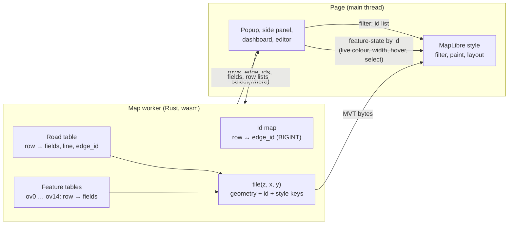

# The tile contract: tiles draw, the data layer knows

Status: design, 2026-10-27. The tile size standard (below) is in force with its test and budget. The rest has no library code yet.
Branch `design-tile-contract`, from `rust-engine` at `cfa80c2`.

This note separates the data of a road from its tiles. A tile then has only what MapLibre needs to draw it. All other data stays
in the map worker and the page gets it by id. The note gives the contract, the id, how the tile keys come from the style, the data
layer API, the CI checks, the expressions and a plan in phases. The decisions for Kaveh are in the last section.

Measurements: Burnaby, the tilted view (pitch 60, zoom 14), headless Chromium with software GL. Files: `.claude/tile-lag/` of the
workspace (`RESULT.md`, `ANALYSIS.md`, `one-feature/`, `expr/`) and [tile_speed.md](tile_speed.md).

## The tile size standard

The tile algorithm applies every reduction that keeps the map the same. If a tile is still large after that, no reduction is left, and
the tile is as small as it can be. So the standard is a list of reduction rules, not a size limit. Each rule has a status and a test.
A ratchet keeps the numbers from getting worse. A change that adds a feature to a tile, or a key, or a layer, must say which rule
allows it.

**The reduction rules.** Each rule has a number in the budget (per tile layer, the largest tile of the view). A rule that is done has
the number 0, and the test asserts it. For the other rules, the number can only go down.

| # | Rule | Now | The test |
|---|---|---|---|
| 1 | Only the features that a style layer draws at a zoom of the tile (`ZoomRules::span`) | Done where every layer on the source has a zoom rule (`simple`: 17 % of its features out at z13). Not done where a layer draws the source at every zoom: `roads-highlight` keeps all of `roads` (full look). | `undrawn` = 0 for a layer with a zoom rule (asserted) |
| 2 | Only the keys that the style reads (section 3) | Not done. Unread keys: `simple` 3 of 18, `slots` 6 of 12, `roads` 14 of 21 (full look). | `keys_unread` (ratchet) |
| 3 | The id is the MVT feature id, a dense row, and no id key (section 2) | Not done. `simple` has no MVT id (`__rs_edge` and `__rs_edge2` are keys). | `no_id` (ratchet) |
| 4 | A number, not a text | Not done. `simple` has 19 to 33 text values (class, colours). `roads` has 30,302 in one Monaco tile (509,422 bytes). | `strings`, `string_bytes` (ratchet) |
| 5 | Each key and each value once in a layer | Done. | `duplicates` = 0 (asserted) |
| 6 | Simplify a line to the pixel tolerance of the zoom | Partly. Below the last zoom the tolerance is 0.5 of 4096 units (1/16 px). A tolerance of 1 px gave 1 to 2 % on Burnaby ([tile_speed.md](tile_speed.md)). | `short_segments`, segments under 1 px (ratchet); a pixel test comes with the change |
| 7 | Drop or merge a feature smaller than a pixel at the zoom | Partly. Only a line under half a unit goes. At z12 in Monaco, 1,533 of 3,057 `simple` features (50 %) and 8,078 of 13,078 `roads` features are under 1 px. The casing seams and laps close joints, so they need a merge, not a drop. | `tiny` (ratchet); a pixel test comes with the change |
| 8 | Coordinates on the grid of the zoom | Not done. All zooms use 4096 units (8 for each pixel); z12 needs 2. The gain is small: geometry is 11 % of `roads` and 18 % of `simple`. | `bytes` (ratchet); a test of the grid comes with the rule |
| 9 | A base-map layer follows rules 1 to 8 | Partly. It follows rule 1 by its `minzoom`. All its keys stay (`ov4`: 0.3 MB of `osm_id`, `kind`, `name`). | The Burnaby gate prints the same numbers for `ov*`. CI cannot: the golden looks have no base-map layers. |
| 10 | One copy of a road in the tile source | Done in the page's look. Not in the full look: `roads` repeats each road that `simple` has. | The `roads` layer of `monaco-full` and `tartu-full` (ratchet) |

**What the big tiles are.** The full look (`export_style`, for a server) has a second road layer, `roads`: one feature for each whole
road with 21 columns. In the largest z12 tile it is 1,366,746 of 1,515,563 bytes in Monaco and 3,740,748 of 3,984,675 in Tartu. The
page's look has no `roads` layer, and its largest tile in these views is 383,687 bytes (Monaco z15).

| The `roads` layer, largest z12 tile | Monaco | Tartu |
|---|---|---|
| Bytes | 1,366,742 | 3,740,743 |
| Geometry | 146,342 (11 %) | 392,562 (10 %) |
| Tags | 493,455 (36 %) | 1,369,051 (37 %) |
| Value table | 635,312 (46 %) | 1,702,620 (46 %) |
| `edge_id`, `edge_ref`, `__rs_edge`, `osm_id`, `__rs_edge2` (tags and values) | 893,581 (65 %) | 2,424,304 (65 %) |
| Features | 13,078 | 35,672 |
| Features that `simple` draws at z12 (its fill pieces) | 1,850 (14 %) | 3,035 (9 %) |
| Features under 1 px | 8,078 (62 %) | 12,163 (34 %) |

The missing rules, in the order of their effect on these tiles:

1. **Rule 1.** `roads-highlight` (the glow of a hovered road) has no zoom rule, so `roads` keeps every road at z12, also those that
   `simple` hides (86 % of the features in Monaco, 91 % in Tartu). `roads-fill` has a class minzoom, but its opacity is 0: it is only
   a click target. If the glow reads `simple` with feature-state, as the page's look does, no layer needs `roads`.
2. **Rules 2 and 4.** `edge_id` (a 64-bit hash), `edge_ref`, `osm_id` and `__rs_edge2` are popup data, and 65 % of the layer. They are
   not read by the style, and most are text. They belong to the data layer (a props file by id for a server).
3. **Rule 10.** With 1 and 2 done, `roads` has nothing that `simple` does not have, so the layer goes.

In the page's look, the missing rules are 7 (half of the z12 `simple` features are under 1 px), 3 and 2.

**The ratchet.** The budget file `rust/roadstyle-rs/tests/data/tile_budget.json` has a limit for each number. The views are the 3 x 3
tiles around a fixed centre of Monaco and of Tartu, at zoom 12, 13, 14 and 15, with an empty keep list (the engine's own tiles,
without a page's popup fields). Each area has two looks: `monaco` and `tartu` are the page's look (the lean look: the `simple`
pieces and the slots), and `monaco-full` and `tartu-full` are the look of `export_style`.

| Number | For |
|---|---|
| features, bytes, values (the distinct values), keys, and the numbers of rules 2, 3, 4, 6 and 7 | the largest tile of each tile layer, in each view |
| bytes of all the tiles, bytes and features of the largest tile | each view |
| layers, characters of all expressions | the style |
| characters of each filter, paint and layout over 256 | each style layer |

**The protocol.**

- A change that makes a number larger than its limit, or breaks a done rule, fails CI. The Rust test `tile_budget` checks the four looks
  and the style. `tests/test_tile_budget.py` checks that the Python binding gives Monaco's page tiles within the same limits.
- To lower the limits after a change that makes the tiles smaller, run `scripts/tile_budget.py` and commit the file. The script lowers a
  limit and never raises one. A limit is the measured number plus 2 % (at least 1).
- To raise a limit or to add one (a new layer, a new expression over 256 characters), run
  `scripts/tile_budget.py --raise --why "the reason"`. The script writes the new limits and the reason in the file (`raises`). The PR
  text must give the same reason, with the numbers before and after, and Kaveh must agree before the merge. Do not edit a limit by hand.
- A new rule, or a rule that gets done, changes this table in the same PR: when a number reaches 0, the test asserts it from then on.
- The local Burnaby gate prints the same table for the Burnaby roads, with the limits of `areas.burnaby` when the file has them:
  `ROADSTYLE_BURNABY_ROADS=/abs/roads.parquet cargo test --release -p roadstyle-rs --test tile_budget burnaby -- --ignored --nocapture`
  (more inputs: `ROADSTYLE_BURNABY_LOOK`, `ROADSTYLE_BURNABY_FEATURES`, `ROADSTYLE_BURNABY_VIEWS`; use absolute paths). The Burnaby
  roads are not in the repository, so CI does not run it.

**The budget now** (2026-10-27; each limit in the file is this number plus 2 %). The page's look:

| Area | Zoom | Bytes, 9 tiles | Largest tile: bytes | features | `simple`: features | bytes | values |
|---|---|---|---|---|---|---|---|
| monaco | 12 | 148,817 | 148,817 | 3,057 | 3,057 | 148,817 | 4,496 |
| monaco | 13 | 328,297 | 188,682 | 3,930 | 3,930 | 188,682 | 5,109 |
| monaco | 14 | 422,576 | 261,434 | 5,092 | 4,243 | 209,696 | 5,530 |
| monaco | 15 | 1,189,927 | 383,687 | 7,384 | 6,605 | 333,935 | 8,806 |
| tartu | 12 | 471,606 | 243,927 | 5,366 | 5,366 | 243,927 | 6,362 |
| tartu | 13 | 1,200,903 | 280,126 | 5,778 | 5,778 | 280,126 | 7,051 |
| tartu | 14 | 1,101,318 | 184,791 | 3,710 | 3,155 | 152,719 | 3,958 |
| tartu | 15 | 785,237 | 167,383 | 3,348 | 3,018 | 146,333 | 3,058 |

The full look of the same views is larger because of `roads` (largest tile: Monaco 1,515,563 / 1,174,723 / 1,200,631 / 906,307 bytes at
z12 to z15; Tartu 3,984,675 / 2,008,851 / 846,441 / 340,709). The style (the same for both areas) has 5 layers in the full look, 4 in
the page's, and the page's `roads-simple` `line-width` is 25,796 characters (section 6).

## Why

On Burnaby, the tilted view takes 2.15 s from the jump to an idle map. `tile()` in the worker is 0.35 s of it. MapLibre's parse and
layout of the 30 tiles (5.9 MB, 115k features) is 1.4 s. In the road layer `simple`, the properties are 2.19 MB and the lines are
0.75 MB. Four keys of each road piece (`__rs_edge2`, `__rs_cls`, `lvl`, `__rs_access`) go only to the dashboard, not to the style.
The sort key `__rs_s` has a different value on almost each piece (49k values).

Two facts from the measurements decide the design:

1. MapLibre's time follows the features that it draws and the data-driven expressions that it calculates for them. A feature that
   no layer draws costs little (option A, now in `rust-engine`).
2. The road layer's expressions are most of the road cost. With all the paint and layout values of the road layer made constant,
   the view takes 0.77 s, not 1.42 s, and `line-width` alone is 0.38 s (the `expr/` test, section 6). Smaller tiles alone give less.

The contract therefore has two parts: small tiles, and small expressions.

## 1. The contract

A feature in a tile has these items only:

- its geometry, clipped to the tile and its buffer;
- its id: the MVT feature id, a small number (section 2);
- the keys that a style layer on its tile layer reads at the zoom of the tile (section 3).

All other data is in the **data layer**: the road table and the feature tables in the map worker, with the id as their row. The
page gets a value by id from the worker. The page never reads a property of a tile feature that the style does not read.



Who reads what:

| Reader | Reads from the tile | Reads from the data layer | How it reaches the map |
|---|---|---|---|
| Style (filter, paint, layout) | the style keys, `["id"]` | nothing | |
| Popup, tooltip | the id of the feature under the pointer | `fields(rows, names)` | |
| Side panel, Street View, Google 3D | the id | the fields, `roadLines(rows)` | |
| Dashboard filters (class, access, bridges, tunnels, modes, `rsFilter`) | nothing | `select(where)` gives the rows that show | a filter clause on `["id"]` |
| Live colours and widths (`rs.setData`) | nothing | `rowsOf(edgeIds)` for the join | feature-state `rs_c`, `rs_w` by id |
| Hover and selection glow | the id | the twin row for a pair | feature-state `hover`, `select` by id |
| Level editor | the id | the road table (`RS_SIDE`), `relevel` | new tiles of the changed roads |
| Base-map popup (`ov4`: `osm_id`, `kind`, `name`) | the id | `features(layer, rows, names)` | |

Much of this is already true. The popup and the side panel read `RoadTable` (`core.js`). The live colours and the glow are
feature-state by road row (`color.js`, `live.js`). The changes are the dashboard filters, the base-map popup, the id and the rule that
decides the keys.

## 2. The id

**The id of a road piece is its road's row.** It is `RoadKey` (`roadstyle-model/src/key.rs`): `table << 32 | row`, and for one build
the table is 0, so the id is the row. All pieces of one road (its casing pieces, halves, seams and fill) have the same id. A
feature-state on the id then applies to the whole road, and the paint expression decides which piece shows it (for example, only the
fill reads `rs_c`).

- **MVT id, not `promoteId`.** Now the pieces have no MVT id, and the source promotes the property `__rs_edge`. The contract writes
  the row as the MVT feature id and removes `__rs_edge` from the tile. The MVT spec says that an id "SHOULD" be unique in a layer, not
  "MUST". MapLibre accepts the same id on more than one feature: that is how `promoteId` works now. The page reads `f.id`, not
  `f.properties.__rs_edge` (`select.js`, `core.js`, `arrows.js`; `level_editor.js` already reads `f.id` first).
- **Base-map features.** The id of a feature of `ov0` to `ov14` is its row in its feature table (as now). The id spaces of the tile
  layers are different: a page never mixes them.
- **Slots (names and arrows).** The id of a slot is the row of its road, the same as its pieces.
- **The limit 2^53.** JavaScript holds an integer exactly only below 2^53. A row is a `u32`. A `RoadKey` stays below 2^53 while the
  table is below 2^21 (`RoadKey::TABLES`, a test checks it). duckOSM's `edge_id` is a BIGINT hash and is often above 2^53. Thus an
  `edge_id` is never a feature id and never a JavaScript `Number`. The data layer gives it as a `BigInt64Array`. The JSON road table
  already writes a number above 2^53 as text (`JsSafe`, `roadstyle-model/src/table.rs`), but then one column has two types. The new
  API gives one type.
- **The id map.** The data layer keeps row → `edge_id` (the road table's `edge_id_col`) and `edge_id` → row (a hash map, made one
  time). `rowsOf(edgeIds)` gives `u32::MAX` for an unknown `edge_id`.
- **Relevel.** The level editor's `relevel` changes the levels of some roads, not the set of roads. The rows stay the same, so the
  feature-state and the page's lists stay correct. `Tiles::replace_lines` replaces the pieces of the changed roads, and the new
  pieces have the same row as their id.
- **A new road set.** A new build, a new area or a new mode makes a new road table, and the rows change. This is a new
  **generation**: the tile prefix changes (as `lv://<gen>/` now), and the page clears its feature-state. The page keeps a selection
  or a live table by `edge_id`, and gets the new rows with `rowsOf`. A row from one generation is never used in the next.
- **Items.** An item on a road (an overlay attached with `edge_col`) is a piece of the road layer, so that the sort key puts it
  between the fills. Its id is its road's row, so a filter or a glow of the road applies to it. To pick an item as itself, the page
  needs the item's own number. See decision D3.

### The size of the id

The MVT feature id is field 1 of a feature: one byte for the field, then the row as a varint. A varint is 1 byte below 128, 2 bytes
below 16,384 and 3 bytes below 2,097,152. The id is not in the tags and not in the layer's value table. The source has no
`promoteId`: MapLibre uses the MVT id when no `promoteId` is set. The pieces of one road have the same row, so a road adds no values
to the tile.

Measured on the 30 Burnaby tiles of the tilted view (the `simple` layer: 87,362 pieces of 20,935 roads, 4.17 MB). A tag is two
varints (the key's index and the value's index). "Distinct values" is the sum over the tiles. Script:
`.claude/tile-lag/idcost.py` of the workspace (`python3 idcost.py tiles/roads`).

| Item | Pieces with it | Tags | Value table | Total | Distinct values |
|---|---|---|---|---|---|
| `__rs_edge` now (the row, as a tag) | 87,362 | 258 KB | 146 KB | **404 KB** | 25,088 |
| `__rs_edge2` now (the twin's row) | 43,924 | 131 KB | 67 KB | **198 KB** | 11,147 |
| `__rs_s` now (rank × 10^8 + row) | 87,362 | 259 KB | 374 KB | **632 KB** | 48,806 |
| MVT id = row, rows as now (max 151,752) | 87,362 | 327 KB (id field) | 0 | **327 KB** | 0 |
| MVT id = row, best order for this view | 87,362 | 264 KB (id field) | 0 | **264 KB** | 0 |
| `__rs_r` (the small rank, about 100 values) | 87,362 | about 175 KB | under 1 KB | **about 175 KB** | about 100 |

With the rows as now, 75 % of the pieces have a 3-byte row (row 16,384 or more), 25 % a 2-byte row, and 321 pieces a 1-byte row.

The expected saving (Burnaby, the tilted view, 5.9 MB):

- Phase 2 (the id): `__rs_edge` and `__rs_s` go out (−1,036 KB), and the MVT id and `__rs_r` come in (+502 KB). The net is
  **−0.53 MB** and **−74k distinct values**.
- Phase 4 removes `__rs_edge2` (−198 KB, −11k distinct values).
- Together: **−0.73 MB (−12 %)** and **−85k of the about 90k distinct values** that the id keys give now.

**The order of the rows.** Smaller numbers for the roads that a view shows most can make the id smaller. The best case is an order
made for this one view: the roads of the low zooms first, then by the number of their pieces. It gives 264 KB, not 327 KB: −63 KB,
1 % of the tiles. A real order is for the whole area (151k roads), so fewer roads get a 2-byte row, and the gain is less than this.
A spatial order (Hilbert) does not make the numbers smaller: a varint holds the number, not its difference from the last one. A new
order also makes a permutation between the road table's input order and the rows. This costs more than 1 % gives, so the rows stay
in the road table's order (decision D7).

## 3. The keys come from the style

The set of keys of a tile layer at zoom z is calculated from the style. It is not a list that a person keeps.

- **The rule.** For each style layer on the tile layer, with z in its `[minzoom, maxzoom)`, collect each `["get", k]` and
  `["has", k]` in its filter, paint and layout (`props::expression_reads` does this now). A key goes into the tile of zoom z only if
  that set has it. A key that only a zoom clause makes useless (for example `__rs_lap` from zoom 17) can go out with the same span
  rule as option A (`ZoomRules::span`).
- **What goes out.** Now the tiles keep every `__rs_*` key, the page's keys (`reads.json`, `pieces`), `name`, `kind`, the popup's
  fields and the caller's `keep` (`props::drawn`, `TileOptions::rule`). The contract keeps only the style's set. `keep` and the
  popup fields go to the data layer. `reads.json`'s `pieces` list becomes empty (or only the items' keys, D3).
- **Small values.** In an MVT, each key on a feature costs two varints, whatever the type of the value. A value costs its bytes one
  time for each tile layer. So the number of keys on a feature and the number of different values are what count. Rules:
  - a value that has a small fixed set (class, piece kind, flags) is a small integer, and the style reads a table with
    `["at", ["get", k], ["literal", [...]]]` or `match`. `__rs_ci` already does this. The class minzoom in the filter reads
    `highway`, a text. It can read `__rs_ci` and then `highway` goes out of the tile;
  - a flag that is false is not written (MapLibre reads a missing key as null);
  - a value of the look's data (a ramp colour of each road) stays as it is, but only on the piece that draws it.
- **The sort key.** `__rs_s` is `rank × 10^8 + row` (`simple.rs`, `sort_key`). The row is now the id, so the tile gets only the
  small `rank` (`__rs_r`, about a hundred values) and the style calculates
  `["+", ["*", ["get", "__rs_r"], 1e8], ["id"]]`. The order is the same. The raise of the top roads reads `["id"]`, not
  `__rs_edge`. A multi-table `RoadKey` is above 10^8, so this form is only for one table. A key of more tables needs its own sort
  rule later.

## 4. The data layer API

The worker owns the data. The page asks by id. The calls are on the object that makes the tiles (`LiveMap`, `Tiler`), so that the
rows and the tiles are always of the same generation. The answers are typed arrays or Arrow IPC bytes, not JSON of the whole
table.

roadstyle-wasm (in the worker; the page calls it through `postMessage`):

```js
map.generation()                        // u32, changes when the rows change
map.rows()                              // the number of roads
map.edgeIds()                           // BigInt64Array, index = row
map.rowsOf(edgeIds /* BigInt64Array */) // Uint32Array, 0xFFFFFFFF = not found
map.fields(rows /* Uint32Array */, names /* string[] */)   // Arrow IPC: one row for each id (popup, side panel)
map.columns(names)                      // Arrow IPC: whole columns (the dashboard's counts and legends)
map.select(where /* JSON text */)       // Uint32Array: the rows that show
map.roadLines(rows)                     // as now
map.features(layer, rows, names)        // Arrow IPC: a base-map layer's fields (ov4's popup)
```

`where` is the dashboard's state, for example
`{"classes_hidden": ["service"], "access_hidden": ["private"], "bridges": true, "tunnels": false, "ids": null, "modes": ["walking"]}`.
`select` adds the twin row of a two-way pair when either edge shows (now done with `__rs_edge2` in the filter). The answer is one
list, so the page does not need `__rs_cls`, `lvl`, `__rs_access` or `__rs_edge2` on a piece.

Python (`roadstyle` binding, the same Rust functions; numpy for the arrays, pyarrow for the tables):

```python
t = roadstyle.Tiler(roads, look)
t.edge_ids()                       # numpy int64, index = row
t.rows_of(edge_ids)                # numpy uint32
t.fields(rows, ["name", "highway"])          # pyarrow.Table
t.select({"classes_hidden": ["service"]})    # numpy uint32
t.features("ov4", rows, ["osm_id", "name"])  # pyarrow.Table
```

How the page uses it:

- **Filters.** The page sends `where` to the worker and gets the rows that show. It sets one clause on each road layer:
  `["match", ["id"], [ ...rows ], true, false]`, or the opposite form with the hidden rows when they are fewer. `match` finds a label
  with one lookup. `["in", ["id"], ["literal", rows]]` searches the list, which is slow for 26k features. A filter change makes
  MapLibre lay out the loaded tiles again. That is also true now (`setFilter`), and it occurs only when a person changes a switch.
- **Live colours.** `rs.setData` joins by `rowsOf(edgeIds)`, not by a scan of all the rows in JavaScript, and sets `rs_c` and `rs_w` by
  id. The style does not change.
- **Popup and panel.** `fields([row], names)` for the road and its twin. `RoadTable` stays the page's one port; behind it the
  table can be the full JSON (as now) or a cache of `fields` answers.

## 5. The checks in CI

Two tests. Both use the views that CI already has (Monaco and Tartu; D4 for Burnaby).

**The contract test** (Rust, `roadstyle-tiles`, `tests/tile_contract.rs`). For each tile of the fixed views, decode the MVT and check:

1. each key of each tile layer is read by a style layer on that tile layer at the tile's zoom (section 3). The test names the key,
   the layer and the zoom when it fails;
2. each feature is drawn by a style layer at a zoom of the tile (z, z + 0.5 and z + 0.999), with the layer's filter. This needs an
   evaluator with all of MapLibre's operators, so this part runs in Node with `@maplibre/maplibre-gl-style-spec` (as the analysis
   script did), next to `bench_live_views.mjs`;
3. each feature of the road layer has an MVT id that is a row of the road table.

The JavaScript side: `tests/test_contract_names.py` already fails when a dashboard module reads a `__rs_*` property that
`reads.json` does not declare. With `pieces` empty, it fails when a module reads a tile property of a piece.

**The size budget** (done: see "The tile size standard"; `rust/roadstyle-rs/tests/data/tile_budget.json`). For each fixed view, for each tile layer: the
features, the bytes, the keys and the different values of each key. The test fails when a number is more than 5 % above the
budget. A change that makes the tiles smaller writes the new budget in the same commit. The budget also has the JSON size of each
data-driven paint and layout property of the road layer (section 6), so a large expression fails CI too.

## 6. The expressions

The `expr/` test (`.claude/tile-lag/expr/README.md`) changes one item of the live style and measures the time from the jump to an idle
map: Burnaby, the tilted view, the tiles of `cfa80c2`, headless Chromium with software GL, the median of 5 runs, each on a new page,
with a 200 ms start wait in each time.

| Variant | ms to idle | Against now |
|---|---|---|
| now | 1416 | |
| all 5 paint and 3 layout properties of `simple` constant | 768 | −648 |
| only `line-width` as an interpolate on the zoom only (no feature data) | 1032 | −384 |
| only `line-color` constant | 1334 | −82 |
| only `line-opacity` constant | 1352 | −64 |
| only `line-offset` constant | 1364 | −52 |
| only `line-dasharray`, `line-sort-key`, `line-cap` or `line-blur` changed | 1400 to 1452 | in the noise |
| the `simple` layer removed (the other layers stay) | 568 | −848 |
| the `simple` layer two times | 2190 | +774 |
| half of the other layers on the `rs-roads` source removed (24 of 49) | 1232 | −184 |
| all other layers on the `rs-roads` source removed (49) | 1083 | −333 |

The size of the expressions (characters of JSON): `line-width` 29,032, `line-offset` 3,184, `line-color` 1,895, the filter 859, each
other property below 300. In the worker's CPU profile of "now" (1,576 ms of samples), `evaluate`, MapLibre's evaluation of style
expressions, is the top function: 311 ms, 20 %.

The style has 50 layers on the vector source `rs-roads`. One of them (`rs-roads-simple`) reads the road layer `simple`. The others
read the overlays and the base-map layers (`ov0` to `ov14`). 12 of the 50 are visible.

What this shows:

- **The expressions are the main cause of the lag.** The road layer costs about 0.85 s. About 0.65 s of it is the calculation of its
  paint and layout expressions, and about 0.2 s is the drawing of its features.
- **`line-width` alone is 0.38 s.** It is an `interpolate` over 9 zoom stops (12 to 20). Each stop is a `case` on the piece kind, pair,
  bridge and twin, with tables of the 29 classes (`["at", ["get", "__rs_ci"], ["literal", [...]]]`, about 3 KB for each stop).
  MapLibre calculates it for each feature at two zooms.
- **The sort key has no cost in time.** Its cost is its 49k different values (section 2).
- **Each style layer on the same features costs again.** One road layer is correct. A second layer for the casing is not a gain. The
  other 49 layers cost 0.33 s together. Their expressions get the same budget as the road layer's.

How to keep the expressions small:

1. **One small width key for each piece, from the engine.** The width reads 5 keys (`__rs_k`, `__rs_ci`, `__rs_pair`, `__rs_bridge`,
   `__rs_twoway`). The engine already knows each piece's width row. It writes one small integer `__rs_wk`, the index of that row, with
   fewer than 200 different values (1 byte in each tag). The style then has one width table for each zoom stop:
   `["interpolate", ["linear"], ["zoom"], 12, ["at", ["get", "__rs_wk"], ["literal", [...]]], 13, ...]`. It is the same map: the same
   widths at the same zooms, with one lookup for each stop, not a `case` tree. The live width stays a factor:
   `["*", ..., ["coalesce", ["feature-state", "rs_w"], 1]]`.
2. **The same index for the offset**, where the offset reads the same keys (`__rs_twoway`, `__rs_pair`, `__rs_ci`).
3. **Fewer stops where the curve lets it.** The classes do not grow with one curve (for example, from zoom 12 to 20 one class grows
   25 times and another 94 times), so one base width times a shared curve changes the pixels. A class whose widths are on one
   exponential curve can have 2 stops, not 9.
4. **A budget** for each data-driven property (section 5): 4 KB.
5. **The same pixels.** A change of an expression must not change the picture. The pixel goldens and the Burnaby pictures of
   `expr/` decide this.

The zoom-only width gives the top limit of the gain (−0.38 s). A width that reads one key is still data-driven, so its gain is less.
A probe before the code: in the `expr/` harness, make each stop one `["at", ["get", "__rs_ci"], ...]` lookup with the saved tiles.
This has the same cost as `__rs_wk` (the pixels are wrong, the time is correct).

## 7. The plan

Each phase can ship alone. Each phase that changes the tile bytes writes the new tile goldens and the new budget. The small
expressions come first: they have the largest gain and need no page change.

| Phase | roadstyle | The page (dashboard, duckosm-rust) | Expected gain (Burnaby, tilted view) | Risks | Tests |
|---|---|---|---|---|---|
| 0. Undrawn features out (done, `5f79037`) | `ZoomRules::span` | none | −15k features, −0.6 MB; time in the noise | | the span tests, the Burnaby hashes |
| 1. Small expressions | the engine writes `__rs_wk` (and the offset's index); `line-width` and `line-offset` as one table lookup for each zoom stop; the same budget for the other 49 layers | none | up to −0.38 s (width); up to −0.65 s with all of the road layer's expressions; the probe gives the real number first | a change of pixels; one more key on each piece (1-byte tag) | pixel goldens, the `expr/` harness, the expression budget |
| 2. The id | MVT id = road row on `simple` and the slots; no `promoteId`; `__rs_edge` out of the tile; sort key from `__rs_r` and `["id"]` | read `f.id` (`select.js`, `core.js`, `arrows.js`, editor); no `promoteId` in `addSource` | −74k different values, −0.53 MB (measured, section 2); time small (the sort key test showed no time) | MapLibre with the same id on many features (now true with `promoteId`, so low); an old page with a new style | sort-key order test (`sources.rs`), glow and live colour e2e, editor e2e |
| 3. The data layer | `generation`, `edgeIds`, `rowsOf`, `fields`, `columns`, `select`, `features` in roadstyle-wasm and Python | filters from `select`, `rs.setData` with `rowsOf`, `ov4` popup from `features` | none alone; it lets phase 4 remove keys | a filter change with 150k ids (size of the `match`); a popup that waits for the worker | unit tests of `select` (twins, modes), filter e2e, popup e2e |
| 4. Keys from the style | `TileOptions::rule` keeps the style's keys of each zoom only; `highway` replaced by `__rs_ci` in the filter; the 5 old width keys go out of the tile where no expression reads them; `reads.json` `pieces` empty | no page read of a tile property | −4 keys on 87k pieces, −`osm_id`/`kind`/`name` on 24k buildings: with phase 2, −0.8 to −1.0 MB of 5.9 MB; time about −0.05 to −0.1 s | a reader that nobody found: the contract test and `test_contract_names.py` find it | the contract test, the size budget |

The sum: the control now takes 1.42 s, and the roads are 0.85 s of it. Phase 1 gives the time. Phases 2 to 4 give the bytes and a
clean contract, with little time.

A larger change, one casing for the two halves of a two-way road (option B in `ANALYSIS.md`, about −18k features), is not in this
plan. It changes the picture and the live colour of each direction, so it needs its own note.

## Decisions for Kaveh

| | Decision | Recommendation |
|---|---|---|
| D1 | The pieces' id: the MVT id (no `promoteId`), or keep `promoteId` on `__rs_edge` | the MVT id: one key less on each piece, and the page reads `f.id` |
| D2 | The dashboard filters: an id list in the filter (a layout of the loaded tiles on each change), or a feature-state `rs_off` in the paint (no layout, but a hidden road is still drawn and a click still finds it) | the id list with `match`: a hidden road costs nothing, as with the filters now |
| D3 | An item picked as itself: keep `__rs_pick` and the item's number as the only declared page keys on items, or give items their own id range | the declared keys: few features have them, and the road's filter and glow stay one lookup |
| D4 | The views of the CI checks: Monaco and Tartu in CI; Burnaby only as a local bench gate (its data is not in CI) | yes |
| D5 | The width: one index key `__rs_wk` (the same pixels, one lookup for each stop), or one base width times a shared zoom curve (2 stops, but the pixels change) | `__rs_wk`; first the probe in `expr/` |
| D6 | The order: small expressions first (phase 1, as in this note), or the id and the data layer first | expressions first: the largest gain, and no page code |
| D7 | The rows: in the road table's order, or numbered again so that the roads of the low zooms get 1- and 2-byte ids | the road table's order: a new order gives 1 % at most (−63 KB in the best case) and adds a permutation |
