# Gallery

<p class="lead">Each picture shows one feature, with the line of code that makes it.</p>

The pictures are Södermalm (Stockholm) and Monaco, from OpenStreetMap:

```python
import geopandas as gpd
import roadstyle as rs
edges = gpd.read_file("ui/studio/samples/sodermalm_driving.geojson")   # Södermalm; Monaco is duckOSM's Monaco build
```

## The road map look

The default map has outlines, street names along the roads and one-way arrows.

```python
rs.render_edges(edges)
```

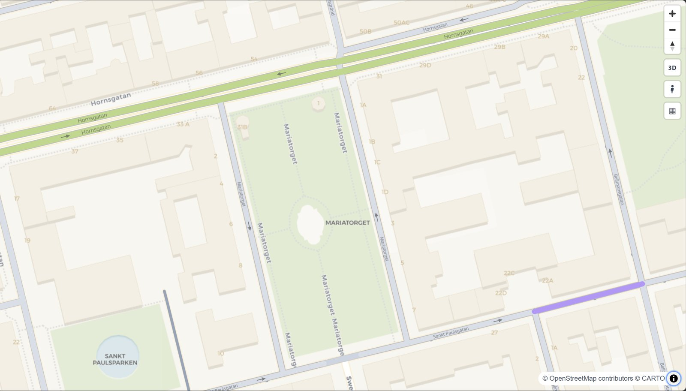

## Bridges and tunnels

A bridge has a slate outline and a soft shadow on the roads under it. A tunnel fades and has a dashed outline. roadstyle works out the drawing order.

```python
rs.render_edges(edges)
```

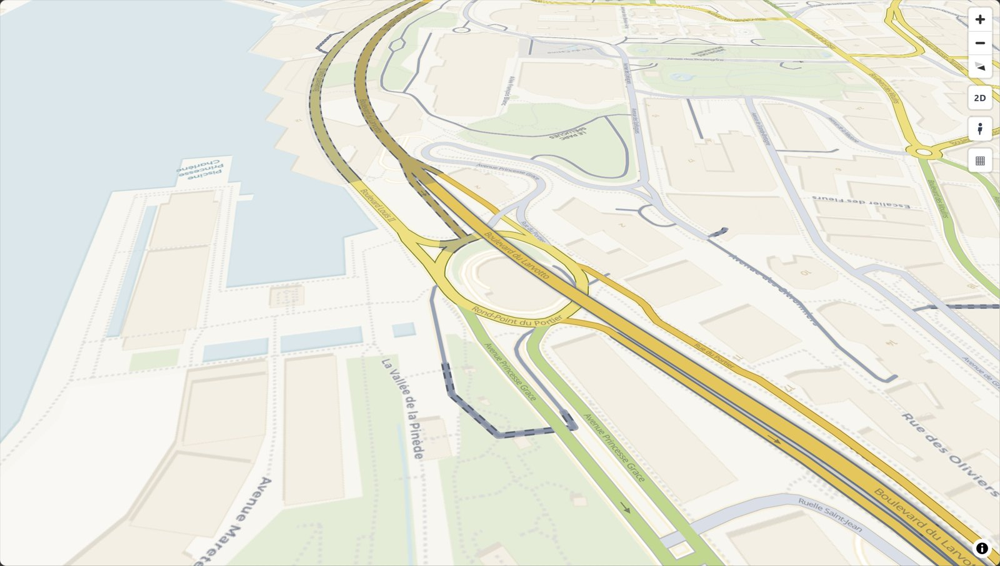

More in [Which road is on top](guides/levels.md).

## Stacked roads

Roads, ramps and tunnels cross at several levels, and each one is drawn in the right order. To fix a place by hand, use the
[level editor](guides/levels.md#edit-the-levels).

```python
rs.render_edges(edges)
```

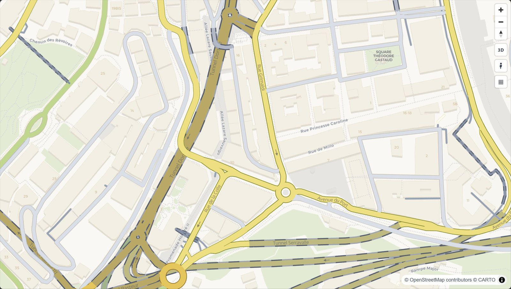

## Colour by your data

Any column, with a legend.

```python
rs.render_edges(edges, color_by="maxspeed_kmh", cmap="YlOrRd", legend=True)
```

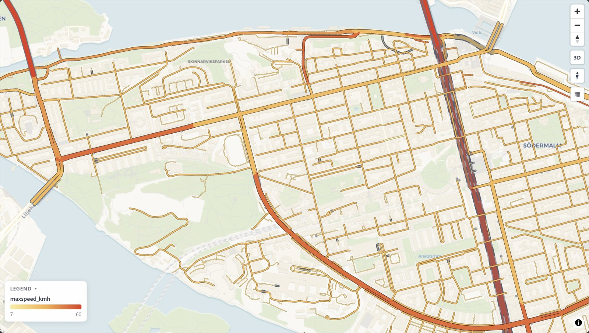

More in [Colour by your data](guides/colour.md).

## 3D bridges

Bridges are raised decks over the roads under them. A map page has a 2D/3D button. A dashboard has the `navigate` button, and its box has a tilt slider.

```python
rs.render_edges(edges, view_3d=True)
```

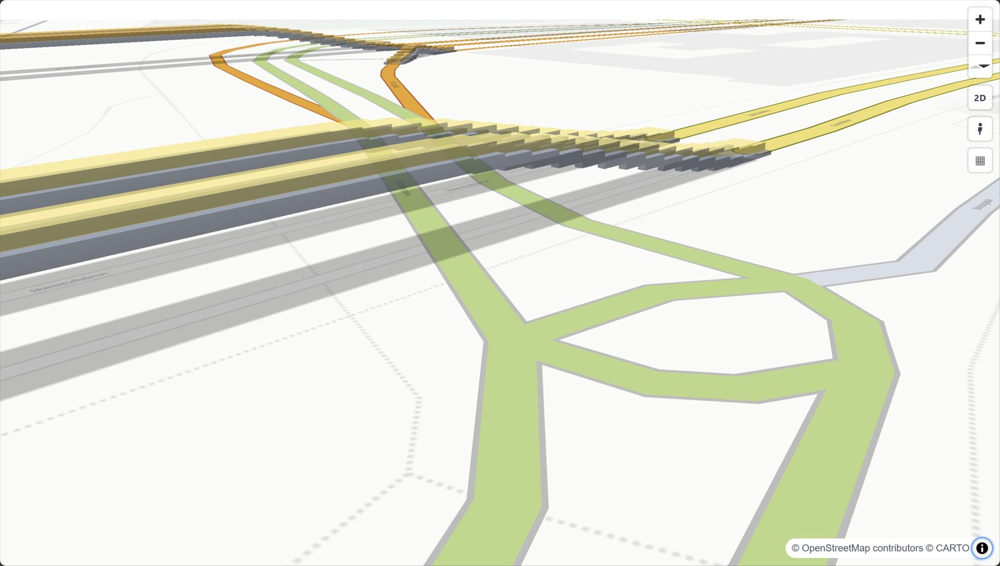

## Street View

Click a road, then click the Street View button. A window that you can move shows Google Street View of that road.

```python
rs.render_edges(edges)                # the Street View button is on by default
```

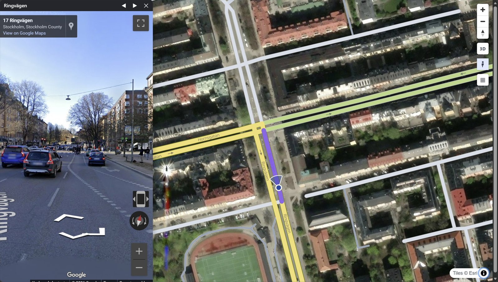

More in [Google Street View](guides/street-view.md).

## Google 3D

A window next to the map shows the photorealistic 3D view of Google. The two cameras move together. A clicked road is drawn in
the 3D view. This needs a [Google key](guides/google-key.md). To try it, use the [live map](maps/live.html).

```python
rs.render_edges(edges, google_3d=True)
```

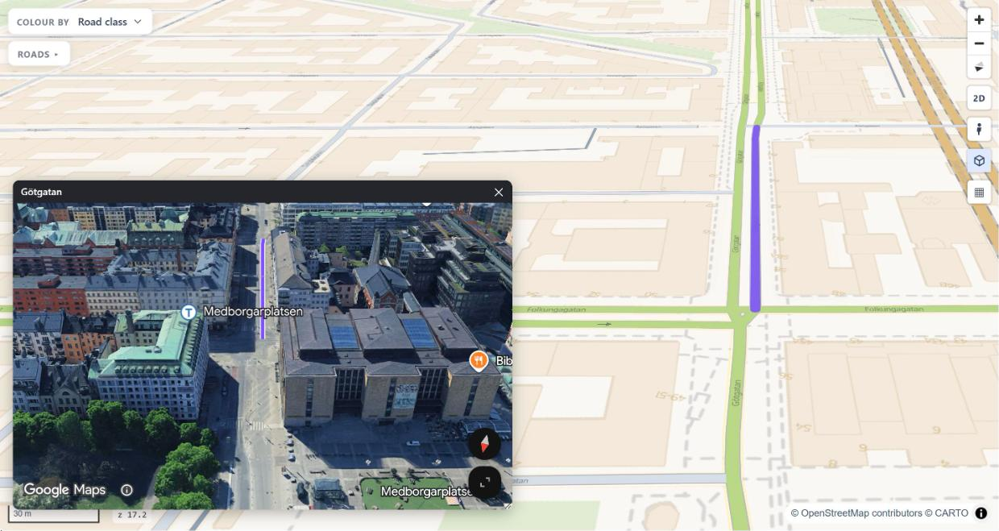

More in [Google 3D](guides/google-3d.md).

## Ready-made pages

One call makes the standard dashboard: a panel at the left and a toolbox at the right edge (navigate, base map, roads, colour and legend, settings).
The panel starts empty: the call above adds the query box and the road card. The pictures show a road selected. The map starts on the base map that you give. The pictures use OpenFreeMap Positron and OpenFreeMap Fiord (the dark theme).

```python
rs.render_dashboard(
    edges, basemap="ofm_positron",
    color_options={"Class": {}, "Speed": {"color_by": "maxspeed_kmh"}},
    dashboard={"panel": {"sections": [{"id": "q", "part": "query"}, {"id": "road", "part": "road_card"}]}},
)
```

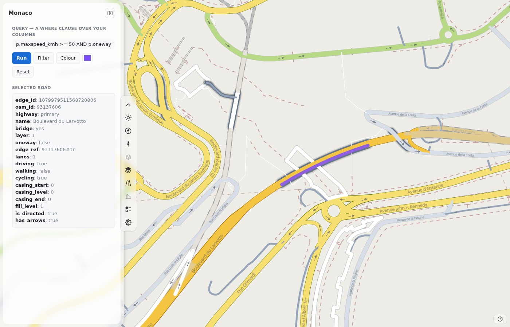

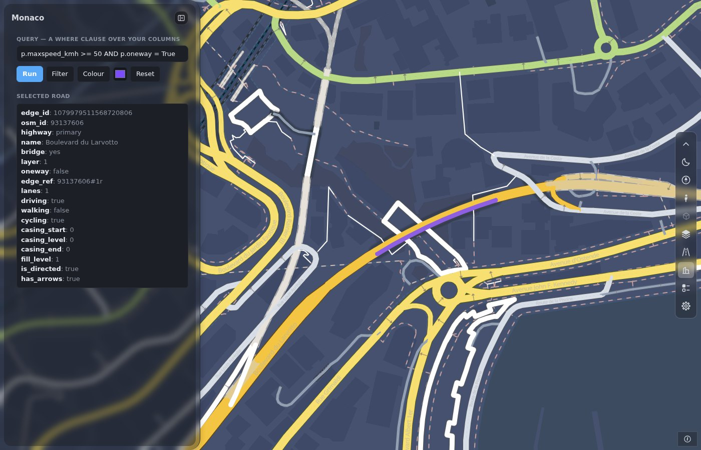

<div style="max-width:300px" markdown>

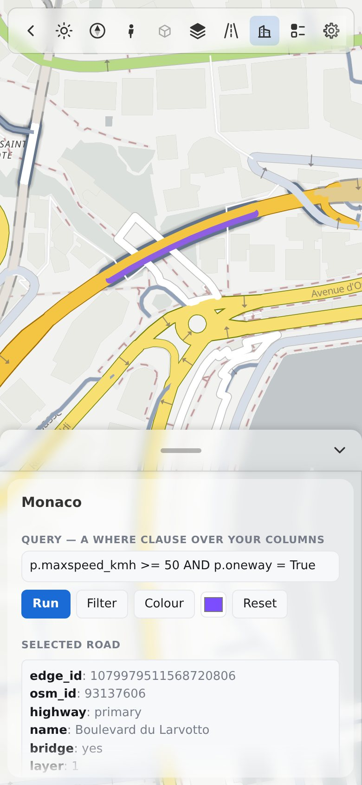

</div>

More in [Dashboards](guides/dashboards.md).

## Mono palette

Shades of grey on a blank canvas: a quiet base under your own data colours. The other palettes are `amber` (the default), `carto` and `highsat`.

```python
rs.render_edges(edges, palette="mono", basemap="blank")
```

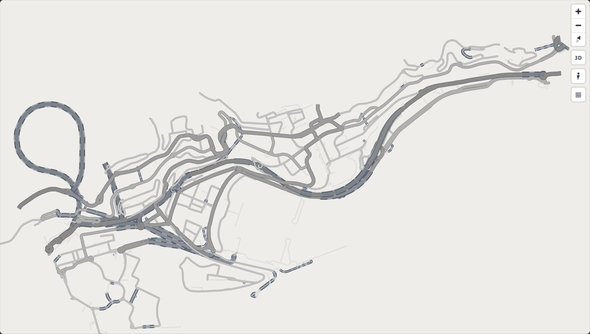

## Base maps

The same map on another background. The base maps are OpenFreeMap Positron (the default), OpenFreeMap Liberty, OpenStreetMap, Esri Gray, Esri Streets, Esri Satellite and a blank canvas that works offline.

```python
rs.render_edges(edges, basemap="blank")
```

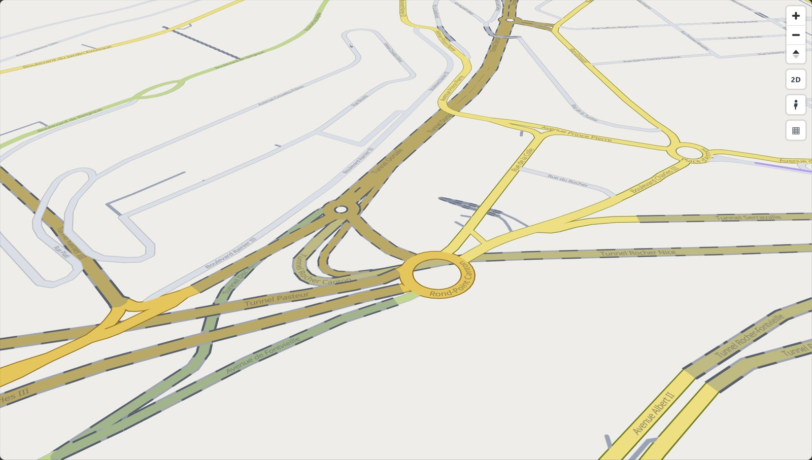

More in [Style the roads](guides/style.md).
