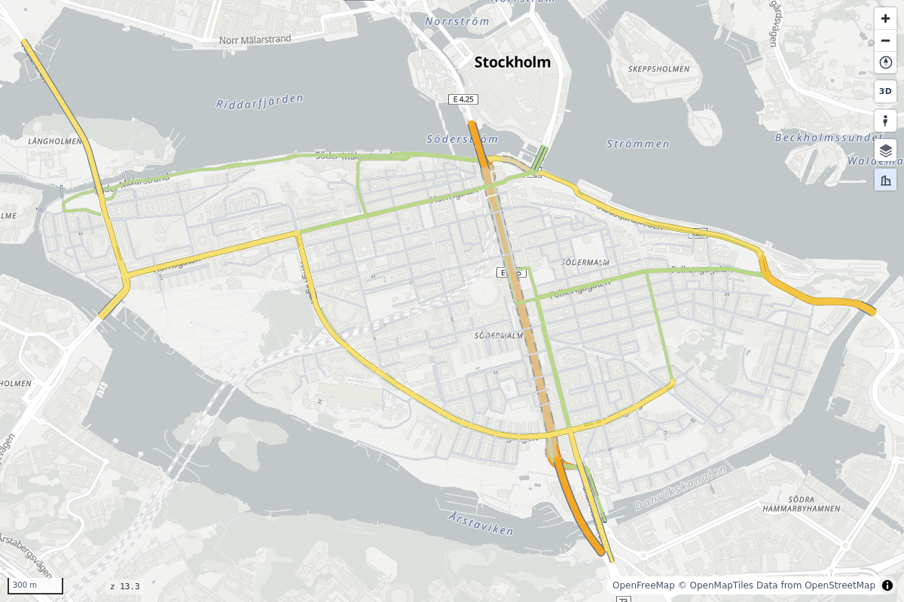

# With AI agents

<p class="lead">An AI agent can use roadstyle in two ways: as tools that any MCP app can call, or as a library that the agent writes code against.</p>

## Tools, no code: the MCP server

The MCP server lets any MCP-capable AI app (Claude Code, Claude Desktop, Cursor, ...) draw road maps with no code.
Each tool saves an HTML map. It returns the path of the map and a PNG preview that the agent can look at.



Add the server to Claude Code:

```bash
claude mcp add roadstyle -- uvx roadstyle-mcp
```

Add it to Claude Desktop (`claude_desktop_config.json`):

```json
{"mcpServers": {"roadstyle": {"command": "uvx", "args": ["roadstyle-mcp"]}}}
```

The server saves maps in `~/roadstyle-maps/`. The preview needs Chromium once: `uvx --from roadstyle-mcp playwright install chromium`.

| Tool | What it does |
|---|---|
| `render_place(place, network_type="drive", options, output_path)` | Downloads the OpenStreetMap roads of a place with osmnx and draws them. `network_type` is `drive`, `walk`, `bike`, `all`, `drive_service` or `all_public` |
| `render_file(path, options, output_path)` | Draws a road file (GeoPackage, GeoJSON, Shapefile, ...) |
| `snapshot(html_path, lon, lat, zoom, bearing, pitch)` | Makes a PNG of a saved map. Use it to check street names and arrows: side streets show from zoom 17 |

`options` takes any [`render_edges` keyword](../reference/parameters.md), for example
`{"color_by": "maxspeed", "legend": true}`. A misspelt keyword gives an error that names the closest valid keyword.

??? info "Claude Code plugin: the server and the skill in one install"
    ```text
    /plugin marketplace add Khoshkhah/roadstyle
    /plugin install roadstyle@roadstyle
    ```

## Code: the agent skill

An agent that writes Python (Claude Code, Codex, the agent of Cursor) works best with the
[skill](https://github.com/Khoshkhah/roadstyle/blob/main/skills/roadstyle/SKILL.md). The skill is one page: the one call,
the data contract, the JavaScript API and the traps. To install it for Claude Code:

```bash
mkdir -p ~/.claude/skills/roadstyle && curl -fsSL -o ~/.claude/skills/roadstyle/SKILL.md \
  https://raw.githubusercontent.com/Khoshkhah/roadstyle/main/skills/roadstyle/SKILL.md
```

All the documentation, as a list of links for LLMs: [llms.txt](../llms.txt).
