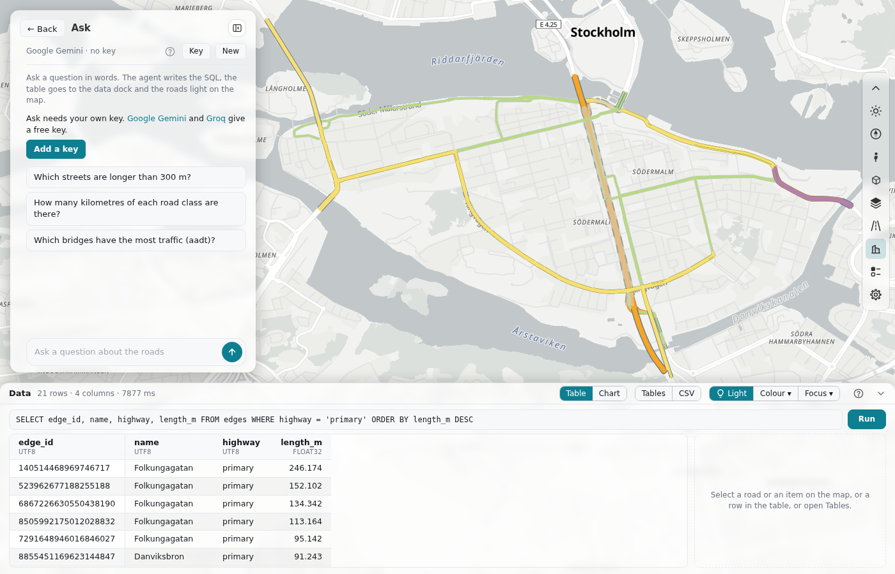

---
hide:
  - toc
---

# Ask

Ask is an AI agent in the side panel. The person types a question in words, for example "Which primary roads are longer than 1 km?". The agent writes SQL, runs it through the [data dock](data-dock.md), reads the result and answers in one to three sentences. Each answer puts its SQL and its table into the data dock, so its roads light on the map. The agent can also colour roads, focus on roads and move the map.

The agent uses the person's own key of a free AI service. The browser sends each request directly to that service. There is no model in the browser and no server of roadstyle or of your page. Ask is a JavaScript module that the host page imports. Each item below has the same form: a box with **Use it for** and **From Python**, the code in tabs, and **Details** that open on a click.



**Try it.** The page below is live: Ask and the [data dock](data-dock.md), with DuckDB in the page and the roads of Södermalm. Click
**Add a key** and paste the key of a free service (Google Gemini or Groq): the key stays in your browser and goes only to that service.
Then click an example question or type your own. The agent writes the SQL, the table goes to the dock, and the roads light on the map.
<a href="../../maps/ask.html" target="_blank" rel="noopener">Open it on a page of its own</a>.

<iframe src="../../maps/ask.html" loading="lazy" title="Ask, live, with the data dock and DuckDB in the page" class="rs-demo" style="height:780px"></iframe>

| Group | Item | From Python | Use it for |
|---|---|---|---|
| Use it | [Add it to a page](#add-it-to-a-page) | no | Ask in your dashboard |
| Use it | [The options](#the-options) | no | what `askPanel` takes |
| Use it | [The methods and the events](#the-methods-and-the-events) | no | to drive Ask from code |
| The person | [What the person sees](#what-the-person-sees) | no | the view and its controls |
| The person | [The services and the keys](#the-services-and-the-keys) | no | a free key of a service |
| The agent | [The agent](#the-agent) | no | its tools and its loop |
| The agent | [Graph questions](#graph-questions) | no | the diameter and shortest distances in SQL |
| The agent | [draw_chart](#draw_chart) | no | a chart of a result |
| Safety and tests | [Safety](#safety) | no | what the worst result is |
| Safety and tests | [Tests](#tests) | no | a fake provider, with no key |

## Use it { .rs-group }

### Add it to a page { .rs-part }

**Use it for:** Ask in a dashboard page. It needs [the data dock](data-dock.md).<br>
**From Python:** no
{ .rs-facts }

=== "JavaScript"

    ```javascript
    import {dataDock} from "./dashboard/data/data_dock.js";
    import {askPanel} from "./dashboard/ask/ask_panel.js";

    const data = dataDock({query, schema, ready});            // your database: see "The data dock"
    const ask = askPanel({
      data,
      about: "A road network of Tartu. One row of edges is one direction of a road.",
      dialect: "DuckDB",
      examples: ["Which streets are longer than 1 km?", "How many one-way roads are there?"],
    });
    ask.addEventListener("answer", (e) => console.log(e.detail));   // {question, text, sql, rows}
    rs.sections.add({id: "ask", label: "Ask", note: "Ask a question about the data", open: () => ask.open()});
    ```

### The options { .rs-part }

**Use it for:** what `askPanel({...})` takes. `data` is necessary.<br>
**From Python:** no
{ .rs-facts }

??? info "Details"

    | Option | Default | What it is |
    |---|---|---|
    | `data` | (necessary) | The data dock. Ask runs all its SQL through it: the guard, the row limit and the table. |
    | `dashboard` | `window.rs` | The page's dashboard. |
    | `about` | `""` | One paragraph about your data. It goes into the prompt. Put here the facts that the model must know, for example which table the map draws. |
    | `dialect` | `"SQL"` | The name of the database's SQL. With `"DuckDB"`, the prompt also tells the model how to read the comments of the tables and columns. |
    | `examples` | `[]` | Questions that the empty start shows as buttons, one row each. A click on a question asks it. |
    | `panel` | `#sb` | The host's dashboard panel. Ask uses roadstyle's [editor frame](dashboard-parts.md#an-editor-in-the-panel) in it. |
    | `backLabel` | `"Back"` | The text of the back button. |
    | `maxSteps` | `6` | The most model calls for one question. |
    | `sendRows` | `30` | The most rows of one result that go to the model. |
    | `providers` | the five free services | The list of services. A test gives a fake provider here (see [Tests](#tests)). |

    The schema of the data dock (`schema()`) gives the prompt its tables. Give `main: true` and `columns: [{name, type, about}]` on the table that the map draws. The prompt has one line for each schema with the table names and their rows, the columns of the main table, and each table of the schema `extra` with its `about`. A prompt of this form stays small (about 4 000 characters), because a free service allows only some thousand tokens a minute.

### The methods and the events { .rs-part }

**Use it for:** to ask a question from code, to stop it and to read the conversation.<br>
**From Python:** no
{ .rs-facts }

??? info "Details"

    | Method | What it does |
    |---|---|
    | `open()`, `close()`, `isOpen()` | Shows the Ask view in the panel, or shows the host's cards again. The conversation stays. |
    | `ask(question)` | Asks a question. It gives a promise of `{question, text, sql, rows}`, or `null` when the question stops with an error. |
    | `stop()` | Stops the question now. |
    | `clear()` | Starts a new conversation, as **New** does. |
    | `remove(i)` | Removes the question `i` and its answer, as the card's ✕ does. |
    | `history()` | The questions and answers of this conversation. |

    | Event | `detail` | When |
    |---|---|---|
    | `answer` | `{question, text, sql, rows}` | The agent gave an answer. |
    | `error` | `{question, message}` | The question stopped: no key, a refused key, three failed queries, `maxSteps`, Stop. |
    | `back` | none | The person clicked Back. Ask closes by itself. |

## The person { .rs-group }

### What the person sees { .rs-part }

**Use it for:** the Ask view in the panel: a tool row, one card for each question, and a question box.<br>
**From Python:** no
{ .rs-facts }

??? info "Details"

    - **The tool row** under the title does not scroll: the service and its model, "?", **Key** and **New**.
    - **One card for each question.** The question is the bold title. The answer is plain text: bold and `code` show as bold and code, and a list shows at most 3 items with "… 2 more in the table". The view shows no HTML, no images and no links from the model, and it removes long ids from the text.
    - **The footer** counts the query that made the table, "1 query · 625 rows", and opens to its SQL. The other queries of the agent and the failed queries that it fixed are inside it. **Show** puts the card's table back into the dock.
    - **The answer's table** is the query with roads (the id column, or a key column of the data dock) that has the most rows, not the last query. When a map tool ran, its roads are the table.
    - **A map change** is one line on the card, for example "MAP Focus on 625 roads (the others hidden)". A colour or a focus is a layer in **Colour ▾** or **Focus ▾** of the data dock. A new question, ✕ of a card and **New** do not remove a layer.
    - **An error** ends the question with a red line on its card, and the question box works again.
    - **A road click** while Ask is open shows no popup. The data dock opens with the road in its card (`rs.holdPopup("ask", …)`).
    - **The question box** is at the bottom. Enter asks, Shift+Enter is a new line. While the agent works, the send button is a stop square. After the first question, **Examples ▴** above the box shows the example chips.

### The services and the keys { .rs-part }

**Use it for:** a free key of one of five services. The key stays only in the person's browser.<br>
**From Python:** no
{ .rs-facts }

??? info "Details"

    Ask offers only services with a free key. The table is as the services said on 2026-11-05. A service can change its free tier.

    | Service | Address | Free key from |
    |---|---|---|
    | Google Gemini (the default) | `https://generativelanguage.googleapis.com/v1beta/openai` | <https://aistudio.google.com/apikey> |
    | Groq | `https://api.groq.com/openai/v1` | <https://console.groq.com/keys> |
    | Cerebras | `https://api.cerebras.ai/v1` | <https://cloud.cerebras.ai> |
    | Mistral | `https://api.mistral.ai/v1` | <https://console.mistral.ai/api-keys> |
    | OpenRouter (only its `:free` models) | `https://openrouter.ai/api/v1` | <https://openrouter.ai/keys> |

    All five use one request: `POST {address}/chat/completions` with the key in the header `Authorization: Bearer <key>`. Each one accepts a request from a browser page.

    **Key** opens the key form in place of the conversation: the service, the model and the key. **Save** asks the service for its models (`GET {address}/models`) and says "The key works" or the service's own error. When the typed model is not in the list, Ask picks a model with tool support from it. When the service refuses the model during a question (HTTP 404, or HTTP 400 that names the model), Ask picks another model once and sends the request again. On HTTP 429 (the free limit) Ask waits as long as the service says, at most 60 s and at most 2 times, with a count down on the card. A server error (HTTP 500, 502, 503 or 504, for example Gemini's 503 "The model is overloaded") is a service that is busy for a short time: Ask waits 5 s, then 10 s, and sends the request again. When the service is still busy, the red line says "<service> is busy now" with the service's own words, and tells the person to try again in a minute or to choose another service under **Key**.

    - The key stays only in this browser: `localStorage` `rs-key:ask:<service>`, one key for each service. The service and the model are in `rs-settings:ask`. The key is never in the page file, never in a URL and never in the conversation.
    - Other pages on the same address (for example the same github.io site) can read the key. Use a key with a spending limit. **Clear** removes it.
    - Ask sends your question, the conversation, the names and descriptions of the tables and columns, and the query results (up to 30 rows each) to the service's address. The key goes only there.

## The agent { .rs-group }

### The agent { .rs-part }

**Use it for:** to know what the agent can do. It has four tools. Each one takes one read-only `SELECT` or `WITH` statement, and the data dock's guard checks each one.<br>
**From Python:** no
{ .rs-facts }

??? info "Details"

    | Tool | What it does |
    |---|---|
    | `run_query(sql)` | Runs the SQL. The model gets the column names and types, the first `sendRows` rows, the number of rows and `more_rows`. |
    | `color_roads(groups)` | 1 to 8 groups `{label, color, sql}`: a colour layer with a legend row for each group. |
    | `focus_roads(sql, mode)` | A focus layer: the other roads fade (`"fade"`) or are hidden (`"hide"`). The camera moves to the roads. |
    | `move_map(sql)` | The camera moves to the roads. |

    A map tool needs SQL that selects the id column. It uses only the roads that the map draws, at most 100 000. It puts its roads into the dock, with the id, the name, the class and the length of each road (the columns that the main table has). No id goes back to the model: it gets a short text, for example "Focus on 625 roads (the others hidden).".

    The loop:

    1. Ask waits for the data ("Loading the data…"), then sends the prompt, the earlier questions and answers of the conversation, and the question.
    2. A tool call runs. An error of the database goes back to the model as it is, and the model writes new SQL. After 3 failed tool calls one after the other, the question stops.
    3. A text is the answer.
    4. The call number `maxSteps` goes with `tool_choice: "none"` and the message "Answer now in 1 to 3 short sentences with the results that you have. Do not call more tools." When it gives no text either, the question stops, and its card keeps the queries that ran.

    A tool result goes to the model with at most 2 500 characters: Ask halves the rows until it fits.

### Graph questions { .rs-part }

**Use it for:** the diameter and the shortest distances of a network, in SQL. It works with `dialect: "DuckDB"`.<br>
**From Python:** no
{ .rs-facts }

??? info "Details"

    With `dialect: "DuckDB"`, the prompt also has a pattern for graph work in SQL: the shortest distances from a few start nodes at once, with `WITH RECURSIVE ... USING KEY (src, node)` on a table of directed edges (a start node, an end node, a length). For the diameter, the model uses two queries:

    1. A forward run from the 4 nodes at the edges of the map (the smallest and the largest x and y).
    2. A backward run, on the reversed edges, from each farthest node of the first run.

    The largest distance of the two runs is the diameter. On Monaco's driving network this gives the exact value, 6 066 m, in 0.6 s. A double sweep from one node gave only 4 319 m, because of the one-way streets, and all the pairs at once took 322 s. The prompt tells the model not to compute all the pairs at once.

### draw_chart { .rs-part }

**Use it for:** a chart of the result of a SQL in the data dock.<br>
**From Python:** no
{ .rs-facts }

??? info "Details"

    `draw_chart(sql, kind, x, y, title)` draws a chart of the result of its SQL in the data dock: `bar`, `line`, `histogram`, `scatter` or `pie` ([A chart](dashboard-parts.md#a-chart)). The dock switches to its **Chart** view, and the answer card shows a small copy of the chart. **Show** on the card puts its table and its chart in the dock again. The prompt tells the model to use it when the person asks for a chart, a graph, a plot or a diagram, and to aggregate in the SQL (`GROUP BY`). A column that is not in the result, or a kind that does not fit the columns, goes back to the model as an error, as a failed query does.

## Safety and tests { .rs-group }

### Safety { .rs-part }

**Use it for:** to know what the worst result is. It is a wrong answer or a wrong colour on the map.<br>
**From Python:** no
{ .rs-facts }

??? info "Details"

    The data of a page can come from OSM, and a street name can hold words to the model. With Ask, the worst result is a wrong answer or a wrong colour on the map: no tool changes the data, the guard refuses a statement that writes or reads a file or an address, and the answer is plain text with no links and no images. The guard is a list of refused words, so it is the first line only. A host can add a second line, for example run the SQL of Ask (`source: "ask"`) between `BEGIN TRANSACTION` and `ROLLBACK`.

### Tests { .rs-part }

**Use it for:** a test with no key and no network. Give a fake provider with its own `chat`.<br>
**From Python:** no
{ .rs-facts }

=== "JavaScript"

    ```javascript
    const fake = {id: "fake", name: "Fake AI", model: "fake-1",
      chat: async ({messages, tools, toolChoice, signal}) => ({content: "Six roads."})};   // an assistant message in the OpenAI form
    const ask = askPanel({data, providers: [fake]});
    localStorage.setItem("rs-key:ask:fake", "not-a-key");
    ```

??? info "Details"

    `chat` gives an assistant message in the OpenAI form: `{content}` or `{content: "", tool_calls: [{id, type: "function", function: {name, arguments}}]}`. An error with `status` 429 and a "try again in 2.5s" message makes Ask wait.
