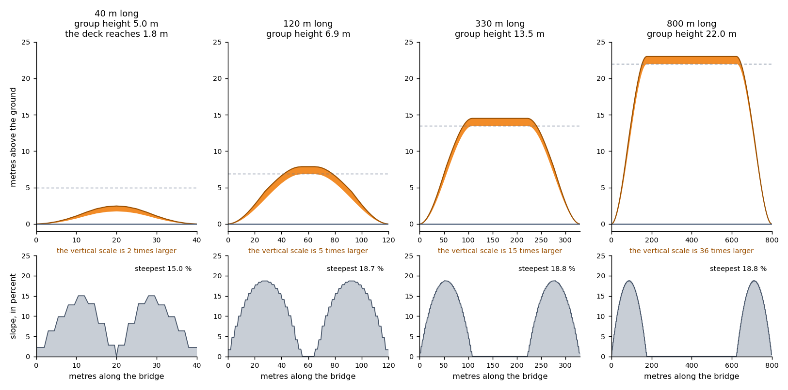
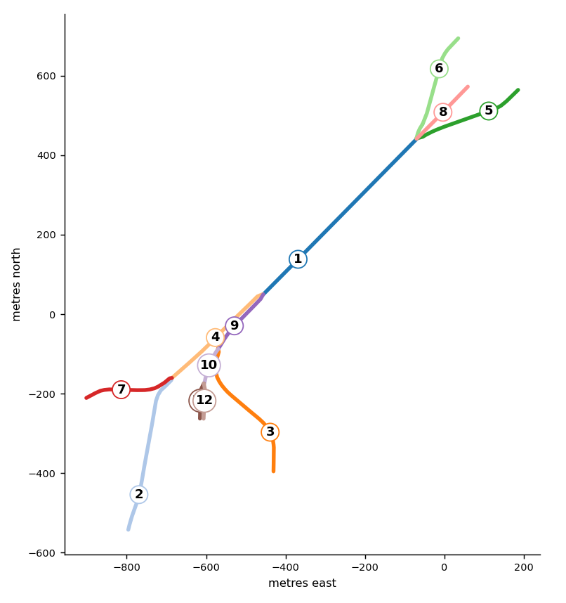
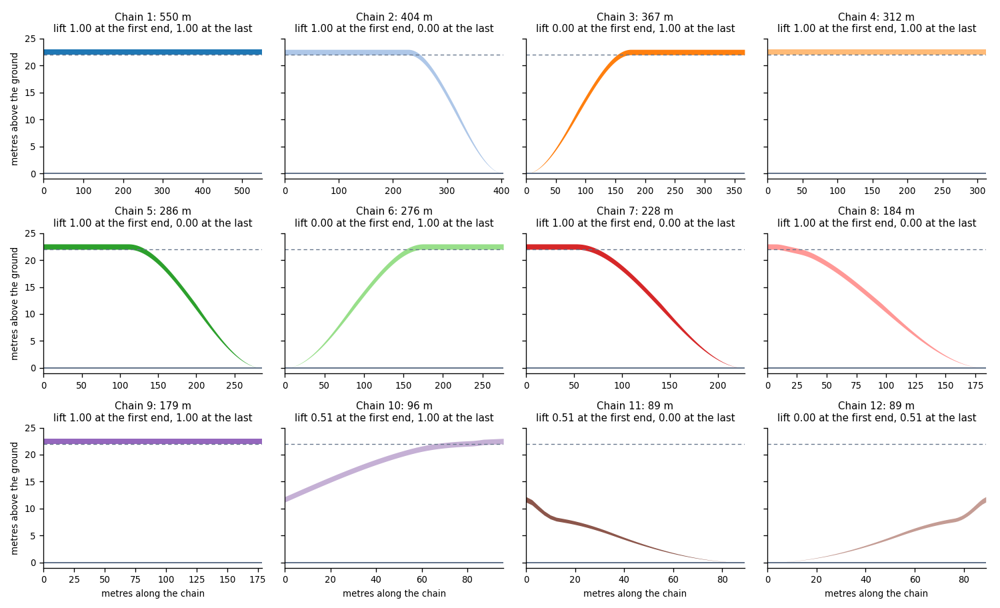

# How the height of a 3D bridge is calculated

With `view_3d=True`, roadstyle draws each bridge as a raised deck. The deck rises from the ground along a ramp, stays at one height, and comes down again.
Two programs make this picture, one after the other. This page explains what each program does and gives the formulas. To switch the bridges on or off, read [Bridges in 3D](style.md#bridges-in-3d).

## Two parts: the engine makes the profile, the page draws it

1. **The engine** (Rust, `decks.rs`) runs when you make the page. It finds the bridges, joins them into groups, and calculates the profile of each group.
   The profile is a list of deck pieces in the style source `decks`. The engine does not draw.
2. **The page** (`bridgemesh.js`) runs in the browser. It reads the profile, adds the height of the ground, and draws the pieces as one mesh.
   The page does not find groups and does not calculate group heights.

## The format of the profile

The profile is a GeoJSON `FeatureCollection` in the source `decks` of the style. It is plain data in the page. Each deck piece is one `Feature`: a polygon (the outline of the piece on the map) and its properties.
After each deck piece, the source holds the two casing slabs of that piece. A casing slab has `__rs_casing_slab: 1` and the same group, chain, lift and place values.

This is the first piece of a straight bridge of 120 m with the default look. The numbers are rounded to 4 digits. `…` marks the properties that are the road's own columns and the colors and widths of its look.

```json
{
  "type": "Feature",
  "properties": {
    "highway": "primary", "bridge": "yes", "layer": "1", "edge_id": 1,
    "…": "the road's columns and the look values",
    "__rs_group": 1,
    "__rs_chain": 1,
    "__rs_full": 6.8889,
    "__rs_thick": 1.0,
    "__rs_lift0": 0.0,
    "__rs_lift1": 0.006,
    "__rs_s0": 0.0,
    "__rs_s1": 0.02083,
    "__rs_base": 0.01,
    "__rs_height": 1.01,
    "__rs_enda": [7.42, 43.74],
    "__rs_edges": [0]
  },
  "geometry": {
    "type": "Polygon",
    "coordinates": [[[7.42, 43.740022], [7.420031, 43.740022], [7.420031, 43.739978], [7.42, 43.739978], [7.42, 43.740022]]]
  }
}
```

| Property | Meaning |
|---|---|
| `__rs_group` | The number of the group |
| `__rs_chain` | The number of the chain (a line of bridge roads, see step 2) |
| `__rs_full` | The group height H, in metres |
| `__rs_thick` | The thickness of the deck, in metres |
| `__rs_lift0`, `__rs_lift1` | The lift at the start and at the end of the piece, from 0 (ground) to 1 (H) |
| `__rs_s0`, `__rs_s1` | Where the piece starts and ends along its chain, from 0 to 1 |
| `__rs_base`, `__rs_height` | The underside and the top of the piece at its middle, without terrain. The page uses them for clicks |
| `__rs_enda`, `__rs_endb` | The two end nodes of the chain, as longitude and latitude. Only the first piece has `__rs_enda`, and only the last piece has `__rs_endb` |
| `__rs_edges` | The roads of the piece |

The names with `__rs_` are internal names of the engine. They can change.

The bridge of 120 m has 47 deck pieces. These are the values that matter, for the first five pieces, the middle piece and the last two pieces.

| Piece | `__rs_s0` | `__rs_s1` | `__rs_lift0` | `__rs_lift1` |
|---|---|---|---|---|
| 1 | 0 | 0.02083 | 0 | 0.006 |
| 2 | 0.02083 | 0.04167 | 0.006 | 0.0232 |
| 3 | 0.04167 | 0.0625 | 0.0232 | 0.0505 |
| 4 | 0.0625 | 0.08333 | 0.0505 | 0.0868 |
| 5 | 0.08333 | 0.10417 | 0.0868 | 0.131 |
| … | | | | |
| 24 | 0.45926 | 0.54074 | 0.9972 | 0.9972 |
| … | | | | |
| 46 | 0.95833 | 0.97917 | 0.0232 | 0.006 |
| 47 | 0.97917 | 1 | 0.006 | 0 |

The pieces join with no gap. The end lift of one piece is the start lift of the next piece, and `__rs_s1` of one piece is `__rs_s0` of the next. The pieces of a ramp are short (2.5 m).
The piece on the flat part is long.

## Part 1. The engine calculates the profile

The engine works in five steps. Each step uses the result of the step before it. These symbols are in the formulas.

| Symbol | Meaning |
|---|---|
| L | The length of a group, in metres |
| H | The group height, in metres |
| g | The grade: metres of ramp for 1 m of height |
| R | The full ramp: metres of ramp for the full height |
| ℓ | The length of a chain, in metres |
| x | The distance along a chain from its start, in metres |
| lift | The part of H that the deck has, from 0 to 1 |

### 1. Find the 3D bridges

A road is a 3D bridge when two conditions are true. Its `bridge` value is `yes`, and its level (`lvl`) is 1 or more. A bridge at level 0 or less stays a flat line.

A two-way road is one bridge road. The engine draws it as two half-width ribbons, one for each direction.

### 2. Join the bridges into groups

Bridge roads that share a node are one group. The level of the roads does not matter. A group has one height, so two roads of one group have the same height at the node where they meet.

Inside a group, the engine joins roads into chains. A chain is a line of bridge roads through nodes where only two bridge roads meet. The engine makes one deck for a chain, with no seam.
A node where three or more bridge roads meet is the end of a chain.

A free end is a node where only one bridge road ends. The deck meets the ground at a free end.

The length of a road is the sum of its segments in metres. The length of a group, L, is the sum of the lengths of its roads. A two-way pair counts one time.

### 3. Give each group a height

The group height, H, is the height of the deck above the ground on its flat part. The engine finds H in one of two ways.

**From the length of the group.** This is the default. A long bridge crosses something wide, so it stands higher.

```text
u = clamp( (L − grow_from_m) ÷ (grow_to_m − grow_from_m), 0, 1 )
H = base_m + (max_m − base_m) × u
```

With the default look, `base_m` is 5, `max_m` is 22, `grow_from_m` is 60 and `grow_to_m` is 600. So H = 5 + 17 × (L − 60) ÷ 540 between 60 m and 600 m. If `grow_to_m` is not larger than `grow_from_m`, H is `base_m`.

| Length of the group | H |
|---|---|
| 60 m or less | 5 m |
| 120 m | 6.9 m |
| 330 m | 13.5 m |
| 600 m or more | 22 m |

**From your own value.** Give `bridge_heights` or `bridge_height_col`. The engine uses your value for the whole group in place of the length rule.
Two different values in one group are an error. For the keywords, read [Every parameter](../reference/parameters.md).

### 4. Find the height at each node

The height at a node is a lift from 0 to 1. Lift 0 is the ground. Lift 1 is H.

```text
g = ramp_m ÷ base_m                 (the default: 40 ÷ 5 = 8)
R = max( H × g, 1 )                 (in metres)
node lift = min( 1, d_free ÷ R )
```

`d_free` is the distance along the roads from the node to the nearest free end of its group. It is 0 at a free end. The engine finds it with a shortest-path search from all the free ends.
A group of 5 m has a full ramp of 40 m. A group of 13.5 m has 108 m. A group of 22 m has 176 m.

The lift belongs to the node and not to the road. For this reason, two chains that meet at a node have the same height there.
A node with no free end in its group, for example in a closed loop, has lift 1.

If the distance from a free end to the middle of a bridge is shorter than the full ramp, the deck does not reach H. A bridge of 40 m has H = 5 m and a full ramp of 40 m.
Its deck rises only 1.8 m at the middle. A short bridge has a low, round hump and no wall.

### 5. Calculate the curve between the nodes, and cut it into pieces

Inside a chain, the engine finds the lift at each distance x along the chain. Let `lift_head` and `lift_tail` be the node lifts at the two ends of the chain.

```text
a = lift_head + x ÷ R                  from the head end
b = lift_tail + (ℓ − x) ÷ R            from the tail end

k = 0.4
e = max( 0.15 × ℓ, 1 )
v = min( clamp(x ÷ e, 0, 1), clamp((ℓ − x) ÷ e, 0, 1) )
w = v × v × (3 − 2v)                   the weight: 0 at the ends, 1 inside
h = max( k − |a − b|, 0 ) ÷ k
t = min(a, b) − w × h × h × k ÷ 4      smooth minimum
t = clamp(t, 0, 1)

lift(x) = t × t × (3 − 2t)
```

The steps in words:

1. Each end gives a lift that rises with the distance from that end (`a` and `b`).
2. The smaller of the two values is the lift. The deck rises from each end and stops at 1.
3. Where `a` and `b` are within `k` of each other, the smooth minimum rounds the place where they meet. It lowers the value by up to `k ÷ 4`, which is 0.1.
   A short bridge gets a round top and no ridge. The weight `w` is 0 at the two ends of the chain, so the lift at a node is exact.
4. The last line, t × t × (3 − 2t), gives each ramp a soft start on the ground and a soft end at the flat part.

The underside and the top of the deck, without terrain:

```text
underside(x) = H × lift(x)
top(x)       = underside(x) + thickness_m × min( 1, 2 × lift(x) )
```

The thickness `thickness_m` is 1 m by default. The factor `min(1, 2 × lift)` makes the deck thin out to nothing at the ground, so the end of a ramp lands flush with the road.

**A worked example.** A straight bridge of 120 m has two free ends. L = ℓ = 120 m, so H = 5 + 17 × 60 ÷ 540 = 6.889 m and R = 6.889 × 8 = 55.11 m.
At x = 10 m: a = 10 ÷ 55.11 = 0.1815 and b = 110 ÷ 55.11 = 1.996. The two values are far apart, so h = 0 and t = 0.1815.
Then lift = 0.1815 × 0.1815 × (3 − 0.363) = 0.0868, and the underside is 6.889 × 0.0868 = 0.60 m. This is the value `__rs_lift0` of piece 5 in the table above.

The engine then cuts the chain into pieces. The cut points are the two ends of the chain, the end of each ramp, and every `step_m` (2.5 m) along each ramp. A piece also ends where one road changes to the next.
For each piece, the engine writes `__rs_lift0 = lift(x_start)`, `__rs_lift1 = lift(x_end)`, `__rs_s0 = x_start ÷ ℓ` and `__rs_s1 = x_end ÷ ℓ`.
It writes `__rs_base = H × lift(x_middle)` and `__rs_height = __rs_base + thickness_m`. These pieces are the profile.



The figure shows the profile of one straight bridge for four lengths. The engine made it with the default look. The orange band is the deck. The dashed line is H.
Make the figure again with `python docs/img/bridge-height/make.py`.

## Part 2. The page draws the profile

The page reads the pieces from the source `decks`. It does not calculate the lift of a piece again. For each piece, the page makes triangles: a top, two side walls and a bottom.
It draws all pieces in one custom layer, as one smooth mesh. Inside a piece, the lift at a vertex is a straight line from `__rs_lift0` to `__rs_lift1`, by the distance along the piece.

### 6. Put the deck on the terrain

Without terrain, the ground height is 0, and the formulas of step 5 give the height of each vertex. When the 3D terrain is on, the page uses these values for each vertex of each side of the deck.

```text
G      the ground height under the vertex
C      the gap = 0.3 + 2.5 × slope          (metres)
Z      the level line = za + (zb − za) × s
       (za, zb: the ground at the two ends of the chain; s: the place along it, 0 to 1)

underside = (1 − lift) × (G + C) + lift × (Z + H)
top       = underside + thickness_m × min( 1, 2 × lift )
```

- Close to the ground (lift near 0), the deck follows the ground under each side of its width, because a hill can slope sideways.
- From the flat part up (lift near 1), the deck is level across its width, between the ground at the two ends of the chain.
- The slope in `C` is the slope of the terrain, read 4 m to each side of the vertex. The gap keeps the start of a ramp above the terrain that the map draws. It fades out as the lift rises.
- Without terrain, G, C and Z are 0, and the underside is H × lift.

If a terrain tile has not arrived, the page does not draw the chains that need it. It draws them when the tile arrives.

### The other work of the page

The casing is a thin slab along each long side of the deck. The extrusion layers of the decks stay in the map with opacity 0. A click or a hover finds the bridge on them. The Street View marker stands on the deck.

## A real example: the Granville Bridge

The Granville Bridge in Vancouver has a main span and many ramps. This is a real group with more than one chain. The data is 41 road edges (27 OpenStreetMap ways) from the
Vancouver database of duckOSM, in `docs/img/bridge-height/granville_bridge_edges.parquet`. The engine makes one group of them, with 12 chains, 624 deck pieces and
H = 22 m. The group is 3061 m long, so H is the largest value, `max_m`. A full ramp is 22 m × 8 = 176 m.



The figure shows the chains on the map. The numbers are the chain numbers of the table, from the longest chain to the shortest one. Each chain has a first end and a last end, in
the order of its points.

| Chain | Roads | Length | Lift at the first end | Lift at the last end | Deck pieces |
|---|---|---|---|---|---|
| 1 | Granville Bridge | 550 m | 1.00 | 1.00 | 2 |
| 2 | Granville Bridge | 404 m | 1.00 | 0.00 | 72 |
| 3 | Granville Bridge | 367 m | 0.00 | 1.00 | 74 |
| 4 | Granville Bridge | 312 m | 1.00 | 1.00 | 4 |
| 5 | Granville Bridge, Seymour Street | 286 m | 1.00 | 0.00 | 73 |
| 6 | Granville Bridge, Howe Street | 276 m | 0.00 | 1.00 | 74 |
| 7 | Granville Bridge | 228 m | 1.00 | 0.00 | 73 |
| 8 | Granville Bridge | 184 m | 1.00 | 0.00 | 72 |
| 9 | Granville Bridge | 179 m | 1.00 | 1.00 | 2 |
| 10 | Granville Bridge | 96 m | 0.51 | 1.00 | 36 |
| 11 | Granville Bridge | 89 m | 0.51 | 0.00 | 71 |
| 12 | Granville Bridge | 89 m | 0.00 | 0.51 | 71 |



The figure shows the profile of each chain. The dashed line is H. What the example shows:

- **Eight chain ends are free ends.** Their lift is 0.00. The ramp rises from the ground there, along the full ramp of 176 m (chains 2, 3, 5, 6, 7, 8, 11 and 12).
- **A node far from a free end has lift 1.00.** A chain with lift 1.00 at both ends is flat. Chains 1, 4 and 9 each have only 2 deck pieces, one for each road.
- **A node that is near a free end has a lift between 0 and 1.** Chains 10, 11 and 12 meet at one node. It is 89 m from the nearest free end, so its lift is 89 ÷ 176 = 0.51. All
  three chains have 0.51 at that node, so there is no step.
- **A short chain does not reach H.** Chains 11 and 12 are 89 m long. Their decks reach only 0.51 × 22 = 11.2 m.
- **All chains of the group have the same H.** Chain 1, the main span, and chain 7, a low ramp, both reach 22 m. The City of Vancouver LiDAR 2022 measures other heights on the same
  bridge: 39 m on the main span, and 11.6 m to 27 m on the ramps. The engine does not read measured heights. For the comparison, read
  `docs/design/bridge_profile_edit.md`.

Make the figures and the table again with `python docs/img/bridge-height/granville.py`.

## What can change a profile

Four things change a profile today.

| What | When | What changes |
|---|---|---|
| `bridge_heights`, `bridge_height_col` | When you make the page | H of a group. The engine makes the ramps again for the new H |
| `bridge_decks` setting | When you make the page | Any number in the formulas: for example `ramp_m`, `base_m`, `thickness_m` |
| `rsSetBridgeHeight(road, metres)` | In the open page | H of a group. The page keeps the lifts, so the ramps keep the length that they had with the first height |
| `rsSetBridges3D(false)` | In the open page | The bridges are flat lines |

The engine does not read a `height` or `maxheight` tag to find H. The height is a rule for the picture and not a measurement. Two bridges of the same length get the same H.
A proposal for an input that gives a chain its own height line is in `docs/design/bridge_profile_edit.md`. It is not built.

A step that edits the pieces between the engine and the page must keep these rules, or the mesh shows a step or a gap:

- The pieces of a chain cover 0 to 1 with no gap. `__rs_s1` of a piece is `__rs_s0` of the next piece, and the end lift of a piece is the start lift of the next piece.
- Two chains that meet at a node have the same lift at that node.
- The lift is 0 at a free end.
- All pieces of a group have the same `__rs_full`.
- `__rs_base` and `__rs_height` of a piece follow its lifts. The page uses them for clicks.
- The casing slabs of a piece have the same lifts and places as the piece.

A test (`test_the_numbers_of_the_bridge_height_page_are_the_engines`) keeps the formulas on this page equal to the engine. It calculates the lift of every piece of four bridges with these formulas and compares it with the engine.

## Settings that change the height

Set these in the `bridge_decks` setting, for example `settings={"config": {"bridge_decks": {"ramp_m": 80}}}`. A longer `ramp_m` makes every ramp longer.
For an 800 m bridge, `ramp_m: 80` moves the start of the flat part from 176 m to 352 m.

| Key | Default | What it changes |
|---|---|---|
| `base_m` | 5 | H of a short group, and the base of the grade |
| `max_m` | 22 | H of a long group |
| `grow_from_m` | 60 | The length up to which H is `base_m` |
| `grow_to_m` | 600 | The length from which H is `max_m` |
| `ramp_m` | 40 | Metres of ramp for `base_m` of height. The grade is `ramp_m` ÷ `base_m` |
| `step_m` | 2.5 | The longest piece on a ramp |
| `thickness_m` | 1 | The thickness of the deck |

Other `bridge_decks` keys change the picture and not the height: `width_scale`, `match_zoom`, `flat_below`, `casing_px` and `opacity`.
Read [Every parameter](../reference/parameters.md) for all of them.
