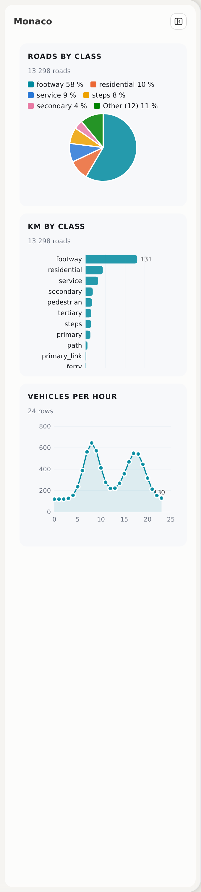
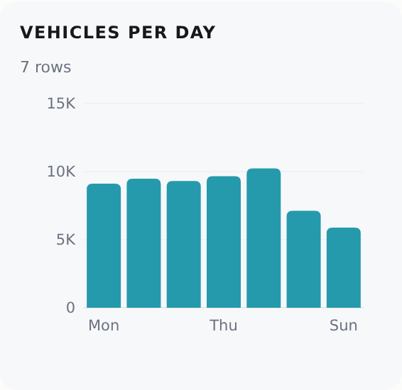
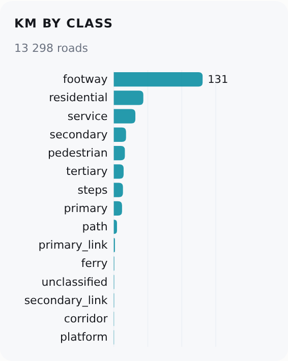
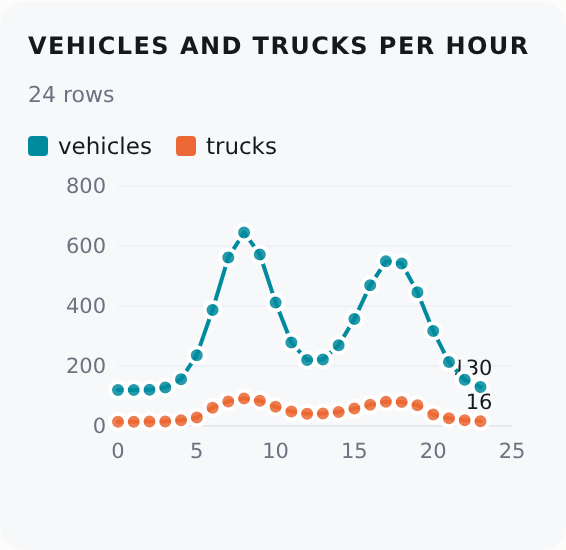
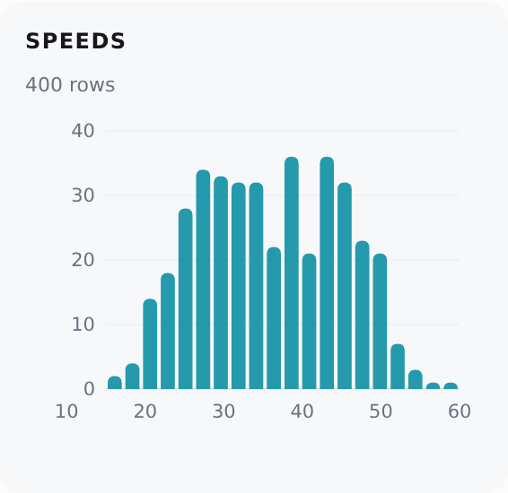
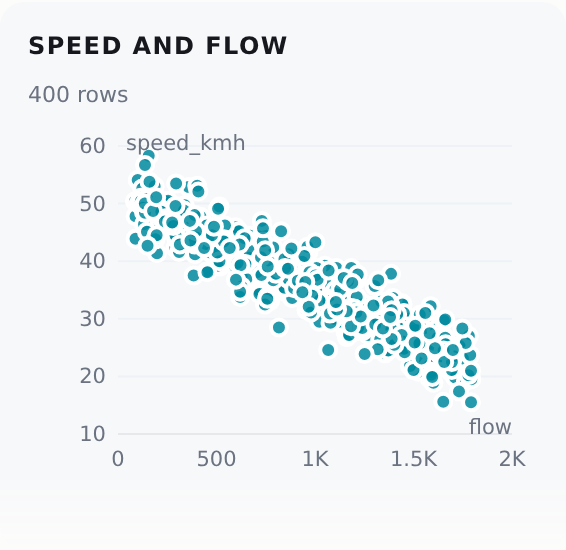
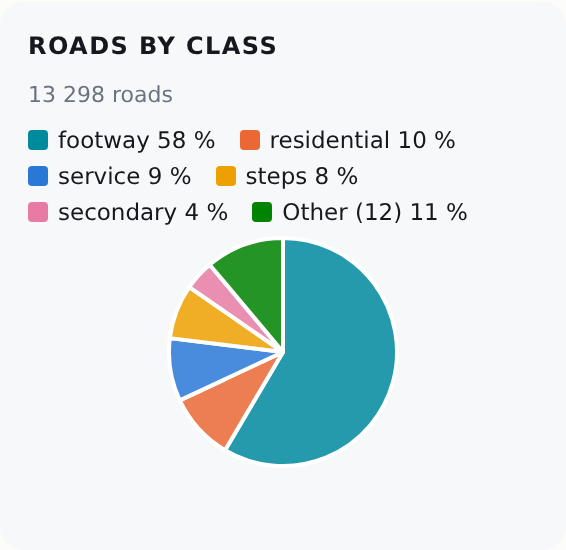

# Charts

<p class="lead">A chart card puts a chart in the panel of a dashboard. You write it in Python, with no JavaScript. The chart reads the map's own roads, or rows that you give. It has the look of the dashboard in the light and the dark theme, and a click on a bar lights its roads on the map.</p>

## A chart card from Python

Add a section with `part: "chart"` and its options in `chart`:

```python
import roadstyle as rs

rs.render_dashboard(edges, dashboard={"panel": {"sections": [
    # the map's roads: the number of roads of each class
    {"id": "classes", "label": "Roads by class", "part": "chart", "chart": {"kind": "pie", "x": "highway"}},
    # the map's roads: the km of each class (the sum of a column, times 0.001)
    {"id": "km", "label": "km by class", "part": "chart", "chart": {"kind": "bar", "x": "highway", "y": "length_m", "scale": 0.001}},
    # your own rows: a DataFrame, or a list of dicts
    {"id": "flow", "label": "Vehicles per hour", "part": "chart", "chart": {"kind": "line", "x": "hour", "y": "vehicles", "data": counts_df}},
]}}).save("dashboard.html")
```

{ width="340" }

## One chart of each kind

Each picture shows one card and the `chart` that made it. The script `docs/img/charts/make.py` makes the pictures again from the roads of Monaco.

### Bar

```python
{"kind": "bar", "x": "day", "y": "vehicles", "data": days_df}
```

{ width="300" }

### Horizontal bar

A bar chart is horizontal when a label of `x` is longer than 8 characters. The bars get thinner to fit the card; only a list that is too long for its minimum (a row of 12 px) scrolls in the card.

```python
{"kind": "bar", "x": "highway", "y": "length_m", "scale": 0.001, "height": 300}
```

{ width="300" }

### Line

`y` can be a list of up to 3 columns. Two or more series have a legend.

```python
{"kind": "line", "x": "hour", "y": ["vehicles", "trucks"], "data": hours_df}
```

{ width="300" }

### Histogram

A histogram counts the values of `x` in 20 equal ranges. It has no `y`.

```python
{"kind": "histogram", "x": "speed_kmh", "data": speeds_df}
```

{ width="300" }

### Scatter

A scatter chart has one point for each row: `x` and `y` are two number columns.

```python
{"kind": "scatter", "x": "flow", "y": "speed_kmh", "data": speeds_df}
```

{ width="300" }

### Pie

A pie has at most 6 slices. The smaller values are one slice, "Other".

```python
{"kind": "pie", "x": "highway"}
```

{ width="300" }

## The options of `chart`

| Option | Default | What it is |
|---|---|---|
| `kind` | (necessary) | `bar`, `line`, `histogram`, `scatter` or `pie` |
| `x` | (necessary) | A column: the groups (bar, pie), the order (line), the numbers (histogram, scatter) |
| `y` | none | A number column, or a list of up to 3 (bar, line). None: the count of rows. A histogram has no `y`. A scatter needs one |
| `agg` | `"sum"` | How the rows of one value of `x` join: `sum`, `mean`, `min`, `max` or `count` |
| `scale` | `1` | A factor for the values of `y` (`0.001`: metres to km) |
| `data` | none: the map's roads | Your own rows. Python: a pandas DataFrame, a GeoDataFrame (its geometry is not used) or a list of dicts. JavaScript: `{columns, rows}` or a list of objects. The rows are written into the page |
| `title` | the card's `label` | The title of the chart. A card with a `label` shows no second title |
| `height` | `220` | The height of the chart in pixels (80 or more) |
| `follow` | `false` | The map's roads only: `true` draws the chart again for the roads that the map shows now |

The section has the keys of each card: `label`, `fold`, `note`, `background`, `after` and `before` ([Add to the panel](dashboard-panel.md)).

## The two sources

- **The map's roads.** With no `data`, the chart reads the road table of the page: the columns that the popup and the colours read. `x` and `y` are columns of the roads. The count line under the title gives the number of roads.
- **Your own rows.** With `data`, the chart reads those rows. `x` and `y` must be columns of `data`. The two sources do not mix.

Python writes `data` into the page as `{"columns": [{"name", "type"}], "rows": [[...]]}`. The types are the SQL type names of the data dock: `VARCHAR`, `DOUBLE`, `BIGINT`, `DATE`, `TIMESTAMP` and `BOOLEAN`. An integer of 2^53 or more is text, so a 64-bit id stays exact. A date is `YYYY-MM-DD` and a time is `YYYY-MM-DD HH:MM:SS`.

## Groups and ranges

- A bar, a line or a pie joins the rows of each value of `x` with `agg`. With no `y`, the value is the number of rows.
- A bar or a pie whose `x` is a number with more than 40 values (a length, say) puts the rows in ranges of `x`: about 12 bars or 6 slices. The data dock uses the same rule (`rs.chart.ranges`).
- The order: ranges, numbers and dates go from small to large. The map's roads go from the largest value to the smallest. Your own rows keep their order.

## A click

- **The map's roads.** A click on a bar, a slice or a point lights its roads on the map, in the colour of the mark (the highlight set `chart`). A second click on the same mark ends the light. A click on another mark moves the light.
- **Your own rows.** A click sends the event `rs:chartpick` with `{id, row, rows}`: the id of the section, the values of the mark (`{hour: 7, vehicles: 820}`) and the indices of the rows of `data` in it. A page can act on it:

```js
document.addEventListener("rs:chartpick", (e) => console.log(e.detail.id, e.detail.row));
```

## The errors

`render_dashboard` gives a `ValueError` for:

- an unknown `kind` or `agg`, or no `x`;
- `y` for a histogram, no `y` for a scatter, more than one `y` for a pie or a scatter, or more than 3;
- a column of `x` or `y` that is not in `data`;
- `follow` with `data`;
- `chart` on a section that is not `part: "chart"`, or `part: "chart"` with no `chart`.

## The same from JavaScript

`rs.sections.add` takes the same section. `data` can be a list of objects:

```js
rs.sections.add({id: "flow", label: "Vehicles per hour", part: "chart",
  chart: {kind: "line", x: "hour", y: "vehicles", data: [{hour: 7, vehicles: 820}, {hour: 8, vehicles: 1140}]}});
```

For a chart in an element of your own, use `rs.chart(el, spec)` ([A chart](dashboard-parts.md#a-chart)).

## The same chart in other places

- The data dock's **Table | Chart** view draws a chart of a SQL result ([The data dock](data-dock.md)).
- The Ask tool `draw_chart` draws a chart of a SQL result in the data dock ([Ask](ask.md#draw_chart)).

All three use `rs.chart`, so they have the same look.

`tests/test_chart_card_browser.py` checks each kind in the panel in both themes and at 390 px, the roads by class against a count of the road table, `follow`, a click on a bar, and `rs:chartpick`.
