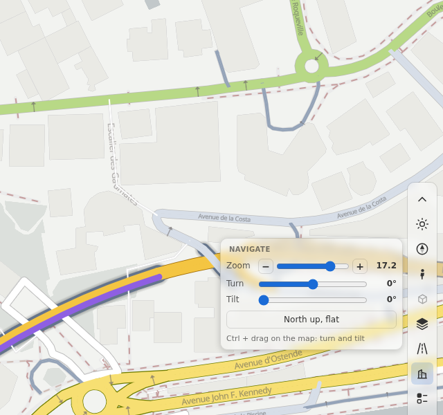
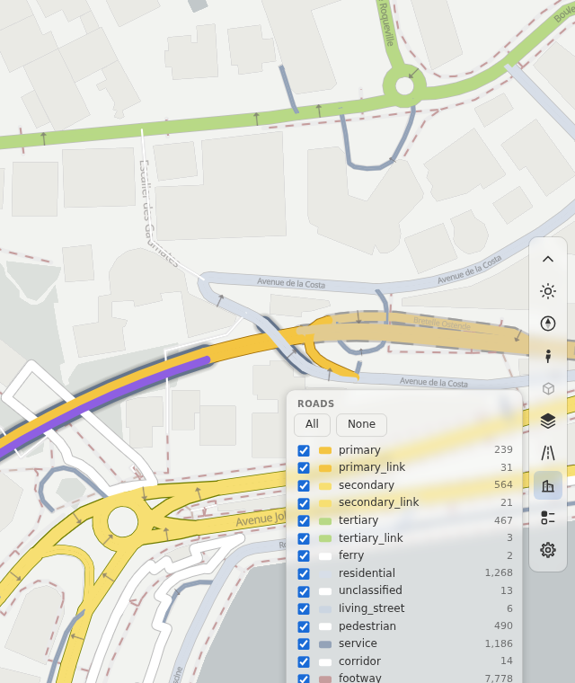
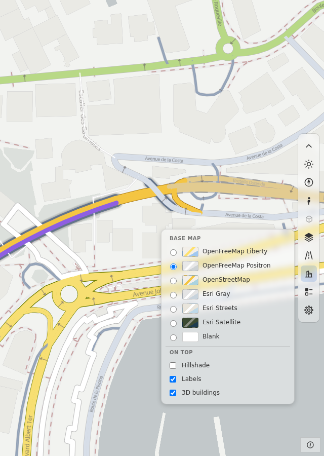
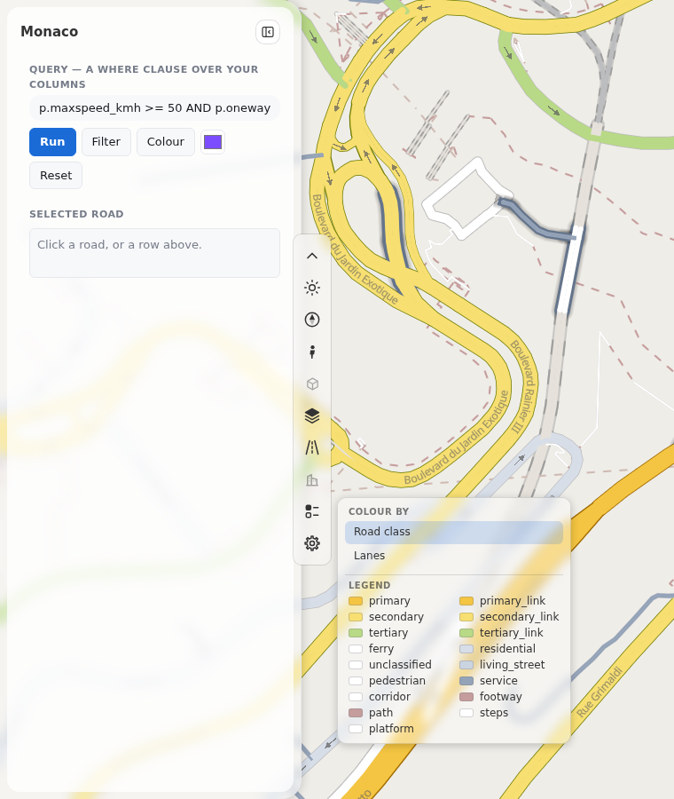
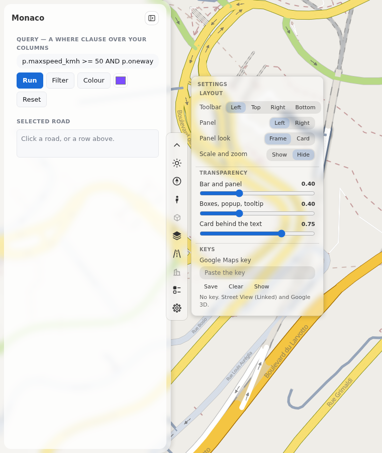
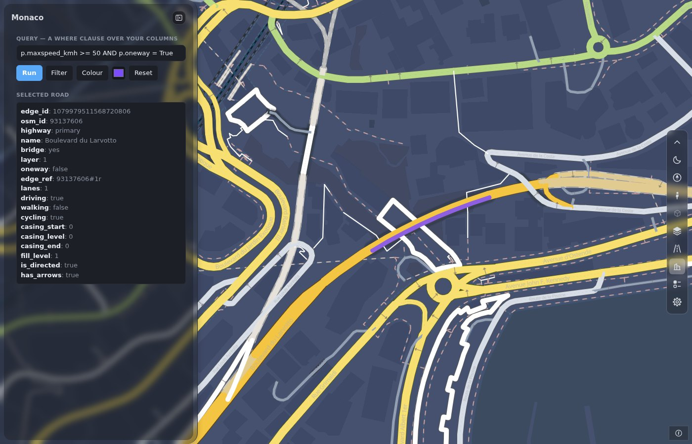
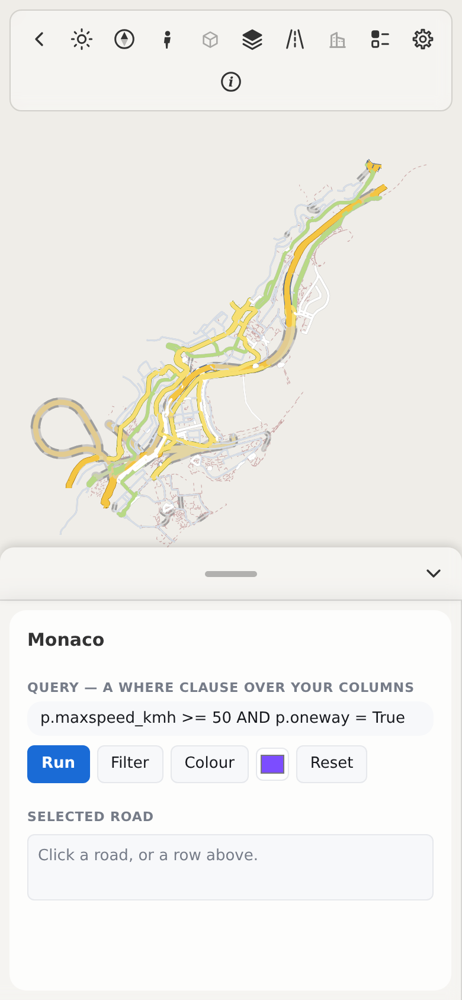

# Layout and toolbox

What each part of the dashboard screen does, and how to change it. Each item has the same form: a picture when there is one, a box with **Use it for** and **From Python**, the code in tabs, and **Details** that open on a click.

| Group | Item | From Python | Use it for |
|---|---|---|---|
| Frame | [The layout](#the-layout) | yes | a floating or a docked panel |
| Frame | [The panel](#the-panel) | yes | the edge, the look and the width of the panel |
| Toolbox | [The toolbox](#the-toolbox) | yes | the edge of the bar of tools, your own tools |
| Toolbox | [Navigate](#navigate) | yes | zoom, turn and tilt |
| Toolbox | [Roads](#roads) | no option | show or hide road classes |
| Toolbox | [Base map](#base-map) | yes | the base map, and the switches on top of it |
| Toolbox | [Colour and legend](#colour-and-legend) | yes | the *Colour by* list and the legend |
| Toolbox | [Settings](#settings) | yes | the place of the bar and the panel, transparency, keys |
| Toolbox | [Credits](#credits) | yes | the sources of the map and of your data |
| Screen | [The dark theme](#the-dark-theme) | JavaScript | a dark page |
| Screen | [The windows](#the-windows) | yes | Street View and Google 3D |
| Screen | [The bottom dock](#the-bottom-dock) | no | a wide table under the map |
| Screen | [A phone](#a-phone) | automatic | the page on a phone |
| Screen | [The area boundary](#the-area-boundary) | yes | an outline, a shade and a camera limit |

## The frame { .rs-group }

### The layout { .rs-part }

**Use it for:** the frame of the page. The panel floats over the map, or it has its own space at the left.<br>
**From Python:** yes, `layout=`
{ .rs-facts }

=== "Python"

    ```python
    rs.render_dashboard(edges)                    # layout="overlay": the panel floats, the toolbox is at the right edge
    rs.render_dashboard(edges, layout="dock")     # the panel has its own space at the left, and there is no toolbox
    ```

??? info "Details"

    - With `layout="dock"` the tools are the MapLibre buttons on the map.
    - `template="map"` gives the map only (the default of `render_edges`).

### The panel { .rs-part }

**Use it for:** the edge, the look and the width of the panel. Its content is the [sections](dashboards.md#the-panel-starts-empty).<br>
**From Python:** yes, `dashboard={"panel": {...}}`
{ .rs-facts }

=== "Python"

    ```python
    rs.render_dashboard(edges, dashboard={"panel": {"side": "right", "look": "card", "width_px": 360}})
    rs.render_dashboard(edges, dashboard={"panel": None})      # no panel: the map and the toolbox
    ```

??? info "Details"

    - The panel has a title (the page's `name`), the theme button and the hide button. Only the body scrolls.
    - `look` is `"frame"` (the default) or `"card"`. The person can change the edge and the look in [Settings](#settings).
    - The panel is `<div id="sb">`, and its sections go in `<div class="sb-body">`.

## The toolbox { .rs-group }

### The toolbox { .rs-part }

**Use it for:** the bar of tools at the edge of the map. Each tool opens a box toward the map.<br>
**From Python:** yes, `dashboard={"toolbar": {...}}`
{ .rs-facts }

=== "Python"

    ```python
    rs.render_dashboard(edges, dashboard={"toolbar": {"position": "left"}})     # left, right (default), top or bottom
    rs.render_dashboard(edges, dashboard={"toolbar": {"position": "top", "align": "end"}})   # the top right corner
    ```

=== "JavaScript"

    ```js
    rs.tools.add({id: "export", title: "Export", icon: "&#8681;", onClick: () => exportRows()});
    ```

??? info "Details"

    - The tools, in order: theme, navigate, Street View, Google 3D, base map, roads, 3D buildings, colour and legend, settings, credits.
    - A tool that the page cannot use is grey, and its tip says why. `rs.tools.list()` gives each tool with its `disabled` state.
    - One box is open at a time. A click outside it, or Escape, closes it.
    - `dashboard={"toolbar": {"hold": True}}` keeps the bar hidden until the page calls `rs.tools.ready()` (6 s at most).
    - `align` is the place of the bar along its edge: `"start"`, `"middle"` (the default) or `"end"`. At the top or the bottom, start is the left; at the left or the right, start is the top. A bar at a corner stays clear of the panel, the dock and the box of the scale.
    - When the tools do not fit, the bar takes more columns or rows. It never scrolls. A box that is too tall scrolls.
    - More about your own tools: [JavaScript](dashboard-manual/javascript.md#toolbox).

### Navigate { .rs-part }

{ width="320" }

**Use it for:** zoom, turn and tilt the map. One button, the compass needle, opens a box with three sliders.<br>
**From Python:** yes, `dashboard={"toolbar": {"navigation": ...}}`
{ .rs-facts }

=== "Python"

    ```python
    rs.render_dashboard(edges, dashboard={"toolbar": {"navigation": "buttons"}})   # +, -, compass and 2D/3D in place of the box
    ```

??? info "Details"

    - Ctrl + drag on the map turns and tilts it. The needle turns with the map.
    - *North up, flat* in the box sets the map back.

### Roads { .rs-part }

{ width="320" }

**Use it for:** show or hide road classes, bridges, tunnels and access kinds.<br>
**From Python:** no option: the tool is there when the page has road classes
{ .rs-facts }

=== "JavaScript"

    ```js
    rsSetClasses(["primary", "secondary"]);      // the same filter as the tool
    rsSetBridges(false);
    ```

??? info "Details"

    - A row has a check box, the colour, the name and the number of roads. *All* and *None* set every row. A click on a name shows only that class.
    - A page with bridges, tunnels or access kinds (`access_col`) has a row for each of them. `rsSetTunnels` and `rsSetAccess` set them. A page with 3D decks (`view_3d=True`) has a **3D bridges** row under Bridges: `rsSetBridges3D` sets it.

### Base map { .rs-part }

{ width="320" }

**Use it for:** the base map, and the switches *On top*: hillshade, 3D terrain, labels, one-way arrows and 3D buildings.<br>
**From Python:** yes, `basemap=`, `basemaps=`, `hillshade=`, `terrain=`, `arrows=`, `buildings_opacity=`
{ .rs-facts }

=== "Python"

    ```python
    rs.render_dashboard(edges, basemap="ofm_liberty", hillshade=True, terrain=True)
    ```

=== "JavaScript"

    ```js
    rsBuildings(true);
    window.rsAddTopRow({id: "sensors", label: "Sensors", get: () => shown, set: (on) => show(on)});   // a switch for your own layer
    ```

??? info "Details"

    - The base maps with no key: OpenFreeMap Liberty and Positron, OpenStreetMap, Esri Gray, Esri Streets, Esri Satellite and Blank. `basemaps=` offers other ones.
    - **Hillshade and 3D terrain** come from the Terrain Tiles on AWS (no key). With the 3D terrain on, a tunnel is drawn on the hill above it and a bridge on the valley under it.
    - `terrain_tunnels=` sets what a tunnel does on the terrain: `"fade"` (the default), `"hide"` or `"show"`. MapLibre has no height for a line, so a per-edge height (a `z` column) cannot be drawn.
    - **One-way arrows** are on by default. A page with `arrows=False` has no switch.
    - **3D buildings** tilt a flat map to 55° and zoom in to 15 when the zoom is under 14.5. The *Opacity* slider sets `buildings_opacity` (default 1).
    - Base-map layers of the style (the duckOSM layers: land cover, water, buildings) get one switch, *Map layers* (`overlays_label`).
    - `rsAddTopRow`: `get` says whether the layer shows, `set(on)` shows or hides it, `available()` greys the row. The event `rs:toprowschange` reads the state again.

### Colour and legend { .rs-part }

{ width="320" }

**Use it for:** the *Colour by* list and the legend, with rows of your own.<br>
**From Python:** yes, `color_options=` and `dashboard={"legend": {...}}`
{ .rs-facts }

=== "Python"

    ```python
    rs.render_dashboard(edges, color_options={"Road class": {}, "Speed": {"color_by": "maxspeed_kmh"}},
                        dashboard={"legend": {"rows": [{"color": "#16a34a", "label": "Sensors", "shape": "circle"}]}})
    ```

=== "JavaScript"

    ```js
    rs.legend.add({id: "events", color: "#ff0066", label: "Events"});
    ```

??? info "Details"

    - A row has a colour, a label and a shape: `square`, `circle` or `line`. The shape tells what the colour is on the map: a line for a road, a circle for a sensor.
    - A page with live data lists each set of numbers with its range and its number of roads. `rs.colorModes` gives the box a list of your own.
    - The tool is grey when the page has no colour option and no live data.

### Settings { .rs-part }

{ width="320" }

**Use it for:** the person's own choices: the place of the bar and the panel, the transparency and the keys. The browser keeps them.<br>
**From Python:** yes, `dashboard={"toolbar": {"settings": False}}` removes the tool
{ .rs-facts }

??? info "Details"

    - **Layout.** The bar: left, top, right or bottom, and its place along that edge (the row *Toolbar place*). The panel: left or right, as a frame or a card. The scale and the zoom number can show.
    - **Transparency.** Three sliders: the bar and the panel; the boxes with the popup and the tooltip; the card behind the text.
    - **Keys.** A Google Maps key and a Mapillary token ([Keys and tokens](google-key.md)). A saved key replaces the key of the page.
    - The settings do not go into the page file.

### Credits { .rs-part }

**Use it for:** the sources of the map and of your data, in a box in the bottom corner.<br>
**From Python:** yes, `dashboard={"credits": [...]}`
{ .rs-facts }

=== "Python"

    ```python
    rs.render_dashboard(edges, dashboard={"credits": [{"text": "My data", "href": "https://example.org"}]})
    ```

??? info "Details"

    - The dashboard starts with "© OpenStreetMap contributors". `"credits": []` leaves out the credits of your page.
    - A base map adds its own sources. A row that names OpenStreetMap shows once.
    - The scale and the zoom number are in the same box. On a phone the credits are a tool of the bar.

## The screen { .rs-group }

### The dark theme { .rs-part }



**Use it for:** a dark page: the bar, the panel, the boxes, the popup and the roads. The theme button changes it.<br>
**From Python:** no keyword: start it dark from `page_script`
{ .rs-facts }

=== "Python"

    ```python
    rs.render_dashboard(edges, page_script="rs.ready(() => rsSetTheme('dark'))")
    ```

=== "JavaScript"

    ```js
    rsSetTheme("dark");      // or "light"; the event rs:themechange follows
    ```

??? info "Details"

    - A dark base map (OpenFreeMap Fiord or Dark, Esri Dark Gray, Blank dark) sets the dark theme too.
    - A theme change needs no new style and no new tile. The fill of a road keeps its colour.

### The windows { .rs-part }

**Use it for:** Street View and Google 3D in a window over the free part of the map, or Street View docked beside it.<br>
**From Python:** yes, `street_view=`, `google_3d=`, `dashboard={"windows": {...}}`
{ .rs-facts }

=== "Python"

    ```python
    rs.render_dashboard(edges, street_view="dock")     # Street View beside the map, with a divider to drag
    rs.render_dashboard(edges, google_3d=True)
    ```

??? info "Details"

    - A window keeps its size and place. The `windows` option sets the rules: keep inside the screen, open again, remember ([Dashboard options](../reference/parameters.md#dashboard-options)).
    - More: [Street View](street-view.md) and [Google 3D](google-3d.md).

### The bottom dock { .rs-part }

**Use it for:** a wide table, a chart or a list under the map. Drag its grip to change the height.<br>
**From Python:** no: [the bottom dock](dashboard-parts.md#the-bottom-dock) is a JavaScript part
{ .rs-facts }

### A phone { .rs-part }

{ width="260" }

**Use it for:** nothing to do. At 700 px or less the page turns to its phone form by itself: the bar is at the top and the panel is a bottom sheet.<br>
**From Python:** automatic, there is no `phone` option
{ .rs-facts }

=== "JavaScript"

    ```js
    rs.sheet(2);              // the sheet: 0 closed, 1 at 40 %, 2 full
    const f = rs.freeArea();  // the part of the map that the bar and the sheet leave free
    ```

??? info "Details"

    - **The bar** is one row. When the tools do not fit, it moves sideways under a finger, with a fade at the edge.
    - **The fold button**, first in the bar, hides the bar. A small button stays and opens it again. The browser keeps the choice.
    - **The sheet** has three heights: closed, 40 % and full. Its grip has an arrow that goes one height down.
    - **The first view** fits between the bar and the sheet. On a desktop it fits beside the panel and the bar.
    - **A window** (Street View, Google 3D) is a bottom sheet too. One sheet is open at a time.

### The area boundary { .rs-part }

**Use it for:** the outline of your area: a dashed line, a shade outside it, and a camera that stays near it.<br>
**From Python:** yes, `boundary=`, `boundary_dim=`, `boundary_limit=`
{ .rs-facts }

=== "Python"

    ```python
    rs.render_dashboard(edges, boundary=area_polygon, boundary_dim=True, boundary_limit=True)
    ```

??? info "Details"

    - `boundary` is GeoJSON, a shapely geometry or a GeoDataFrame. With no outline of your own, use the outline of the roads: `edges.union_all().convex_hull`.
    - `boundary_limit=True` keeps the center near the area, and the zoom-out stops 3 levels under the zoom that shows the whole area.
    - The `boundary` option of `dashboard=` sets the opacity of the shade and the size of the limit ([Dashboard options](../reference/parameters.md#dashboard-options)).
