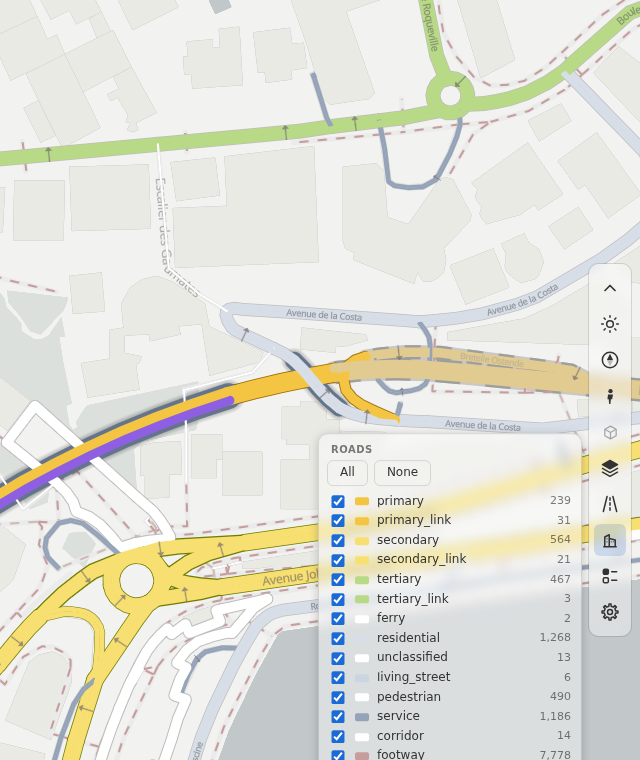
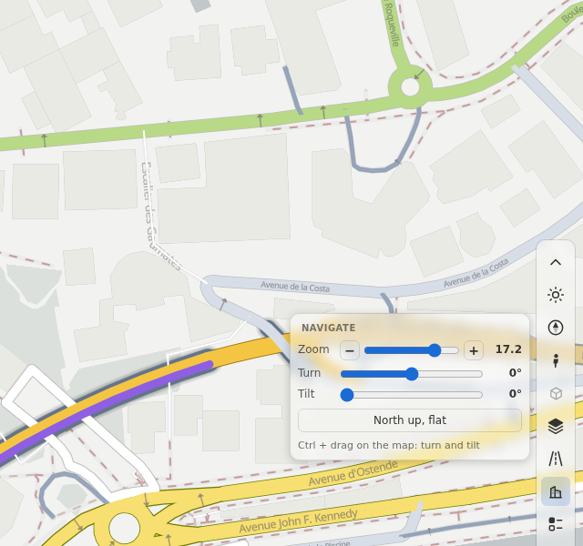
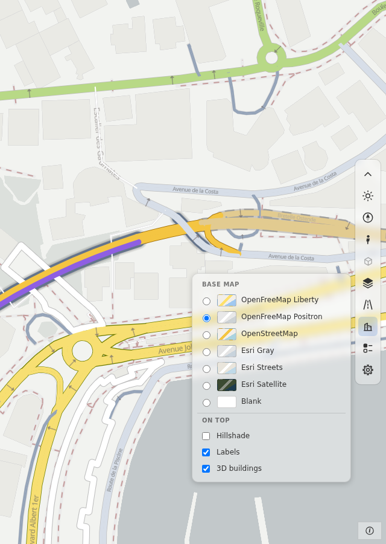
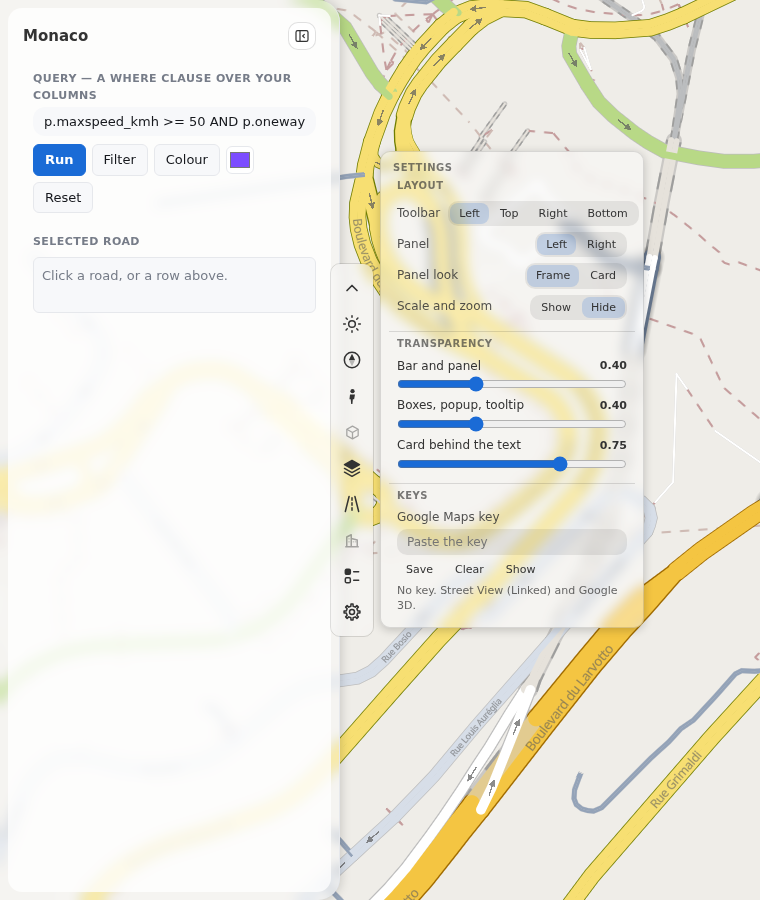
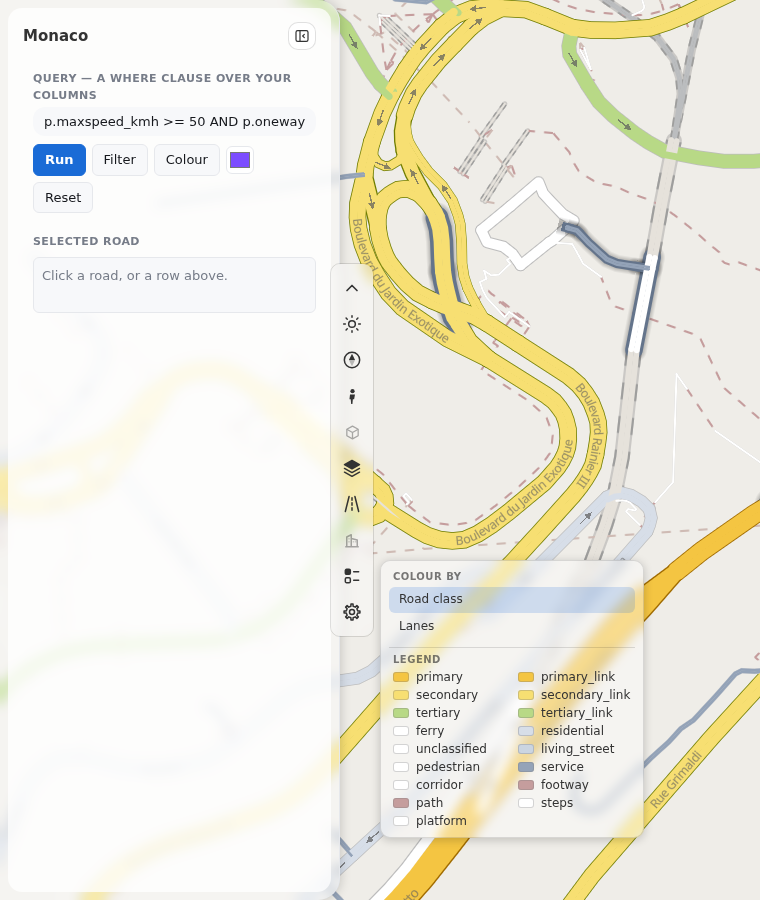
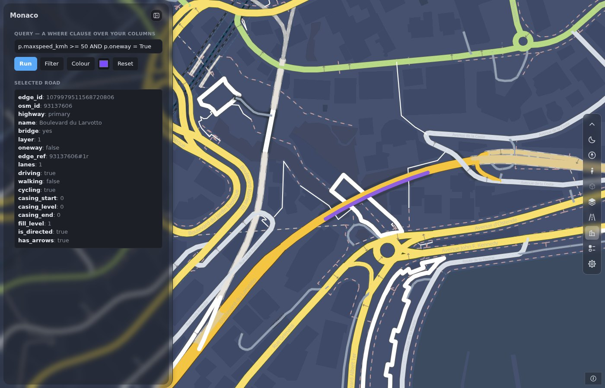

# Dashboard layout

A dashboard is a map with a side panel and a toolbox. `render_dashboard` makes it from your road data. It starts with a blank map (no key), the panel at the left, the toolbox at the right edge, and no scale box.

```python
import roadstyle as rs

rs.render_dashboard(edges, color_options={"Road class": {}}).save("dashboard.html")
```


## The form

There is one template with a panel: `dashboard`. `layout` changes the frame:

| Keyword | What you get |
|---|---|
| `layout="overlay"` (default) | The map fills the window. The panel floats over it, at the left. The toolbox is a column at the right edge (`dashboard={"toolbar": {"position": "left"}}` moves it); its boxes open to its left |
| `layout="dock"` | The panel is docked at the left and takes its own space. No toolbox: the tools are the MapLibre buttons |

`template="map"` is the map only (the default of `render_edges`). The `classic` template and the report page are gone.

`dashboard={...}` changes any option of the template. You give only the parts that you change. The call merges them over the template's
defaults, and a wrong key or value is an error. These are the parts:

| Part | Keys |
|---|---|
| `panel` | `None` (no panel: a map with the toolbox), or `side` (`"left"` or `"right"`), `width_px` (400 by default; fit your content to the panel and do not widen the panel for it), `look` (`"frame"` or `"card"`), `sections`, `hide` ([Add to the panel](dashboard-panel.md)) |
| `toolbar` | `position` (`"left"`, `"top"`, `"right"` or `"bottom"`), `navigation` (`"box"` or `"buttons"`), `settings`, `hold` |
| `legend` | `rows`: the rows that your page adds to the legend |
| `credits` | the credits of your own data: `[{"text": ..., "href": ...}]` |
| `scale_box` | `True` shows the scale and the zoom number at the start |
| `windows` | `clamp`, `recenter_map`, `restore_open`, `remember`: the rules of the Street View and Google 3D windows |
| `google_3d` | `fov_deg`, `follow`, `selection_style`, `mesh_altitude_m`, `layers` |
| `phone` | `max_width_px` (700) and `toolbar`: the phone form |

## The toolbox

The bar has one button for each tool, in this order: theme, navigate, Street View, Google 3D, base map, roads, 3D buildings,
colour and legend, settings, credits. The toolbox is fixed. A tool that the page cannot use stays in its place, greyed out, and its
tooltip says why. For example, Google 3D is grey when `google_3d` is off, and the 3D buildings tool is grey when the base map is not
a vector map. `rs.tools.list()` gives each tool with its `disabled` state.

A box opens toward the map. One box is open at a time. A click outside it, or Escape, closes it. A box stays inside the window.

<div class="grid" markdown>





</div>

### Navigate

**One button** (the compass needle) replaces the zoom buttons, the compass and the 2D/3D button. A click opens a box with a zoom
slider (with - and +), a turn slider, a tilt slider and the button *North up, flat*. Ctrl + drag on the map turns and tilts it.
The needle turns with the map and flattens with the tilt.

`dashboard={"toolbar": {"navigation": "buttons"}}` brings the earlier buttons back: +, -, the compass and 2D/3D. Dragging the compass
turns the map (left and right) and tilts it (up and down). A click on it sets north and the tilt back.

### Roads

The `roads` tool is the road filter. The box has a row for each road class, with a check box, its colour, its name and its number
of roads. *All* and *None* set every row. A click on a name shows only that class. A page with bridges, tunnels or access kinds
(`access_col`) has a row for each of them too. The tool uses the same calls as `rsSetClasses`, `rsSetBridges`, `rsSetTunnels` and
`rsSetAccess`, so a script and the tool use one filter. When a page has no road classes, the tool is grey. A style that comes later
(`rs.setStyle`) brings its own classes.

### Base map

The base-map tool lists the base maps that need no key: OpenFreeMap Liberty and Positron, OpenStreetMap, Esri Gray, Esri Streets,
Esri Satellite and Blank. Under *On top* it has three switches: Hillshade, Labels and 3D buildings. A page can offer other base maps with `basemaps=`.

When the style has base-map layers of its own (the duckOSM layers: land cover, water, buildings and more), the box has one more
switch for all of them. Its label is *Map layers* (`overlays_label`). The legend box lists the same layers, each with its colour. The
swatch has a thin border, so that a white colour shows.

The 3D buildings switch tilts a flat map to 55° and zooms in to 15 when the zoom is under 14.5, because the buildings start at that
zoom. When you switch it off, the map goes flat again if this switch tilted it. A call of `rsBuildings(on)` from a script moves nothing.



### Colour and legend

The box has the *Colour by* list and the legend of the active colour option. Your own rows follow the legend
(`dashboard={"legend": {"rows": [...]}}`, or `rs.legend.add`). A row has a colour, a label and a shape: `square` (the default),
`circle` or `line`. The shape tells the reader what the colour is on the map: a line for a road, a circle for a sensor. A page with
live data lists each set of numbers with its range and its number of roads. `rs.colorModes` gives the box a "Colour by" list of your
own. The tool is grey when the page has no colour option and no live data.

### Settings

The gear button opens the settings. The browser keeps them. They do not go into the page file.

- **Layout.** The bar: left, top, right or bottom. The panel: left or right, as a frame (default) or a card. The scale and zoom number can show.
- **Transparency.** Three sliders: the bar and the panel, the boxes with the popup and the tooltip, and the card behind the text.
  Every floating part follows one of the three sliders. All three start at 40 %.
- **Keys.** A Google Maps key (Street View, Google 3D). No base map needs a key. A saved key replaces the key of the page. A page needs no Google key at build time.

### Credits

The credits button is in a box in the bottom corner of the map, on the side opposite to the panel. With the bar at the right, the box is at the bottom right, below the end of the bar. The scale and the zoom number are
in the same box, and the person chooses to show them. The box is always shown. On a phone the credits button is in the bar.
The credits list starts with the credits of your page. The dashboard has "© OpenStreetMap contributors", the source of its roads.
`dashboard={"credits": [{"text": "My data", "href": "https://example.org"}]}` adds yours, and `dashboard={"credits": []}` leaves out
the credits of your page. A base map that lists its sources gives its own rows after yours, and a row that names OpenStreetMap is not
shown twice. The blank base map lists no source, so the list shows the credit that the style's roads source carries ("Data from
OpenStreetMap") in place of your page's credit. The base map's credits follow. The list is short: a long list of image sources is left out.

<div class="grid" markdown>





</div>

## The dark theme

The theme button sets the light or the dark theme for the whole page: the bar, the panel, the boxes, the popup and the roads. A dark base map (OpenFreeMap Fiord or Dark, Esri
Dark Gray, Blank dark) sets the dark theme too. The style's own layers (land, parks, water, buildings, paved areas, lines and points of a duckOSM map, the casing of the roads, the names and the arrows) have a dark
colour in the style, and the global state `rs_theme` picks it. A change of theme needs no new style and no new tile. The dark colour is the light one turned by the `dark` block of the profile.
The fill of a road keeps its colour. Design: `docs/design/dark_theme.md`.



## Add a tool

To add a tool of your own, use `rs.tools`:

```javascript
rs.tools.add({id: "export", title: "Export", icon: "&#8681;", onClick: () => save()});
```

To hold the bar until your tools are in, use `dashboard={"toolbar": {"hold": True}}` and call `rs.tools.ready()` (the bar shows after 6 s at most).

Your own blocks and legend rows: [Add to the panel](dashboard-panel.md). Older script? [Move a dashboard](migrating-dashboard.md).

## Roads at small zooms

The dashboard hides minor road classes at a small zoom. The table is one default of `minzoom`:

| Roads | First zoom |
|---|---|
| service roads, living streets | 14 |
| steps, platforms, corridors, roads (`highway=road`) | 15 |
| roads with private access (`access_col`), any class | 15 |
| every other class | 0 |

`minzoom=False` shows all classes at every zoom. `minzoom={"*": 0, "service": 14}` sets every class first, then changes the ones that you name.
The key `"@private"` sets the first zoom of the private-access roads. The profile's own table (`default.yaml`) is the table of the `map` template and does not change.

## The windows

Street View and Google 3D open in the free part of the map and keep their size. Google 3D has a view switch, **Imagery** or **Map**, and **Follow** is on at the start.

`street_view="dock"` docks Street View beside the map, as a side of the page with a divider that you drag. The window takes the right part of the screen (the lower part on a phone). The Street View button of the bar closes and opens it. A dashboard with `dashboard={"panel": None}` has no panel: the page is the map and the toolbox. See [Street View](street-view.md#docked-beside-the-map).

## A phone

At 700 px or less, the bar is at the top and the panel is a bottom sheet.

{ width="260" }

- **The bar** has the same tools as on a desktop, in **one row**. When the tools do not fit, the row moves sideways under a finger (it has
  no scrollbar). A soft fade at an edge shows that more tools are there. A box of the bar opens under the row, as a fixed box with
  the width of the window, so the scrolling row does not clip it.
- **The fold button** is first in the bar. It hides the bar, and one small button stays. A tap on that button opens the bar again. The page keeps
  your choice in this browser (`rs-settings:toolbar-folded`).
- **The sheet** has three heights: closed, 40 % and full. Its grip is a strip of 44 px with an arrow. The arrow goes one height down, and up when the sheet is
  closed. The grip and its line follow the theme. The sheet uses the height of the visible screen (`dvh`), so the grip of the full sheet stays below the bar and you can lower the sheet.
- **The first view** fits into the free part of the window: below the bar and above the sheet. On a desktop it fits beside the panel and the
  bar. A page of your own can ask for these values with `rsFreePad()` and `rs.freeArea()`, and it can set the sheet with `rs.sheet(n)`.
- **A window** (Street View, Google 3D) is a bottom sheet too. One sheet is open at a time. The bar of a window wraps, and the 3D note has its own row.
- **A box** of the bar stays inside the screen, also sideways.

## The area boundary

`boundary=` (GeoJSON or a shapely geometry) is an input of the page: a dashed line shows it. `boundary_dim=True` shades the outside; `boundary_limit=True` keeps the camera near it.

## Style

The dashboard has one accent colour, the Sonocount teal: `--accent` is `#0e7c8e` in the light theme and a lighter teal in the dark theme. It is defined once in `dashboard.css`. A selected tab, a primary button, the mode and follow buttons of the Street View and Google 3D windows, and a link use it, in the panel and in the floating windows. A page cannot set its own accent.

The box in the bottom corner (scale, zoom number, credits) has the rounded shape of the bar. A button with a text shows no tooltip box, and a tooltip box never covers its control. On a phone every tool of the one-row bar can be reached: the row scrolls, and the first and the last tool are whole at the ends.

Every part uses the same tokens in both themes (rules: `docs/design/dashboard_templates.md`, 3.4).
