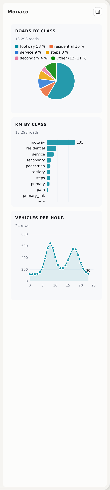
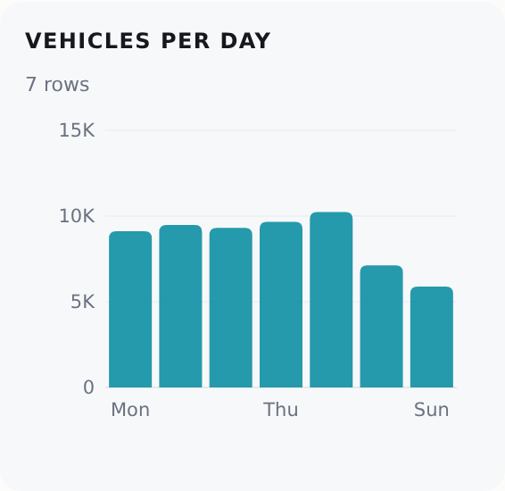
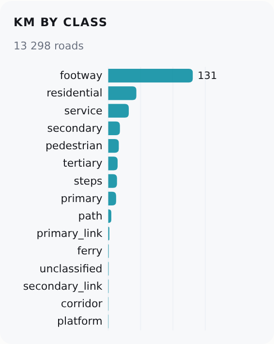
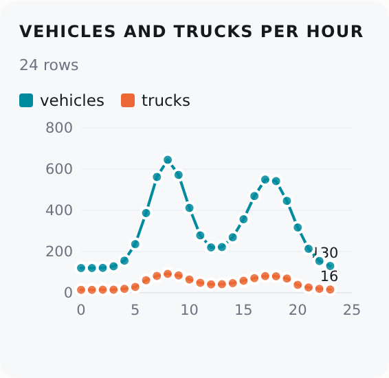
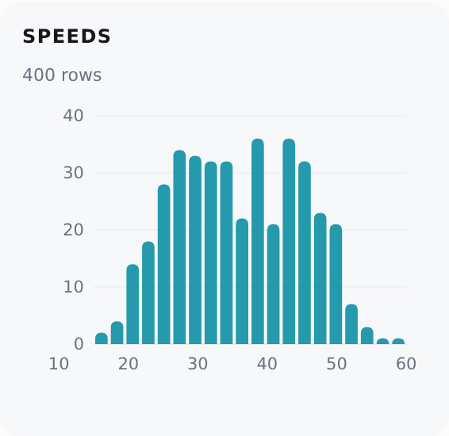
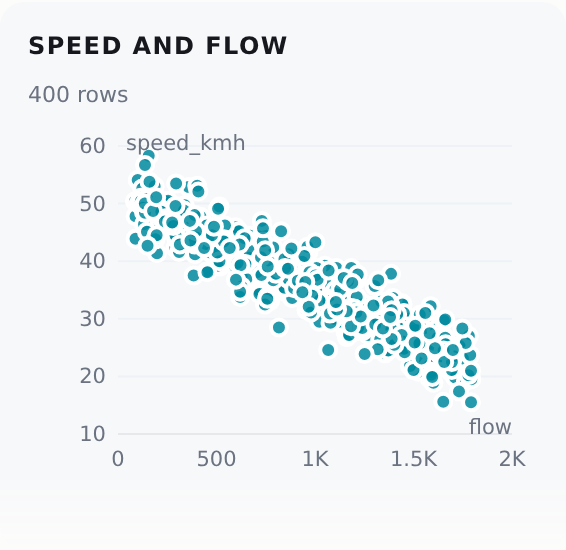
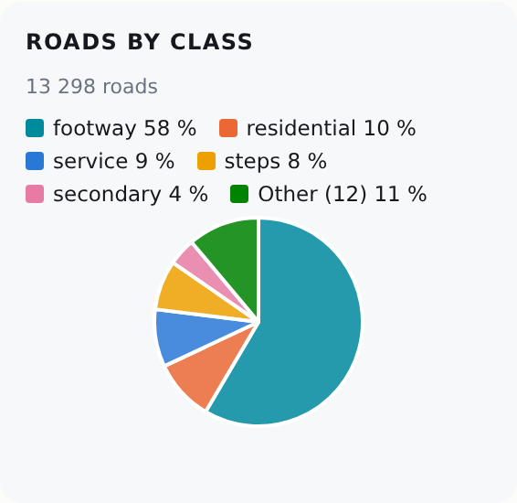

# Dashboard parts

Every dashboard page is made of the same parts. Each box on this page is the real part: click it, type in it, fold it. **Use a part when one exists. Do not write CSS or JavaScript of your own for it**, because a copy does not follow the dark theme.

Each part has the same form: the live part, a box with **Use it for** and **From Python**, and the code in tabs, always in the order **Python**, **HTML**, **JavaScript**. **Details** opens on a click.

- **Python**: a section of `rs.render_dashboard(gdf, dashboard={"panel": {"sections": [...]}})`.
- **HTML**: the `html` of a section, from Python or JavaScript.
- **JavaScript**: code in `page_script`, inside `rs.ready(() => {...})`.

[All the parts in one panel](../parts/gallery.html) has a theme switch and a phone width.

| Group | Part | From Python | Use it for |
|---|---|---|---|
| Layout | [Cards](#cards) | yes | the blocks of the panel |
| Layout | [A card in the page's own HTML](#a-card-in-the-pages-own-html) | HTML | a card inside a tab or a block |
| Layout | [A card that opens something](#a-card-that-opens-something) | no | a card that opens an editor |
| Layout | [Tabs](#tabs) | yes | the sections of a page |
| Layout | [An editor in the panel](#an-editor-in-the-panel) | no | an editor that needs the whole panel |
| Layout | [A list or a table that scrolls](#a-list-or-a-table-that-scrolls) | HTML | a long list |
| Layout | [Steps](#steps) | HTML | a task in steps |
| Layout | [Show more](#show-more) | no | a long list |
| Layout | [An empty state](#an-empty-state) | HTML | a list with no item |
| Layout | [An icon button in a title row](#an-icon-button-in-a-title-row) | no | an action of a card, such as "zoom to the area" |
| Layout | [The panel's fixed bar](#the-panels-fixed-bar) | no | the state and the main button of a page |
| Inputs | [Buttons](#buttons) | HTML | an action |
| Inputs | [A two-way switch](#a-two-way-switch) | no | a mode or a setting |
| Inputs | [A select box](#a-select-box) | HTML | one value of many |
| Inputs | [A text box, a check box and a radio button](#a-text-box-a-check-box-and-a-radio-button) | HTML | a form |
| Inputs | [A colour picker](#a-colour-picker) | HTML | a colour that the person chooses |
| Inputs | [Option rows](#option-rows) | HTML | settings with a note |
| Inputs | [A day picker](#a-day-picker) | no | one day of data at a time |
| Inputs | [The query part](#the-query-part) | yes | a question about the roads |
| Inputs | [A date range, a week or a month](#a-date-range-a-week-or-a-month) | no | a page with a period of data |
| Inputs | [An hour picker](#an-hour-picker) | no | the hour of a page |
| Inputs | [A slider](#a-slider) | no | a number from a range |
| Inputs | [A number field](#a-number-field) | no | a count, a width |
| Inputs | [An on/off switch](#an-onoff-switch) | HTML | a setting that has an effect at once |
| Inputs | [A search field](#a-search-field) | no | a place, a road |
| Inputs | [A file drop zone](#a-file-drop-zone) | no | an input file |
| Inputs | [An action menu](#an-action-menu) | no | the actions of an item |
| Inputs | [A toggle button](#a-toggle-button) | no | a mode that is on or off |
| Inputs | [A tool row](#a-tool-row) | HTML | the tools of an editor |
| Inputs | [Rows that a click selects](#rows-that-a-click-selects) | HTML | a change list |
| Showing data | [Number tiles](#number-tiles) | yes | the few numbers of a page |
| Showing data | [Rows of fields](#rows-of-fields) | HTML | the fields of one item |
| Showing data | [List rows](#list-rows) | HTML | a list of results |
| Showing data | [Chips and a dot](#chips-and-a-dot) | HTML | a label, a colour mark |
| Showing data | [The road card](#the-road-card) | yes | the clicked road |
| Showing data | [A chart](#a-chart) | yes | a chart of rows |
| Showing data | [Charts of your own](#charts) | no | a chart that `rs.chart` does not draw |
| Showing data | [Colour classes](#colour-classes) | yes | classes for a colour menu |
| Status | [A callout](#a-callout) | HTML | the answer of a page |
| Status | [Status colours](#status-colours) | HTML | an error, a warning, a good result |
| Status | [A field error and a warning](#a-field-error-and-a-warning) | HTML | a value that is wrong or needs a look |
| Status | [A progress bar and a busy button](#a-progress-bar-and-a-busy-button) | no | a long task |
| Status | [A toast and a status line](#a-toast-and-a-status-line) | HTML | the result of an action |
| Status | [A confirm dialog](#a-confirm-dialog) | no | a question before an action, in place of `confirm()` |
| Status | [A count badge and a "not saved" dot](#a-count-badge-and-a-not-saved-dot) | HTML | a count on a tab or a button, a change that is not saved |
| Help | [A help window](#a-help-window) | yes | "How to read this page" |
| Help | [A hover box](#a-hover-box) | no | words under the pointer |
| Help | [A button tip](#a-button-tip) | HTML | the name of an icon button |
| Map | [The bottom dock](#the-bottom-dock) | no | a wide table under the map |

**yes**: a Python option, no JavaScript. **HTML**: write the HTML in a section's `html`. **no**: JavaScript only.

## Foundations { .rs-group }

### The accent color and the theme tokens { .rs-part }

**Use it for:** your own colours. The tokens change with the theme.<br>
**From Python:** CSS, in a `<style>` of a section's `html`
{ .rs-facts }

| Token | Use |
|---|---|
| `var(--ink)`, `var(--mut)` | text, muted text |
| `var(--bg)`, `var(--card)` | the panel, a box in it |
| `var(--line)` | thin lines |
| `var(--accent)`, `var(--accent-fill)` | links; a filled control |
| `var(--rs-err)`, `var(--rs-warn)`, `var(--rs-ok)` | [status colours](#status-colours) |
| `var(--rs-unsaved)`, `var(--rs-danger-fill)` | the ["not saved" dot](#a-count-badge-and-a-not-saved-dot); the fill of a red button (`sb-danger`) |
| `var(--rs-accent-text)` | the accent as text on an accent tint (a pressed button, a selected row) |

??? info "Details"

    - The accent is one teal for the whole dashboard. A page does not set its own. `--accent` is `#0e7c8e` in the light theme and a lighter teal in the dark theme. `--accent-fill` is `#0E7F91` and takes white text in both themes.
    - `var(--rs-hover-bg)` is the tint behind a control under the pointer.
    - `rsSetTheme("dark")` or `rsSetTheme("light")` changes the theme and sends the event `rs:themechange`.
    - `tests/test_dashboard_themes_browser.py` opens each part in both themes. It fails on a text with a contrast under 4.5 and on a light surface or line in the dark theme.

### The rules { .rs-part }

- **Width.** Fit the content to the panel. Do not make the panel wider.
- **Colours.** Use the tokens, not fixed colours. A colour of your data can be fixed.
- **Both themes.** Look at the page in the light and the dark theme, and at phone width.
- **Scroll.** Put a long list in `rs-scroll`.
- **Transparency.** The person sets it in the settings box. A page never sets an opacity.

## Layout: cards, tabs and frames { .rs-group }

### Cards { .rs-part }

<iframe class="rs-live" src="../../parts/gallery.html?part=cards" title="Cards, live" loading="lazy"></iframe>

**Use it for:** each block of the panel. A section with a `label` is a card.<br>
**From Python:** yes
{ .rs-facts }

=== "Python"

    ```python
    {"id": "notes", "label": "Notes", "html": "<p>Text</p>"}
    {"id": "more", "label": "More", "fold": True, "note": "Click the title", "html": "<p>Text</p>"}
    {"id": "flat", "label": "No background", "background": False, "html": "<p>Text</p>"}
    ```

=== "JavaScript"

    ```js
    rs.sections.add({id: "more", label: "More", fold: true, html: "<p>Text</p>"});
    rs.sections.note("more", "3 roads");      // the line under the title
    rs.sections.fold("more", false);          // open it
    ```

<a id="cards-the-panel-standard"></a>

??? info "Details"

    - A card that folds keeps its state in the browser. **Collapse all** in the panel title folds all of them.
    - The event `rs:sectionchange` has `detail.id` and `detail.state` (`add`, `remove`, `hide`, `show`, `fold`, `unfold`).
    - A section without a `label` is the page's HTML with no box. It has no title, no padding and no background. Use it for content with its own layout: tabs, a row of number tiles, or the page's own cards. It is as wide as the cards and has `--rs-card-gap` above and below.

    **The panel standard.** Two options choose one of four kinds of card:

    | | `background` (default) | `background: false` |
    |---|---|---|
    | does not fold (default) | `{"id", "label", "html"}` | `{"id", "label", "html", "background": False}` |
    | `fold: true` | `{"id", "label", "html", "fold": True}` | `{"id", "label", "html", "fold": True, "background": False}` |

    - Each kind has the same title row, the same 12 px corners and the same padding.
    - A card that folds has a chevron, and its title is a button. A closed card has a thin gray edge (`--rs-card-edge`). An open card has a thin accent ring and an accent title. The edge and the ring are inside the card, so they do not change its size. The edge has a contrast of 3:1 or more on the card and on the panel, in both themes.
    - A "?" of [`rs.help.button`](#a-help-window) is at the right end of the title row, before the chevron. The chevron is last.
    - A closed card is 14 + 16 + 14 = 44 px high with the default padding.
    - The buttons in the panel title are in a fixed order: "collapse all" (`#rs-fold-all`) is at the left of "hide the panel" (`#sb-hide`).
    - Do not write your own spacing, padding or corner radius. The panel sets them.
    - Do not put an `rs-sec-box` inside a section with a `label`. The section is already a card, and a box in it makes a card in a card. Put the content directly in `html`.
    - Use `var(--accent-fill)` (`#0E7F91`) with white text for a filled control. Use `var(--accent)` for links and marks. Do not use another teal.

    Three CSS variables on `:root` hold the numbers for all cards:

    | Variable | Default | Meaning |
    |---|---|---|
    | `--rs-card-gap` | `12px` | The space between two cards, and between a card and a section without a label |
    | `--rs-card-pad` | `14px` | The padding inside a card |
    | `--rs-panel-bottom` | `28px` | The space under the last card, at the end of the panel |

### A card in the page's own HTML { .rs-part }

<iframe class="rs-live" src="../../parts/gallery.html?part=page-card" title="A card in the page's own HTML, live" loading="lazy"></iframe>

**Use it for:** a card inside a tab, a block or an [editor frame](#an-editor-in-the-panel). A section with a `label` is a card already.<br>
**From Python:** HTML
{ .rs-facts }

=== "HTML"

    ```html
    <div class="rs-sec-box"><div class="rs-card-title">By hour of the day</div><p>Text</p></div>
    <div class="rs-sec-box"><h3>By hour</h3><p>A short, muted description.</p><svg>...</svg></div>
    ```

### A card that opens something { .rs-part }

<iframe class="rs-live" src="../../parts/gallery.html?part=open" title="A card that opens something, live" loading="lazy"></iframe>

**Use it for:** a card whose only job is to open an editor or a dialog. The card is one button.<br>
**From Python:** no
{ .rs-facts }

=== "JavaScript"

    ```js
    rs.sections.add({id: "edit", label: "Edit roads", note: "Opens the editor", open: () => frame.open("tags")});
    rs.sections.add({id: "ask", label: "Ask", icon: "ask", background: true, open: () => ask.open()});
    ```

??? info "Details"

    - The card is one button: a click anywhere on it, or Enter on its title, runs `open`. `open` is JavaScript only, because it is a function.
    - The card never folds, and "Collapse all" leaves it. It has no background and a thin edge. Under the pointer it gets a light tint of the accent colour.
    - `note` tells the state. `rs.sections.note(id, text)` changes it.
    - `icon` changes the mark at the end of the row: `"edit"` (the pencil, the default), `"ask"` (a speech bubble with a question mark) or your own `<svg>`. It does not depend on the background.
    - `background: true` gives the light accent tint, so that one card stands out from the others. The edge stays.
    - To keep a card from opening (a step that is not ready), disable its title button: `rs.sections.get(id).querySelector(".rs-sec-title").disabled = true`.
    - A card with `open` and `fold` is an error.

### Tabs { .rs-part }

<iframe class="rs-live" src="../../parts/gallery.html?part=tabs" title="Tabs, live" loading="lazy"></iframe>

**Use it for:** the sections of a page: a click shows another pane. To draw the same content in another way, use a [two-way switch](#a-two-way-switch).<br>
**From Python:** yes
{ .rs-facts }

=== "Python"

    ```python
    {"id": "streets", "label": "Streets", "tabs": [
        {"id": "a", "label": "Overview", "html": "<p>...</p>"},
        {"id": "b", "label": "Hours", "html": "<p>...</p>"}]}
    ```

=== "HTML"

    ```html
    <nav class="rs-tabs"><button class="rs-tab on" data-tab="a">Overview<span class="rs-count">12</span></button><button class="rs-tab" data-tab="b">Hours</button></nav>
    <div data-pane="a">...</div><div data-pane="b" hidden>...</div>
    ```

=== "JavaScript"

    ```js
    const tabs = rs.tabs.use(document.querySelector(".rs-tabs"), id => console.log(id));
    tabs.select("b");   // as a click
    ```

??? info "Details"

    - `rs-count` is a count after the words of a tab. Add `err` or `warn` only when the count needs attention.
    - A click or the left and right keys select a tab. The selected button has `on` and `aria-selected="true"`.
    - The panes are the siblings of the `nav` with `data-pane`. Only the selected one shows.
    - `tabs.select("b", true)` selects with no call of `onChange`. `tabs.current()` gives the selected tab.

### An editor in the panel { .rs-part }

<iframe class="rs-live" src="../../parts/gallery.html?part=frame" title="The editor frame, live" loading="lazy"></iframe>

**Use it for:** an editor that needs the whole panel, as Edit design and the level editor do. Click **Open the editor frame** above.<br>
**From Python:** no
{ .rs-facts }

| Area | Where | What to put in it | Scrolls |
|---|---|---|---|
| `top` | the panel's title line | "← back" and the title | no |
| `head` | under the title line | the tab row, or a row of your own | no |
| `body` | the middle | the form of the selected tab | yes |
| `bar` | the bottom edge | the state and the main buttons | no |

=== "JavaScript"

    ```javascript
    const fr = rs.frame({panel: document.getElementById("sb"), title: "Edit roads", back: "Steps", id: "ed",
                         tabs: [["tags", "Tags"], ["notes", "Notes"]]});
    fr.addEventListener("tab", (e) => { fr.body.innerHTML = formOf(e.detail.tab); });
    fr.addEventListener("back", () => fr.close());
    fr.bar.innerHTML = "<b>2 changes</b> <button type='button' class='sb-primary'>Apply</button>";
    fr.open("tags");
    ```

??? info "Details"

    | Option | Default | What it does |
    |---|---|---|
    | `panel` | (needed) | the host's panel: `#sb` with `.sb-card`, `.sb-top` and `.sb-body` |
    | `title` | (needed) | the title |
    | `back` | `null` | the words of the back button; `null`: no button |
    | `tabs` | `[]` | `[[id, name], ...]`: the tab row |
    | `head` | `null` | an element for the head row (the Ask panel: no tabs, a row of its own) |
    | `id` | `"rs-frame"` | the start of the ids: `<id>-back`, `<id>-tabs`, `<id>-tab-<tab>`, `<id>-body` |

    | Method or event | What it does |
    |---|---|
    | `open(tab)` | hides the host's panel content and shows the frame |
    | `close()` | removes the frame and shows the host's panel again |
    | `tab(name)`, `tab()` | selects a tab with no event; gives the selected tab |
    | `isOpen()` | `true` while the frame is open |
    | event `tab` | a click on a tab (`e.detail.tab`) |
    | event `back` | a click on the back button: call `close()` |

    - The frame does not draw the body: draw it when the event `tab` comes.
    - A count on a tab: add a `<span class="rs-count">` to the tab's button (`#<id>-tab-<tab>`) after `open()`.
    - The parts of this page work in the body. Each `<select>` becomes the [select box](#a-select-box).
    - On a phone the frame fills the sheet, and the tabs scroll sideways.
    - A module page without `window.rs`: `import {editorFrame} from "./dashboard/frame.js"`.

### A list or a table that scrolls { .rs-part }

<iframe class="rs-live" src="../../parts/gallery.html?part=scroll" title="A table that scrolls, live" loading="lazy"></iframe>

**Use it for:** a long list or table in the panel. For a wide table, use [the bottom dock](#the-bottom-dock).<br>
**From Python:** HTML
{ .rs-facts }

=== "HTML"

    ```html
    <div class="rs-scroll"><table class="rs-table"><thead><tr><th data-sort="desc">Street</th><th>Hours</th></tr></thead><tbody>...</tbody></table></div>
    ```

??? info "Details"

    - The area has a thin scrollbar and a fade at the bottom while there is more below. Its height is `--rs-scroll-h` (default: 520 px or 60 % of the window, the smaller).
    - The header row stays in view, and the numbers line up. `data-sort` on a `th` shows the sort arrow. The table does not sort: your code sorts the rows.

### Steps { .rs-part }

<iframe class="rs-live" src="../../parts/gallery.html?part=steps" title="Steps, live" loading="lazy"></iframe>

**Use it for:** a task in steps.<br>
**From Python:** HTML
{ .rs-facts }

=== "HTML"

    ```html
    <ol class="rs-steps">
      <li class="rs-step done"><span class="rs-step-n">1</span><div class="rs-step-b"><b>Choose an area</b><p>Monaco</p></div></li>
      <li class="rs-step on"><span class="rs-step-n">2</span><div class="rs-step-b"><b>Build the roads</b><p>...</p></div></li>
      <li class="rs-step wait"><span class="rs-step-n">3</span><div class="rs-step-b"><b>Edit OSM data</b><span class="rs-step-note">After step 2</span></div></li>
    </ol>
    ```

??? info "Details"

    - `done` has a check mark, `on` (the step to do now) has a filled number and an accent edge, `wait` is dimmed and says what it waits for. Put the buttons of a step in its `rs-step-b`.

### Show more { .rs-part }

<iframe class="rs-live" src="../../parts/gallery.html?part=more" title="Show more, live" loading="lazy"></iframe>

**Use it for:** a long list.<br>
**From Python:** no
{ .rs-facts }

=== "JavaScript"

    ```js
    const l = rs.more(document.getElementById("roads"), {items: roads, page: 50, noun: "roads",
                                                          render: r => `<div class="rs-qrow"><b>${r.name}</b><span>${r.km} km</span></div>`});
    l.set(otherRoads);           // a new list: the first page again
    ```

??? info "Details"

    - The list shows its first `page` rows, and a line under it says "50 of 134 roads" with a button "Show 50 more". `render` gives an element or HTML. It gives `{set(items), shown()}`. The list is in memory. A page that loads its rows from a server can use the `rs-more` line with its own button.

### An empty state { .rs-part }

<iframe class="rs-live" src="../../parts/gallery.html?part=empty" title="An empty state, live" loading="lazy"></iframe>

**Use it for:** a list with no item.<br>
**From Python:** HTML
{ .rs-facts }

=== "HTML"

    ```html
    <div class="rs-empty"><svg>...</svg><span><b>No fixes yet.</b><br>Click a road on the map to fix its tags.</span><button type="button">Add a fix</button></div>
    ```

??? info "Details"

    - The icon and the button are optional. It works in the panel, in a frame and in a page of its own.

### An icon button in a title row { .rs-part }

<iframe class="rs-live" src="../../parts/gallery.html?part=icon-btn" title="An icon button in a title row, live" loading="lazy"></iframe>

**Use it for:** an action of a card, such as "zoom to the area".<br>
**From Python:** no
{ .rs-facts }

=== "JavaScript"

    ```js
    rs.sections.button("area", {icon: "<svg>...</svg>", title: "Zoom to the area", onClick: () => zoomTo(area)});
    ```

??? info "Details"

    - The button goes after the card's title, before the "?" and the chevron. A click on it does not fold or open the card. In a card of the page's own HTML, put `<button class="rs-icon-btn" title="..." aria-label="...">` in the `.rs-card-title`.

### The panel's fixed bar { .rs-part }

<iframe class="rs-live" src="../../parts/gallery.html?part=panel-bar" title="The panel's fixed bar, live" loading="lazy"></iframe>

**Use it for:** the state and the main button of a page.<br>
**From Python:** no
{ .rs-facts }

=== "JavaScript"

    ```js
    const bar = rs.panel.bar();
    bar.innerHTML = '<span><b>3 fixes</b> not saved</span><button type="button" class="sb-primary">Build</button>';
    ```

??? info "Details"

    - `rs.panel.bar()` gives the element at the bottom edge of the panel, under the cards and outside the part that scrolls. It has the look of the editor frame's bar. The first text in it takes the free width, and the buttons are at the right. Empty, it does not show. While an [editor frame](#an-editor-in-the-panel) is open, the frame's own bar is there and this bar does not show. On a phone it is at the bottom of the sheet. A second call gives the same element.

## Inputs { .rs-group }

### Buttons { .rs-part }

<iframe class="rs-live" src="../../parts/gallery.html?part=buttons" title="Buttons, live" loading="lazy"></iframe>

**Use it for:** an action. `sb-primary` is the one main action of a card. `sb-danger` is an action that deletes. `rs-link` is a small action in a line of text.<br>
**From Python:** HTML
{ .rs-facts }

=== "HTML"

    ```html
    <div class="sb-actions"><button type="button" class="sb-primary">Run</button><button type="button">Reset</button></div>
    <button type="button" class="sb-danger">Delete</button>
    <button type="button" class="rs-link">clear</button>
    ```

??? info "Details"

    | Kind | Hover |
    |---|---|
    | Not filled | the tint `--rs-hover-bg` and the accent colour |
    | Filled | brighter |
    | A link | underlined |

    - A `disabled` button is faded and does not react. Keyboard focus has an accent ring.
    - `sb-danger` is red with white text. Use it for an action that deletes, as the OK button of a [confirm dialog](#a-confirm-dialog).
    - The look of a plain `<button>`, a `<select>` and a `<label>` in the panel is in `dashboard.css`, so a host page with its own panel (`#sb`) and no dashboard template gets it too. A disabled button, also a primary one, is dimmed.

### A two-way switch { .rs-part }

<iframe class="rs-live" src="../../parts/gallery.html?part=switch" title="A two-way switch, live" loading="lazy"></iframe>

**Use it for:** a mode or a setting with a few values: the same content is drawn in another way. To show another pane, use [tabs](#tabs).<br>
**From Python:** no
{ .rs-facts }

=== "HTML"

    ```html
    <div class="rs-seg" id="mode"><button class="on" data-v="all">Every day</button><button data-v="first">First day</button></div>
    ```

=== "JavaScript"

    ```js
    rs.tabs.use(document.getElementById("mode"), v => redraw(v));
    ```

### A select box { .rs-part }

<iframe class="rs-live" src="../../parts/gallery.html?part=select" title="A select box, live" loading="lazy"></iframe>

**Use it for:** one value of many, for example "Colour by". Write a plain `<select>`: roadstyle gives it its look.<br>
**From Python:** HTML
{ .rs-facts }

=== "HTML"

    ```html
    <label>Colour by</label>
    <select id="by"><option value="class">Road class</option><option value="speed">Speed limit</option></select>
    ```

=== "JavaScript"

    ```js
    document.getElementById("by").addEventListener("change", e => recolour(e.target.value));
    ```

??? info "Details"

    - Your code reads and sets the `<select>` as usual (`value`, `disabled`, the `change` event). The button follows.
    - The keys: Down or Up opens the list, Enter picks, Escape closes.
    - In a card, the select box has a thin line around it, as a text box has.

### A text box, a check box and a radio button { .rs-part }

<iframe class="rs-live" src="../../parts/gallery.html?part=inputs" title="Text boxes, check boxes and radio buttons, live" loading="lazy"></iframe>

**Use it for:** a form. Write no class.<br>
**From Python:** HTML
{ .rs-facts }

=== "HTML"

    ```html
    <label>Street</label><input placeholder="Götgatan">
    <label>Note</label><textarea rows="3"></textarea>
    <input type="checkbox" checked> Bridges
    <input type="radio" name="count" checked> Every day
    ```

### A colour picker { .rs-part }

<iframe class="rs-live" src="../../parts/gallery.html?part=color" title="A colour picker, live" loading="lazy"></iframe>

**Use it for:** a colour that the person chooses. Write a plain `<input type="color">`: roadstyle gives it its look. `rs.colorPick` gives a palette first.<br>
**From Python:** HTML
{ .rs-facts }

=== "HTML"

    ```html
    <label>Road fill</label><input type="color" id="fill" value="#b8d986">
    ```

=== "JavaScript"

    ```js
    document.getElementById("fill").addEventListener("input", e => preview(e.target.value));   // while the person drags
    document.getElementById("fill").addEventListener("change", e => save(e.target.value));     // when the person is done
    // a palette first (default: the 8 chart colours), a hex field, and "More…", which opens the same box
    const line = rs.colorPick(document.getElementById("line"), {label: "Line colour", value: "#eb6834", onChange: v => save(v)});
    line.value();      // "#eb6834"
    ```

??? info "Details"

    - The box has a square for the saturation and the lightness, a hue bar, the colour before and the new colour, a hex field, the colours used last on the page, and an eyedropper where the browser has one.
    - Your code reads and sets `value` and `disabled` as usual. The swatch follows. `input` comes while the person drags, `change` when the box closes with a new colour.
    - Escape closes the box and puts back the colour before. A click on the old colour does the same and keeps the box open. Enter or a click outside keeps the new colour.
    - The arrow keys move the dot in the square (with Shift: ten times as far) and the hue on the bar.
    - It comes to each `<input type="color">` in the panel at the start, in a section that `rs.sections.add` adds, and in an [editor frame](#an-editor-in-the-panel).
    - `rs.colorPick(el, {label, value, palette, onChange})` shows the swatch and the hex in a field. Its box has the palette, a hex field and **More…**. **More…** opens the box above, so the dashboard has one colour box and no browser dialog. A hex that is not a colour has a red edge and changes nothing. `onChange(hex)` comes for each new colour. It gives `{value(), set(hex, quiet)}`.

### Option rows { .rs-part }

<iframe class="rs-live" src="../../parts/gallery.html?part=opt" title="Option rows, live" loading="lazy"></iframe>

**Use it for:** settings with a short note, or a choice of a list. `rs-opts-row` puts the rows side by side.<br>
**From Python:** HTML
{ .rs-facts }

=== "HTML"

    ```html
    <div class="rs-opts">
      <label class="rs-opt"><input type="checkbox" checked><span><b>Layers</b><small>Water, land use, buildings.</small></span></label>
      <label class="rs-opt"><input type="radio" name="x"><span><b>Monaco</b><small>2 km²</small></span><button type="button">Get</button></label>
    </div>
    ```

### A day picker { .rs-part }

<iframe class="rs-live" src="../../parts/gallery.html?part=days" title="A day picker, live" loading="lazy"></iframe>

**Use it for:** a page that shows one day of data at a time.<br>
**From Python:** no
{ .rs-facts }

=== "JavaScript"

    ```js
    const day = rs.days.use(document.getElementById("day"), {
      days: ["2026-10-01", "2026-10-04", "2026-10-05"],      // the days with data
      onChange: d => fetch(`daily_${d}.json`).then(r => r.json()).then(draw),
    });
    ```

??? info "Details"

    - `value` is the day at the start (default: the latest). `label` is the label (default: "Day").
    - `day.value()` gives the day. `day.set("2026-10-04")` changes it; `day.set(d, true)` does not call `onChange`.
    - Only the days in `days` can be picked. "‹" and "›" skip the days with no data. "Latest" goes to the last day.
    - When `onChange` gives a promise, the field waits for it. When the promise fails, the picker goes back to the old day and shows a line.

### The query part { .rs-part }

**Use it for:** a question about the roads: a WHERE line with **Run**, **Filter**, **Colour** and the list of the roads that match.<br>
**From Python:** yes
{ .rs-facts }

=== "Python"

    ```python
    {"id": "q", "label": "Query", "part": "query", "text": "p.lanes >= 2"}
    ```

`text` is the start text (none: an empty box). More: [Dashboards](dashboards.md#the-panel-starts-empty).

### A date range, a week or a month { .rs-part }

<iframe class="rs-live" src="../../parts/gallery.html?part=range" title="A date range, a week and a month, live" loading="lazy"></iframe>

**Use it for:** a page with a period of data.<br>
**From Python:** no
{ .rs-facts }

=== "JavaScript"

    ```js
    const r = rs.days.range(document.getElementById("period"), {
      unit: "day",                          // "day": from a day to a day; "week": Monday to Sunday; "month": one month
      min: "2026-09-01", max: "2026-11-06", // the first and the last day that can be chosen
      days: ["2026-10-05", "2026-10-06"],   // optional: only these days can be the first or the last day of a range
      value: ["2026-10-05", "2026-10-11"],  // the period at the start (default: the last 7 days, the last week or the last month)
      onChange: ([from, to]) => load(from, to),
    });
    r.value();                              // ["2026-10-05", "2026-10-11"]
    r.set(["2026-10-01", "2026-10-03"], true);   // quiet: does not call onChange
    r.unit("week");                         // another unit: the week of the last day
    ```

??? info "Details"

    - Use it on a page that shows a period of data: from one day to another, one week, or one month. It is the day picker's field with a calendar.
    - **Days.** The first click in the calendar sets the first day, the second click sets the last day. While the pointer moves, the calendar shows the range that a click gives. The field says "5–11 Oct 2026".
    - **Week.** A click on a day takes its week, Monday to Sunday. The field says "Week 45 · 2–8 Nov 2026" (the ISO week number).
    - **Month.** The calendar is a grid of 12 months. The field says "November 2026".
    - "‹" and "›" go to the period before and after: the same number of days, the week, or the month. A period with no day in `min` to `max` is disabled.
    - `onChange` can give a promise, as in the day picker. To let the person choose the unit, put an `rs-seg` beside the field and call `unit(u)`.

### An hour picker { .rs-part }

<iframe class="rs-live" src="../../parts/gallery.html?part=hours" title="An hour picker, live" loading="lazy"></iframe>

**Use it for:** the hour of a page.<br>
**From Python:** no
{ .rs-facts }

=== "JavaScript"

    ```js
    const h = rs.hours.use(document.getElementById("hour"), {value: 8, onChange: h => load(h)});   // one hour: 08:00 – 09:00
    const r = rs.hours.use(document.getElementById("rush"), {value: [7, 9], range: true, label: "Rush hours",
                                                              hours: [6, 7, 8, 9, 10], onChange: ([a, b]) => load(a, b)});
    h.value();             // 8
    r.set([16, 18]);       // the hours 16, 17 and 18: 16:00 to 19:00
    ```

??? info "Details"

    - The hour picker has the look of the day picker: a field that opens a list of the hours.
    - **One hour.** "‹ [08:00 – 09:00] ›". The list scrolls to the chosen hour, which has a tick. "‹" and "›" go to the hour before and after.
    - **A range** (`range: true`). "From [07:00] To [10:00] 3 h". The value `[7, 9]` is the hours 7, 8 and 9, so To is 10:00, the end of the last hour. The list of To shows only hours after From. A From after To moves To with it.
    - `hours` are the hours that can be chosen (default: all 24). The others are dimmed in the list, and "‹" and "›" skip them.
    - Keys: ↓ opens the list, ↓ ↑ Home End walk it, Enter picks, Escape closes.

### A slider { .rs-part }

<iframe class="rs-live" src="../../parts/gallery.html?part=slider" title="A slider, live" loading="lazy"></iframe>

**Use it for:** a number from a range.<br>
**From Python:** no
{ .rs-facts }

=== "JavaScript"

    ```js
    rs.slider(document.getElementById("speed"), {label: "Speed limit", min: 0, max: 130, step: 10, value: 50, unit: "km/h",
                                                   onInput: v => preview(v), onChange: v => apply(v)});
    rs.slider(document.getElementById("flow"), {label: "Flow", min: 0, max: 2000, step: 50, value: [300, 1200], unit: "veh/h"});   // two handles
    ```

??? info "Details"

    - The value is at the right of the label. `onInput` comes while the handle moves, `onChange` at the release. With `value: [a, b]` the slider has two handles, and they do not cross. `format(v)` gives the text of a value (default: the value and the unit). It is the browser's range input, so the arrow keys, Home and End work. It gives `{value(), set(v, quiet)}`.

### A number field { .rs-part }

<iframe class="rs-live" src="../../parts/gallery.html?part=number" title="A number field, live" loading="lazy"></iframe>

**Use it for:** a count, a width.<br>
**From Python:** no
{ .rs-facts }

=== "JavaScript"

    ```js
    rs.number(document.getElementById("lanes"), {label: "Lanes", min: 1, max: 8, step: 1, value: 2, onChange: n => apply(n)});
    rs.number(document.getElementById("width"), {label: "Width", min: 0, max: 40, step: 0.5, value: 7.5, unit: "m"});
    ```

??? info "Details"

    - "−", the number, the unit and "+" are one box. "−" or "+" is disabled at the limit. A typed number out of the range becomes the nearest limit. It gives `{value(), set(v, quiet)}`.

### An on/off switch { .rs-part }

<iframe class="rs-live" src="../../parts/gallery.html?part=onoff" title="An on/off switch, live" loading="lazy"></iframe>

**Use it for:** a setting that has an effect at once.<br>
**From Python:** HTML
{ .rs-facts }

=== "HTML"

    ```html
    <label class="rs-switch"><input type="checkbox" role="switch" checked><span>Show bridges</span></label>
    ```

??? info "Details"

    - It is a check box, so `checked`, `disabled`, the `change` event and Space work as for a check box. Use it for a setting that has an effect at once. Use a check box in a form that has a **Save** button.

### A search field { .rs-part }

<iframe class="rs-live" src="../../parts/gallery.html?part=search" title="A search field, live" loading="lazy"></iframe>

**Use it for:** a place, a road.<br>
**From Python:** no
{ .rs-facts }

=== "JavaScript"

    ```js
    const s = rs.search(document.getElementById("place"), {placeholder: "Find a place", button: "Go",
      suggest: q => fetch(url + encodeURIComponent(q)).then(r => r.json()).then(a => a.map(p => ({label: p.name, sub: p.country, value: p}))),
      onPick: item => fly(item.value), onSubmit: q => find(q), onClear: () => reset()});
    ```

??? info "Details"

    - `suggest(text)` gives a list of `{label, sub, value}`, or a promise of one. The list shows at most `max` rows (default 8). While the promise runs, a ring turns in place of the magnifier. A list with no row says "No match for …" (`none` gives your own words).
    - ↓ ↑ walk the list, Enter picks the marked row or calls `onSubmit(text)`, Escape closes the list, and a second Escape clears the text. The end button (`button`) calls `onSubmit` too.
    - It gives `{value(), set(text), focus(), clear()}`.

### A file drop zone { .rs-part }

<iframe class="rs-live" src="../../parts/gallery.html?part=drop" title="A file drop zone, live" loading="lazy"></iframe>

**Use it for:** an input file.<br>
**From Python:** no
{ .rs-facts }

=== "JavaScript"

    ```js
    rs.drop(document.getElementById("file"), {accept: ".pbf,.osm", text: "Drop an .osm.pbf file here, or <u>choose a file</u>",
                                              hint: "Up to 2 GB", onFiles: files => load(files[0]), onClear: () => reset()});
    ```

??? info "Details"

    - A file over the box fills it with the accent. A click, Enter or Space opens the browser's file window. After the pick, a row shows the file's name and size and a "×" that takes it away. `multiple: true` takes more files. It gives `{files(), clear()}`.

### An action menu { .rs-part }

<iframe class="rs-live" src="../../parts/gallery.html?part=menu" title="An action menu, live" loading="lazy"></iframe>

**Use it for:** the actions of an item.<br>
**From Python:** no
{ .rs-facts }

=== "JavaScript"

    ```js
    const items = [{label: "Edit", onClick: edit}, {label: "Export", disabled: true}, "-", {label: "Delete", danger: true, onClick: remove}];
    row.append(rs.menu.button(items));                        // a new "⋯" button with the menu
    const m = rs.menu(document.getElementById("more"), items); // or the menu of your own button
    ```

??? info "Details"

    - `"-"` is a line between two groups. `icon` is an SVG before the label. ↓ ↑ Home End walk the list, Enter picks, Escape closes and gives the focus back to the button. `rs.menu` gives `{open(), close(), set(items)}`.

### A toggle button { .rs-part }

<iframe class="rs-live" src="../../parts/gallery.html?part=toggle" title="A toggle button, live" loading="lazy"></iframe>

**Use it for:** a mode that is on or off.<br>
**From Python:** no
{ .rs-facts }

=== "JavaScript"

    ```js
    const t = rs.toggle(document.getElementById("here"), on => setMode(on ? "what-is-here" : null));
    t.set(false, true);          // quiet: no onChange
    ```

??? info "Details"

    - The button stays pressed (`aria-pressed`) until the next click: the accent tint, an accent edge and accent text. It gives `{set(on, quiet), value()}`.

### A tool row { .rs-part }

<iframe class="rs-live" src="../../parts/gallery.html?part=toolrow" title="A tool row, live" loading="lazy"></iframe>

**Use it for:** the tools of an editor.<br>
**From Python:** HTML
{ .rs-facts }

=== "HTML"

    ```html
    <div class="rs-toolrow" id="tools"><button data-v="pan" title="Move the map" aria-label="Move the map"><svg>...</svg></button>
      <button data-v="pen" title="Draw a road" aria-label="Draw a road"><svg>...</svg></button></div>
    ```

=== "JavaScript"

    ```js
    rs.tabs.use(document.getElementById("tools"), tool => setTool(tool));   // one tool is pressed
    ```

??? info "Details"

    - The pressed tool has the card colour, an accent edge and an accent icon. For tools that are on or off one by one, set `aria-pressed` on each button in place of `rs.tabs.use`.

### Rows that a click selects { .rs-part }

<iframe class="rs-live" src="../../parts/gallery.html?part=rows" title="Rows that a click selects, live" loading="lazy"></iframe>

**Use it for:** a change list.<br>
**From Python:** HTML
{ .rs-facts }

=== "HTML"

    ```html
    <div class="rs-rows" id="changes">
      <button class="rs-row" data-v="4182"><b>Wall, way 4182</b><small>barrier=wall · 42 m</small><span class="rs-row-v">new</span></button>
      <button class="rs-row" data-v="991"><span class="rs-row-i"><svg>...</svg></span><b>Door, node 991</b><small>entrance=yes</small></button>
    </div>
    ```

=== "JavaScript"

    ```js
    const list = rs.tabs.use(document.getElementById("changes"), id => show(id));
    list.select("991");          // from the code
    ```

??? info "Details"

    - A list starts with no row selected. A click or ↓ ↑ selects one row, which has the accent tint and an accent bar. A row that holds a control (a select box, a button) is a `<div class="rs-row" data-v="..." tabindex="0">`: the control is at its end, a click in the control does not select the row, and Enter or Space selects it. `rs-row-i` is an icon, `rs-row-v` a value at the end. Use it for a list of items that a click opens (a change list). Use [option rows](#option-rows) for a choice with a check box or a radio button.

## Showing data { .rs-group }

### Number tiles { .rs-part }

<iframe class="rs-live" src="../../parts/gallery.html?part=kpi" title="Number tiles, live" loading="lazy"></iframe>

**Use it for:** the few numbers that a page is about. For many numbers, use [a table](#a-list-or-a-table-that-scrolls).<br>
**From Python:** yes
{ .rs-facts }

=== "Python"

    ```python
    {"id": "tiles", "kpis": [
        {"title": "Inside the range", "value": "80.4%", "sub": "promised 80 %", "color": "#15803d"},
        {"title": "Hours", "value": 1412}]}
    ```

=== "HTML"

    ```html
    <div class="rs-cap">All hours</div>
    <div class="rs-kpis" id="k"></div>
    ```

=== "JavaScript"

    ```js
    document.getElementById("k").innerHTML = rs.kpi("Inside the range", "80.4%", "promised 80 %", "#15803d") + rs.kpi("Hours", "1412");
    ```

??? info "Details"

    - A row has three tiles. `--rs-kpi-cols` changes the number.
    - In the dark theme the colour of a value is mixed with the text colour, so it stays readable.

### Rows of fields { .rs-part }

<iframe class="rs-live" src="../../parts/gallery.html?part=kv" title="Rows of fields, live" loading="lazy"></iframe>

**Use it for:** the fields of one item: one road, one sensor.<br>
**From Python:** HTML
{ .rs-facts }

=== "HTML"

    ```html
    <div class="rs-name">Götgatan</div>
    <div class="rs-kv"><span>highway</span><b>primary</b></div>
    <div class="rs-kv"><span>lanes</span><b>2</b></div>
    ```

### List rows { .rs-part }

<iframe class="rs-live" src="../../parts/gallery.html?part=list" title="List rows, live" loading="lazy"></iframe>

**Use it for:** a list of results: a name and a muted detail. Put a long list in [`rs-scroll`](#a-list-or-a-table-that-scrolls).<br>
**From Python:** HTML
{ .rs-facts }

=== "HTML"

    ```html
    <div class="rs-qrow"><b>Götgatan</b><span>highway: primary</span></div>
    ```

### Chips and a dot { .rs-part }

<iframe class="rs-live" src="../../parts/gallery.html?part=chips" title="Chips and a dot, live" loading="lazy"></iframe>

**Use it for:** a small label of a value (not an action), and a colour mark before a word.<br>
**From Python:** HTML
{ .rs-facts }

=== "HTML"

    ```html
    <span class="rs-chip">road type</span> <span class="rs-chip accent">primary</span>
    <span class="rs-dot" style="background:#15803d"></span>inside the range
    ```

### The road card { .rs-part }

**Use it for:** the fields of the road that the person clicked.<br>
**From Python:** yes
{ .rs-facts }

=== "Python"

    ```python
    {"id": "road", "label": "Selected road", "part": "road_card", "fields": ["name", "highway", "lanes"]}
    ```

`fields` are the columns to show (none: every column). The road card and the popup can be on the same page: [A click on a road](dashboards.md#a-click-on-a-road-the-popup-the-card-or-both).

### A chart { .rs-part }

<iframe class="rs-live" src="../../parts/gallery.html?part=chart" title="A chart, live" loading="lazy"></iframe>

**Use it for:** a chart of rows: bar, line, histogram, scatter or pie.<br>
**From Python:** yes
{ .rs-facts }

=== "Python"

    ```python
    {"id": "km", "label": "km by class", "part": "chart",
     "chart": {"kind": "bar", "x": "highway", "y": "length_m", "scale": 0.001}}
    ```

=== "JavaScript"

    ```js
    const c = rs.chart(document.getElementById("km"), {kind: "bar", x: "highway", y: "km",
      columns: [{name: "highway", type: "VARCHAR"}, {name: "km", type: "DOUBLE"}],
      rows: [["residential", 30.5], ["primary", 12.5]], onPick: (i) => console.log("row", i)});
    c.set({kind: "pie"});      // the same rows, another kind
    ```

??? info "Details"

    | Kind | `x` | `y` | What it draws |
    |---|---|---|---|
    | `bar` | labels | one number column, or up to 3 | one bar for each row, at most 40 |
    | `line` | a number, a date or a time | one number column, or a list | one line in the order of `x` |
    | `histogram` | a number column | none | the rows in 20 equal ranges |
    | `scatter` | a number column | a number column | one point for each row, at most 5000 |
    | `pie` | labels | one number column of 0 or more | at most 6 slices; the rest is "Other" |

    - The series colours are `--rs-chart-1` to `--rs-chart-8`, checked for colour vision deficiency in both themes.
    - `title` (or `false`), `count`, `small`, `head`; `set(change)`, `spec()`, `svg()`, `destroy()`.
    - The pointer on a mark shows its values. A click calls `onPick(row)`.

    **A chart card from Python**

    A chart card is a section with `part: "chart"` and its options in `chart`. It reads the map's roads or rows that you give, and it follows the dark theme. A click on a bar lights its roads on the map.

    ```python
    import roadstyle as rs

    rs.render_dashboard(edges, dashboard={"panel": {"sections": [
        # the map's roads: the number of roads of each class
        {"id": "classes", "label": "Roads by class", "part": "chart", "chart": {"kind": "pie", "x": "highway"}},
        # the map's roads: the km of each class (the sum of a column, times 0.001)
        {"id": "km", "label": "km by class", "part": "chart", "chart": {"kind": "bar", "x": "highway", "y": "length_m", "scale": 0.001}},
        # your own rows: a DataFrame, or a list of dicts
        {"id": "flow", "label": "Vehicles per hour", "part": "chart", "chart": {"kind": "line", "x": "hour", "y": "vehicles", "data": counts_df}},
    ]}}).save("dashboard.html")
    ```

    { width="340" }

    **The options of `chart`**

    | Option | Default | What it is |
    |---|---|---|
    | `kind` | (necessary) | `bar`, `line`, `histogram`, `scatter` or `pie` |
    | `x` | (necessary) | A column: the groups (bar, pie), the order (line), the numbers (histogram, scatter) |
    | `y` | none | A number column, or a list of up to 3 (bar, line). None: the count of rows. A histogram has no `y`. A scatter needs one |
    | `agg` | `"sum"` | How the rows of one value of `x` join: `sum`, `mean`, `min`, `max` or `count` |
    | `scale` | `1` | A factor for the values of `y` (`0.001`: metres to km) |
    | `data` | none: the map's roads | Your own rows. Python: a pandas DataFrame, a GeoDataFrame (its geometry is not used) or a list of dicts. JavaScript: `{columns, rows}` or a list of objects. The rows are written into the page |
    | `title` | the card's `label` | The title of the chart. A card with a `label` shows no second title |
    | `height` | `220` | The height of the chart in pixels (80 or more) |
    | `follow` | `false` | The map's roads only: `true` draws the chart again for the roads that the map shows now |

    The section has the keys of each card: `label`, `fold`, `note`, `background`, `after` and `before` ([Dashboards](dashboards.md#the-panel-starts-empty)).

    **The two sources**

    - **The map's roads.** With no `data`, the chart reads the road table of the page: the columns that the popup and the colours read. `x` and `y` are columns of the roads. The count line under the title gives the number of roads.
    - **Your own rows.** With `data`, the chart reads those rows. `x` and `y` must be columns of `data`. The two sources do not mix.

    Python writes `data` into the page as `{"columns": [{"name", "type"}], "rows": [[...]]}`. The types are the SQL type names of the data dock: `VARCHAR`, `DOUBLE`, `BIGINT`, `DATE`, `TIMESTAMP` and `BOOLEAN`. An integer of 2^53 or more is text, so a 64-bit id stays exact. A date is `YYYY-MM-DD` and a time is `YYYY-MM-DD HH:MM:SS`.

    **Groups and ranges**

    - A bar, a line or a pie joins the rows of each value of `x` with `agg`. With no `y`, the value is the number of rows.
    - A bar or a pie whose `x` is a number with more than 40 values (a length, say) puts the rows in ranges of `x`: about 12 bars or 6 slices. The data dock uses the same rule (`rs.chart.ranges`).
    - The order: ranges, numbers and dates go from small to large. The map's roads go from the largest value to the smallest. Your own rows keep their order.

    **A click**

    - **The map's roads.** A click on a bar, a slice or a point lights its roads on the map, in the colour of the mark (the highlight set `chart`). A second click on the same mark ends the light. A click on another mark moves the light.
    - **Your own rows.** A click sends the event `rs:chartpick` with `{id, row, rows}`: the id of the section, the values of the mark (`{hour: 7, vehicles: 820}`) and the indices of the rows of `data` in it. A page can act on it:

    ```js
    document.addEventListener("rs:chartpick", (e) => console.log(e.detail.id, e.detail.row));
    ```

    **The errors**

    `render_dashboard` gives a `ValueError` for:

    - an unknown `kind` or `agg`, or no `x`;
    - `y` for a histogram, no `y` for a scatter, more than one `y` for a pie or a scatter, or more than 3;
    - a column of `x` or `y` that is not in `data`;
    - `follow` with `data`;
    - `chart` on a section that is not `part: "chart"`, or `part: "chart"` with no `chart`.

??? info "One chart of each kind"

    Each picture shows one card and the `chart` that made it.

    **Bar**

    ```python
    {"kind": "bar", "x": "day", "y": "vehicles", "data": days_df}
    ```

    { width="300" }

    **Horizontal bar**

    A bar chart is horizontal when a label of `x` is longer than 8 characters. The bars get thinner to fit the card; only a list that is too long for its minimum (a row of 12 px) scrolls in the card.

    ```python
    {"kind": "bar", "x": "highway", "y": "length_m", "scale": 0.001, "height": 300}
    ```

    { width="300" }

    **Line**

    `y` can be a list of up to 3 columns. Two or more series have a legend.

    ```python
    {"kind": "line", "x": "hour", "y": ["vehicles", "trucks"], "data": hours_df}
    ```

    { width="300" }

    **Histogram**

    A histogram counts the values of `x` in 20 equal ranges. It has no `y`.

    ```python
    {"kind": "histogram", "x": "speed_kmh", "data": speeds_df}
    ```

    { width="300" }

    **Scatter**

    A scatter chart has one point for each row: `x` and `y` are two number columns.

    ```python
    {"kind": "scatter", "x": "flow", "y": "speed_kmh", "data": speeds_df}
    ```

    { width="300" }

    **Pie**

    A pie has at most 6 slices. The smaller values are one slice, "Other".

    ```python
    {"kind": "pie", "x": "highway"}
    ```

    { width="300" }

### Charts { .rs-part }

<iframe class="rs-live" src="../../parts/gallery.html?part=svg" title="A chart of your own, live" loading="lazy"></iframe>

**Use it for:** a chart that [`rs.chart`](#a-chart) does not draw, for example the band of a forecast.<br>
**From Python:** no
{ .rs-facts }

=== "JavaScript"

    ```js
    const s = document.querySelector("#chart");
    rs.svg(s, "line", {x1: 0, x2: 300, y1: 40, y2: 40, stroke: "var(--rs-chart-grid)"});
    rs.svg(s, "polygon", {points: "...", fill: "var(--rs-chart-band)", stroke: "var(--rs-chart-band-line)"});
    ```

??? info "Details"

    - `rs.svg` puts a `var(--x)` value in the style, so the chart follows the theme with no code of its own.
    - The shared chart colours are `--rs-chart-band`, `--rs-chart-band-line`, `--rs-chart-grid` and `--rs-chart-miss`.

### Colour classes { .rs-part }

**Use it for:** road classes of a number, for a colour menu.<br>
**From Python:** yes
{ .rs-facts }

=== "Python"

    ```python
    cls = rs.classify(gdf["coverage"], method="natural", k=5, pivot=0.8, palette="rdylgn", fmt="{:.0%}")
    gdf["cov_class"] = cls.labels
    rs.render_dashboard(gdf, color_options={"Coverage": cls.option("cov_class")})
    ```

=== "JavaScript"

    ```js
    const cuts = rs.naturalBreaks(values, 5);    // the same cuts, for a page with live data
    ```

??? info "Details"

    - `method` is `natural`, `quantile`, `equal` or `fixed` (your own `breaks`).
    - A `pivot` (the promised 80 %, zero) is always a cut. A missing value gets its own grey class.

## Status and feedback { .rs-group }

### A callout { .rs-part }

<iframe class="rs-live" src="../../parts/gallery.html?part=callout" title="A callout, live" loading="lazy"></iframe>

**Use it for:** the answer of a page, in one box at the top.<br>
**From Python:** HTML
{ .rs-facts }

=== "HTML"

    ```html
    <div class="rs-callout" style="--rs-callout:#16a34a"><b>Yes, the promise holds.</b> On 80 % of hours the traffic was inside the range.</div>
    ```

??? info "Details"

    - The colour is `--rs-callout` (default: the accent). For a status, use a [status colour](#status-colours).
    - The mark is "i". `--rs-mark` gives another one, for example `style="--rs-mark:'✓'"`.

### Status colours { .rs-part }

<iframe class="rs-live" src="../../parts/gallery.html?part=status" title="Status colours, live" loading="lazy"></iframe>

**Use it for:** something that is wrong (`err`), needs a look (`warn`) or is good (`ok`), on a callout, a chip or a [count](#tabs).<br>
**From Python:** HTML
{ .rs-facts }

=== "HTML"

    ```html
    <div class="rs-callout err"><b>Given up.</b> The solver could not keep 2 crossings.</div>
    <div class="rs-callout warn"><b>Check this.</b> Choose which road is on top.</div>
    <span class="rs-chip err">given up</span> <span class="rs-chip ok">kept</span>
    ```

??? info "Details"

    - A callout gets the mark ✕, ! or ✓, so the status is clear without the colour.
    - For your own status text, use `color: var(--rs-err)`, `var(--rs-warn)` or `var(--rs-ok)`. They have a light and a dark value.

### A field error and a warning { .rs-part }

<iframe class="rs-live" src="../../parts/gallery.html?part=field-msg" title="A field error and a warning, live" loading="lazy"></iframe>

**Use it for:** a value that is wrong or needs a look.<br>
**From Python:** HTML
{ .rs-facts }

=== "HTML"

    ```html
    <label>Lanes</label><input id="lanes" value="0" aria-invalid="true"><p class="rs-field-msg">Lanes is 1 or more.</p>
    <label>Max speed</label><input value="fast"><p class="rs-field-msg warn">Give a speed in km/h, for example 50.</p>
    ```

??? info "Details"

    - `aria-invalid="true"` on a field (also on a `<select>`: its select box) gives it a red edge. `rs-field-msg` is the line under the field, red with an icon; `warn` makes it amber. An empty line does not show, so a page can keep the element and set its text. Check the value while the person types, and disable the main button while a field has an error.

### A progress bar and a busy button { .rs-part }

<iframe class="rs-live" src="../../parts/gallery.html?part=progress" title="A progress bar and a busy button, live" loading="lazy"></iframe>

**Use it for:** a long task.<br>
**From Python:** no
{ .rs-facts }

=== "JavaScript"

    ```js
    const p = rs.progress(document.getElementById("build"), {label: "Building the roads"});
    p.set(0.42);                 // 42 %
    p.set(0.9, "Roads 9 of 10"); // your own text
    p.set(null);                 // no known value: a part of the bar moves
    rs.busy(document.getElementById("load"), fetch(url));   // a ring before the text, no clicks until the promise ends
    ```

??? info "Details"

    - `rs.busy(button, true)` and `rs.busy(button, false)` set the state by hand. `<span class="rs-spinner"></span>` is the ring alone.

### A toast and a status line { .rs-part }

<iframe class="rs-live" src="../../parts/gallery.html?part=toast" title="A toast and a status line, live" loading="lazy"></iframe>

**Use it for:** the result of an action.<br>
**From Python:** HTML
{ .rs-facts }

=== "HTML"

    ```html
    <div class="rs-status warn">3 fixes are not saved.</div>
    ```

=== "JavaScript"

    ```js
    rs.toast("Saved 12 fixes.", {kind: "ok", action: {label: "Undo", onClick: undo}});
    rs.toast("The build stopped: no memory.", {kind: "error", ms: 0});      // ms: 0 stays until the person closes it
    ```

??? info "Details"

    - A toast comes over the middle of the free part of the map, at the bottom. On a phone it comes at the top, because the sheet is at the bottom. It goes after 4 s (`info`, `ok`), 6 s (`warn`) or 8 s (`error`). It stays while the pointer or the focus is on it. A warning and an error are `role="alert"`. `rs.toast` gives `{close()}`.
    - A status line (`rs-status`, with `ok`, `warn` or `error`) is the same look in a card, and it stays. Each kind has its colour and its icon.

### A confirm dialog { .rs-part }

<iframe class="rs-live" src="../../parts/gallery.html?part=confirm" title="A confirm dialog, live" loading="lazy"></iframe>

**Use it for:** a question before an action, in place of `confirm()`.<br>
**From Python:** no
{ .rs-facts }

=== "JavaScript"

    ```js
    if(await rs.confirm({title: "Delete 3 fixes?", text: "You cannot undo this.", ok: "Delete", danger: true})) remove();
    ```

??? info "Details"

    - Use it in place of the browser's `confirm()`.
    - The promise gives `true` for the OK button and `false` for Cancel, Escape or a click outside. `danger: true` makes the OK button red (`sb-danger`), and the focus starts on Cancel, so Enter does not delete. It is the browser's `<dialog>`: the focus stays in it. On a phone it is a sheet at the bottom. `cancel` changes the word "Cancel".

### A count badge and a "not saved" dot { .rs-part }

<iframe class="rs-live" src="../../parts/gallery.html?part=badge" title="A count badge and a not saved dot, live" loading="lazy"></iframe>

**Use it for:** a count on a tab or a button, a change that is not saved.<br>
**From Python:** HTML
{ .rs-facts }

=== "HTML"

    ```html
    <button class="rs-tab" data-tab="fixes">Fixes<span class="rs-badge">12</span></button>
    <button class="rs-tab" data-tab="tags">Tags<span class="rs-unsaved" role="img" aria-label="Not saved" title="Not saved"></span></button>
    ```

??? info "Details"

    - They go in a tab or a button. On a filled tab or button, the badge is a darker teal with white text.

## Help and hints { .rs-group }

### A help window { .rs-part }

<iframe class="rs-live" src="../../parts/gallery.html?part=help" title="A help window, live" loading="lazy"></iframe>

**Use it for:** "How to read this page": a "?" in the panel title, or in a card title, opens the words.<br>
**From Python:** yes
{ .rs-facts }

=== "Python"

    ```python
    rs.render_dashboard(gdf, dashboard={"panel": {
        "help": {"title": "How to read this page", "intro": "What the page shows.",
                 "terms": [["Flow", "Cars in one hour."]], "note": "A short note."},
        "sections": [{"id": "s", "label": "Streets", "html": "...",
                      "help": {"title": "About the streets"}}]}})    # a "?" in the card title
    ```

=== "JavaScript"

    ```js
    rs.help.set({title: "How to read this page", intro: "What the page shows.", terms: [["Flow", "Cars in one hour."]]});
    rs.help.button(rs.sections.get("s"), {title: "About the streets"});    // a "?" in the card title
    rs.help.open({title: "Opened by a link"});                              // the same window, with no button
    ```

??? info "Details"

    - The words are `{title, intro, terms, note}`, and in JavaScript also `html` and `button` (the name of the button). The words can have HTML.
    - Escape, the ✕ and a click outside close the window. On a phone it is a sheet at the bottom.
    - `rs.help.get()` gives the words, `rs.help.clear()` takes the window away. The event `rs:helpchange` has `detail.open`.

### A hover box { .rs-part }

<iframe class="rs-live" src="../../parts/gallery.html?part=hover" title="A hover box, live" loading="lazy"></iframe>

**Use it for:** the words of the point under the pointer: a bar of your own chart, a feature of your own map layer.<br>
**From Python:** no
{ .rs-facts }

=== "JavaScript"

    ```js
    rs.hover.on(chartNode, ev => "<b>Saturday</b><br>24 hours");     // the words, or a function of the event
    rs.hover.show("<b>A street</b>", mapEvent.originalEvent);         // by hand
    rs.hover.hide();
    ```

### A button tip { .rs-part }

<iframe class="rs-live" src="../../parts/gallery.html?part=tip" title="A button tip, live" loading="lazy"></iframe>

**Use it for:** the name of an icon button. Give the button a `title`.<br>
**From Python:** HTML
{ .rs-facts }

=== "HTML"

    ```html
    <button type="button" title="Zoom to the area" aria-label="Zoom to the area"><svg>...</svg></button>
    ```

??? info "Details"

    - A button with words of its own shows no tip. A touch shows no tip.
    - The tip comes in the panel, the toolbox, its boxes and the windows. In another place, the browser shows its own tooltip.

## Parts that need the map { .rs-group }

These parts work only on a page with a map. The box below is a small page with three roads, at phone width. [Open it alone](../parts/host.html) to see the desktop form.

### The bottom dock { .rs-part }

<iframe class="rs-live rs-live-map" src="../../parts/host.html" title="The bottom dock on a map, live" loading="lazy"></iframe>

**Use it for:** a wide table, a chart or a list that does not fit in the panel. Click **Show the table** above.<br>
**From Python:** no
{ .rs-facts }

=== "JavaScript"

    ```javascript
    const t = rs.dock.table({columns: [{name: "edge_id", type: "BIGINT"}, {name: "name", type: "VARCHAR"}], rows: [[8121729169906061189n, "Götgatan"]]});
    rs.dock.add({id: "roads", label: "Roads", el: t.el, note: "1 row"});
    rs.dock.open("roads");
    ```

??? info "Details"

    - **A desktop.** The dock has the left and the right edge of the map. In `layout="overlay"` it goes from edge to edge of the window, with round top corners. The map ends at the top of the dock. With the card look the map goes on under the dock, and the dock is the glass of the panel's card. The panel, the toolbox, its boxes and a bar along the bottom end above the dock, and the camera fits the roads above it. The box with the scale and the credits hides while the dock is open.
    - **The height.** Drag the grip on the top edge. The height is 120 px to 70 % of the window. A double click on the grip closes the dock or opens it again. A closed dock is its title row (32 px). The browser keeps the height and the open state for each page.
    - **The title row.** With one content, the row shows its label. With two or more, it shows tabs. After the label: the content's `note` ("12 rows"), its `actions` (an element: buttons of the content), the arrow that closes or opens the dock, and ✕ for a content with `closable: true`.
    - **A phone.** The dock is a bottom sheet of 40 % of the screen. A tap on its grip goes to the full height and back. A drag down closes it. One sheet is open at a time: when the dock opens, the panel's sheet goes down and Street View and Google 3D close, and when one of them opens, the dock closes. A closed dock is a round button with its label and note.
    - **The calls.** `add({id, label, el, note, actions, closable})`, `open(id)`, `close()`, `show(id)`, `note(id, text)`, `height(px)`, `list()`, `isOpen()` and `remove(id)`. The event `rs:dockchange` (`open`, `id`, `height`) comes when the dock opens, closes, changes its content or changes its height.
    - **The table.** `rs.dock.table({columns, rows, idColumn, more, onSort})` gives `{el, set({columns, rows, more}), rows(), sort()}`: a table in the same look on every page.
        - The box is as wide as its columns and has the height of the dock. Its two scrollbars are always visible. The header row stays at the top, and the first column stays in view when the table scrolls sideways.
        - A header shows the column's name and, under it, its type (`type`). Its tooltip is the column's `about`. A number column is at the right.
        - A 64-bit id (a `BigInt`) shows exactly. `null` shows as a muted "null". A cell is at most 320 px wide. A longer text ends with "…", and the full text is in its tooltip.
        - A click on a header sorts by that column: rising, falling, then the order of the rows again. With `more: true` (the rows are not all the rows) and `onSort(column, dir)`, the host sorts all its rows and gives `{rows}` back.
        - With `idColumn`, a click on a row selects that road and zooms to it.
        - A table of more than 1000 rows draws only the rows in view, so 50 000 rows stay fast.
    - `rs.holdPopup(key, on)` holds the popups of roads and overlay items while a part that shows the facts is in view (the data dock's card). The popups come back when no key holds it. `rs.fade(ids, {opacity})` fades the other roads (`rs.fade(null)` ends it).
    - `rs.holdHover(key, on)` holds the road hover while a tool of the page works on other objects (the Building tab of duckOSM's fixes editor): no road lights up, and a click still selects the road. `rs.holdSelectLook(key, on)` keeps `rs:select` but draws no select look on a road or an overlay item, so the page draws its own selection. Each hold ends when no key holds it.

### The data dock and Ask { .rs-part }

**Use it for:** SQL on the host's database, with the result in the bottom dock (the data dock), and a question to a model with the person's own key (Ask).<br>
**From Python:** no
{ .rs-facts }

Both need a database of the host, so this page does not show them live: see [The data dock](data-dock.md) and [Ask](ask.md).
