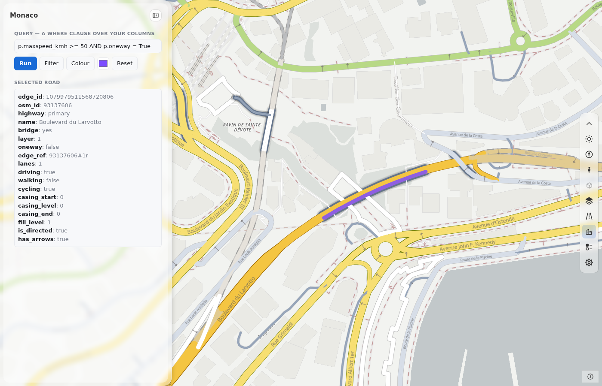
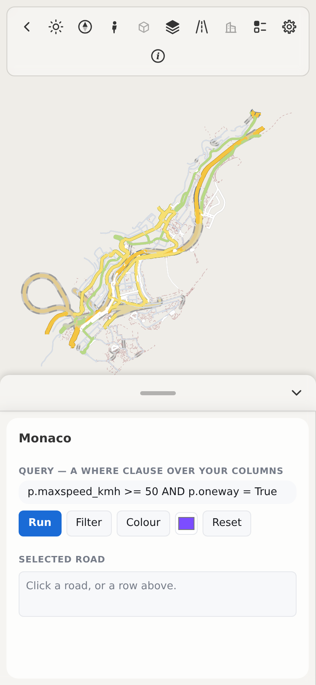

# Dashboards & JavaScript

<p class="lead">Get a finished dashboard page in one call, or put your own panel next to the map and drive it from JavaScript.</p>

=== "Python"

    ```python
    import roadstyle as rs

    rs.render_dashboard(edges, color_options={
        "Road class": {},
        "Speed": {"color_by": "maxspeed_kmh", "cmap": "plasma"},
    }).save("dashboard.html")
    rs.render_street_view(edges).save("street_view.html")
    ```

=== "Command line"

    ```bash
    roadstyle edges.gpkg --page dashboard -o dashboard.html
    roadstyle edges.gpkg --page street-view -o street_view.html
    ```

## Ready-made pages

| call | what you get |
|---|---|
| `rs.render_dashboard` | the map, a panel with a query box, a results table and a selected-road read-out, and a toolbox with the base map, the road filter, the colour options and the legend, the settings and more |
| `rs.render_street_view` | Google Street View beside or below the map ([Google Street View](street-view.md)) |

Each takes every `render_edges` keyword and returns the same map object (`.save()`, `.html`).
`color_options` fills the *Colour by* list in the toolbox. `name=` sets the page title.

<div class="grid" markdown>



{ width="260" }

</div>

The pictures show Monaco, made with `rs.render_dashboard(edges, name="Monaco")` at 1400 by 900 and at 390 by 844.

## The standard dashboard

Every dashboard has the same parts, in the same places. You do not build them. You change them with one option, `dashboard={...}`.

- **The panel** is at the left, with the query box and the selected road. You can add blocks of your own to it
  ([Add to the panel](dashboard-panel.md)).
- **The toolbox** is one bar next to the panel. Its tools are always in the same places: theme, navigate, Street View, Google 3D,
  base map, roads, 3D buildings, colour and legend, settings, and the credits. A tool that the page cannot use is greyed out, and its
  tooltip says why. You can add tools of your own with `rs.tools` ([Dashboard layout](dashboard-layout.md)).
- **One `navigate` button** replaces the zoom buttons, the compass and the 2D/3D button. It opens a box with a zoom, a turn and a
  tilt slider. Ctrl + drag on the map turns and tilts it.
- **The `roads` tool** is the road filter: a row for each road class, and the rows for bridges, tunnels and access kinds.
- **The base-map tool** has the base maps, the switches on top of them (hillshade, labels, 3D buildings) and one switch for the
  style's own base-map layers.
- **The legend** is in the colour and legend box. It lists the colour options, the legend of the active one, the rows that your page
  adds (`rs.legend`), and the colours of the base-map layers.
- **The settings** keep the place of the bar and the panel, three transparency sliders and your keys, in your browser.
- **The credits** are in a box in the corner of the map. On a phone they are in the bar.
- **A phone** (700 px or less) has the bar at the top in one row that moves sideways under a finger, and a fold button that hides the bar
  to one small button. The panel is a bottom sheet with a button on its grip.

The pages [Dashboard layout](dashboard-layout.md) and [Add to the panel](dashboard-panel.md) have the details. To build your own
panel and tools from JavaScript, use `rs.sections`, `rs.legend` and `rs.tools`
([JavaScript API](../reference/javascript.md#the-rs-object)).

```python
rs.render_dashboard(edges, dashboard={
    "toolbar": {"position": "right", "navigation": "buttons"},   # the bar at the right, with the zoom buttons
    "panel": {"side": "right", "width_px": 400},
})
```

Roads at small zooms: the dashboard hides the minor road classes at a small zoom. Service roads and living streets show from zoom 14.
Steps, platforms, corridors and roads (`highway=road`) show from zoom 15, and so do the roads with private access (`access_col`). Every
other class shows at every zoom. `minzoom=False` shows all classes at every zoom.

## Views: several settings in one menu

`views=` adds a *View* menu above *Colour by* on a map page (`render_edges`). A view is a name and the settings it sets together; the page opens with the first one. A page with the toolbox bar (the dashboard) hides the View menu, as it hides the old floating boxes. Call `rsSetView(name)` from your own control there.

```python
rs.render_edges(edges, color_options={"Class": {}, "Amber": {"palette": "amber"}, "Carto": {"palette": "carto"}},
                views={"Normal":       {"color": "Class", "road_fill": True, "tunnels": True, "bridges": True},
                       "Casing only":  {"road_fill": False},
                       "Main roads":   {"classes": ["motorway", "trunk", "primary", "secondary", "tertiary"]},
                       "Ground only":  {"tunnels": False, "bridges": False}})
```

The settings: `color` (a `color_options` name), `road_fill`, `bridges`, `tunnels`, `view3d` (True / False), `overlays`
(`{label: True / False}`), `classes` (a list), `basemap` (a key) and `palette` (a palette name). A view sets only what it names, so name
the same settings in every view when they must switch back.

`palette` switches every color of the map: the road classes, and also the names, arrows, bridges, tunnels and the swatches of the roads filter of the `roads` tool. A color option with a palette (`{"palette": "carto"}`, above) recolors only the road fills.

```python
rs.render_edges(edges, views={"Day": {"palette": "amber", "basemap": "positron"},
                              "Night": {"palette": "mono", "basemap": "dark_matter"}})
```

A name the page does not have is an error. From your page: `rsSetView(name)`, and `rsSetRoadFill(on)`
for the fill alone.

## Drive the map from your own page

`m.html` is the saved page as a string. Put your panel before `</body>` and talk to the map
through the `window.rs*` functions:

```python
m = rs.render_edges(edges, palette="mono")
panel = """
<div id="side" style="position:fixed;top:0;right:0;bottom:0;width:400px;background:#fff"></div>
<style>#map{right:400px!important} body{--rs-side:400px}</style>
<script>
map.once("load", () => {                  // the roads are queryable once the map loads
  const ids = rsQuery(p => p.name === "Götgatan");
  rsColor(ids, "#e63946"); rsFocus(ids);
});
document.addEventListener("rs:select", e => {
  document.getElementById("side").textContent = JSON.stringify(e.detail.properties);
});
</script>"""
open("host.html", "w").write(m.html.replace("</body>", panel + "</body>"))
```

| call | does |
|---|---|
| `rsQuery(p => bool)` | the ids of the edges whose columns match |
| `rsColor(ids, "#hex")` / `rsColor(null)` | paint those edges / reset |
| `rsHighlight(ids)` | selection glow (`[]` clears) |
| `rsFocus(ids)` | fit the camera to them |
| `rsSelect(id)` | select one edge, like a click |
| `rs:select` event | `e.detail.properties` is the clicked edge's row; `e.detail.streetView` a Street View link facing its direction, or null |

!!! warning "Two traps"
    - **Ids past 2**53.** `rsSelect`, `rsColor` and `rsFocus` take roadstyle's ids, not your
      `edge_id`. Find them with `rsQuery(p => String(p.edge_id) === "8121729169906061189")`.
    - **A fixed side panel covers the map.** Inset it: `#map{right:400px!important}
      body{--rs-side:400px}`. The map's controls, the base-map button among them, move with it.

To show a set of edges, recolour them with `rsColor`; don't draw extra lines over the roads.
Pick a highlight colour that no `color_options` entry already uses.

**See also:** [JavaScript API](../reference/javascript.md) · [Command line](../reference/cli.md) · [Every parameter](../reference/parameters.md)
