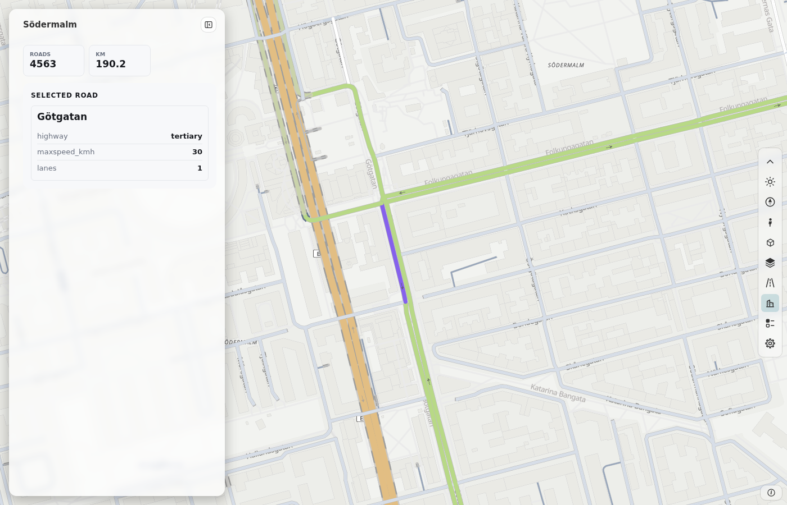

# Dashboards

<p class="lead" markdown>A dashboard is a map with a toolbox and a side panel. Make the page from Python in one call. Then control it from [JavaScript](dashboard-manual/javascript.md).</p>

- **The map** is the map of a map page, with the same defaults. Any `render_edges` keyword changes it.
- **The toolbox** is the bar of tools at the edge of the window ([Layout and toolbox](dashboard-layout.md)).
- **The panel** starts empty. The page adds sections to it.



The picture shows Södermalm at 1400 by 900: `rs.render_dashboard` with `road_popup=False` and two sections, number tiles (`kpis`) and the road card (`part: "road_card"`), after a click on Götgatan.

Each item below has the same form: a picture or a live page when there is one, a box with **Use it for** and **From Python**, the code, and **Details** that open on a click.

| Group | Item | From Python | Use it for |
|---|---|---|---|
| Make a page | [Make one from Python](#make-one-from-python) | yes, `rs.render_dashboard` | a dashboard from road edges |
| Make a page | [Move the toolbox and the panel](#move-the-toolbox-and-the-panel) | yes, `dashboard=` | the edge of the bar, the side and the look of the panel |
| Make a page | [Dock the panel](#dock-the-panel) | yes, `layout="dock"` | a panel with its own space |
| Options | [Page keywords](#page-keywords) | yes | the keywords that matter for a dashboard |
| Options | [The `dashboard` option](#the-dashboard-option) | yes | to change the template |
| The panel | [The panel starts empty](#the-panel-starts-empty) | yes, `panel.sections` | the blocks of the panel |
| The panel | [The errors](#the-errors) | yes | what the call refuses |
| The panel | [A click on a road: the popup, the card, or both](#a-click-on-a-road-the-popup-the-card-or-both) | yes, `road_popup=` | how a click shows a road |
| More | [Views: several settings in one menu](#views-several-settings-in-one-menu) | yes, `views=` | a *View* menu |

## Make a page { .rs-group }

### Make one from Python { .rs-part }

<iframe src="../../maps/dashboard.html" loading="lazy" title="The dashboard that the block above makes" class="rs-demo"></iframe>

**Use it for:** a dashboard page from road edges. It has two sections: number tiles, and the card of the road that you click.<br>
**From Python:** yes, `rs.render_dashboard(edges, ...)`
{ .rs-facts }

=== "Python"

    ```python
    import roadstyle as rs

    rs.render_dashboard(
        edges,
        name="Södermalm",
        color_options={
            "Road class": {},
            "Speed limit": {"color_by": "maxspeed_kmh", "cmap": "plasma", "vmin": 20, "vmax": 60},
        },
        boundary=edges.union_all().convex_hull,   # the area: a dashed outline
        boundary_limit=True,                      # the camera stays near the area
        road_popup=False,                         # a click fills the road card, with no popup
        dashboard={"panel": {"sections": [
            {"id": "tiles", "kpis": [
                {"title": "Roads", "value": len(edges)},
                {"title": "km", "value": round(edges.to_crs(3006).length.sum() / 1000, 1)}]},
            {"id": "road", "label": "Selected road", "part": "road_card", "fields": ["name", "highway", "maxspeed_kmh", "lanes"]},
        ]}},
    ).save("dashboard.html")
    ```

??? info "Details"

    - `rs.render_dashboard` takes road edges and gives one map object. `.save(path)` writes one HTML file that works offline, and `.html` is the same page as text.
    - `edges` is a GeoDataFrame in EPSG:4326 with a `LineString` for each road and a `highway` column.
    - `color_options` fills the *Colour by* list. `name` sets the page title.
    - `boundary` is the outline of the area, and `boundary_limit=True` keeps the camera near it: the map cannot go far away.
    - Every call takes every `render_edges` keyword. `rs.render_street_view(edges)` gives Google Street View beside or below the map ([Street View](street-view.md)).
    - The command line is `roadstyle edges.gpkg --page dashboard -o dashboard.html`.

### Move the toolbox and the panel { .rs-part }

<iframe src="../../maps/dashboard_left.html" loading="lazy" title="The dashboard with the toolbox at the left and the panel at the right" class="rs-demo"></iframe>

**Use it for:** the toolbox at the left edge, and the panel at the right as a floating card. The panel has a query (type a condition and click **Run**) and a chart of the road classes.<br>
**From Python:** yes, `dashboard=` changes any option of the page
{ .rs-facts }

=== "Python"

    ```python
    rs.render_dashboard(
        edges,
        name="Södermalm",
        color_options={"Road class": {}},
        boundary=edges.union_all().convex_hull, boundary_limit=True,
        dashboard={"toolbar": {"position": "left"},
                   "panel": {"side": "right", "look": "card", "width_px": 360, "sections": [
                       {"id": "q", "label": "Query", "part": "query", "text": "p.maxspeed_kmh >= 50"},
                       {"id": "classes", "label": "Roads by class", "part": "chart", "chart": {"kind": "pie", "x": "highway"}},
                   ]}},
    ).save("dashboard_left.html")
    ```

### Dock the panel { .rs-part }

<iframe src="../../maps/dashboard_dock.html" loading="lazy" title="The dashboard with the panel docked at the left" class="rs-demo"></iframe>

**Use it for:** a panel with its own space at the left. The map takes the rest, and there is no toolbox. The "?" in the panel title opens the help window, and the panel has a bar chart.<br>
**From Python:** yes, `layout="dock"`
{ .rs-facts }

=== "Python"

    ```python
    rs.render_dashboard(
        edges,
        name="Södermalm",
        color_options={"Road class": {}},
        layout="dock",
        boundary=edges.union_all().convex_hull, boundary_limit=True,
        dashboard={"panel": {
            "help": {"title": "How to read this page", "intro": "The roads of Södermalm, coloured by their class.",
                     "terms": [["Road class", "The type of the road in OpenStreetMap (highway)."]]},
            "sections": [{"id": "count", "label": "Roads by class", "part": "chart", "chart": {"kind": "bar", "x": "highway"}}],
        }},
    ).save("dashboard_dock.html")
    ```

## Options { .rs-group }

### Page keywords { .rs-part }

**Use it for:** the page keywords that matter most for a dashboard. Every keyword, with its default, is in [Every parameter](../reference/parameters.md).<br>
**From Python:** yes
{ .rs-facts }

??? info "Details"

    | Keyword | Use |
    |---|---|
    | `name` | The title of the page |
    | `template`, `layout` | `"dashboard"` (the default of `render_dashboard`) has a panel, `"map"` has the map only; `layout`: `"overlay"` or `"dock"`. `template` is a keyword, not a key of `dashboard=` |
    | `color_options` | The entries of the *Colour by* list |
    | `basemap`, `basemaps`, `basemap_switcher` | The start base map, the list in the switcher, and the switcher itself |
    | `live_data` | `True` adds the support for `rs.setData` |
    | `views` | Named groups of settings, for `rs.setView` |
    | `street_view`, `street_view_key` | The Street View window, and its Google key |
    | `mapillary_token` | A Mapillary client token for the Street View window (or the variable `MAPILLARY_TOKEN`). Limit it to your site: it is written into the page. |
    | `google_3d`, `google_3d_layers` | The Google 3D window, and the layers that it draws |
    | `boundary`, `boundary_dim`, `boundary_limit` | The outline of the area, the shade outside it, and the camera limit |
    | `minzoom` | The first zoom of each road class |
    | `page_script` | JavaScript text that the page runs before it is ready: put the code in `rs.ready(() => ...)` |
    | `dashboard` | The options of the next section |

### The `dashboard` option { .rs-part }

**Use it for:** to change the template. Give only the keys that you change. The call merges them over the defaults, and a wrong key or value is an error.<br>
**From Python:** yes, `dashboard={...}`. Every key, with its default, is in [Dashboard options](../reference/parameters.md#dashboard-options)
{ .rs-facts }

??? info "Details"

    - There is no `phone` option: the page turns to its phone form by itself when the window is 700 px wide or less.

## The panel { .rs-group }

### The panel starts empty { .rs-part }

**Use it for:** the blocks of the panel. The panel has only its frame: the title (the page's `name`), the theme button and the hide button. A page adds sections with `dashboard={"panel": {"sections": [...]}}`, in their order.<br>
**From Python:** yes, `panel.sections`. Keys and defaults: [Dashboard options](../reference/parameters.md#dashboard-options)
{ .rs-facts }

A page can have no roads yet (a host that builds its data after the page opens, and adds the roads with `rs.setStyle`). The page then opens on the world, has no banner "0 road features", and needs no patch of its own for these.

=== "Python"

    ```python
    rs.render_dashboard(edges, dashboard={
        "panel": {"sections": [
            {"id": "q", "part": "query", "label": "Query", "text": "p.maxspeed_kmh >= 50"},
            {"id": "road", "part": "road_card", "label": "Selected road", "fields": ["name", "highway", "lanes"]},
            {"id": "classes", "part": "chart", "label": "Roads by class", "chart": {"kind": "pie", "x": "highway"}},
            {"id": "notes", "label": "Notes", "before": "road",
             "html": '<p>Your text</p><p class="sb-note">Small print</p>'},
        ]},
    })
    ```

??? info "Details"

    - The base map, the color and the legend are tools of the toolbox, not sections of the panel.
    - A section holds one of these:
        - **A part of roadstyle** (`part`):
            - `"query"`: a WHERE clause over the columns of the roads, with *Run*, *Filter*, *Colour* and *Reset*, and the list of the matching roads. `text` is the start text (none: an empty box).
            - `"road_card"`: the fields of the selected road. It fills on the event `rs:select` and empties on `rs:deselect`. `fields` is the list of columns that it shows (none: every column).
            - `"chart"`: a chart of the map's roads or of your own rows. `chart` holds its options: `{"kind": "bar", "x": "highway"}`. See [A chart](dashboard-parts.md#a-chart).
        - **Tabs** (`tabs`): a tab row with one pane for each tab ([Tabs](dashboard-parts.md#tabs)).
        - **Number tiles** (`kpis`): a row of big numbers ([Number tiles](dashboard-parts.md#number-tiles)).
        - **The page's own HTML** (`html`). Build it from the [shared parts](dashboard-parts.md) of a dashboard.
    - `help` on a card puts a "?" in its title, and `panel.help` puts one in the panel's title ([A help window](dashboard-parts.md#a-help-window)).
    - A section with a `label` is a card, and the label is its title ([Cards](dashboard-parts.md#cards)). `fold: true` makes the card fold, `note` is one line of state under the title, and `background: false` takes its colour away. `after` or `before` is the id of an earlier section.

### The errors { .rs-part }

**Use it for:** to know what `render_dashboard` refuses in a section.<br>
**From Python:** yes
{ .rs-facts }

??? info "Details"

    - an `id` that is empty or used twice;
    - a section with none or more than one of `html`, `part`, `tabs` and `kpis`;
    - `tabs` that are empty or use an id twice; `kpis` that are empty or have a `value` that is not a text or a number;
    - an unknown `part`;
    - `text` on a part that is not `query`, `fields` on a part that is not `road_card`, and `chart` on a part that is not `chart`;
    - a part `chart` with no `chart`, or a wrong `chart` ([Charts](dashboard-parts.md#a-chart));
    - an `after` or `before` that is not an earlier section, or both of them;
    - `fold: true`, `note`, `background: false` or `help` without a `label`; a `help` without a `title`.

    There is no `hide`, because the panel has nothing of its own to hide. A page that gives `hide` gets an error that says what to do.

### A click on a road: the popup, the card, or both { .rs-part }

**Use it for:** to choose how a click shows a road. A click selects the road, and the page sends the event `rs:select` with its fields. A click opens the popup by default (`road_popup=True`). The road card is a second way to show the same click.<br>
**From Python:** yes, `road_popup=` and a section `{"part": "road_card"}`
{ .rs-facts }

??? info "Details"

    | You want | Give |
    |---|---|
    | the popup only | nothing (the default) |
    | the card in the panel only | a section `{"part": "road_card"}` and `road_popup=False` |
    | both | a section `{"part": "road_card"}` |
    | your own | `road_popup=False`, and a listener of `rs:select` in `page_script` |

    Hover, select and tooltip are separate switches: `road_tooltip` shows a tooltip, and `hover_color` lights the road.

## More { .rs-group }

### Views: several settings in one menu { .rs-part }

**Use it for:** a *View* menu above *Colour by* on a map page (`render_edges`). A view is a name and the settings that it sets together. The page opens with the first one.<br>
**From Python:** yes, `views=`
{ .rs-facts }

=== "Python"

    ```python
    rs.render_edges(edges, color_options={"Class": {}},
                    views={"Normal":      {"color": "Class", "road_fill": True},
                           "Casing only": {"road_fill": False},
                           "Main roads":  {"classes": ["primary", "secondary", "tertiary"]}})
    ```

??? info "Details"

    - A page with the toolbox hides the menu: call `rsSetView(name)` from your own control there.
    - A class in `classes` must be in the data, else the call stops with an error.
    - The settings of a view are in [Every parameter](../reference/parameters.md#render_edges).

**See also:** [Layout and toolbox](dashboard-layout.md) · [Dashboard parts](dashboard-parts.md) · [JavaScript](dashboard-manual/javascript.md) · [Every parameter](../reference/parameters.md) · [Command line](../reference/cli.md)
