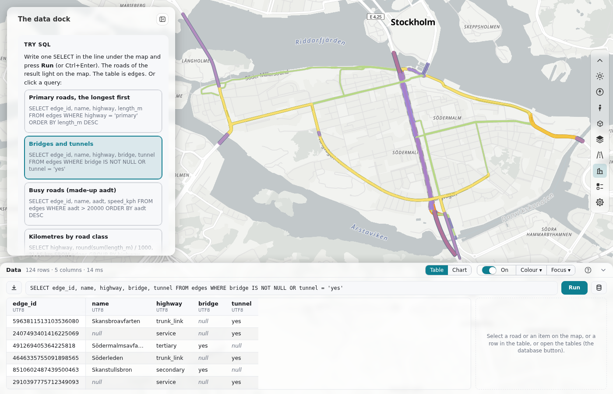

---
hide:
  - toc
---

# The data dock

The data dock is one SQL line over a wide table of the result, in the [bottom dock](dashboard-layout.md#the-bottom-dock). The roads of the result light on the map, a click on a row selects its road, and **Colour** and **Focus** keep a change of the map until the person turns it off. It is a JavaScript module that the host page imports. Your page runs the SQL on its own data: roadstyle has no database. Each item below has the same form: a box with **Use it for** and **From Python**, the code in tabs, and **Details** that open on a click.



**Try it.** The page below is live: DuckDB runs in the page (duckdb-wasm) with the roads of Södermalm as the table `edges`. Write a
`SELECT` in the line and press **Run**, or click a query in the panel. The roads of the result light on the map, and a click on a row
selects its road. <a href="../../maps/data_dock.html" target="_blank" rel="noopener">Open it on a page of its own</a>.

<iframe src="../../maps/data_dock.html" loading="lazy" title="The data dock, live, with DuckDB in the page" class="rs-demo" style="height:780px"></iframe>

| Group | Item | From Python | Use it for |
|---|---|---|---|
| Use it | [Add it to a page](#add-it-to-a-page) | no | the data dock in your dashboard |
| Use it | [The options](#the-options) | no | what `dataDock` takes |
| Use it | [From JavaScript](#from-javascript) | no | to run SQL and to read the result from code |
| What the person does | [The title row](#the-title-row) | no | the controls of the dock |
| What the person does | [The line](#the-line) | no | to write and run one SQL statement |
| What the person does | [The table](#the-table) | no | the result, sorted and exported |
| What the person does | [Tables](#tables) | no | the list of the tables of your data |
| What the person does | [The map switch](#the-map-switch) | no | the table on the map, or the map's own colours |
| What the person does | [A row](#a-row) | no | one road: its card and its place |
| What the person does | [Table or chart](#table-or-chart) | no | the same result as a chart |
| What the person does | [Colour and focus](#colour-and-focus) | no | to keep a change of the map |

## Use it { .rs-group }

### Add it to a page { .rs-part }

**Use it for:** the data dock in a dashboard page. `query` and `schema` are necessary.<br>
**From Python:** no
{ .rs-facts }

=== "JavaScript"

    ```javascript
    import {dataDock} from "./dashboard/data/data_dock.js";

    const data = dataDock({
      query: async (sql, {signal}) => myDb.query(sql),        // your database: {columns: [{name, type}], rows: [[...], ...]}
      schema: async () => ({tables: [{name: "main.edges", rows: 2765, about: "One row is one direction of a road."}]}),
      ready: myDb.loaded,                                     // a promise: the data is loaded
      tables: [{name: "sensors", url: "sensors.geojson", about: "Traffic sensors: one point each."}],
      load: (t) => myDb.loadTable(t),                         // loads one of `tables` into the schema "extra"
      roadsBy: (sql, column) => `SELECT edge_id FROM edges WHERE "${column}" IN (SELECT "${column}" FROM (${sql}))`,
      sql: "SELECT edge_id, name, highway FROM edges WHERE highway = 'primary'",
    });
    data.open();
    ```

### The options { .rs-part }

**Use it for:** what `dataDock({...})` takes.<br>
**From Python:** no
{ .rs-facts }

??? info "Details"

    | Option | Default | What it is |
    |---|---|---|
    | `query(sql, {signal})` | (necessary) | Runs one statement on your data. It gives `{columns: [{name, type}], rows}` (a value is a string, number, boolean, `BigInt` or `null`), or it throws an `Error` with the database's message. |
    | `schema()` | (necessary) | `{tables: [{name, rows, about}]}`: the list of tables, and Ask's view of the data. |
    | `ready` | ready at once | A promise that ends when your data is loaded. A run waits for it. |
    | `tables`, `load(t)` | none | Your page's own tables, `[{name, url, about}]`. The data dock gives each one to `load` once at the start, and a run waits for them. A table that does not load does not stop the others. |
    | `idColumn` | `"edge_id"` | The column with the road ids. |
    | `keys`, `roadsBy(sql, column)` | `["osm_id", "name"]`, none | A result with no `idColumn` finds its roads by the first of `keys` that it has: `roadsBy` gives the SQL of the road ids. |
    | `sql` | `""` | The start text of the line. |
    | `label` | `"Data"` | The label of the dock. |
    | `limit` | `1000` | The most rows in the table. |
    | `card` | `true` | The road card beside the table, in place of the popup. While the dock shows the data dock, a road that the person selects (a row, a name, Ask, or a click on the map) or an overlay item that the person clicks shows only in the card: the dock holds every popup (`rs.holdPopup`). When the dock closes, the popups come back. |
    | `guard` | `true` | `false`: the person's own SQL does not go through the read-only guard. |

### From JavaScript { .rs-part }

**Use it for:** to run SQL, to show a result that you made, and to read the result from code.<br>
**From Python:** no
{ .rs-facts }

=== "JavaScript"

    ```javascript
    await data.run("SELECT edge_id, name FROM edges LIMIT 10");
    data.view("chart");
    data.chart({kind: "bar", x: "highway", title: "Roads by class"});
    ```

??? info "Details"

    - `data.run(sql?)` puts `sql` in the line and runs it, and gives the result. `data.show({sql, columns, rows, more})` shows a result that you made.
    - `data.sql()`, `data.result()`, `data.csv()` and `data.stop()` give the line, the result, the CSV text, and stop a run.
    - `data.roads(sql)` gives the road ids (on the map) that the SQL selects by `idColumn`. It refuses a query of more than 100 000 roads.
    - `data.colour(groups, {sql})` and `data.focus(ids, {sql, mode})` add the same layers as the buttons. `data.layers()` lists them.
    - For [Ask](ask.md): `data.idColumn`, `data.keyOf(result)` (the column that finds the roads of a result, or `null`) and `data.roadsOf(result)` (its roads on the map).
    - The events are `run` (`sql`, `columns`, `rows`, `more`, `ms`, `source`), `error` (`sql`, `message`, `source`), `layers`, `light` (`on`, see [The map switch](#the-map-switch)), `row` and `cardclose` (see [A row of your own](#a-row-of-your-own)).

## What the person does { .rs-group }

### The title row { .rs-part }

**Use it for:** the controls of the dock. After the label and the note, there are two joined groups: **Table | Chart** and **On | Colour ▾ | Focus ▾** (the map switch first).<br>
**From Python:** no
{ .rs-facts }

??? info "Details"

    - **Table | Chart** is what the dock shows. **On | Colour ▾ | Focus ▾** is the map. The tables button and the download button are on [the line](#the-line).
    - **?** opens a help window with one row for each control.

### The line { .rs-part }

**Use it for:** to write and run one SQL statement. Only one `SELECT` or `WITH` statement runs.<br>
**From Python:** no
{ .rs-facts }

??? info "Details"

    - A click on the line opens it as a text box. **Ctrl+Enter** or **Run** runs it, and **Escape** folds it.
    - The download button (⤓), before the line, saves all the rows of the result as a CSV file. The tables button (a database icon), after **Run**, shows the tables of the data in the side column.
    - An error shows under the line, in the database's words.
    - The guard refuses a statement that writes, loads, or reads a file or an address.

### The table { .rs-part }

**Use it for:** the result. The note in the title row has the number of rows: "1 000 of 2 765 rows · 3 columns · 5 ms".<br>
**From Python:** no
{ .rs-facts }

??? info "Details"

    - The table shows at most `limit` rows, but the download button (⤓) saves all the rows (at most 1 000 000), and a click on a header sorts all the rows.
    - A DATE shows as `2026-06-10`, a TIMESTAMP as `2026-06-10 08:30:00`, and a geometry as `(32 bytes)`.
    - The column widths are measured once for each result. A sort keeps the columns in place and in the same width.

### Tables { .rs-part }

**Use it for:** the list of the tables of your data. It opens in the side column beside the table or the chart.<br>
**From Python:** no
{ .rs-facts }

??? info "Details"

    - The side column shows the list or the card of a selected road: one of the two at a time, the last one opened. The table and the chart stay in view.
    - The list has a search field (by name or description; Enter opens the first table, Escape closes the list), a group for each schema with its number of tables (the page's own `extra` first), and a card for each table with its name, its number of rows and one line of what it holds.
    - A click on a card shows the table's rows and closes the list: the line gets `SELECT * FROM <table>`, which you can change and run again.

### The map switch { .rs-part }

**Use it for:** the table on the map, or the map's own colours. On, the roads of the table are lit (the highlight set `dock`, in roadstyle's select purple), the dock's Colour and Focus layers show, and a page shows its own shapes of the result.<br>
**From Python:** no
{ .rs-facts }

=== "JavaScript"

    ```js
    data.addEventListener("light", e => myLayer.hidden = !e.detail.on);   // the page's own shapes of the result (nodes, buildings)
    data.light();                                                          // true: the table is shown on the map now
    ```

??? info "Details"

    - The map switch is the dashboard's [on/off switch](dashboard-parts.md#an-onoff-switch) at the start of the map group. It shows **On** or **Off**. The browser keeps the choice.
    - **Off:** the map shows its own colours, and the table stays. The light goes, the Colour and Focus layers are hidden (they stay in their lists), and **Colour ▾** and **Focus ▾** are disabled.
    - **On:** the light, the layers and the two buttons come back. A new Colour or Focus layer (from Ask, for example) turns the switch on.
    - A new table changes the light. A table that a colour or a focus already shows has no light. A closed dock lights nothing.
    - `data.light()` is `true` while the switch is on and the dock is open. The event `light` (`detail.on`) comes when that changes: at a click on the switch, and when the dock opens or closes.
    - `data.showOnMap()` turns the switch on, as a click does, and gives `true` when it was off. Ask calls it before a colour, a focus or a move, because with the switch off the result does not show.

### A row { .rs-part }

**Use it for:** one road. A click on a row selects its road and zooms to it.<br>
**From Python:** no
{ .rs-facts }

??? info "Details"

    - The side column then shows the road's card: its name, its main facts as chips (class, length, speed limit, one-way, the networks), its other fields in small type with rounded numbers, and its id with **Copy id** and **Zoom**.
    - The card leaves out the fields of roadstyle's drawing (`casing_*`, `fill_level` and others).
    - In a result of names, a click selects the roads of that name.
    - A click on an overlay item on the map (a building, a crossing) shows the item in the card: its name, the overlay's name as a chip, its fields (the overlay's popup fields when it has them) and its id with **Copy id**. The close button deselects it. While the dock shows the card, no popup shows, for a road or for an item.

### A row of your own { .rs-part }

**Use it for:** a row of a result that is not a road (a node, a building, a wall), which your page draws on the map itself. The page hears the click, shows the item on the map, and puts the item's facts in the card.<br>
**From Python:** no
{ .rs-facts }

=== "JavaScript"

    ```javascript
    data.addEventListener("row", async (e) => {                      // a click, or Enter, on a row of the table
      const {columns, row} = e.detail;                               // the values are in the order of the columns
      const facts = columns.map((c, i) => [c.name, row[i]]).filter(([k]) => k !== "geom");
      drawOnMap(await shapeOf(row));                                 // your own drawing: the select look
      data.card({title: row[1], chip: "buildings", rows: facts, id: row[0]});
    });
    data.addEventListener("cardclose", () => clearMyDrawing());      // the person closed the card
    ```

??? info "Details"

    - The event `row` comes for every row, also a road row: `detail.columns` (the columns of the result), `detail.row` (the values, in the order of the columns), `detail.index` (the row's place in the table now) and `detail.rowId` (the value of the `idColumn` as a string, or `null` when the result has none). Ignore what you do not need.
    - The row shows as selected: the accent tint and a bar. A sort keeps the same row selected, because the table knows it by its values.
    - The keys do what a click does: Tab goes to a row, Enter or Space picks it.
    - `data.card({title, chip, rows, id})` fills the card with the same look as the card of an overlay item: the title, the chip, the rows `[[name, value], ...]` (a `null` or empty value is left out), and the `id` with **Copy id**. `data.card(null)` closes the card.
    - The event `cardclose` comes when the card goes away without your call: the close button, a new selection (a road, an overlay item), or a new result. It does not come for your own `data.card(null)`. The row stops being selected. Remove your drawing on the map in `cardclose`.

### Table or chart { .rs-part }

**Use it for:** the same result as a chart ([A chart](dashboard-parts.md#a-chart)). **Kind**, **X** and **Y** change it, and **SVG** downloads it.<br>
**From Python:** no. For a chart in the panel, see [A chart](dashboard-parts.md#a-chart)
{ .rs-facts }

=== "JavaScript"

    ```javascript
    data.chart({kind: "line", x: "hour", y: "vehicles", title: "Vehicles"});
    data.view("table");     // or "chart"
    ```

??? info "Details"

    - The first chart comes from the columns: a date or a time and a number give a line, a text and a number a bar, one number a histogram, two numbers a scatter.
    - A histogram counts all the rows, not only the table's. The **Kind** buttons have a tooltip that says how to use each kind.
    - **X** and **Y** offer only the columns that fit the kind. For a bar or a pie, X is the groups and Y is "(count of rows)" or a measure. For a line, X is a number, a date or a time. For a histogram, X is a measure. For a scatter, X and Y are two measures. A road id, a geometry or a list is never offered. When the kind changes, X and Y move to a column that fits.
    - A bar or a pie whose X is a number with more than 40 values (a length, say) shows the rows in ranges of X: about 6 slices or 12 bars, over all the rows.
    - On a computer, **Kind**, **X** and **Y** are a column at the left of the chart, and the chart has no title line: it uses the full height of the box. **SVG** is in the top right corner. The box scrolls only when the chart is taller than the box (many bars at their least height). On a phone, **Kind**, **X** and **Y** are a row over the chart.
    - In the Chart view, the chart takes the width of the side column while it has no road card and no list of tables. When one of the two opens, the column comes back. The Table view keeps the side column with its hint, so that the table does not change its width.

### Colour and focus { .rs-part }

**Use it for:** to keep a change of the map until the person turns it off. **Colour ▾** colours the roads of the table. **Focus ▾** fades or hides the other roads.<br>
**From Python:** no
{ .rs-facts }

??? info "Details"

    - **Colour ▾.** "+ Colour the roads of this table" gives one colour for each value of a text column with 2 to 8 values (for example `highway`), else one colour, with a legend row for each colour. Each layer has a check box that turns it off and on, and ✕ that removes it.
    - **Focus ▾.** "+ Focus on the roads of this table" keeps these roads, and the other roads fade (`rs.fade`) or hide. One focus is on at a time; **None** turns it off. Each focus has **Fade / Hide** and ✕.
