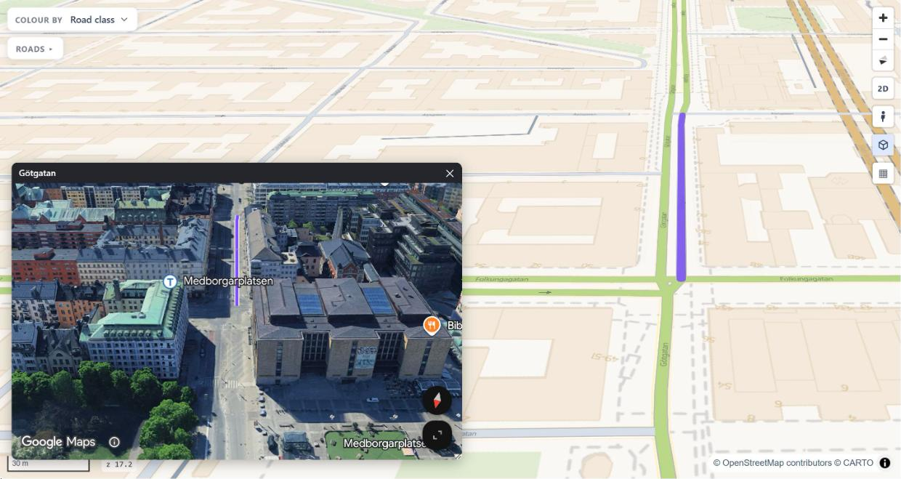

# Google 3D

<p class="lead">See the roads in Google's photorealistic 3D view, next to the map. The two cameras move together.</p>



!!! note "A key is necessary"
    The Google 3D window needs a Google Maps JavaScript API key. See
    [Keys and tokens](google-key.md). Serve the page from an address in the Websites list of the key.
    Do not open it from disk.

```python
rs.render_edges(edges, google_3d=True)                        # the key from GOOGLE_MAPS_KEY
rs.render_edges(edges, google_3d=True, street_view_key=KEY)   # or this key
```

The default of `google_3d` is on for a page with a toolbar (the template `dashboard`), and off for other pages.
Use `google_3d=False` to turn it off.

If a page has no toolbar and no key, `google_3d=True` stops with an error.
The template `dashboard` has a settings tool where you type the key. So the page can start without a key.
Then the Google 3D window says that it needs a key. It has an **Open settings** button.

## The window

Press the **Google 3D** button (the cube, in the toolbar). The window opens in the middle of the
free part of the map. The panel and the toolbar do not cover it.
Drag its title bar to move it. Drag its corner to change its size.
The page remembers the size, if the window was open, and where.
In the other templates, the center of the map moves to the middle of the free part while the window is open.
So the window does not cover the clicked road.
Google's 3D view loads when the window opens. The page removes it when you close the window.

The window bar has these controls:

| Control | What it does |
|---|---|
| **Imagery** / **Map** | the photographic mesh, or Google's drawn 3D map |
| **Following** / **Follow the map** | on at the start (`google_3d.follow` in the template). If it is on, the 3D view follows the map. Click it to follow again |
| **Show** | the layers of the window (see [Your own layers](#your-own-layers)) |

## The two cameras move together

The map leads, and the link goes one way. When you move, turn, tilt or zoom the map, the 3D view
moves to the same camera. When you move the 3D view yourself, only the 3D view moves, and Follow
turns off. Click **Follow the map** to set the 3D view to the map again. A road selection also turns Follow on.

| Map | Google 3D |
|---|---|
| center | center |
| bearing (turn) | heading |
| pitch (tilt) | tilt |
| zoom | range: the distance from the camera to the center, in metres |

??? info "Ground heights and limits"
    Google puts its camera above sea level. The map is on the ground. So the page reads the
    height of the ground under the center from the free
    [Terrain Tiles on AWS](https://registry.opendata.aws/terrain-tiles/) (Mapzen, no key) and gives it to Google.
    The window bar shows the credit **heights: Mapzen**. If the heights do not load, the bar shows
    **⚠ no ground heights**. Then the 3D view can be too close on a hill.

    The map has the last word. If the map stops at its limit (a box from `map.setMaxBounds(...)`,
    or its maximum tilt), the 3D view gets the camera of the map.

    Some differences stay:

    - The tilt stops at 70° in the two views (the map setting `camera.max_pitch`).
    - The window is smaller than the map. It shows the same view at a smaller size.
      If the window has a different shape, it shows less on the sides.

## Click a road

When you click a road, the 3D view draws the road in the selection color. The camera flies to
the middle of the road and looks along it. The map follows the camera.

## Your own layers

A page can add layers to the window. A layer draws the features of a GeoJSON source of the page on
Google's 3D view, for example a bus route, a zone or some points. Give the layers in `google_3d_layers`, a list of
dictionaries:

```python
rs.render_dashboard(edges, google_3d=True, google_3d_layers=[
    {"id": "route", "label": "Bus route", "kind": "line", "source": "bus", "match": "route_id",
     "arrows": True, "style": {"color": "#e11d48", "width": 6}},
    {"id": "zones", "label": "Zones", "kind": "polygon", "source": "zones", "scope": "view",
     "style": {"fill": "rgba(255,0,0,0.3)", "outline_width": 3}},
])
```

| Key | Meaning |
|---|---|
| `id`, `source` | the name of the layer (use it once) and the id of a GeoJSON source of the page |
| `kind` | `line`, `ribbon` (a band: `style.width_m`, or `style.width_prop` = a property in metres), `polygon` or `points` (`style.radius` in metres) |
| `scope` | `selection` (default): the features whose `match` property is equal to the same property of the selected road. `view`: the features in the visible area, at most `max` (500) |
| `on` | `False`: the layer starts hidden |
| `arrows` | `True`: direction arrows along a `line` |
| `style` | `color`, `width`, `outline`, `outline_width`, `dash` (`[metres on, metres off]`), `fill`, `width_m`, `width_prop`, `radius` |

The window has a **Show** menu with one check box for each layer. It shows when there are two or
more layers. The page remembers your choice.
A wrong key, a wrong `kind`, a repeated `id` or a `selection` layer without `match` stops with an error.

## The selection

The selected road is one solid line, also in a tunnel. It lies `mesh_altitude_m` (1.5 m) above Google's mesh.
The default style of the template is `google_3d.selection_style` (cyan, 8 px, a dark outline, white arrows).
All layers that draw the selection use this style.
A selection can have points (`sel.points`). The window draws a pin for each point.
To change an option, use `dashboard=`:

```python
rs.render_dashboard(edges, google_3d=True, dashboard={"google_3d": {"selection_style": {"color": "#ff0066", "width": 10}}})
```

All keys are in the [parameters reference](../reference/parameters.md).

## From JavaScript

| Call or event | What it does |
|---|---|
| `rsSetGoogle3D(true)` / `rsSetGoogle3D(false)` | opens / closes the window |
| `rs:google3dchange` | fires when the window opens or closes; `e.detail.open` |
| `rsG3dDraw(cs, name, lvl, sel)` | draws a selection of your own: `cs` the road's `[lng, lat]` points (or `[]`), `sel.points` points drawn as pins |
| `rsG3dLayers.register({id, kind, features, style})` | adds a layer at run time; `features(selection, {bounds})` gives a GeoJSON FeatureCollection. The same `id` replaces a layer |
| `rsG3dLayers.list()` / `isOn(id)` / `setOn(id, on)` / `refresh()` | read the layers, show or hide one, draw again |
