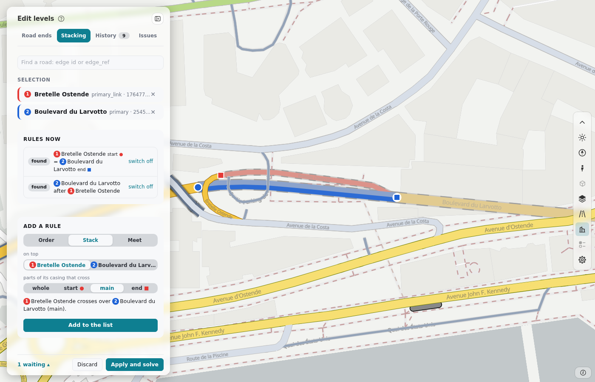

---
hide:
  - toc
---

# Edit the levels

The level editor says which road is drawn over which road: a bridge over the street under it, a tunnel under it, and the order where two
roads meet. It has four tabs: **Road ends** (one road: the shape and the head length of each end), **Stacking** (two roads: the rules
between them), **History** (your edits, with their times) and **Issues** (what the solver could not keep).

**Try it.** The level editor below is live, on the roads of Södermalm. Click a road, change the shape of an end, or click a second road in
**Stacking** and add a rule. **Apply and solve** solves in the page and draws the roads again. Nothing is saved: your changes stay in the page
until you reload it. <a href="../../live/level_editor/?store=page" target="_blank" rel="noopener">Open it on a page of its own</a>.

<iframe src="../../live/level_editor/?store=page" loading="lazy" title="The level editor, live, on the roads of Södermalm" class="rs-demo" style="height:780px"></iframe>

## Use it

| What | Where |
|---|---|
| Make an area, solve it and open the editor (`roadstyle levels edit`) | [Which road is on top: Edit the levels](levels.md#edit-the-levels) |
| The files of your edits: `edits.csv`, `heads.csv`, `caps.csv` | [Which road is on top: Edit the levels](levels.md#edit-the-levels) |
| The editor in your own dashboard page (`levelEditor`) | [Which road is on top: Edit the levels in a dashboard](levels.md#edit-the-levels-in-a-dashboard) |
| How the levels are solved | [How the levels are solved](../rust/levels-solver.md) |
