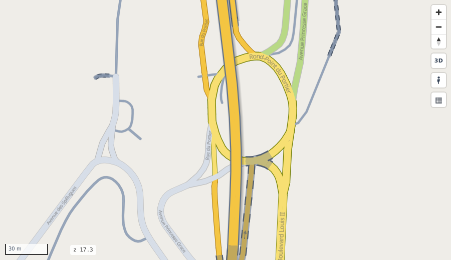
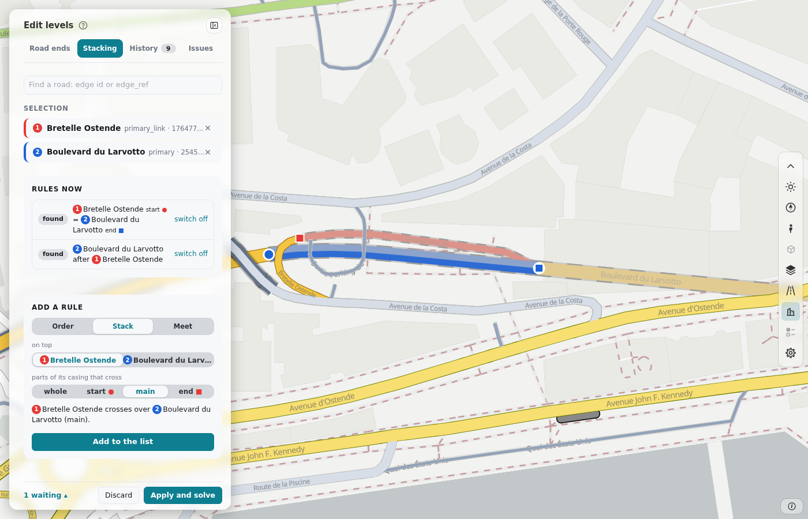
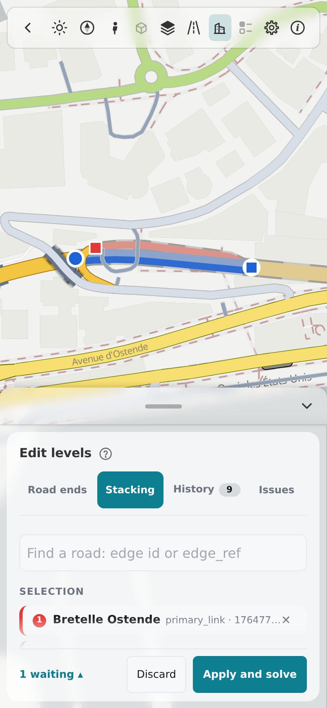

# Which road is on top

<p class="lead">Each edge has numbers that say where its outline and its road are drawn. The map uses only these numbers. A solver
calculates them, and an editor lets you change them by hand.</p>



Monaco, Rond-Point du Portier: the primary road crosses the roundabout on a bridge (grey-blue outline, soft shadow), and a tunnel (dashed
outline) goes under both. Where the roads only meet, the roundabout is on top. Where they cross, the bridge is on top.

=== "Python"

    ```python
    rs.render_edges(edges).save("map.html")    # roadstyle calculates the numbers
    ```

=== "Command line"

    ```bash
    roadstyle levels make edges.gpkg out/area     # the input of the solver, in an area folder
    roadstyle levels solve out/area               # levels.csv
    roadstyle levels edit out/area                # the editor, http://127.0.0.1:8780/level_editor/
    ```

    The Python commands `roadstyle-levels make`, `solve` and `edit` make the same files.

## The rule

- Each edge has a **casing number** and a **fill number**. They are whole numbers. 0 is the ground, and null is 0.
- The casing has **three parts**: a start head, a main part and an end head (`casing_start`, `casing_level`, `casing_end`). A head is
  5 m long by default. On a short road the main part can have no length.
- The map draws number by number, the lowest first. **At each number, all the outlines come first, then all the roads.** So two roads
  that meet join with no ring: each head is under the fill of the other road.
- **Nothing else sets the order**: not the road class, and not `layer`, `bridge` or `tunnel`. These are only inputs of the solver.

## How the solver works

`render_edges(edges)` with no level columns runs the solver with its defaults. You can also run it once and draw with the columns:

```python
levels = rs.compute_levels(edges)
rs.render_edges(levels, casing_start_col="casing_start", casing_level_col="casing_level",
                casing_end_col="casing_end", fill_level_col="fill_level").save("map.html")
```

The input (`rs.level_input(edges)`) finds four kinds of pair between roads. The two directions of a segment are one road.

| Pair | When | What it asks |
|---|---|---|
| *meet* | two road ends are at one node | each head is under the fill of the other road (always kept) |
| *stack* | roads of different bands cross, or come nearer than `band_dist` (10 m) away from a node that they share | each crossing part of the upper casing is over the lower fill |
| *crossing* | a path meets a car road at a node, in the same band | the road's head is over the path's fill: the path is under the road |
| *order* | roads meet in one band, or of different bands that only meet (a tunnel mouth) | the road with the higher priority has the higher fill |

The **band** comes from the tags: a `layer` that is not 0, else 1 for a bridge and -1 for a tunnel, else 0 (or your `band_col`). The
**priority** is a roundabout, then a tunnel, then a bridge, then the road class. roadstyle finds a roundabout in the OSM column
`junction`: with no such column you get a warning.

The solver keeps, in this order:

1. as many stacks as possible (the real crossings);
2. as many *crossing* pairs as possible;
3. as many order wishes as possible;
4. as many near rules as possible (off by default; `near_rules=True` turns them on);
5. as few numbers as possible, with each casing near its fill.

??? info "The answer, the rules that always hold, and the two engines"

    **Rules that always hold:** no casing part is over its own fill, every *meet* rule, and each number is from `-max_level` to
    `max_level` (20). The other rules are wishes: they can break when they cannot all hold, for example a ring of three roads, each one
    over the next.

    **The answer:** each edge gets its four numbers. The most frequent casing number becomes 0 (the ground), and the numbers have no
    gaps. A stack that the solver could not keep is in `result.attrs["levels_given_up"]`, with a warning: it is a flaw on the map. The order
    wishes that it did not keep are in `levels_orders_not_kept`. The `levels_info.json` of an area also has `crossings` and
    `crossings_not_kept`.

    **The two engines** solve the same input in the same steps:

    - **Rust** (the default; `engine="rust"` or `ROADSTYLE_ENGINE=rust`) solves each step as a minimum-cost flow. It checks each rule that
      must hold before it gives the answer, and it has no time limit.
    - **Python** (`engine="python"`) solves each step as an integer program with HiGHS. A step that needs more than `time_limit` (60 s)
      keeps the best answer that it found, with a warning. It has no *crossing* step: pairs with `crossing` rows stop with an error.

    Two answers can be equally good, so the two engines can give different numbers for some roads.

    The solver reads only the pairs, not the lines or the head lengths. The input decides which parts of a stack cross, with the
    head lengths of that time.

## Edit the levels

Make an area, solve it and open the editor. The `roadstyle` program does this with no Python:

```bash
roadstyle levels make edges.gpkg out/area --boundary area.geojson    # roads.parquet, pairs.csv, edits.csv, boundary.geojson
roadstyle levels solve out/area                                      # levels.csv, levels_info.json
roadstyle levels edit out/area                                       # the editor, http://127.0.0.1:8780/level_editor/
```

`--boundary` is optional: the editor draws the area's edge as a dashed line. The editor saves your changes in the area folder.

<div class="grid" markdown>



{ width="260" }

</div>

The editor has four tabs: **Road ends** (the shape and the head length of each end of one road), **Stacking** (the rules between two
roads), **History** (your edits, with their times) and **Issues** (what the solver could not keep). Try it live, and read what each part
does, in [Edit the levels](level-editor.md). Its **?** button explains each part too.

Your changes are in three small tables in the area folder. The input step never writes them:

| File | What it has |
|---|---|
| `edits.csv` | your rules: `relation` (`order`, `stack`, `meet`, and `crossing` to switch off a found crossing), `a`, `b`, `a_end` (the part of a stack: `start`, `main`, `end`), `b_end`, `enabled` (`false` switches a found row off), `time` |
| `heads.csv` | the head length of each road end in metres (`road`, `start_m`, `end_m`; empty: 5 m), `time` |
| `caps.csv` | the cap of each road end (`road`, `start`, `end`: `round`, `square`, `flat`; empty: round), `time` |

`time` is the local time of the change (`YYYY-MM-DD HH:MM`). The readers ignore it. **Add from files…** in *History* puts the rows of
your own edits.csv, heads.csv or caps.csv in the list of waiting changes. `levels.csv` is the result: the four numbers and the ends of
each edge. An example: the tables of Monaco in `examples/levels/monaco/`.

??? info "An area in a DuckDB file, and old level files"

    `make_area(edges, folder, db="monaco.duckdb")` ties the area to a DuckDB file. Each solve also writes the result into it
    (`visualization.edge_levels`), and `rs.load_area_levels(con, edges)` reads it back for the same edges only. duckOSM's
    `duckosm levels monaco.duckdb` makes such an area for all travel modes. Keep the three tables: with them a new file gets the same
    order back.

    A file of roadstyle 0.17.1 has `visualization.edge_levels` with only `edge` and the four numbers. Both readers read it: the ends
    get the default 5 m and a round cap. You do not need to change the file.

## Edit the levels in a dashboard

The editor draws into the standard panel of a dashboard (`#sb`), so it has the panel, the theme and the phone sheet of the page. A page
that has a dashboard adds it with one call:

```js
const editor = await levelEditor({map, panel: document.getElementById("sb"), backLabel: "Steps", pkgUrl, store});
editor.addEventListener("solved", async (e) => apply(e.detail.levelsCsv, await e.detail.draw()));
editor.addEventListener("back", () => { editor.destroy(); showSteps(); });
```

The editor hides the body of the panel and shows its tabs. "← Steps" (`backLabel`) sends the event `"back"`. When changes wait, it
first asks *Apply*, *Discard* or *Stay*. `editor.destroy()` puts the host's panel back. The calls and the options:
[Use roadstyle in the browser](../rust/browser.md#the-level-editor-in-a-page).

## Your own numbers

The solver is one way to fill the columns. Whole numbers of your own also work, for example a sidewalk at -1 under a street at 0 and a
crossing at 1 over it:

```python
edges["casing_level"] = edges["fill_level"] = edges["kind"].map({"sidewalk": -1, "street": 0, "crossing": 1})
```

To give your own band for each edge and let the solver do the rest: `rs.compute_levels(edges, band_col="band")`. Each number gets its
own map layers, so keep the range small.

See also: [the level step, in full](https://github.com/Khoshkhah/roadstyle/blob/main/docs/design/level_input.md) ·
[bridges and tunnels in 2D](style.md#bridges-and-tunnels-in-2d) · [every parameter](../reference/parameters.md)
