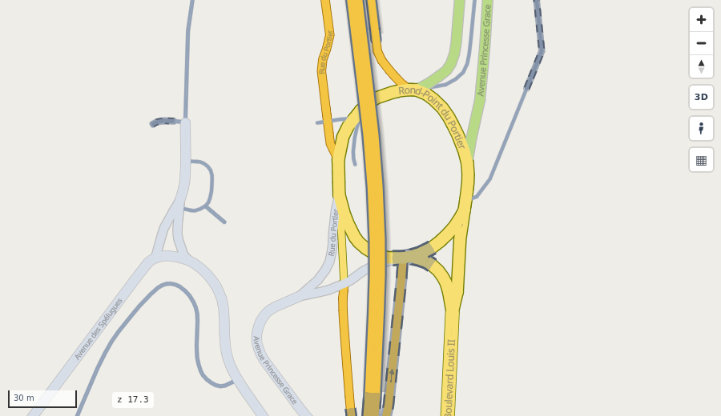
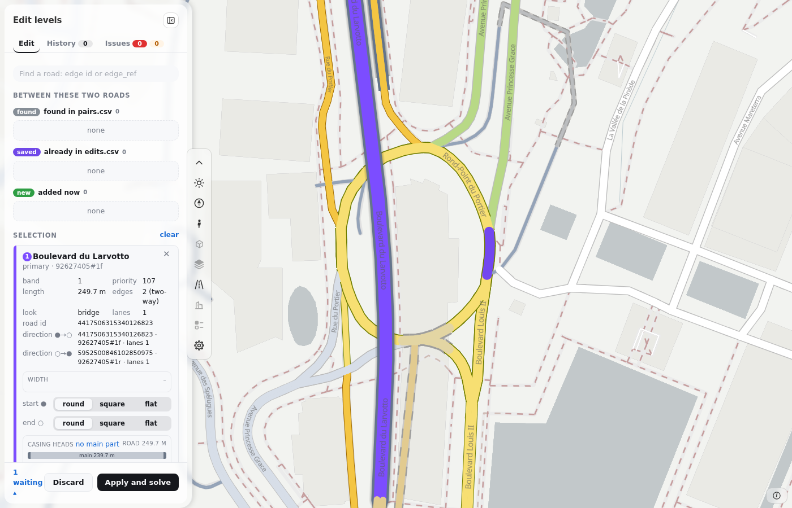

# Which road is on top

<p class="lead">Every edge gets numbers for where its outline and its road are drawn. The map is drawn by those numbers alone. A solver works them out, and an editor lets you fix any place by hand.</p>



Monaco, Rond-Point du Portier: the primary road crosses the roundabout on a bridge (slate outline, soft shadow), and a tunnel (dashed
outline) passes under both. Where the roads only meet, the roundabout is on top. Where they cross, the bridge is.

=== "Python"

    ```python
    rs.render_edges(edges).save("map.html")    # the positions are computed for you
    ```

=== "Command line"

    ```bash
    # the level step with files you can read and edit (an area folder)
    roadstyle-levels make edges.gpkg out/area     # the solver's input
    roadstyle-levels solve out/area               # levels.csv
    roadstyle-levels edit out/area                # the editor, http://localhost:8780/
    ```

## The rule

- Every edge has a **casing position** and a **fill position**. They are whole numbers, 0 is the ground, and null counts as 0.
- The casing has **three parts**: a start head, a main part and an end head (`casing_start`, `casing_level`, `casing_end`). The heads
  are 5 m long by default. On a short road the main part can have no length.
- The map is drawn position by position, lowest first. **At each position every outline is drawn first, then every road.** So two
  roads that meet merge without a ring: each head lies under the other road's fill. A road whose numbers are all higher than
  another's is drawn completely over it, outline included.
- **Nothing else orders the drawing**: not the road class, not `layer`, `bridge` or `tunnel`. They are only inputs of the solver. Two
  edges at the same position are drawn in no set order.

## How the solver works

`render_edges(edges)` without level columns runs the level step with its defaults. You can also run it yourself, once, and draw with the
columns:

```python
levels = rs.compute_levels(edges)
rs.render_edges(levels, casing_start_col="casing_start", casing_level_col="casing_level",
                casing_end_col="casing_end", fill_level_col="fill_level").save("map.html")
```

**1. The input** (`rs.level_input(edges)`). The two directions of a segment are one road. Between roads the input finds three kinds of pair:

| pair | when | what it asks |
|---|---|---|
| *meet* | two road ends are one node | each head is under the other road's fill (a hard rule) |
| *stack* | roads of different bands cross, or run within `band_dist` (10 m) away from a node they share | each crossing part of the upper road's casing is over the lower road's fill |
| *order* | roads meet: of one band, or of different bands that only meet (a tunnel mouth) | the road with the higher priority has the higher fill |

The band is the level from the tags: a non-zero `layer`, else 1 for a bridge, -1 for a tunnel, else 0 (or your own `band_col`). The
priority is a roundabout, then a tunnel, then a bridge, then the road class (`order="priority"`). A roundabout is known by the OSM
`junction` column: without it you get a warning.

**2. Hard rules and wishes.** Some rules always hold: no casing part is over its own fill, the meet rules, and every number is in the
range `-max_level` to `max_level` (20). The others are wishes that can break when they cannot all hold. A ring of three roads, each
over the next, is an example.

**3. The stages.** The solver works in this order. Each stage keeps the result of the stage before it:

1. Keep as many real crossings (stacks) as possible.
2. Then keep as many order wishes as possible.
3. Then keep as many near rules as possible. A near rule lifts a part that only comes close to the road under it. They are off by
   default: turn them on with `near_rules=True`.
4. Then use as few positions as possible, and put each casing as near to its fill as possible.

**4. The answer.** Every edge gets its four numbers. The solver moves them so that the most common casing position is 0 (the ground),
and makes them consecutive. A stack that it could not keep is in `result.attrs["levels_given_up"]`, with a warning: it is a flaw on
the map. The order wishes that it did not keep are in `levels_orders_not_kept`.

**The two engines.** Both solve the same input in the same stages:

- **Python** (the default) solves each stage as an integer program with HiGHS. A stage that needs more than `time_limit` (60 s)
  keeps the best answer that it found, with a warning.
- **Rust** (`engine="rust"`, or `ROADSTYLE_ENGINE=rust`) solves each stage as a minimum-cost flow: each rule "number A ≤ number B + w"
  is one arc of a graph. It checks every hard rule of its answer before it gives it, and it has no time limit. Monaco (13,298 edges)
  takes 0.2 s, Tartu (64,828 edges) 3.1 s. It keeps the levels of the last 2 networks, so a style, its tiles and each palette of one
  network solve one time.

Two answers can be equally good: the two engines can give different numbers for a few roads, with the same broken rules and the same
number of positions.

The solver reads only the pairs, never the lines or the head lengths. Which parts of a stack cross is decided in the input, with the
heads of that time.

## Fix it by hand: the level editor



`roadstyle-levels edit out/area` opens a local page with the map and a panel. Click a road, or find it by edge id or `edge_ref`. Pick a
second road to see every pair between the two.

The editor is in Rust: the solver runs in the page (WebAssembly), and a small Rust server (`roadstyle serve out/area`) gives the page
the area's files and saves your changes. Monaco solves in 0.1 s in the page. `--engine python` opens the earlier editor with its Python
server. Build the page's WebAssembly package once with `rust/roadstyle-wasm/build_editor.sh`. On any other web server the page shows
the area and saves nothing.

- **Add a rule**: *order* (whose fill is on top where they meet), *stack* (one road over the other: pick the parts of its casing) or
  *meet* (join two ends).
- **Switch off** a pair that the input found. To replace a found stack, switch off its rows, then add your own parts.
- **Before you add**, the page tells you if the new rule is already there or makes a loop with other rules (A over B, B over C, C over
  A: no numbers keep them all).
- **Each end of a road**: its cap (*round*, *square*, *flat*) and its head length. A change of caps or heads needs no solve.
- **Apply and solve** solves all waiting changes together and redraws the roads that changed. If the solver refuses them, nothing is
  saved.
- **Modes**: when the roads have a `modes` column (duckOSM gives it), boxes show only the roads of the ticked modes.
- The **Issues** tab lists the stacks given up, the near warnings and the order wishes not kept.

Your changes are in three small tables in the area folder. The input step never writes them:

| file | what |
|---|---|
| `edits.csv` | your rules: `relation` (`order`, `stack`, `meet`), `a`, `b`, `a_end` (a stack's part: `start`, `main`, `end`), `b_end`, `enabled` (`false` switches that found row off) |
| `heads.csv` | head lengths per road end in metres (`road`, `start_m`, `end_m`; empty: 5 m) |
| `caps.csv` | cap per road end (`road`, `start`, `end`: `round`, `square`, `flat`; empty: round) |

`levels.csv` is the result: per edge its four numbers and its ends as drawn. An example: Monaco's tables in `examples/levels/monaco/`.

**An area in a database.** `make_area(edges, folder, db="monaco.duckdb")` ties the area to a DuckDB file. Every solve also writes the
result into it (`visualization.edge_levels`), and `rs.load_area_levels(con, edges)` reads it back for the same edges only. duckOSM's
`duckosm levels monaco.duckdb` makes such an area for all travel modes, and mapstyle draws from it. Keep the three tables: with them a
rebuilt file gets the same drawing order back.

## Your own numbers

The solver is one way to fill the columns. Any whole numbers per edge work, for example a sidewalk at -1 under a street at 0 and a
crossing at 1 over it:

```python
edges["casing_level"] = edges["fill_level"] = edges["kind"].map({"sidewalk": -1, "street": 0, "crossing": 1})
```

To give your own band per edge and let the solver do the rest: `rs.compute_levels(edges, band_col="band")`. `render_edges` takes no band
and no order: compute the levels first. Each position gets its own layers, so keep the range small.

See also: [the level step, in full](../design/level_input.md) · [divided casing](../design/levels_split_casing.md) ·
[bridges and tunnels in 2D](style.md#bridges-and-tunnels-in-2d) · [every parameter](../reference/parameters.md)
