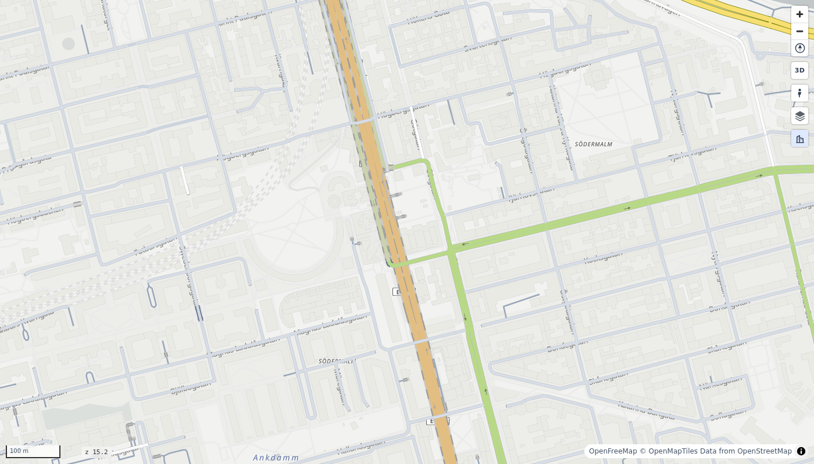

# Roads from OpenStreetMap

<p class="lead">No road data of your own? Download a place from OpenStreetMap with osmnx and draw it with four lines of code.</p>



[osmnx](https://osmnx.readthedocs.io/) downloads the road network of an area from OpenStreetMap. roadstyle takes its edges as they are.

```python
import osmnx as ox                       # pip install osmnx
import roadstyle as rs

G = ox.graph_from_place("Tartu, Estonia", network_type="drive", simplify=False)
G = ox.simplify_graph(G, edge_attrs_differ=["bridge", "tunnel"])   # see "Bridges and tunnels" below
rs.render_edges(ox.graph_to_gdfs(G, nodes=False)).save("tartu.html")
```

## Choose the area and the roads

| You have | Call |
|---|---|
| a place name | `ox.graph_from_place("Södermalm, Stockholm", ...)` |
| a point and a distance | `ox.graph_from_point((59.315, 18.07), dist=1000, ...)`: `(lat, lon)`, metres |
| a box | `ox.graph_from_bbox((west, south, east, north), ...)` |
| a polygon | `ox.graph_from_polygon(polygon, ...)`: shapely, in EPSG:4326 |

Give `simplify=False` to each call, then simplify as in the example above. The download of a district takes one or two minutes
(Södermalm: about 90 seconds). A county or a country can take much longer.

`network_type` sets which roads osmnx downloads. Always give it, because the default of osmnx is `"all"`:

| `network_type` | Roads |
|---|---|
| `"drive"` | public roads for cars |
| `"drive_service"` | the same, and service roads (driveways, parking aisles) |
| `"walk"` | all that a pedestrian can use, also footways and steps |
| `"bike"` | all that a cyclist can use |
| `"all"`, `"all_public"` | all ways, or all public ways |

roadstyle styles each edge by its `highway` class, so footways and cycleways have their own look.

## Two things about osmnx data

**The graph has directions.** A two-way street is two edges, one for each direction, and a one-way street is one edge. roadstyle
expects this: it draws the two directions side by side and puts arrows on the one-way streets. Do not change the graph with
`ox.convert.to_undirected`.

### Bridges and tunnels

By default osmnx joins the OpenStreetMap ways that follow each other into one edge, when no junction is between them. Then a tunnel that
goes straight onto a bridge becomes one edge with both `tunnel` and `bridge`, and roadstyle draws all of it as a bridge. In Stockholm,
Söderledstunneln and Centralbron became one edge of 1.5 km.

To prevent this, download with no simplification, then simplify with no join at the start or the end of a bridge or a tunnel:

```python
G = ox.graph_from_place(place, network_type="drive", simplify=False)
G = ox.simplify_graph(G, edge_attrs_differ=["bridge", "tunnel"])
```

This gives some more edges (1,470 in place of 1,361 for Södermalm). If you forget it, roadstyle gives a warning: *"6 edges are tagged
both bridge and tunnel and will be drawn as bridges"*.

A joined edge can also have lists, for example `name = ['Götgatan', 'Ringvägen']`. roadstyle keeps the first value of each list, and
changes the `(u, v, key)` index of osmnx into normal columns.

## Style by an OSM tag

osmnx keeps the OpenStreetMap tags as columns (`name`, `maxspeed`, `lanes`, `oneway`, ...), so all of
[Colour by your data](colour.md) works on them. `maxspeed` is text in OSM (`"30"`, sometimes `"SE:urban"`), so make it a number
first:

```python
import pandas as pd

edges = ox.graph_to_gdfs(G, nodes=False)
edges["speed_kmh"] = pd.to_numeric(edges["maxspeed"], errors="coerce")
rs.render_edges(edges, color_by="speed_kmh", cmap="plasma").save("speed.html")
```

## When the download fails

osmnx keeps each download in a `cache/` folder in the folder where you run it, so it downloads an area only once. To get new data,
delete that folder.

The downloads come from the public Overpass servers, which are sometimes busy or off. Then osmnx stops with `Connection refused` or a
timeout. Wait and try again, or use another server:

```python
ox.settings.overpass_url = "https://maps.mail.ru/osm/tools/overpass/api"
```

This is the setting of osmnx 2.x. Older examples use `ox.settings.overpass_endpoint`, which osmnx 2.x does not read.

**More:** [notebooks/10_osmnx.ipynb](https://github.com/Khoshkhah/roadstyle/blob/main/notebooks/10_osmnx.ipynb) shows all of this on
Södermalm, with the maps. An AI agent can do the same with no code: the tool `render_place` of the MCP server downloads and draws a
place in one call ([With AI agents](agents.md)).
