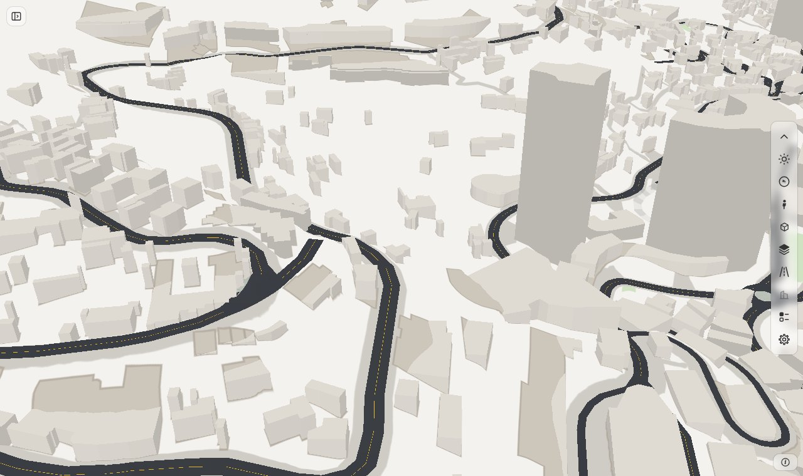
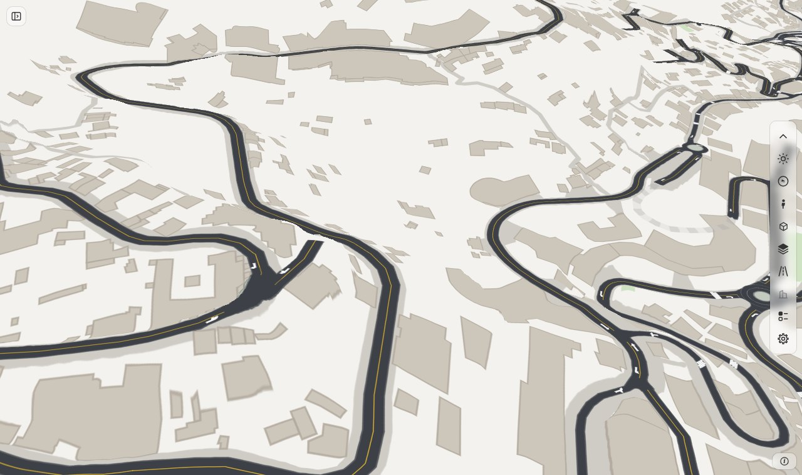
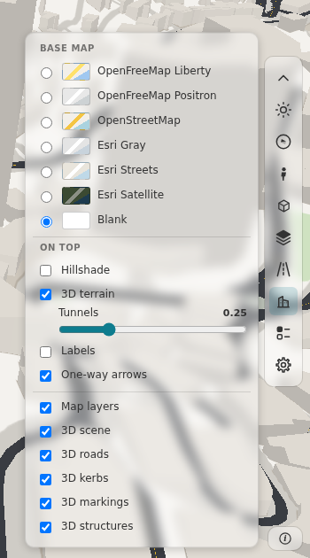
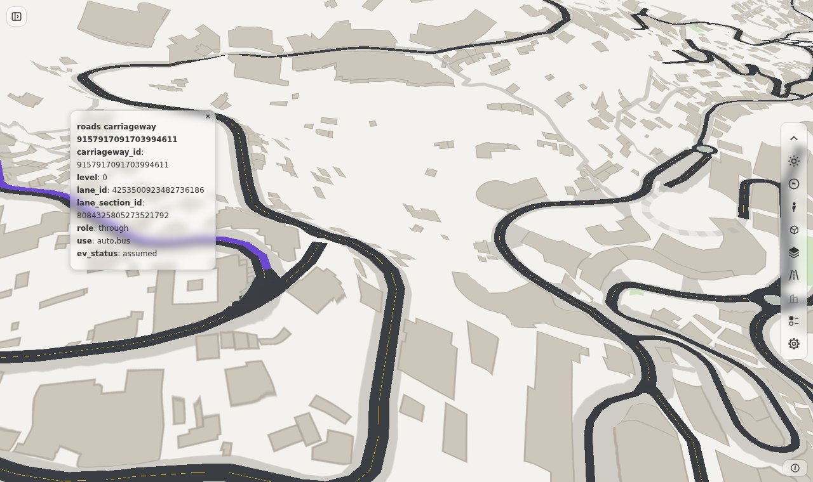
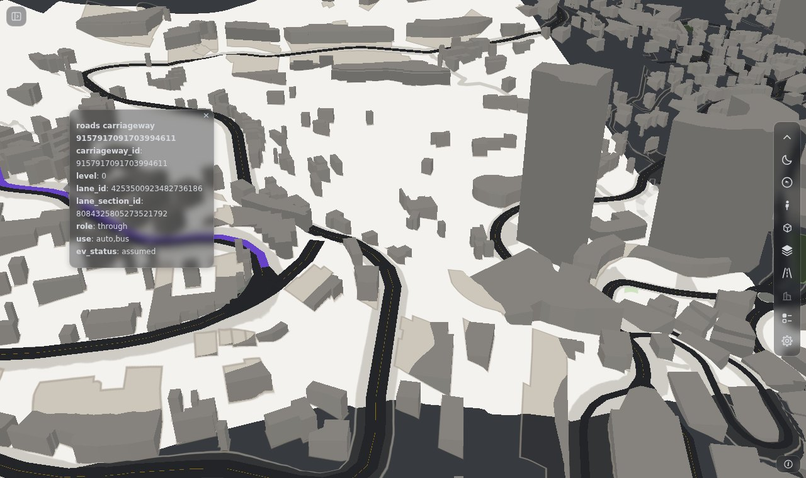

# 3D road tiles (GLB)

<p class="lead">Draw real 3D roads on the map: lanes, junctions, kerbs, markings, bridge decks and buildings, each at its own height. The tiles come from a GLB archive that SimReady writes for an area.</p>



A page that has `scene_3d` reads the tiles of the view and draws their triangles in the map. The base map, the 3D terrain, clicks,
Street View and the toolbox stay as they are. The layer adds one row in the base-map box for the whole scene and one row for each part. The part `buildings` has no row: the toolbox's buildings button switches it.

| | Flat map (no `scene_3d`) | With `scene_3d` |
|---|---|---|
| Road surface | a flat colour on the ground | triangles at the height of the model |
| Bridge deck, tunnel shell | a road drawn over the others by its level | a deck with its thickness, at its height over the valley |
| Kerb, island, marking | a flat shape or symbol | a surface at its own height |
| Click | the road edge (`rs:select`) | the triangle: its `lane_id`, `junction_id`, `structure_id` (`rs:scene3dselect`) |



*The same view with the scene off (`rsScene3d(false)`).*

## Start

You need three things: a page with a `ground`, the 3D terrain on, and the archive.

```python
import roadstyle as rs

rs.render_dashboard(
    edges,
    ground=ground,                                    # the area's ground: the 3D roads lie on it
    terrain=True,                                     # the layer draws only with the 3D terrain on
    scene_3d="out/monaco-rust/gltf/monaco.page.pmtiles",
).save("look.html")                                   # put monaco.page.pmtiles next to the page
```

1. Render the page. roadstyle reads the archive's header and metadata when it renders. An archive that does not fit is an error at this step.
2. Put the archive next to the page. The page fetches it by file name. To use another address, give `{"tiles": path, "url": address}`.
3. Serve both files with a web server that answers `Range` requests (see below). Open the page.
4. Zoom in to zoom 15 or more. The rows in the base-map box turn on.

!!! warning "Use a server that answers Range requests"
    The page reads only the tiles of the view. For this it asks the server for byte ranges of the archive. `python -m http.server` does not
    answer `Range` requests, so the page says that the archive "did not open". nginx, Caddy, GitHub Pages and S3 answer them. SimReady's hub does too.

!!! note "Render the page again when you rebuild the archive"
    The page keeps the archive's parts, its CRS and its ground id from the time of the render. A new archive with another list of
    parts, for example one with a new part `buildings`, needs a new render. Until then the layer names the tile that does not fit
    and does not draw it.

## The options

`scene_3d` is a path, or a dictionary. Every key but `tiles` is optional.

| Key | Default | What it does |
|---|---|---|
| `tiles` | none | The path of the archive. roadstyle reads its header and metadata when it renders |
| `url` | the file name of `tiles` | The address that the page fetches |
| `on` | `True` | `False` starts the page with the scene off |
| `popup` | `True` | A click opens a popup with the `extras` of the triangle. `False` gives the click to your page (`rs:scene3dselect`) |
| `min_zoom` | 15 | The layer reads nothing below this zoom |
| `max_tiles` | 49 | The most tiles that the layer reads for one view. A tilted view reaches far |
| `cache_mb` | 200 | The tiles in memory stay under this size |

A key that is not in this table is an error that lists the keys.

## What the archive must hold

- A PMTiles v3 archive of GLB tiles at one zoom (SimReady: 16). Tile type 0, tile compression gzip.
- The root node of each GLB has one child for each part. SimReady writes `roads`, `kerbs`, `markings`, `structures` and `buildings`.
  The archive's metadata lists them in `kinds`. A tile with a part that `kinds` does not list is an error.
- The root `extras.simready` of each GLB has `crs` (an EPSG code), `origin` `[x, y, 0]` and `ground` (the ground id). A vertex is
  `(east - origin.x, height, -(north - origin.y))` in metres of that CRS. The height is metres above the datum of the ground.
- The CRS is a row of `data/crs.json`: a UTM zone (EPSG 32601 to 32660, 32701 to 32760, 25828 to 25838), SWEREF99 TM (3006), L-EST97 (3301) or
  Web Mercator (3857). Another code is an error that lists the codes. A code of a known family is one more row.
- Each primitive has a material colour (`baseColorFactor`) and `extras`. The layer draws opaque triangles. A GLB with a feature that the layer
  does not read (a Draco or meshopt buffer, sparse accessors, an alpha material) is an error that names it.

## The ground and the 3D terrain

The heights are above the datum of the ground, so the layer draws on the page's own `ground`. The archive names its ground id in its
metadata. A page with another ground, or with no `ground`, is an error when roadstyle renders it, and the message names both ids. In an
open page, `rsGround(other)` makes the layer say so (`rsScene3dProblems()`) and draw nothing.

With the 3D terrain off the layer draws nothing: the rows are grey and say why. It never draws the roads flat.

The layer lifts the whole scene by 0.6 m (`ontop.scene_3d.lift_m`). The terrain that the map draws is a mesh that is lower than the exact
ground in places, and a road at its exact height is covered by it. Measured on Monaco with the 3D terrain on:

| Lift | Share of the road pixels that show |
|---|---|
| none | 44 to 100 % |
| 0.15 m | 82 to 100 % |
| 0.3 m | 91 to 100 % |
| 0.6 m (default) | 92 to 100 % |
| 1.0 m | 93 to 100 % |

The share does not grow above 0.3 m, so the lift is one number and does not follow the slope.

## The switches



The base-map box has the row **3D scene** for the whole scene and one row for each part, except `buildings`. A part that is off is not drawn and not picked.
The rows are the box's own part, so they have both themes. A row is grey, with the reason in its tooltip, when:

- the 3D terrain is off ("Needs the 3D terrain");
- the zoom is below `min_zoom` ("Zoom in to 15 to see the 3D roads");
- the scene is off (for the rows of the parts).

The part `buildings` is switched by the buildings button of the toolbox. That one button also switches the buildings of a vector base map
(OpenFreeMap) and the buildings of the area, so the page has one switch for all 3D buildings. When the scene shows its buildings, the base map's buildings are not drawn.

From JavaScript: `rsScene3d(on)` and `rsScene3dKind(kind, on)`. `rsScene3dKind("buildings", on)` switches the same part as the button.

## A click



A click on a triangle of the scene is the event `rs:scene3dselect`. The picked primitive is drawn again in the select colour of the
palette. With `popup` (the default) a popup lists the `extras` of the primitive:

| `extras` | Meaning |
|---|---|
| `lane_id`, `lane_section_id`, `carriageway_id` | the lane, its section and its carriageway |
| `role`, `use` | what the lane is for (`through`, ...) and who can use it (`auto,bus`) |
| `level`, `ev_status` | the level (0: on the ground) and the status of the model's rule for the lane |
| `junction_id`, `stop_line_id` | the junction, or the stop line, that the primitive belongs to |
| `structure_id` | the bridge or tunnel |
| `island_id`, `mark` | the island, or the kind of marking |

The popup shows what the archive holds: a primitive has only the keys that apply to it. A click on the scene does not send `rs:select`, and it deselects the road. A click on an empty
place sends `rs:scene3ddeselect`. `rsScene3dPick({x, y})` asks the same without a click.

## Use it in a dashboard

A page that has its own flat road layers hides them while the scene is drawn, or the two draw the same roads twice. Listen to
`rs:scene3dchange` and `rs:scene3dstatus`, and read `rsScene3dStatus().drawn`:

```javascript
const flat = ["roads-fill", "roads-casing"];                 // example names: the ids of your own flat road layers
function sync() {
  const drawn = rsScene3dStatus().drawn;                     // on, terrain on, zoom ok, a tile is there
  flat.forEach(id => map.setLayoutProperty(id, "visibility", drawn ? "none" : "visible"));
}
document.addEventListener("rs:scene3dchange", sync);
document.addEventListener("rs:scene3dstatus", sync);
```

SimReady's look page does this for its flat lane layers. A button of your page can use the same calls:
`rsScene3d(false)` shows the flat map again.



*The dark theme dims the surfaces (`dim.dark`, 0.6). The base map here is the blank one, so it stays light.*

## Tiles and memory

| What | Value |
|---|---|
| Tiles that the layer reads | the tiles that the view touches, and one ring around them (a primitive can reach a few metres into the next tile) |
| Most tiles for one view | `max_tiles` (49). `rsScene3dStatus().tiles.capped` is `{shown, total}` when the view needs more |
| Lowest zoom | `min_zoom` (15) |
| A tile that does not load | tried 3 times, then named in `rsScene3dProblems()` and in a toast |
| Memory | the tiles stay under `cache_mb` (200 MB). The least recently used tile that is not in view goes first |
| Graphics card | all of Monaco (34 tiles, 0.7 M triangles) is about 10 MB |

See [Memory budget](../design/memory_budget.md) for how the budget is chosen.

## The look

The surface colour is the GLB's material colour: SimReady sets the colour of each lane type. The layer lights it with one
directional light and an ambient value. The values are the settings `ontop.scene_3d` (`data/basemaps.json`):

| Setting | Default | Meaning |
|---|---|---|
| `lift_m` | 0.6 | the lift over the exact ground, in metres |
| `light` | `[-0.4, 0.5, 0.75]` | the direction to the light: east, south, up |
| `ambient` | 0.8 | the share of the colour that no light changes. Lower it for more shade on slopes |
| `dim.light`, `dim.dark` | 1.0, 0.6 | a factor on the colour in the light and in the dark theme |

## JavaScript

| Call | What it does |
|---|---|
| `rsScene3d(on)` | the whole scene on or off. No argument: whether it is on |
| `rsScene3dKind(kind, on)` | one part on or off. No `on`: whether it is on. No argument: `{kind: on}` |
| `rsScene3dPick({x, y})` | what the layer draws under a screen point: `{kind, node, tile, extras}`, or `null` |
| `rsScene3dStatus()` | `{on, terrain, zoom_ok, drawn, tiles: {wanted, loaded, loading, capped}, problems}` |
| `rsScene3dProblems()` | `[{code, message}]`: each problem that the layer found |
| `rsScene3dVertices(max)` | the vertices of the tiles in memory, `[{kind, tile, lng, lat, h}]`, to check the data |

| Event | When | `detail` |
|---|---|---|
| `rs:scene3dchange` | the scene or a part goes on or off, or a problem comes or goes | `on`, `kinds` |
| `rs:scene3dstatus` | the tiles that the view needs change, or one arrives | the same as `rsScene3dStatus()` |
| `rs:scene3dselect` | a click hits a triangle | `kind`, `node`, `tile`, `extras` |
| `rs:scene3ddeselect` | a click that is not on the scene, after one that was | none |

A page with no `scene_3d` throws when it calls `rsScene3d`. The full list is in [JavaScript](../reference/javascript.md).

## When something is wrong

The layer never hides a problem. Each one goes to the browser console, to a toast and to `rsScene3dProblems()`. The part that it
concerns is not drawn. The messages that you can meet:

| Message starts with | Cause | What to do |
|---|---|---|
| `scene_3d: ... its heights are above the ground A, and the page draws the ground B` | the archive and the page have different grounds | give the page the ground of the archive (`ground=`) |
| `scene_3d: ... the page has no ground` | the page has no `ground` | add `ground=` |
| `scene_3d: the archive's CRS EPSG:n is not in the projection table` | the CRS is not in `data/crs.json` | add the row (a code of a known family is one more row) |
| `scene_3d: unknown key ...` | a key that is not in the table of options | use one of the keys that the message lists |
| `3D roads: the archive ... did not open` | the server does not answer `Range` requests, or the address is wrong | serve the files with a server that answers `Range`; check `url` |
| `3D roads: the tile z/x/y did not load` | a tile is missing, or the server was off | reload; check the archive |
| `... has the part "x", which the archive's metadata does not list` | the page is older than the archive | render the page again |
| `3D roads: the tiles in view hold n MB, more than cache_mb` | the cache is too small for this view | zoom in, or give a larger `cache_mb` |
| `scene_3d: ...: a material with alphaMode ...`, `... the glTF extension ...` | a GLB with a feature that the layer does not read | write opaque triangles with a plain material colour |

A row of the base-map box that is grey is not an error. Its tooltip names the reason (the 3D terrain is off, or the zoom is too low).

## What the layer does not do yet

- A hover on the scene (only a click).
- A part colour from the palette: the layer uses the GLB's material colour.
- A `File` or a `Blob` as the archive: the page needs an address.

## See also

- [3D road tiles: the design](../design/scene_3d_tiles.md): the choices, the projection table and the measurements.
- [Google 3D](google-3d.md) and [How the height of a 3D bridge is calculated](bridge-height.md): the other 3D views of the page.
- [JavaScript](../reference/javascript.md): every call and event of the page.
