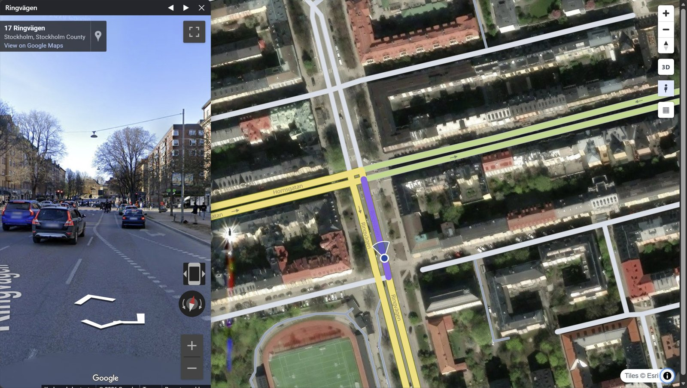

# Street View

<p class="lead">Click a road and see it in Google Street View, Panoramax or Mapillary. The view looks the way the road runs. Google's Classic view and Panoramax need no API key.</p>

<div class="grid cards" markdown>

-   :material-dock-window:{ .lg .middle } **The floating window**

    ---

    On every map by default. A Street View button opens a small window over the map. In a dashboard, the button is in the toolbox.

    [:octicons-arrow-right-24: The floating window](#the-floating-window)

-   :material-view-split-vertical:{ .lg .middle } **Side by side**

    ---

    A page with the map and Street View next to each other. A divider moves between them.

    [:octicons-arrow-right-24: Side by side](#side-by-side)

</div>

!!! warning "Serve the page"
    Street View loads only in a page served over http(s). If you open the page from disk (`file://`), Street View stays
    grey and the page shows a link. Serve the folder with `python -m http.server`. Then open
    `http://localhost:8000/map.html`.

## The floating window



1. Press the **Street View** button. In a dashboard toolbox, it is after the navigate button.
2. Click a road.

The window follows each new click. Drag its title bar to move it. Drag its corner to change its size.
The window stays inside the map. The page remembers if the window was open, and where.

<iframe src="../../maps/street_view_window.html" loading="lazy" title="A map with the Street View window open" class="rs-demo"></iframe>

```python
rs.render_edges(edges)                       # street_view="window": the button and window (default)
rs.render_edges(edges, street_view=True)     # a Street View link in the road popup instead
rs.render_edges(edges, street_view=False)    # no Street View
rs.render_edges(edges, street_view_key=KEY)  # the window with Linked / Classic (see below)
```

A key needs more than the key itself: billing, the Maps JavaScript API and a list of your web
addresses. See [Keys and tokens](google-key.md).

With a Google Maps JavaScript API key, the window bar has a **Linked / Classic** switch.
Linked is a real panorama, and the map marker walks with you. Classic is a link that opens the spot in Google Maps, because Google no longer lets a page frame its keyless embed.

## Docked beside the map

A dashboard can have Street View as one side of the page, with a divider that you drag:

```python
rs.render_dashboard(edges, street_view="dock", street_view_key=KEY).save("street_view.html")
```

The Street View window takes the right part of the screen (the lower part on a phone). The map takes the rest.
The toolbox is at the left edge of the map. Its Street View button closes and opens the dock.
The share of Street View is 20 to 80 %. The browser remembers it.

The dock page has no panel. Use `dashboard={"panel": {...}}` to add one. Use `dashboard={"toolbar": {"position": "top"}}` to move the toolbox.
A map with the toolbox, no panel and no Street View dock is `dashboard={"panel": None}`.

## Side by side

This page is a page of its own. The map and Street View share the screen. Click a road, and Street View shows it.

**Beside the map**

<iframe src="../../maps/street_view.html" loading="lazy" title="The map with Google Street View beside it" class="rs-demo"></iframe>

**Below the map**

<iframe src="../../maps/street_view_below.html" loading="lazy" title="The map with Google Street View below it" class="rs-demo tall"></iframe>

=== "Python"

    ```python
    rs.render_street_view(edges).save("street_view.html")                  # beside
    rs.render_street_view(edges, layout="below").save("street_view.html")  # below
    ```

=== "Command line"

    ```bash
    roadstyle edges.gpkg --page street-view -o street_view.html
    roadstyle edges.gpkg --page street-view --layout below -o street_view.html
    ```

| option | default | does | command line |
|---|---|---|---|
| `layout` | `"beside"` | `"beside"` or `"below"` the map | `--layout below` |
| `panel_width` | `42` | Street View's share of the width (of the height when below), 20-80 % | `--panel-width 60` |
| `resizable` | `True` | a divider that the viewer can drag. `False` fixes the size | `--no-resize` |
| `street_view_key` | `None` | a Google **Maps JavaScript API** key (below). The default is the variable `GOOGLE_MAPS_KEY` | |

Every `render_edges` keyword also works here. On a phone, Street View is under the map.

??? info "Linked and Classic"
    Without a key, the panel is Google's keyless embed. It is a closed box. When the viewer walks in it
    with Google's arrows, the page does not know where the viewer went. The map marker stays behind.
    The embed also shows photos that people took indoors.

    With `street_view_key=`, the panel is a real panorama (the Maps JavaScript API).
    Each step and turn moves the marker on the map. The map pans to keep the marker in view.
    Only Google's own street imagery shows. The step buttons of the page still walk along the clicked road.

    A switch in the bar changes between **Linked** (this panorama) and **Classic** (a link to Google Maps).
    The browser remembers the choice.

    The key is written into the page, as every browser key is. To make a key and limit it to your own
    addresses, see [Keys and tokens](google-key.md). Google bills Dynamic Street View for each panorama
    above a monthly free quantity. The same key also opens the [Google 3D](google-3d.md) window.

## Panoramax and Mapillary

The window title bar has a switch: **Google**, **Panoramax** and **Mapillary**. The browser remembers the choice.
For each road that you click, and for each step, the window shows the photo of the provider that is nearest to the spot.
The photo must be within 30 m and must look along the road (within 45 degrees). The view looks the way the road runs,
if the provider says which way the photo looks. If the provider has no photo there, the window says so.

| Provider | Key | Photos |
|---|---|---|
| Google | none for the Classic link. A [Google key](google-key.md) for Linked | Google |
| [Panoramax](https://panoramax.fr/) | none | open data (mostly CC-BY-SA), from `api.panoramax.xyz` |
| [Mapillary](https://www.mapillary.com/) | a free **client token** ([how to get it](google-key.md#the-mapillary-token)) | crowd-sourced (CC-BY-SA) |

**Coverage.** If Panoramax or Mapillary is chosen, the **Coverage** button (the map icon after the provider switch)
draws where that provider has photos. It shows a line for each sequence, and a dot for each photo from zoom 15.
Mapillary lines start at zoom 6. Coverage shows only inside the page `boundary`, or inside the bounds of the roads if the page has no boundary.
Coverage goes away when you choose Google or close the window.

**Click a photo.** If Coverage is on, click a dot to open that photo in the window. A ring marks it until the next road or step.
The map marker goes to the place where the photo was taken. It turns the way the photo looks.

??? info "Details for Panoramax and Mapillary"
    - **Privacy.** A click on a road sends the place of the road to the provider that you use.
      The viewers of Panoramax and Mapillary (Photo Sphere Viewer and MapillaryJS) load from the jsDelivr CDN
      when first used. These tabs need an internet connection. The rest of the map works offline.
    - **Photos are not map-matched.** Neither provider snaps its photos to a road. The position of a photo is the raw GPS fix
      (often 5-15 m off). Its direction is the camera heading. The window checks only the distance (30 m) and the heading (45 degrees).
      Near parallel roads, near junctions or in tunnels, a photo can belong to the neighbouring road.
      A drive that one direction recorded can be missing for the other direction.
    - **Panoramax viewer.** A flat photo opens whole. It has zoom buttons and the wheel, like panoramax.fr.
      A 360 degree photo turns freely.
    - The map marker turns with the view and follows a step to the next photo.
      The credit of the provider is in the attribution box while its window is open.

## Where it looks

- Street View stands on the centre line of the clicked road, at the point nearest the click. It looks
  the way the edge runs.
- On a two-way road, each direction stands 2.5 m to its right, in its own lane. The two
  directions look opposite ways.
- A **marker** (a dot and a cone) on the map shows where Street View stands and which way it looks.
- The **◀ ▶** buttons walk 15 m back or forward along the road.

Google shows the nearest panorama that it has. Where it has no car imagery, the panorama can be a photo that a person uploaded.

**Privacy:** the page sends nothing to Google until Street View is opened. (Side by side: until you click a road.)
The request has only the position and the heading.

??? info "Control Street View from your own page"
    `rsSetStreetView(true)` opens the window. `rsStreetViewStep(15)` steps. The `rs:select` event has the Street View URL.
    `rsSetStreetViewMarker(false)` hides the marker. `rsSetStreetViewMarkerAt(lng, lat, heading)` puts the marker
    where your own Street View stands, snapped onto the road in its lane.
    See the [JavaScript API](../reference/javascript.md).

## Where the spot is: position and direction

To put a sensor, a sign or a camera at an exact spot, walk there in Street View. Then read the spot:

```js
const s = rsGetStreetViewSpot();
// {id, properties, m, len, lng, lat, heading, roadHeading, onRoad, source}
document.addEventListener("rs:streetviewspot", e => console.log(e.detail));   // on every change
```

| field | what |
|---|---|
| `id`, `properties` | the edge of the spot (`properties.edge_id` and others) |
| `m`, `len` | metres along the edge from its start, and its length |
| `lng`, `lat` | the point: in the lane on a two-way road, else where the panorama stands |
| `heading` | where the viewer looks, in degrees from north |
| `roadHeading` | the direction of the edge at that point |
| `onRoad` | `false` if the viewer walked off every drawn road. Then only `lng`, `lat`, `heading` are set |
| `source` | `"panorama"` or `"map"` |

Linked and Classic give different spots:

| | Linked (with `street_view_key=`) | Classic (keyless) |
|---|---|---|
| `source` | `"panorama"` | `"map"` |
| edge, metres along it, point | current | the clicked or stepped spot |
| `heading` | where the viewer looks | the direction of the road there |
| walking or turning in the picture | updates the spot | the page does not see it |

Classic has no picture in the page: it is a link, and the page cannot see where you look in Google Maps.

**See also:** [Every parameter](../reference/parameters.md) · [Command line](../reference/cli.md) · [Dashboards](dashboards.md)
