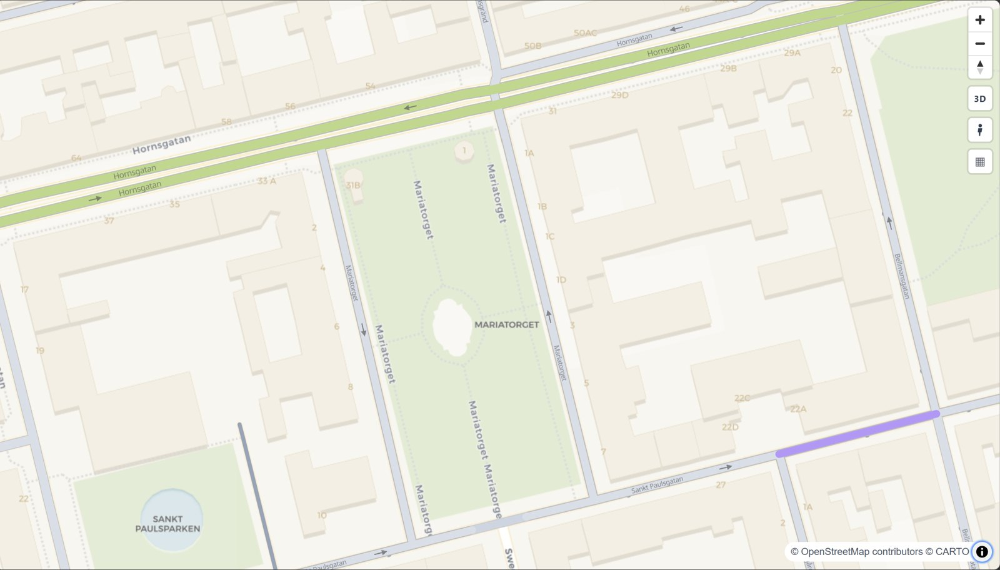
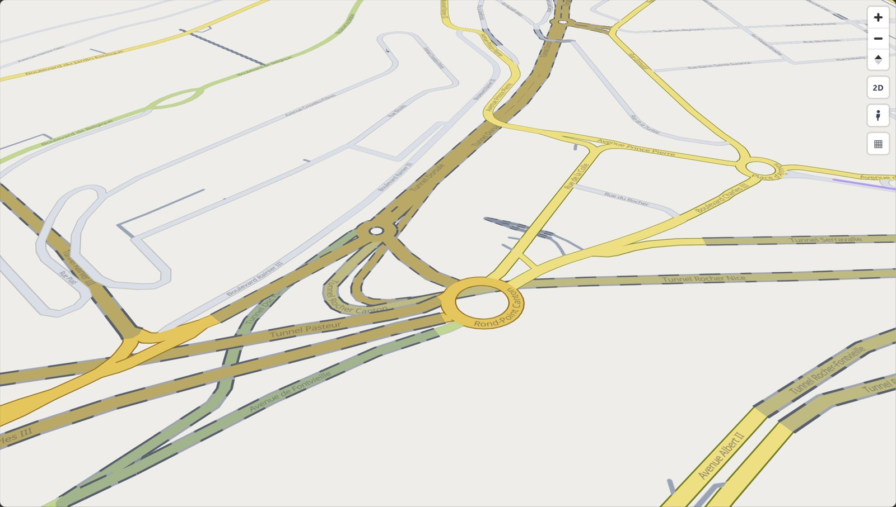
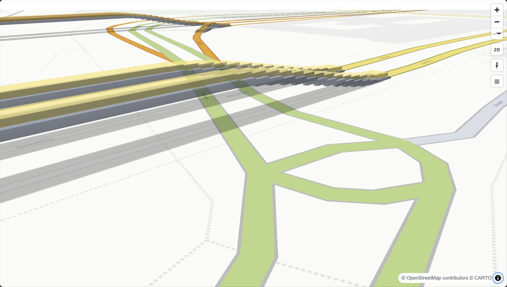

# Style the roads

<p class="lead">Choose a palette and a base map, remove the names or the arrows, show bridges in 3D, and keep only the road classes that you want.</p>

<iframe src="../../maps/first_map.html" loading="lazy" title="A map with the default style" class="rs-demo"></iframe>

=== "Python"

    ```python
    import geopandas as gpd
    import roadstyle as rs

    edges = gpd.read_file("edges.gpkg")
    rs.render_edges(edges, palette="carto", basemap="ofm_positron").save("map.html")   # the default: amber on OpenFreeMap Positron
    ```

=== "Command line"

    ```bash
    roadstyle edges.gpkg --palette carto --basemap ofm_positron -o map.html
    ```

## Palettes

A palette gives each road class its colour and the colour of its outline (the casing).

| Palette | Look |
|---|---|
| `amber` (default) | orange, yellow and green main roads, grey-blue streets: each class shows on a light base map |
| `carto` | the soft colours of the OpenStreetMap standard map |
| `highsat` | bright colours, high contrast |
| `mono` | grays: use it under the colours of your data |

<div class="grid" markdown>





</div>

To change the colour of a class or to make a palette of your own, see [Settings & palettes](../reference/settings.md).

## Base maps

`basemap=` sets the base map. `basemaps=` sets the list in the button **Base map and layers**.

```python
rs.render_edges(edges, basemap="ofm_dark", basemaps=["ofm_dark", "ofm_positron", "satellite"])
rs.render_edges(edges, palette="mono", basemap="blank")      # no tiles: the page works offline
```

| Key | Base map | Dark twin |
|---|---|---|
| `ofm_positron` (default), `ofm_liberty` | OpenFreeMap | `ofm_dark`, `ofm_fiord` |
| `osm` | OpenStreetMap | |
| `esri_gray`, `esri_street` | Esri | `esri_dark_gray` |
| `satellite` | Esri World Imagery | |
| `blank` | no tiles and no network | `blank_dark` |

No base map needs a key. A base map that roadstyle removed (see the CHANGELOG) gives `ofm_positron` and a warning.

## Names, arrows and the base map button

The street names, the one-way arrows and the base map button are on. To remove them:

```python
rs.render_edges(edges, labels=False, arrows=False, basemap_switcher=False)
```

On the command line: `--no-labels`, `--no-arrows` and `--no-basemap-switcher`. To filter the road classes on a page, use the
`roads` tool of a dashboard ([Layout and toolbox](dashboard-layout.md#roads)).

## Bridges in 3D

`view_3d=True` tilts the camera and draws each bridge as a raised deck, so you can see the roads under it. A map page has a
2D/3D button. A dashboard has the tilt slider in its `navigate` box. Below zoom 16 the bridges are flat.

```python
rs.render_edges(edges, view_3d=True)                         # command line: --view-3d
```



## Bridges and tunnels in 2D

- A **bridge** has a grey-blue outline and a soft **shadow** on the roads under it.
- A **tunnel** moves its colours toward one colour (Sand), and its outline is two dashed colours (*Graphite + silver*).
- `tunnel_control=True` adds a *Tunnels* box to the page, to try other values. `rsSetTunnelStyle({strength, palette, ratio})`
  does the same from the JavaScript of your page.

To change these looks for all your maps, put them in a palette (colours) or a profile (all else), see
[Settings & palettes](../reference/settings.md):

```yaml
# ./palettes/mine.yaml                    use it with palette="mine"
bridges: {casing_color: "#475569"}
tunnels: {toward: "Slate", palette: "Teal + mint"}
```

```yaml
# ./profiles/mine.yaml                    use it with profile="mine"
tunnels: {strength: 40}                   # 0: the normal colours, 100: the full tunnel colours
bridges: {shadow: {show: false}}
```

Which road is drawn over which road comes from the levels: [Which road is on top](levels.md).

## Keep or remove road classes

```python
rs.highway_types(edges)                                      # the classes in your data
rs.render_edges(edges, include=["motorway", "trunk", "primary", "secondary"])
rs.render_edges(edges, exclude=["service", "footway", "path", "cycleway"])
rs.render_edges(edges, minzoom=False)                        # each class at each zoom
rs.render_edges(edges, minzoom={"residential": 14})          # a class from zoom 14
```

By default the small classes show only when you zoom in. `include` and `exclude` also keep or remove the `*_link` roads of each
class (`match_links=True`).

## Your own road classes

For a class column that is not the OSM `highway`, for example the functional classes of NVDB, make a palette file with a colour
for each class, and use that column: `render_edges(edges, highway_col="functional_road_class", palette="nvdb")`. The form of a palette
file: [Settings & palettes](../reference/settings.md).

**See also:** [Every parameter](../reference/parameters.md) · [Settings & palettes](../reference/settings.md) · [Gallery](../gallery.md) · [JavaScript API](../reference/javascript.md) (`rsSetBasemap`, `rsSetClasses`, `rsSetView3D`)
