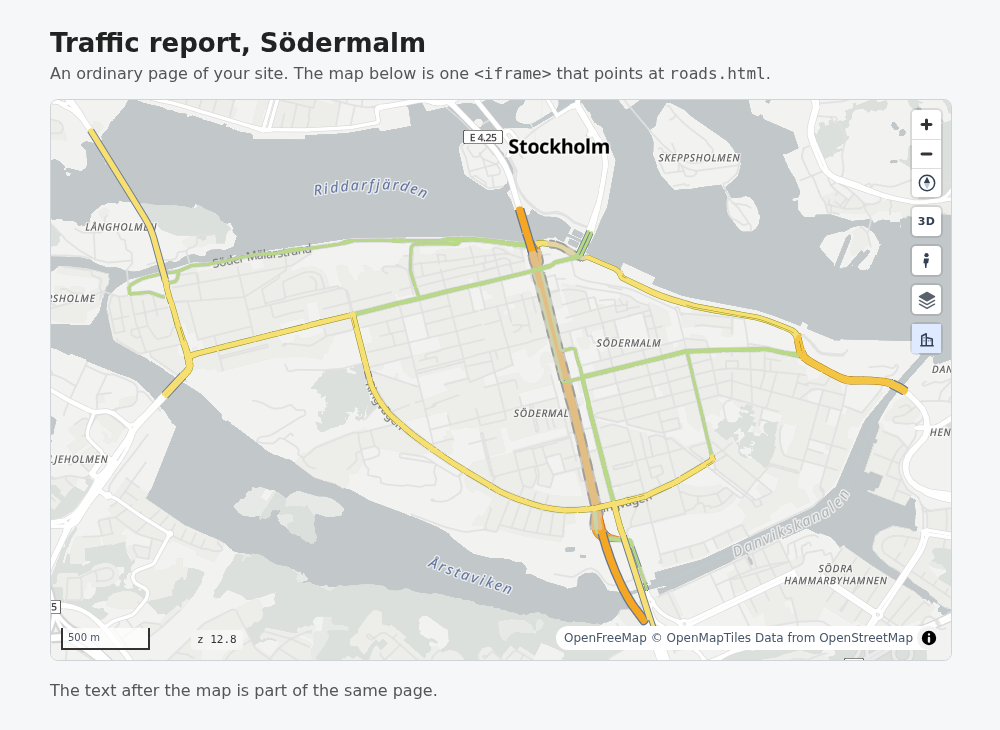

# On a website or in a map app

<p class="lead">You can show a roadstyle map on a web page in two ways: put the saved page in an iframe, or write a style that other map apps open by URL.</p>

| Way | Python at runtime? | Use it when |
|---|---|---|
| [The saved HTML in an iframe](#the-saved-html-in-an-iframe) | no | you have a static site, a report or a quick embed |
| [A style for other map apps](#a-style-for-other-map-apps) | once, to write the files | GeoLibre, RustGIS, QGIS or your MapLibre page must open the roads by URL |

In both ways the browser needs no styling code. The style holds the rules, and each road piece carries its values.

## The saved HTML in an iframe

The default map is one offline file. Save it, then point an iframe at it. The map keeps all its features:
zoom-scaled widths, labels, 3D and the `window.rs*` API.

```python
rs.render_edges(edges).save("roads.html")
```

```html
<iframe src="roads.html" style="width:100%;height:600px;border:0"></iframe>
```



The map is a snapshot. To show new data, run Python again.

To add your own panel to the map, see [Dashboards](dashboards.md).

**See also:** [Every parameter](../reference/parameters.md) · [JavaScript API](../reference/javascript.md)

## A style for other map apps

`rs.export_style` writes the roads as a MapLibre style, vector tiles, a sprite and the road table. It writes the roads only: the base map is the app's own.
The tiles carry only the keys that the style reads. The table `props.json` carries the data columns.
Put the folder on a web server. Then open it in GeoLibre (with the roadstyle plugin), RustGIS or any MapLibre page.

```python
rs.export_style("sodermalm/edges_driving.parquet", "out/sodermalm", base_url="https://example.org/sodermalm")
```

The input is a duckOSM GeoParquet file (`duckosm export-gis --format geoparquet`). It holds the edges with their data and their drawing
positions. If the file has no positions, you get an error that tells you how to save them. A GeoDataFrame also works.

| File | Content |
|---|---|
| `style.json` | the layers of the roads; every URL starts with `base_url` |
| `tiles/{z}/{x}/{y}.mlt` | the road tiles in MLT. `tile_format="mvt"` gives `.pbf`. `format="pmtiles"` writes one `roads.pmtiles`. MLT needs MapLibre GL JS 5.12 or later |
| `props.json` | the road table: every column of every road, by the row of the road (an id above 2^53 is text). A click reads it |
| `sprite.json`, `sprite.png` (and `@2x`) | the one-way arrow |
| `popup.js`, `popup.css` | the text of the popup and of the hover box (the GeoLibre plugin imports them) |

- `base_url` is the URL where the folder is served. The server must send `Access-Control-Allow-Origin: *`.
- Other keywords go to `render_edges` (`profile`, `palette`, ...). `basemap=`, `views=` and `color_active=` are errors: the style has no base map and no page state.
- An app has no slider or menu. The style has the start values of the page state (tunnel look, colour option).

### GeoLibre

GeoLibre (web or desktop) opens the export with the plugin in `geolibre-plugin/`. The plugin is on the branch `geolibre` of this repository, not on `main`.

1. Open Settings › Manage Plugins › Settings › Manifest URLs. Type the URL of `geolibre-plugin/plugin.json` on your server, then click Add.
2. Open the export: use the menu **roadstyle** › Add a roadstyle layer, or open `https://web.geolibre.app/?roadstyle=<URL of style.json>`.
3. The roads are one row in the Layers panel, over the base map of GeoLibre. To hide them, use that row. A click on a
   road shows its data. The hover lights the road. A tilt shows the bridge decks in 3D.

??? info "More GeoLibre ways: a duckOSM folder, and the look for a data layer"
    The duckOSM GeoParquet file also opens alone, with no plugin, as a data layer in the simple style of GeoLibre:
    `https://web.geolibre.app/?data=<URL of edges_driving.parquet>`. Identify shows the data.

    To open all of a duckOSM database in one step, write its folder with `duckosm export-gis <db> -f geoparquet`.
    Put the folder on your server. Then use the menu **roadstyle** › Open a duckOSM folder and type the URL of the folder.
    GeoLibre opens each file of the folder as a layer. The plugin gives roadstyle's look to each edges layer.

    To give roadstyle's look to another data layer (also a layer from a duckOSM `.duckdb` file):

    1. Open Plugins › Installed › roadstyle. If the menu **roadstyle** is not there, make the plugin active.
    2. Use the menu **roadstyle** › Style a layer with roadstyle. Type the number of the layer.
    3. Accept the look URL (the plugin's `looks/default.json`), or type the URL of your own look from `rs.export_look(path)`.

    The layer must have the columns `highway`, `oneway`, `tunnel`, `bridge`, `casing_level` and `fill_level`. The duckOSM
    GeoParquet export has them. The look has the class colours, the casings, the drawing positions, the tunnels and the two-way roads.
    It has no names, arrows or 3D decks. The own line of GeoLibre for the layer becomes transparent. Identify still shows the data.

### RustGIS

Use Home › Add › Basemap › Add Tile Layer with the `style.json` URL, or open RustGIS with `?style=<URL>`. RustGIS puts the new layer
under its sample layers. Clear the check boxes of the sample layers. RustGIS does not draw `line-offset`, line labels or 3D
([what is lost](https://github.com/Khoshkhah/roadstyle/blob/main/docs/design/style_export.md#what-you-lose-outside-roadstyles-page)).

### A local test

The web apps are https pages. They read `http://localhost` only after you allow the local network access of Chrome:
click the icon at the left of the address bar, then Site settings › Local network access.
