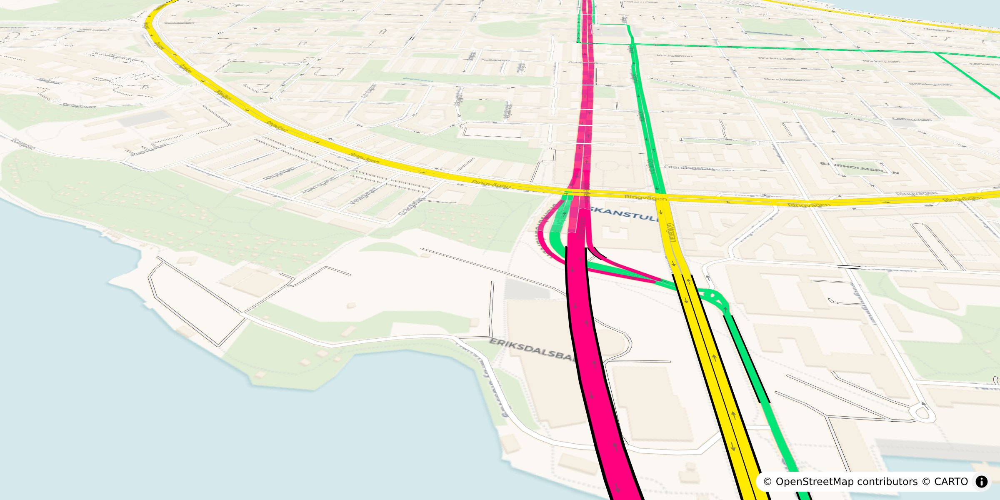

# roadstyle

<p class="lead">Turn a road network into a styled, interactive HTML map that works offline, with Google Street View and a JavaScript API.</p>

<div class="rs-hero" markdown>

</div>

[:material-map: Open the live map](maps/live.html){ .md-button .md-button--primary }

```bash
pip install roadstyle
```

```python
import geopandas as gpd
import roadstyle as rs

edges = gpd.read_file("edges.gpkg")        # road edges with a `highway` column
rs.render_edges(edges).save("roads.html")  # one self-contained file, opens offline
```

## What you can do

<div class="grid cards" markdown>

-   :material-palette:{ .lg .middle } **Style the roads**

    ---

    Palettes, base maps, labels, arrows and 3D bridges.

    [:octicons-arrow-right-24: Style the roads](guides/style.md)

-   :material-chart-line:{ .lg .middle } **Colour by your data**

    ---

    Categorical or numeric columns, legends, switchable colourings.

    [:octicons-arrow-right-24: Colour by your data](guides/colour.md)

-   :material-layers-outline:{ .lg .middle } **Add your own layers**

    ---

    Zones, points and lines under or over the roads.

    [:octicons-arrow-right-24: Add your own layers](guides/overlays.md)

-   :material-google-street-view:{ .lg .middle } **Google Street View**

    ---

    Click a road and see it, in a floating window or beside the map.

    [:octicons-arrow-right-24: Google Street View](guides/street-view.md)

-   :material-map-marker-path:{ .lg .middle } **Big networks**

    ---

    Vector tiles in the file, on by default, and one tiling rule for every path.

    [:octicons-arrow-right-24: Big networks](guides/big-networks.md)

-   :material-view-dashboard-outline:{ .lg .middle } **Dashboards & JavaScript**

    ---

    The standard dashboard with its toolbox, and `window.rs*` calls to drive the map.

    [:octicons-arrow-right-24: Dashboards & JavaScript](guides/dashboards.md)

-   :material-web:{ .lg .middle } **Put it on a website**

    ---

    The saved page in an iframe, or a style for other map apps.

    [:octicons-arrow-right-24: Put it on a website](guides/website.md)

</div>

## What is new in 0.26.0

- **A standard dashboard and toolbox.** `render_dashboard` has one panel and one bar of tools. The bar has one `navigate` button
  (zoom, turn and tilt, with Ctrl + drag), the `roads` filter, one base-map tool, the legend, the settings and the credits.
  A tool that the page cannot use is greyed out, with a reason. On a phone the bar folds and the panel is a bottom sheet.
  [Dashboard layout](guides/dashboard-layout.md) · [Add to the panel](guides/dashboard-panel.md)
- **One zoom table.** The dashboard shows service roads and living streets from zoom 14, and steps, platforms, corridors, roads and
  private roads from zoom 15. `minzoom=False` shows all. [Dashboard layout](guides/dashboard-layout.md#roads-at-small-zooms)
- **Tiles are the default.** Every page embeds its roads as MLT tiles to zoom 16, with one road layer for every zoom. `tiles=False`
  gives GeoJSON roads, and `tile_format="mvt"` gives MVT. One tiling rule serves the page, the browser worker, `export_style` and
  `roadstyle tiles`. [Big networks](guides/big-networks.md) · [Make tiles and PMTiles](rust/tiles.md) ·
  [Tiling](design/tiling.md)
- **The level editor is in the dashboard.** `roadstyle levels edit AREA_DIR` opens it from the Rust program, with no Python. It draws into the page's one
  standard panel, with the base-map box, red and blue picks, segmented tabs and the area boundary (`levels make --boundary`). The History tab has `edits.csv`.
  [Edit the levels](guides/levels.md#edit-the-levels) · [in a dashboard](guides/levels.md#edit-the-levels-in-a-dashboard)
- **Parts for a dashboard page.** The panel has shared parts: a help window (`rs.help`), a hover box (`rs.hover`), tabs (`rs.tabs`), number tiles (`rs.kpi`),
  scroll areas and tables, chart colours (`rs.svg`), chips and text boxes. `rs.classify` makes discrete colour classes for roads. The panel is 400 px wide.
  [Dashboard parts](guides/dashboard-parts.md)
- **Live data.** Colours by natural breaks, a legend with the number of roads, and a guide for a new day.
  [Live data](guides/live-data.md)
- **Move a script.** [Move a dashboard to the new version](guides/migrating-dashboard.md) lists each change from 0.25.

## When to use roadstyle

- **Instead of geopandas `.explore()`** when the output is a road map you care about: casings,
  per-class widths, one-way arrows, bridges over tunnels. `.explore()` draws one flat line.
- **Instead of prettymaps** when you need an interactive web map or colour by data (flow, speed).
  prettymaps makes static images.
- **Instead of kepler.gl** for road cartography. kepler.gl is a general exploration GUI; its roads
  are flat strokes with no labels or arrows.
- For a quick look at any geometry, those tools are fine; roadstyle is for roads.

## Built on

- **[MapLibre GL JS](https://maplibre.org/)** (BSD-3-Clause) draws every web map: roadstyle writes its style and
  data, and a copy of MapLibre is inlined in each saved page so it opens offline.
- **[OpenStreetMap](https://www.openstreetmap.org/copyright)** data (© OpenStreetMap contributors, ODbL) and the
  **[openstreetmap-carto](https://github.com/gravitystorm/openstreetmap-carto)** style, whose road classes,
  colours and widths roadstyle follows.
- **[HiGHS](https://highs.dev/)**, through [SciPy](https://scipy.org/), is the optional Python solver of which road is drawn on top. The default solver is in Rust.
- **[GeoPandas](https://geopandas.org/)** and **[Shapely](https://shapely.readthedocs.io/)** for the geometry.

[:material-image-multiple: Gallery](gallery.md) ·
[:material-book-open-variant: Reference](reference/parameters.md) ·
[:material-tune: Studio](studio.md) ·
[:material-github: GitHub](https://github.com/Khoshkhah/roadstyle) ·
[:material-package-variant: PyPI](https://pypi.org/project/roadstyle/) ·
[:material-history: Changelog](https://github.com/Khoshkhah/roadstyle/blob/main/CHANGELOG.md)
