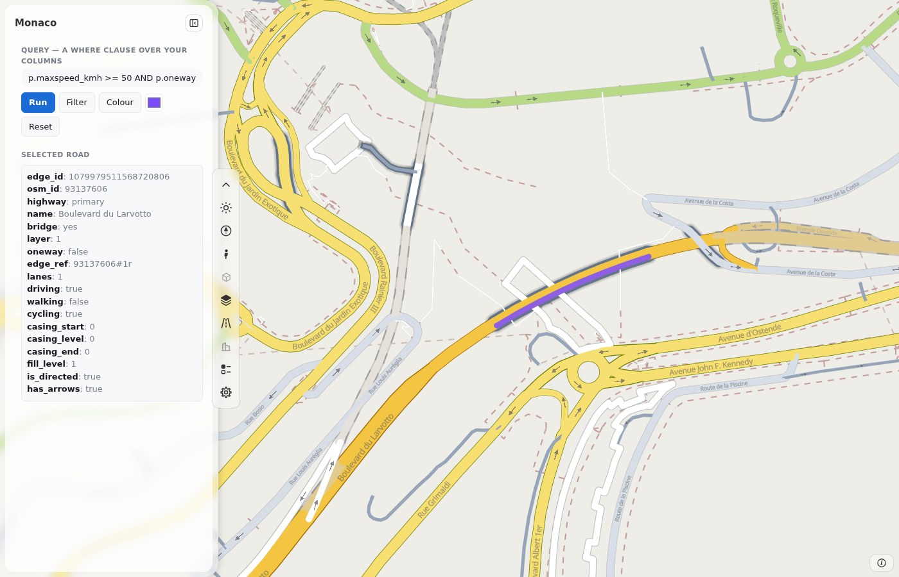
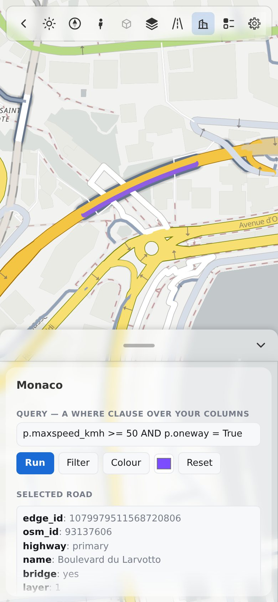
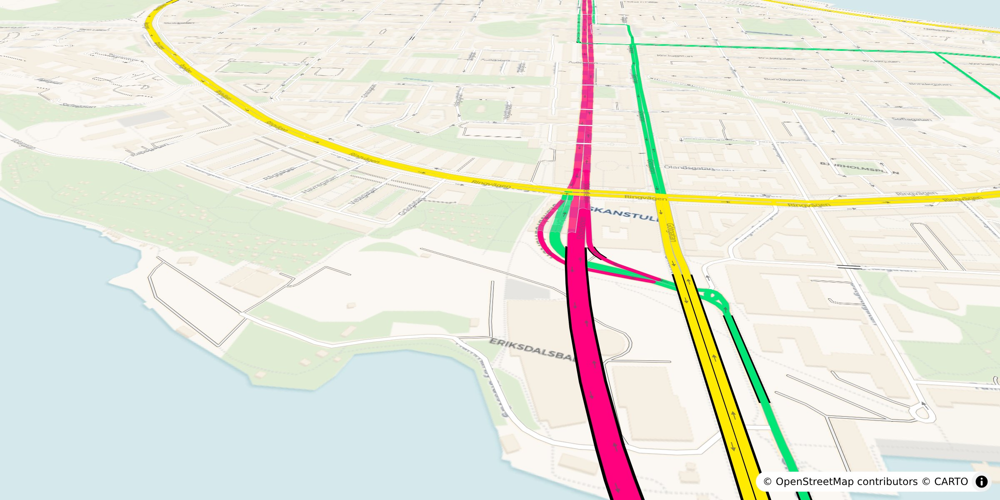

# roadstyle

<p class="lead">Turn a road network into a styled, interactive HTML map that works offline, with Google Street View and a JavaScript API.</p>

<div style="display:flex;gap:12px;align-items:flex-start;justify-content:center;margin:1rem 0">


</div>

<div class="rs-hero" markdown>

</div>

[:material-map: Open the live map](maps/live.html){ .md-button .md-button--primary }

```bash
pip install roadstyle
```

```python
import geopandas as gpd
import roadstyle as rs

edges = gpd.read_file("edges.gpkg")        # road edges with a `highway` column
rs.render_edges(edges).save("roads.html")  # one self-contained file, opens offline
```

## What you can do

<div class="grid cards" markdown>

-   :material-palette:{ .lg .middle } **Maps**

    ---

    Style the roads, colour them by your data, bridges and tunnels in the right order, your own layers, big networks.

    [:octicons-arrow-right-24: Style the roads](guides/style.md)

-   :material-google-street-view:{ .lg .middle } **Street View and 3D**

    ---

    Click a road and see it in Google Street View, Panoramax or Mapillary, or in Google's 3D view.

    [:octicons-arrow-right-24: Street View](guides/street-view.md)

-   :material-view-dashboard-outline:{ .lg .middle } **Dashboards**

    ---

    A map with a toolbox and a panel, from one Python call. Add parts to the panel, and control it from JavaScript.

    [:octicons-arrow-right-24: Dashboards](guides/dashboards.md)

-   :material-web:{ .lg .middle } **Use it elsewhere**

    ---

    Put the map on a website or in another map app, or let an AI agent make maps.

    [:octicons-arrow-right-24: On a website or in a map app](guides/website.md)

-   :material-image-multiple-outline:{ .lg .middle } **Gallery**

    ---

    Pictures of each look, and a live map to try.

    [:octicons-arrow-right-24: Gallery](gallery.md)

-   :material-language-rust:{ .lg .middle } **Rust engine**

    ---

    The engine under the Python library: in the browser, tiles and PMTiles, the command line.

    [:octicons-arrow-right-24: Rust engine](rust/index.md)

</div>

What changed in each version: [What is new](whats-new.md).

## When to use roadstyle

- **Instead of geopandas `.explore()`** when the output is a road map you care about: casings,
  per-class widths, one-way arrows, bridges over tunnels. `.explore()` draws one flat line.
- **Instead of prettymaps** when you need an interactive web map or colour by data (flow, speed).
  prettymaps makes static images.
- **Instead of kepler.gl** for road cartography. kepler.gl is a general exploration GUI; its roads
  are flat strokes with no labels or arrows.
- For a quick look at any geometry, those tools are fine; roadstyle is for roads.

## Built on

- **[MapLibre GL JS](https://maplibre.org/)** (BSD-3-Clause) draws every web map: roadstyle writes its style and
  data, and a copy of MapLibre is inlined in each saved page so it opens offline.
- **[OpenStreetMap](https://www.openstreetmap.org/copyright)** data (© OpenStreetMap contributors, ODbL) and the
  **[openstreetmap-carto](https://github.com/gravitystorm/openstreetmap-carto)** style, whose road classes,
  colours and widths roadstyle follows.
- **[HiGHS](https://highs.dev/)**, through [SciPy](https://scipy.org/), is the optional Python solver of which road is drawn on top. The default solver is in Rust.
- **[GeoPandas](https://geopandas.org/)** and **[Shapely](https://shapely.readthedocs.io/)** for the geometry.

[:material-image-multiple: Gallery](gallery.md) ·
[:material-book-open-variant: Reference](reference/parameters.md) ·
[:material-tune: Studio](studio.md) ·
[:material-github: GitHub](https://github.com/Khoshkhah/roadstyle) ·
[:material-package-variant: PyPI](https://pypi.org/project/roadstyle/) ·
[:material-history: Changelog](https://github.com/Khoshkhah/roadstyle/blob/main/CHANGELOG.md)
