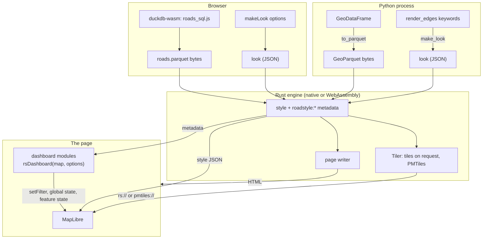
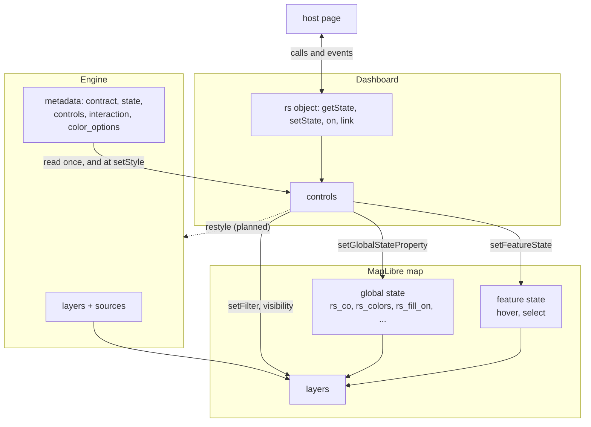
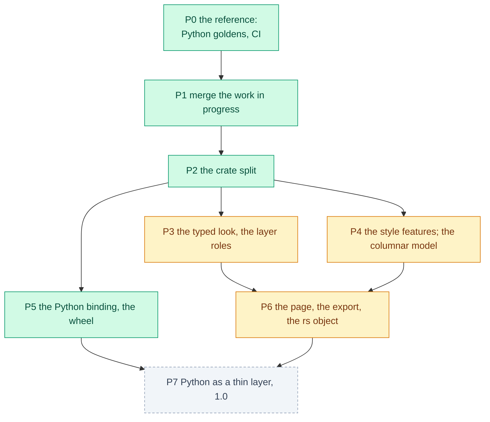

# How the engine is built

About the parts of the Rust engine, how one map goes through them, and why Python stays the reference.

Before version 0.25, the style engine had three copies: Python roadstyle, a Rust port in the GeoLibre plugin, and a Rust port of
the level solver in duckosm-rust. The copies were already different. Now there is one Rust engine in this repository, with three
front-ends: Python, the browser and Rust. The Python API did not change.

The full design, with the parts that are not built, is in [the Rust library plan](../design/rust_library.md). This page tells
only what is built on 2026-10-23.

## One map, from the roads to the page

*The engine is the same code in Python and in the browser. Only the input side differs.*

1. **The roads.** Python writes the GeoDataFrame as GeoParquet bytes. In the browser, duckdb-wasm writes them from a duckOSM file
   with `roads_sql.js`. The engine reads the geometry as WKB and the columns that the keywords name (`highway_col`, ...).
2. **The look.** `make_look` merges the palette, the profile and the settings, as `_settings.py` does, and adds the keywords that
   change the style. The bundled palettes and profiles are roadstyle's YAML files, read when the crate is built.
3. **The style.** The engine computes the levels if the roads have none, then makes the sources, the layers and the metadata.
4. **The output.** The style with the roads in it (`export_inline`), the style with tile sources and a `Tiler`, a PMTiles
   archive, or a whole page.
5. **The page.** MapLibre draws the style. The dashboard reads the metadata and adds the controls. After this step, the page does
   not need the engine, except for one road's properties on request (`engine.props`).

## The engine and the dashboard share a contract

The dashboard does not call the engine. It reads the style: the metadata keys `roadstyle:contract`, `roadstyle:state`,
`roadstyle:controls`, `roadstyle:interaction` and `roadstyle:color_options`, the layers and the road properties. It changes the
map only with MapLibre's own calls. Thus the Python page, duckosm-rust's page and the GeoLibre plugin use the same files in
`src/roadstyle/static/dashboard/`.

*The dashed arrow is planned, not built: a change that needs new data (a color column that the style does not have, another
profile) cannot go back to the engine yet. `rs.can(...)` returns false for such a change.*

The names of the contract are in [the interaction contract](../reference/contract.md). A test,
`tests/test_contract_names.py`, fails when the code has a name that the reference does not have, or the reverse.

## The crates

The workspace has a core of libraries with no file, network or browser access (`roadstyle-model`, `roadstyle-levels`,
`roadstyle-engine`, `roadstyle-tiles`), a reader (`roadstyle-io`) and the front-ends (`roadstyle-wasm`, `roadstyle-py`). The
split lets a user take only one part: duckosm-rust's level step needs only `roadstyle-levels`. The table is in
[The crates](crates.md).

## Python is the reference

The rule of the port is simple: a Rust output is correct only when it is the same as the Python output, byte for byte, or the
same when decoded for the tiles. A difference is a bug in the port, or an item in a list with its cause and a decision
([Parity and speed](parity.md#the-differences-that-stay)). Python roadstyle stays the reference until the last phase of the plan.

Each part of the engine came with its golden test, so each part was ready to ship alone. The 16 Python projects that use roadstyle did
not wait for a full rewrite, and no test had to trust the port's own idea of correct output.

## What stays in Python

| Part | Why it stays |
|---|---|
| The `render_edges` API, its keywords and `WebMap` | It is the API of 16 projects. Python reads the data, converts it to GeoParquet and calls Rust |
| The folium and lonboard backends | They are Python objects for notebooks |
| A `Styler` object (`style=`) | It is Python code that the engine cannot run |
| The readers (`load_edges`, `from_duckdb`, `from_arrow`, `from_geojson`) and the filters | Python reads every format; the engine reads GeoParquet only |
| The level areas, the level editor and the level store (`level_area.py`, `level_editor.py`, `levels_store.py`) | A local tool with an HTTP server and files. The engine has the solver with its defaults only |
| `snapshot`, the CLI, the MCP server, the studio | Tools around a page: they need Python, a browser or the network |
| The Leaflet output (`to_spec`, `to_html`, `save`) | The old output, kept as it is |
| mapstyle's part of the look | mapstyle makes its base-map part from its own data. A port is a separate decision |

## The plan: what is done and what is open

*Green: done. Yellow: partly done. Grey, dashed: open. State on 2026-10-23.*

Open parts: the typed and versioned look with a schema, the layer roles in the metadata, the columnar road model (less memory for each road), `Tiler.restyle` (the dashed arrow
above), the npm packages, the level options of `compute_levels` in Rust, and P7, in which Python stops computing what Rust
computes.
