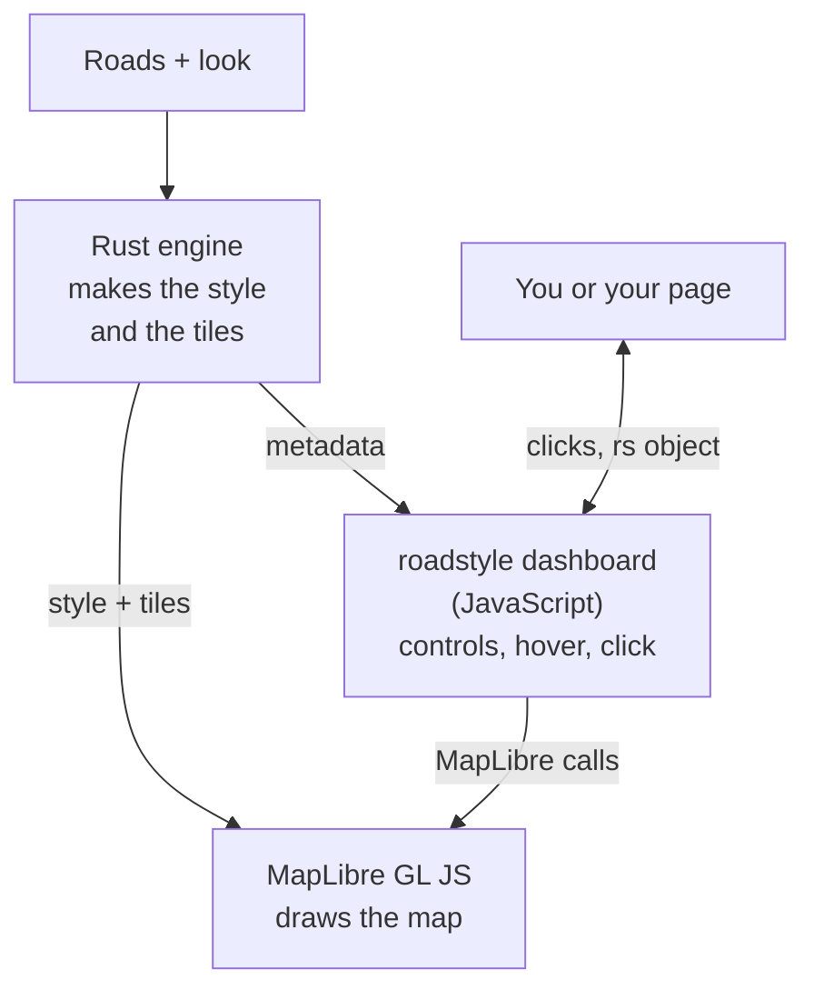
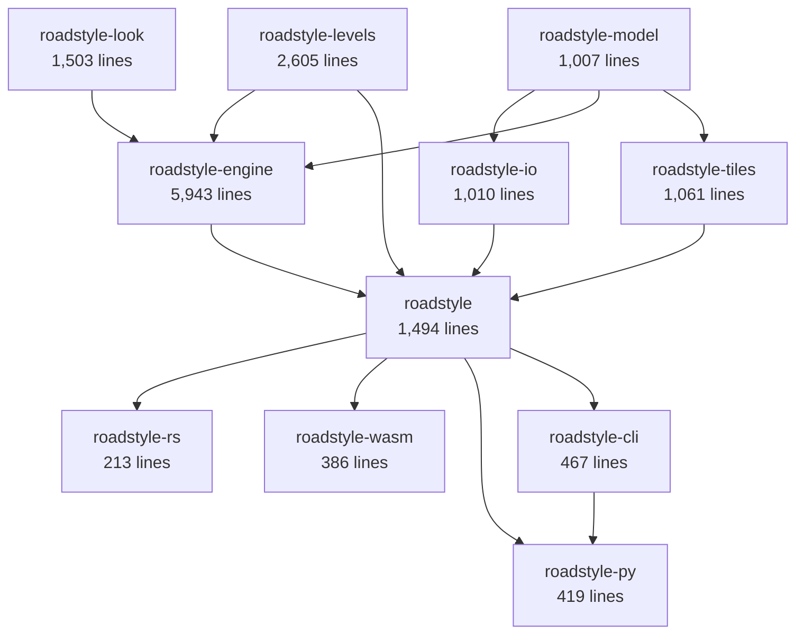
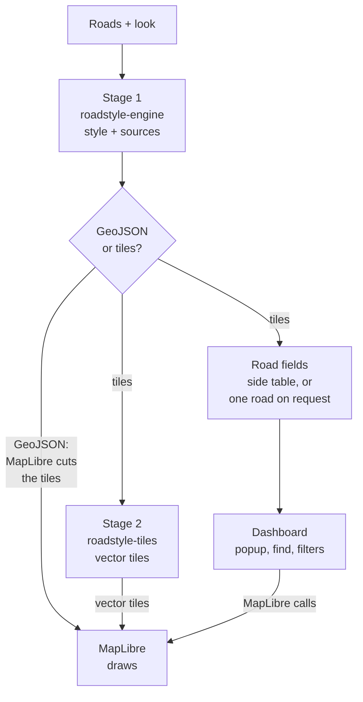
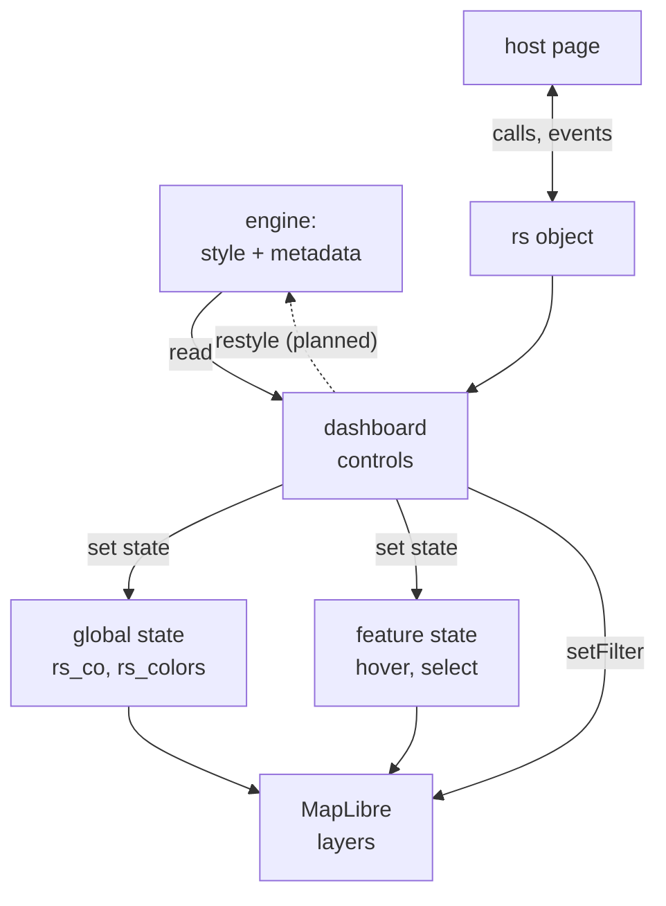
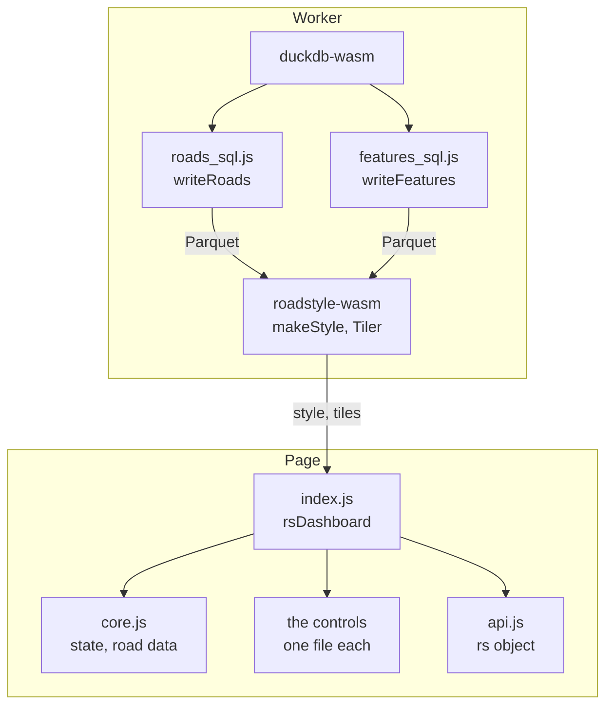
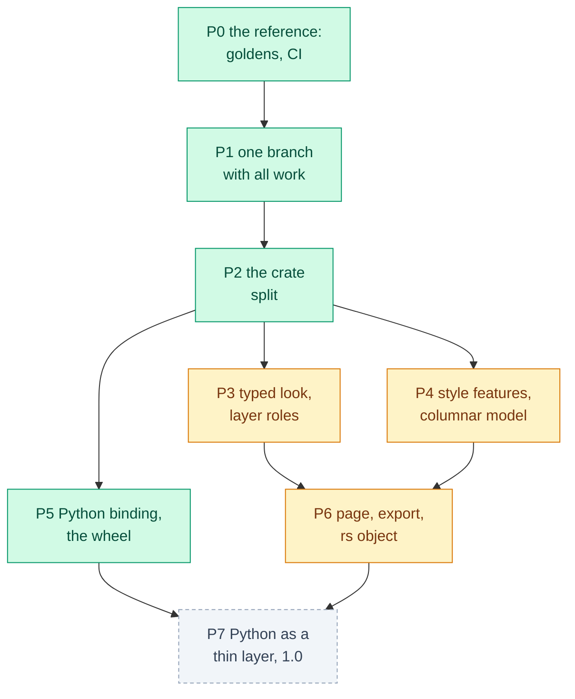

# Architecture of the Rust version

About the structure of roadstyle's Rust engine: its crates and their modules, the path of one map from the roads
to the page, and the JavaScript side.

The tables with sizes, modules, APIs, metadata keys and design gaps come from the code. `docs/gen_architecture.py` reads
`rust/*/Cargo.toml` and the source trees, and the docs build runs it, so these tables show the code that the site is built from.
Their texts are the first sentences of the code's own comments. The full design, with the parts that are not built, is in
[the Rust library plan](../design/rust_library.md).

## The big picture: the engine, JavaScript and MapLibre

A roadstyle map has three parts, and each part has one job. The Rust engine makes the data. MapLibre GL JS draws it.
roadstyle's JavaScript adds the controls and answers the mouse.

*Rust gives JSON text and bytes, and never calls JavaScript or MapLibre. MapLibre does not know roadstyle: for MapLibre the
roads are an ordinary style. The dashboard reads only the style. One call goes back to the engine: on a click, a browser page can
ask the engine for the properties of one road (`engine.props`).*

**1. The Rust engine makes the data.** From the roads and the look, it makes the pieces of the roads with their values (the
color, the casing, the place in the drawing order), and a MapLibre style with the rules that read these values (the width for each
zoom, the color, the sort order) and the `roadstyle:*` metadata for the dashboard. The pieces go into the vector tiles, one tile
at a time on request or all in one PMTiles archive, or into GeoJSON. The engine never draws
([the rules and the values](drawing.md#the-rules-are-in-the-style-the-values-are-in-the-data)).

**2. MapLibre GL JS draws.** MapLibre is the JavaScript map library in the browser. It reads the style and the tiles and draws
them with WebGL. It moves the camera, zooms and tilts the map. It asks for each tile that it needs.

**3. roadstyle's JavaScript adds the controls.** The dashboard modules (`src/roadstyle/static/dashboard/`) read the metadata and
add the Roads box, Colour by, the legend, the search, Street View and the other controls. They change the map only with
MapLibre's own calls. The `rs` object is the API of the dashboard for a host page.

The engine runs in one of two places:

| Case | Where the engine runs | What runs in the browser |
|---|---|---|
| Python: `render_edges(engine="rust")` | natively, in the Python process, before the page exists | MapLibre and the dashboard; the style is inside the HTML file |
| The browser: the WebAssembly package | in the page or in a worker. `roadstyle_wasm.js` (made by `wasm-bindgen`) lets JavaScript call `makeStyle` and `new Tiler` as normal functions | the engine, MapLibre and the dashboard. MapLibre gets each tile from `tiler.tile(z, x, y)` through `maplibregl.addProtocol("rs", ...)` |

The Python page and the browser pages use the same MapLibre version (5.24) and the same dashboard files.

## The crates

The workspace `rust/` has three kinds of crates:

- **The core:** `roadstyle-model` (the roads and their properties), `roadstyle-levels` (the drawing order), `roadstyle-engine`
  (the style) and `roadstyle-tiles` (the vector tiles and PMTiles).
- **The reader:** `roadstyle-io` reads Arrow batches (`roads_from`, `table_from`) and GeoParquet bytes (`read_roads`, `read_table`, which
  give their batches to the same decoder).
- **The front-ends:** the facade `roadstyle` for Rust users (with the page writer), `roadstyle-wasm` for the browser and
  `roadstyle-py` for Python. `roadstyle-rs` is the old name of the facade.

Each arrow points from a crate to the crate that uses it:

<!-- gen:crate-graph -->

<!-- /gen:crate-graph -->

`roadstyle-levels` has no dependency on the other crates, so a program that needs only the drawing order (duckosm-rust's level
step) takes this crate alone.

<!-- gen:crates -->
| Crate | Job | Lines | Dependencies |
|---|---|---|---|
| [`roadstyle-model`](#roadstyle-model) | roadstyle's road model: the roads as features with typed properties, and the geometry helpers | 1,007 | arrow-array, arrow-schema, rstar, serde, serde_json |
| [`roadstyle-look`](#roadstyle-look) | roadstyle's look: the typed, versioned config (palettes, profiles, settings, map options) that the engine draws a map with | 1,503 | base64, crc32fast, flate2, serde, serde_json, yaml-rust2 |
| [`roadstyle-io`](#roadstyle-io) | roadstyle's readers: the roads and other tables from GeoParquet | 1,010 | `roadstyle-model`, arrow-array, arrow-schema, arrow-select, bytes, i_overlay, parquet, serde_json |
| [`roadstyle-levels`](#roadstyle-levels) | roadstyle's drawing levels: the tags rule and the solver (no dependency on the other crates) | 2,605 | rstar, sha2 |
| [`roadstyle-engine`](#roadstyle-engine) | roadstyle's rendering engine: the style of a map, the data-driven paint, the legend data, the base-map layers | 5,943 | `roadstyle-levels`, `roadstyle-look`, `roadstyle-model`, indexmap, rstar, serde_json |
| [`roadstyle-tiles`](#roadstyle-tiles) | roadstyle's vector tiles on request (the rules of tiles.py) | 1,061 | `roadstyle-model`, flate2, indexmap, rstar, serde_json |
| [`roadstyle`](#roadstyle) | roadstyle as a Rust library: the facade over the model, the readers, the levels, the engine and the tiles | 1,494 | `roadstyle-engine`, `roadstyle-io`, `roadstyle-levels`, `roadstyle-tiles`, base64, flate2, serde_json |
| [`roadstyle-rs`](#roadstyle-rs) | The old name of the facade crate roadstyle, kept for one version | 213 | `roadstyle`, serde_json |
| [`roadstyle-wasm`](#roadstyle-wasm) | The browser's front-end of roadstyle-rs: makeStyle, Tiler, memoryBytes | 386 | `roadstyle`, serde_json, wasm-bindgen |
| [`roadstyle-py`](#roadstyle-py) | The Python binding of roadstyle's Rust engine: the module roadstyle._rust (PyO3, abi3) | 419 | `roadstyle`, `roadstyle-cli`, pyo3, serde_json |
| [`roadstyle-cli`](#roadstyle-cli) | The roadstyle program: one command for each job (serve: the level editor's files) | 467 | `roadstyle`, serde_json |

All crates: 16,108 lines of Rust in `rust/*/src/`.
<!-- /gen:crates -->

The crates read roadstyle's data (`src/roadstyle/data/`: the palettes, the profiles, the sprite) and the page files
(`src/roadstyle/static/`) when they are built, so both engines use one copy of these files. All crates have the version 0.0.1
and are not on crates.io. To read their API documentation, run `cargo doc --no-deps --open` in `rust/`.

### The interface between the crates and their users

The roads go in as Arrow batches (the geometry as WKB in EPSG:4326). Python gives an Arrow table (any object with
`__arrow_c_stream__`; the binding reads it through the Arrow C stream interface), and bytes are a `TypeError`. The CLI and the browser
give the bytes of a GeoParquet file. The look goes in as a typed `Look`
(`roadstyle-look`): the palette, the profile, the settings and the keywords of `render_edges`, merged one time by `Look::resolve`, or a
saved look read by `Look::from_json` (version 1, or version 0: the `look.json` of 0.25.0). The style comes out as JSON
text, with the metadata for the dashboard. Errors are text: `Result<_, String>` in Rust, a thrown `Error` in JavaScript, a
`ValueError` in Python.

## The modules of each crate

The column "Python counterpart" names the module of the Python engine that does the same job. The golden tests compare the two.

<!-- gen:modules -->
#### `roadstyle-model` { #roadstyle-model }

Library, in `rust/roadstyle-model/`. Public API: `geom`, `props`, `table`, `topology`, `Row`, `obj`, `Cell`, `Lines`, `RoadTable`.

| Module | Lines | What it does | Python counterpart |
|---|---|---|---|
| `lib` | 27 | roadstyle's road model: the roads as columns (`RoadTable`, module `table`), the typed properties of the engine's features (`props`), the geometry helpers (`geom`), and `Row`, a row of another table |  |
| `geom` | 264 | Geometry from WKB for the base map: GeoJSON, and the area and the centroid as shapely (GEOS) computes them |  |
| `props` | 308 | The properties of a road or a piece, and the typed features of the sources `roads` and `simple` |  |
| `table` | 343 | The roads as columns: `RoadTable` keeps each column of the input as one Arrow array and every line in one coordinate buffer, not a map of JSON values for each road |  |
| `topology` | 65 | The roads' topology, made one time for all the stages (audit R4): a node for each end of a road, the number of road ends at each node, and one R-tree of the roads' boxes |  |

#### `roadstyle-look` { #roadstyle-look }

Library, in `rust/roadstyle-look/`. Public API: `basemap`, `widths`, `VERSION`, `LookData`, `Look`, `RoadLook`, `SlotLook`, `DeckLook`, `Ramp`, `make_look`, `theme`, `Options`, `py_round`, `RoadModel`, `png_pixels`.

| Module | Lines | What it does | Python counterpart |
|---|---|---|---|
| `lib` | 251 | roadstyle's look: the one typed, versioned value that the engine draws a map with | `_settings.py` |
| `basemap` | 358 | The base map's half of the look (mapstyle's styles, merged into roadstyle on 2026-10-23): a duckOSM map's travel mode, its theme and its path style give the roads' palette and settings (mapstyle's `mode_settings`) and the base map's part of the look (`features`: the layers of layers.yaml, the 3D heights, the base map's style in the theme's colours and its images) | `style.py` |
| `png` | 95 | The PNG images of the look: a texture's mask (8-bit grey) read, and a texture in its colour (8-bit RGBA) written |  |
| `ramp` | 117 | The colour ramps of data colours (render_edges' cmap): ports of roadstyle's colors.py ColorRamp over branca's LinearColormap | `colors.py` |
| `resolve` | 500 | The resolution of the look (look.json): what roadstyle renders a map with, made from render_edges' palette, profile and settings, as Python makes it | `_settings.py`, `style.py` |
| `widths` | 182 | The road width model (render_web's _load_road_model: the look's "roads_model" and the theme's roads): the width of each class by zoom, its draw order and its two-way split | `render_web.py` |
| `cmaps.json` | (data) | data read when the crate is built |  |

#### `roadstyle-io` { #roadstyle-io }

Library, in `rust/roadstyle-io/`. Public API: `columns`, `duckosm`, `geojson`, `read`, `write`.

| Module | Lines | What it does | Python counterpart |
|---|---|---|---|
| `lib` | 12 | roadstyle's readers and writers: the roads and other tables from GeoParquet (`read`), the roads from GeoJSON (`geojson`), the SQL that reads a duckOSM file (`duckosm`), a table or a source's features as Parquet or GeoParquet (`write`, stage 1's files), and a table of typed columns (`columns`) |  |
| `columns` | 89 | A table of typed columns as GeoParquet (a level area's roads.parquet): text, whole numbers, numbers, booleans, lists of them, and the WKB column `geometry` |  |
| `duckosm` | 265 | The SQL that reads a duckOSM file: the roads of every mode (mapstyle's `_roads_union` and `load_roads`, with the stored levels and the columns that render_map adds) and the base map's tables (`features.*`, the queries of mapstyle's `load_layers`) |  |
| `geojson` | 118 | The roads from a GeoJSON file (RFC 7946: a FeatureCollection in EPSG:4326) |  |
| `read` | 222 | The roads from a GeoParquet file: every column an Arrow array of the table (as GeoPandas' GeoJSON writes its values), the geometry a LineString from WKB |  |
| `write` | 304 | The writers: a table of rows (the road table, or a source's features) as Parquet; with a geometry column, GeoParquet (WKB in `geometry`, the `geo` metadata of GeoParquet 1.1) |  |

#### `roadstyle-levels` { #roadstyle-levels }

Library, in `rust/roadstyle-levels/`. Public API: `area`, `flow`, `solve`, `Pt`, `ROADSTYLE_VERSION`, `Method`, `LevelEdge`, `LevelEdges`, `Row`, `Levels`, `Order`, `Edit`, `Options`, `levels`, `InputRoad`, `AreaInput`, `make`, `edge_hash`.

| Module | Lines | What it does | Python counterpart |
|---|---|---|---|
| `lib` | 631 | The drawing order of the roads, `visualization.edge_levels` and `edge_levels_meta`: roadstyle's `compute_levels`, with `method="tags"` (a rule on the tags, the default) or `method="solve"` (its optimization, with the defaults of duckOSM's `duckosm levels` and no edits) |  |
| `area` | 572 | A level area as the level editor has it: its roads (both directions of a segment are one road), the pairs that the input found (pairs.csv) and your edits (edits.csv) | `level_area.py`, `level_editor.py` |
| `flow` | 297 | A minimum-cost flow with whole numbers: the primal-dual algorithm (Dijkstra on the reduced costs, then a maximum flow on the arcs of reduced cost 0) |  |
| `input` | 695 | The solver's input from the edges: the roads, their bands and priorities, and their relations |  |
| `solve` | 410 | The numbers of the roads from their rules: the stages as minimum-cost flows |  |

#### `roadstyle-engine` { #roadstyle-engine }

Library, in `rust/roadstyle-engine/`. Public API: `colors`, `contract`, `decks`, `draw`, `export_look`, `features`, `layers`, `overlays`, `palettes`, `planner`, `road`, `roads`, `simple`, `slots`, `sources`, `MAX_ROADS`, `Src`, `Parts`, `make_parts`, `restyle`, `make_style`, `take_roads`, `level_edges`, `geom`, `props`, `table`, `Cell`, `RoadTable`, `Row`, `Road`, `Roads`, `look`, `Look`.

| Module | Lines | What it does | Python counterpart |
|---|---|---|---|
| `lib` | 482 | roadstyle's rendering engine: the style of a map from the roads, the look, the data-driven paint, the legend data and the base-map layers |  |
| `colors` | 322 | Data-driven colour and width: render_edges' color_by, colors, cmap, vmin, vmax, width_by, color_table, color_key, color_options, color_active and legend, read from look["args"] | `stylers.py`, `render_web.py`, `colors.py` |
| `contract` | 157 | The output side of the interaction contract: what a page's dashboard reads from a style made with `state: "live"` | `render_web.py` |
| `decks` | 291 | render_web._bridge_decks: the bridges as ramped deck ribbons for the 3D view (the fill-extrusion source `decks`) | `render_web.py` |
| `draw` | 221 | The drawing values of each road: what the stages of render_web.render bake as `__rs_*` properties, as typed fields | `render_web.py` |
| `export_look` | 157 | export_look: the simple look for a data layer that another app draws (the GeoLibre plugin): MapLibre layers with no source that read the raw duckOSM columns, one casing and one fill layer per position, the arrows and the names, the hover layer, the popup, the outline of the area |  |
| `features` | 110 | The base-map layers' features: mapstyle.map.load_layers from the rows the worker's SQL writes (features.parquet: one row per feature with its layer, osm_id, kind, name, bearing, the height tags and the WKB), as `{layer: FeatureCollection}` in draw order | mapstyle's `map.py` |
| `layers` | 1,211 | The road layers: the expression builders of roadstyle's render_web, over the road tables of `_load_road_model` (look.json "roads_model" and "theme") | `render_web.py` |
| `overlays` | 509 | The overlays: the base map's and the caller's own (render's `overlays=`, `user_overlays`), then roadstyle's _edge_overlay and _overlay_layers: the overlay sources and their layers before the placement and the passes (layers.rs) | mapstyle's `map.py` |
| `palettes` | 260 | A view's palette in one page | `render_web.py` |
| `planner` | 148 | The route planner's data: mapstyle.map.planner_data and _planner_ends, from the roads (in load_roads' order) and the tables the worker's SQL writes (planner.parquet: a `part` column, in the order Python reads them) | mapstyle's `map.py` |
| `road` | 231 | The roads that the stages draw: the input table (roadstyle-model's `RoadTable`) and the drawing values of each road (`Draw`), whose properties are the `__rs_*` marks and `lvl` in the order that the stages set them (render_web.render's order) | `render_web.py` |
| `roads` | 414 | The "roads" source: the stages of roadstyle's render_web.render that bake the `__rs_*` properties of each road, in the same order | `render_web.py` |
| `simple` | 795 | The "simple" source: simple mode's one road layer, every casing piece and every fill (render_web._casing_parts, _halves, _end_stub, _simple_pieces), from the roads after their stages (roads::mark_roads) | `render_web.py` |
| `slots` | 441 | The "slots" source: the names and the one-way arrows (render_web._annotation_slots, then the export's `__rs_arw` and _mark_cls), from the roads after their stages (roads::mark_roads) | `render_web.py` |
| `sources` | 194 | Stage 1: the roads and the look give the style and its sources, typed in memory: the drawing sources (the roads' lines with their drawing values, the pieces, the names and arrows, the 3D decks, the base map, ...) and the road table (every field of each road, by its row) |  |

#### `roadstyle-tiles` { #roadstyle-tiles }

Library, in `rust/roadstyle-tiles/`. Public API: `pmtiles`, `stage`, `EXTENT`, `SOURCE`, `Val`, `Tiles`, `TileValue`.

| Module | Lines | What it does | Python counterpart |
|---|---|---|---|
| `lib` | 808 | The style's sources as vector tiles (Mapbox Vector Tile 2.1), made when the map asks for them, with the rules of roadstyle's tiles.py: the page gives MapLibre one source, `{"type": "vector", "tiles": ["<prefix>roads/{z}/{x}/{y}"]}`, and each of the style's sources is a layer in its tiles (the layers' `source-layer`) | `tiles.py` |
| `pmtiles` | 182 | A PMTiles v3 archive (the format of the `pmtiles` package's Writer, which tiles.py and the export use): the tiles gzipped, each content once (a run of one content on consecutive tile ids is one entry), the directory in one root (or a root of leaves when it is more than 16 KB), the metadata as gzipped JSON | `tiles.py` |
| `stage` | 71 | Stage 2's rules: which properties of each source go into the tiles, from which zoom, with which zooms and buffer | `tiles.py` |

#### `roadstyle` { #roadstyle }

Library, in `rust/roadstyle/`. Public API: `level_area`, `level_editor`, `page`, `read_features`, `make_style`, `make_sources`, `sources_of`, `tile_stage`, `tiled_style`, `xyz_at`, `tile_files`, `tile_files_with`, `Format`, `ROAD_TABLE`, `file_names`, `source_file`, `write_source_file`, `write_road_table`, `save_sources`, `tile_made`, `make_tiled`, `roadstyle_engine::*`, `duckosm`, `geojson`, `read`, `levels`, `tiles`.

| Module | Lines | What it does | Python counterpart |
|---|---|---|---|
| `lib` | 369 | roadstyle as a Rust library: the facade |  |
| `level_area` | 295 | A level area's input in Rust (roadstyle's level_area.make_area and level_input, `roadstyle-levels make`): from the edges, the folder's roads.parquet (one row for each road: its edges both ways, its band and priority, the fields the editor shows, each edge's own oneway, driving, directed, edge_ref, lanes and modes, the first edge's line), pairs.csv (the rules between the roads) and an empty edits.csv the first time | `level_area.py` |
| `level_editor` | 545 | The level editor in a page: an area folder's roads (roads.parquet, one row for each road with its edges both ways) and pairs, the solver of roadstyle-levels' `area`, and what the page draws and shows | `level_editor.py` |
| `page` | 285 | The page writer: the HTML page of a live style (state "live") and the options of its dashboard (`page`: the options of rsDashboard, as render_web.render's `page`) | `render_web.py` |

#### `roadstyle-rs` { #roadstyle-rs }

Library and program, in `rust/roadstyle-rs/`. Public API: `roadstyle::*`.

| Module | Lines | What it does | Python counterpart |
|---|---|---|---|
| `lib` | 4 | The old name of the facade crate `roadstyle`, kept for one version so that the users who pin `roadstyle-rs` (duckosm-rust's page, the GeoLibre plugin) build with no change |  |
| `main` | 209 | The native front-end of roadstyle-rs: the style, natively, with the time of each step |  |

#### `roadstyle-wasm` { #roadstyle-wasm }

Cdylib, in `rust/roadstyle-wasm/`. Public API: `Look`, `fromJson`, `toJson`, `resolveLook`, `makeLook`, `rampStops`, `makeStyle`, `solveLocal`, `startFrom`, `levelsCsv`, `makePage`, `exportLook`, `fileNames`, `roadTable`, `makeSources`, `duckosmPlan`, `duckosmLevels`, `duckosmFeaturesSelect`, `readGeoJson`, `tileSources`, `tileFiles`, `memoryBytes`, `LevelArea`, `Tiler`, `Sources`, `Roads`.

| Module | Lines | What it does | Python counterpart |
|---|---|---|---|
| `lib` | 386 | The browser's front-end of roadstyle-rs: `Look`, `makeStyle`, `makePage`, `Tiler` and `memoryBytes` through wasm-bindgen, and the allocator that grows the memory in large steps |  |

#### `roadstyle-py` { #roadstyle-py }

Cdylib, in `rust/roadstyle-py/`. Public API: `resolve_look`, `make_style`, `make_sources`, `tile_files`, `solve_rules`, `make_page`, `export_look`, `duckosm_catalog_sql`, `duckosm_plan`, `duckosm_levels`, `duckosm_features_select`, `serve`, `take_warnings`, `PyLook`, `Tiler`, `Sources`.

| Module | Lines | What it does | Python counterpart |
|---|---|---|---|
| `lib` | 419 | The Python binding of roadstyle's Rust engine: the module `roadstyle._rust` | `_engine.py` |

#### `roadstyle-cli` { #roadstyle-cli }

Library and program, in `rust/roadstyle-cli/`. Public API: `commands`, `WRITABLE`, `MAX_BODY`, `Page`, `serve`.

| Module | Lines | What it does | Python counterpart |
|---|---|---|---|
| `lib` | 239 | The roadstyle program: one command for each job |  |
| `commands` | 219 | The commands of the roadstyle program (main.rs runs `run`): stage 1 (`sources`), stage 2 (`tiles`), a level area (`levels make`, `levels solve`) and the level editor (`serve`) |  |
| `main` | 9 | `roadstyle <command>`: the roadstyle program (`roadstyle help` lists the commands: lib.rs, commands.rs) |  |
<!-- /gen:modules -->

## The three stages and the one call

The engine has three stages. Each stage is one crate, and each stage knows nothing of the next one. The facade `roadstyle` (in
Python, `render_edges`) is the one call that runs them in order.

*A map uses one of the two forms, never both. With **GeoJSON** (the default page), stage 1's sources go to MapLibre with all
the road fields in them, and MapLibre cuts the tiles in the browser. With **vector tiles** (ways A, B and C), stage 2 cuts them
first.*

The road fields (the name, the class, your columns) are a separate, small input for the interaction: the popup, the search and
the filters. Drawing does not need them. In the tiles they repeat in each tile and at each zoom: on Tartu, the 26 road fields make
the 9 tiles of one zoom-12 view 17.9 MB in place of 16.2 MB. Thus each tiled way gives the fields in its own way:

| Form | The fields in the drawing data | The fields for the dashboard |
|---|---|---|
| GeoJSON (the default) | in the source `roads`: one feature for each road, with its line and all its fields. The pieces in `simple` hold only `__rs_edge`, the road's row | from the source `roads` |
| A. Tiles in one HTML file | none | the side table (`window.RS_SIDE`), loaded one time with the page: the popup, the search and the filters work |
| B. Tiles on a server | every column, because a map app has no side table | from the tiles, for the app's own popup |
| C. Tiles made in the browser | only the columns of `keep` | one road on request (`engine.props`): the popup works, but `rs.find` and `rs.query` find nothing, because the page does not have all the fields |

**Planned: one road table for every form.** Today GeoJSON and tiles keep the fields in two different ways. In the design phase,
stage 1 gives two outputs: the drawing sources (the pieces, the slots, the decks), with only the drawing values and the road's
row, and **one road table** with the fields of each road, keyed by its row. Stage 2 cuts only the drawing sources into tiles. The
page or the worker gives the dashboard the road table, whole (as the side table does now) or one road at a time (as
`engine.props` does now). Way B can keep every column in its tiles, as an option of stage 2, for map apps. The row "One road
table" of [Known design gaps](#known-design-gaps) shows when this is built. A proposal on top of it: keep the data in a DuckDB
file on a server, and serve the tiles and the roads on request ([the design note](../design/duckdb_server.md)).

The one call (the facade, `render_edges`) runs the stages in order. Stage 3 puts the style and the data of the selected form into
one HTML file.

| Stage | Crate | Input → output | Public call today |
|---|---|---|---|
| 1. The style and the sources | `roadstyle-engine` | the roads (GeoParquet) and the look → the style, its sources (the pieces of the roads) and the `roadstyle:*` metadata | Rust `make_style`, `make_parts`; Python `export_inline(engine="rust")`; the browser `makeStyle` |
| 2. The tiles | `roadstyle-tiles` | the sources → vector tiles on request, or one PMTiles archive | Rust `Tiles`; in Python and in the browser only with stage 1 (`export_style`, `tiles=True`, `new Tiler`) |
| 3. The page | `roadstyle::page` | the style, the data and the options of the dashboard → one HTML file | Rust `page::make_page`; the browser `makePage`; Python through `render_edges` |
| The one call | `roadstyle` (facade) | the roads and the look → the output of the way you ask for | Rust `make_tiled`; Python `render_edges`, `export_style`; the browser `new Tiler` |

Where the inputs come from: the roads are an Arrow table that Python makes (`_engine._arrow`: GeoPandas' `to_arrow`; `duckosm.read`:
DuckDB's `arrow()`), or GeoParquet bytes that the browser worker writes from a duckOSM file (`writeRoads`). The look comes from `Look::resolve` (the browser: `resolveLook`; Python: `_rust.resolve_look`), and each binding keeps it as a handle. In Python the
stages run natively; in the browser they run in the page or in a worker, and the page only draws. Then the dashboard reads the
metadata and adds the controls, and the `rs` object is the API for a host page.

**What the design phase adds** (step (f) of the roadstyle-rs session; the last rows of [Known design gaps](#known-design-gaps)):

- **A public call for each stage alone**, in Rust, Python and the browser.
- **The output of stage 1 as the input of stage 2.** Stage 1 returns its output in memory, as typed values. You can save it as a file,
  and stage 2 takes it from memory or reads it from a file. The one call passes it in memory, with no file.
- **Two file formats between stage 1 and stage 2:** GeoJSON, which MapLibre reads directly and people can read, and GeoParquet, a binary format
  for large areas (much smaller than Tartu's GeoJSON text of about 150 MB) that DuckDB also reads directly.
- **The road table as its own Parquet file**, next to the pieces, not inside the GeoJSON.

The metadata keys between the engine and the dashboard, and the modules that write or read them:

<!-- gen:metadata -->
| Metadata key | Written or read by |
|---|---|
| `roadstyle:arrows` | `roadstyle-engine::contract`, `roadstyle-engine::lib`, `roadstyle-engine::sources` |
| `roadstyle:color_options` | `roadstyle-engine::lib` |
| `roadstyle:columns` | `roadstyle::lib`, `roadstyle-engine::sources`, `roadstyle-tiles::stage` |
| `roadstyle:contract` | `roadstyle-engine::contract`, `roadstyle-engine::lib`, `roadstyle-engine::sources` |
| `roadstyle:controls` | `roadstyle-engine::contract`, `roadstyle-engine::lib` |
| `roadstyle:group` | `roadstyle-engine::layers`, `roadstyle-engine::lib` |
| `roadstyle:images` | `roadstyle-engine::lib`, `roadstyle-look::basemap` |
| `roadstyle:interaction` | `roadstyle-engine::lib`, `roadstyle-model::props`, `roadstyle-tiles::stage` |
| `roadstyle:json` | `roadstyle::lib`, `roadstyle-io::read`, `roadstyle-io::write` |
| `roadstyle:live` | `roadstyle-engine::layers`, `roadstyle-engine::lib` |
| `roadstyle:over` | `roadstyle-engine::layers` |
| `roadstyle:planner` | `roadstyle-engine::lib`, `roadstyle-engine::planner` |
| `roadstyle:planner_skipped` | `roadstyle-engine::lib`, `roadstyle-engine::planner` |
| `roadstyle:position` | `roadstyle-engine::export_look` |
| `roadstyle:sources` | `roadstyle-engine::contract`, `roadstyle-engine::lib`, `roadstyle-engine::sources` |
| `roadstyle:state` | `roadstyle-engine::contract`, `roadstyle-engine::lib` |
| `roadstyle:tiles` | `roadstyle::lib`, `roadstyle-engine::sources`, `roadstyle-tiles::stage` |
<!-- /gen:metadata -->

## The engine and the dashboard share a contract

The dashboard does not call the engine. It reads the style's metadata, its layers and the road properties, and it changes the
map only with MapLibre's own calls. Thus every page (the Python page, duckosm-rust's page, the GeoLibre plugin) uses the same
files. The names are in [the interaction contract](../reference/contract.md), and `tests/test_contract_names.py` checks them
against the code.

*The dashed arrow is planned, not built. A change that needs new data (a color column that the style does not have, another
profile) cannot go back to the engine, and `rs.can(...)` returns false for it.*

## The JavaScript side

*The dashboard modules are ES modules. The Python page puts them in the page as one plain script (`render_web._DASH_FILES`), so a
saved page still works offline.*

<!-- gen:js -->
**The dashboard modules** (`src/roadstyle/static/dashboard/`):

| File | Lines | What it does | Window API |
|---|---|---|---|
| `api.js` | 143 | the runtime API of the interaction contract: one object for a host page, over the window.rs* functions of the controls |  |
| `arrows.js` | 155 | oneway direction-arrow icon (openstreetmap-carto) |  |
| `basemap.js` | 46 | base-layer switching: window.rsSetBasemap(key|index) is the API (swaps the raster source's tiles; the road layers stay put); the dropdown is just UI over it and stays in sync | `RS_BASEMAPS`, `rsSetBasemap` |
| `color.js` | 89 | "colour by" recolouring: each option's fill is baked per edge (__rs_fill / __rs_fill__1 …), and the road layers' expressions (made in Python, render_web._fill_expr) pick the active option from the state rs_co | `RS_COLOR_OPTIONS`, `rsColor`, `rsColorBase`, `rsSetColorField`, `rsSetRoadFill` |
| `core.js` | 182 | roadstyle's map dashboard: the state that every control reads, the road data, and the id-set queries | `rsFocus`, `rsGetProps`, `rsHighlight`, `rsQuery` |
| `filter.js` | 150 | road-class filtering: window.rsSetClasses([...]) shows exactly those classes and hides the rest across every road layer; the collapsible checkbox panel is just UI over it | `RS_ACCESS`, `RS_CLASSES`, `RS_CLASS_COL`, `RS_CLASS_COLORS`, `rsFilter`, `rsGetAccess`, `rsSetAccess`, `rsSetBridges`, `rsSetClasses`, `rsSetTunnels` |
| `find.js` | 54 | FIND: substring over the curated popup fields (or every public prop) — matched against each field's VALUE, or its column NAME when the field is set, so "bridge" finds bridge=yes roads (no value literally contains "bridge"), likewise tunnel/oneway | `rsFind` |
| `float.js` | 51 | shared by the Street View and Google 3D windows |  |
| `google3d.js` | 136 | GOOGLE 3D window (google_3d=True, with a key): Google's photorealistic 3D view in a floating window, opened by its map button (or rsSetGoogle3D(true)) | `rsSetGoogle3D` |
| `index.js` | 94 | roadstyle's map dashboard, the entry: rsDashboard(map, options) adds the map controls and the road interaction of roadstyle's page to a MapLibre map |  |
| `legend.js` | 36 | the legend of the active "colour by" option: COLOR_OPTIONS[i].legend, {title, kind: "categorical", entries: [[label, colour], ...]} or {title, kind: "continuous", ramp: [colour, ...], vmin, vmax} (stylers.bake_color_options) |  |
| `live.js` | 67 | LIVE DATA (R22): rs.setData(table, options) joins a table to the roads, by edge_id or by the row, and gives each road its colour and its width factor as feature state on its row (the names of the style's metadata roadstyle:live: rs_c and rs_w), which the road layer reads |  |
| `overlays.js` | 127 | extra overlay layers (zones / POIs / lines): click an interactive overlay -> popup of its fields; a Layers control toggles each overlay's visibility | `RS_OVERLAYS`, `rsSetOverlay` |
| `panel.js` | 68 | panel mode: a full-height side panel hosts the map controls (colour-by, road filter, legend, host tools) and the selected road's record | `rsPanelShow` |
| `select.js` | 176 | hover + click-to-select + info popup (feature-state, tolerance box, throttled to one query/frame) | `rsDeselect`, `rsSelect` |
| `streetview.js` | 118 | Street View window (street_view="window"): hidden until the map button (or rsSetStreetView(true)) opens it; then a draggable, resizable window over the map that follows every road selection | `rsSetStreetView` |
| `svspot.js` | 188 | GOOGLE STREET VIEW of the clicked edge (the window, the side-by-side page, or a plain link), looking the way the edge runs | `rsGetStreetViewSpot`, `rsSetStreetViewMarker`, `rsSetStreetViewMarkerAt`, `rsStreetViewStep` |
| `tunnel.js` | 63 | the tunnel look, v2's slider: TUNNEL.strength 0-100 moves a tunnel's colours toward TUNNEL.to.fill | `RS_TUNNEL_PALETTES`, `RS_TUNNEL_TOWARDS`, `rsSetTunnelStyle` |
| `view3d.js` | 21 | 2D/3D camera: window.rsSetView3D(on) tilts to the configured camera.pitch_3d (2D also squares the bearing back to north); the toggle button is UI over it and follows any pitch change — its label shows the view it will switch TO | `rsSetView3D` |
| `views.js` | 45 | views: a name and a set of settings, applied together through the functions above; a view sets only what it names | `RS_VIEWS`, `rsSetView` |
| `zoom.js` | 7 | zoom read-out next to the scale bar (zoom_readout=False leaves it out) |  |

**The worker SQL** (`rust/roadstyle-wasm/js/`):

| File | Lines | Exports |
|---|---|---|
| `features_sql.js` | 46 | `writeFeatures(q, catalog, specs)` |
| `roads_sql.js` | 97 | `makeRoads(q, catalog, opts = {})`, `writeRoads(q, mode = "all")` |

**The WebAssembly API** (`rust/roadstyle-wasm/src/lib.rs`):

| Call | Its doc comment |
|---|---|
| `Look` | A resolved look (roadstyle-look), parsed one time: `resolveLook(options)` makes it, `Look.fromJson(text)` reads a saved look (version 1, or version 0: today's look.json), `toJson()` gives its text (version 1). The calls below take it, not its text. |
| `fromJson` | Look.fromJson(text): a saved look (version 1 or 0). An error is a thrown Error. |
| `toJson` | toJson(): the look's text (version 1). |
| `resolveLook` | resolveLook(options: string) -> Look: the look of render_edges' palette, profile and settings; options: {"palette", "profile", "settings", "args", "features", "files"} as JSON text. An error is a thrown Error. |
| `makeLook` | makeLook(options: string) -> Look: the old name of resolveLook, for one version. |
| `rampStops` | rampStops(cmap: string, n: number) -> string[]: `n` colours ("#rrggbb") at even steps along a ramp (render_edges' cmap: a branca scheme or a matplotlib colormap name, or the JSON text of a list of colours), from the first colour to the last (at least 2), as roadstyle's ColorRamp.stops: for example a colour for each category of a column. An error is a thrown Error. |
| `makeStyle` | makeStyle(roads: Uint8Array, look: Look, features?: Uint8Array, planner?: Uint8Array, name?: string) -> string; an error is a thrown Error. |
| `solveLocal` | The solve after a change that names the roads of `changed` (edge ids): the roads around it, else the whole area. |
| `startFrom` | The answer to start from (levels.csv, levels_info.json): 4 numbers for each road; the given-up parts as "upper\|lower\|part". |
| `levelsCsv` | levels.csv: one row for each edge with its four numbers and its ends as drawn (4 numbers for each road). |
| `makePage` | makePage(style: string, page: string, parts: string, pmtiles?: Uint8Array) -> string: the page of a live style (state "live") with the dashboard's options (roadstyle::page; MapLibre stays a placeholder). |
| `exportLook` | exportLook(look: Look, cols: string[] (highway, oneway, tunnel, bridge, id), positions: number[]) -> string: the simple look for another app's data layer (roadstyle's export_look) from a resolved look. |
| `fileNames` | fileNames(format): the names of stage 1's files (style.json, a file for each source, road_table.parquet). |
| `roadTable` | roadTable(): the road table as the page loads it, JSON text (props, mids, bboxes, lines: one item for each road). |
| `makeSources` | makeSources(parquet, look, features, planner, name): stage 1, with makeStyle's arguments. |
| `duckosmPlan` | duckosmPlan(catalog, mode, tags, specs) -> string: the SQL that reads a duckOSM file (roadstyle-io's duckosm.rs, the one copy that Python runs too), as JSON text: {"catalog": the 2 queries of the catalog, "roads": 3 statements, "meta": the stored levels' query or null, "select": the roads of `mode`, "layers": [{spec, name, sql: the queries in order}]}. `catalog`: the JSON text of {"name", "tables": [[schema, table]], "columns": [[schema, table, column]]} (with no tables: only "catalog" is in the answer); `specs`: layers.yaml's layers as JSON text. |
| `duckosmLevels` | duckosmLevels(source?, nEdges?, edgeHash?) -> string: the look's keyword `levels` (JSON text) from the stored levels' metadata row (none: the file has no such row); an error says what to do. |
| `duckosmFeaturesSelect` | duckosmFeaturesSelect(specs: number[]) -> string \| undefined: the base map's rows from the tables f<spec> that were made. |
| `readGeoJson` | readGeoJson(bytes: Uint8Array) -> Roads: the roads of a GeoJSON file (a FeatureCollection in EPSG:4326; roadstyle-io's geojson.rs says how each property becomes a column). An error is a thrown Error. |
| `tileSources` | tileSources(sources, prefix, keep): stage 2 from memory (the typed pieces, no GeoJSON text; the sources stay as they are). The Tiler's style has the one vector source `<prefix>roads/{z}/{x}/{y}`, with the pieces' promoteId (roadstyle::tile_stage). |
| `tileFiles` | tileFiles(files, prefix, keep): stage 2 from stage 1's files (GeoJSON or GeoParquet, as style.json names them); the Tiler's style is the saved style with the one vector source (roadstyle::tiled_style). |
| `memoryBytes` | The size of the module's memory, in bytes. |
| `new Tiler` | A map with vector tiles: `new Tiler(roads, look, features?, name?, prefix, keep)`, then `style()` (the style's JSON text) and `tile(source, z, x, y)` (a vector tile, empty when nothing is in it) for each request of the map, and `props(layer, id)` (the tile layer, for example `roads`). |
| `tiler.check` | The check before rules are added (rows: CSV text with a header): [[index, why, [rule rows]]]. |
| `tiler.facts` | What the panel shows of each road, a list in the roads' order. |
| `tiler.ends` | Each road end as drawn, a list in the roads' order: heads, caps, and yours (heads.csv, caps.csv). |
| `tiler.draw` | The map's table (GeoParquet, one row for each edge) for makeStyle: 4 numbers for each road. |
| `tiler.tile` | `source` is the style's one source, `roads`: the tile has a layer for each of the old sources. |
| `tiler.archive` | archive(bounds, layers): a PMTiles archive of every tile in bounds [min lon, min lat, max lon, max lat] (one file of the map). |
| `tiler.props` | The properties of the feature `id` of a source, as JSON (`null` when there is none). |
| `tiler.file` | file(name, format, keep): one of stage 1's files ("geojson" or "geoparquet"; the roads' file has their drawing values and `keep`, the road table every field of each road). |
| `tiler.columns` | The names of the roads' columns (the file's properties), in order. |
| `tiler.sources` | sources(look, features?, planner?, name?): stage 1 of these roads, as makeSources; `features` and `planner` are Parquet bytes. |
<!-- /gen:js -->

How to use these files in a page: [Use roadstyle in the browser](browser.md).

## Python is the reference

A Rust output is correct only when it is the same as the Python output: byte for byte for the style and the page, the same
features when decoded for the tiles. A difference is a bug in the engine, or an item in a list with its cause and a decision
([Parity and speed](parity.md#the-differences-that-stay)). Each module has golden tests from the Python engine.

## What stays in Python

| Part | Why it stays |
|---|---|
| The `render_edges` API, its keywords and `WebMap` | Python reads the data, converts it to GeoParquet and calls Rust |
| The folium and lonboard backends | They are Python objects for notebooks |
| A `Styler` object (`style=`) | It is Python code that the engine cannot run |
| The readers (`load_edges`, `from_duckdb`, `from_arrow`, `from_geojson`) and the filters | Python reads every format; the engine reads GeoParquet only |
| The level areas, the level editor and the level store (`level_area.py`, `level_editor.py`, `levels_store.py`) | A local tool with an HTTP server and files. The engine has the solver with its defaults only |
| `snapshot`, the CLI, the MCP server, the studio | Tools around a page: they need Python, a browser or the network |
| The Leaflet output (`to_spec`, `to_html`, `save`) | Another output format |
| mapstyle's part of the look | mapstyle makes its base-map part from its own data |

## Known design gaps

The plan expects a pure core with no I/O, a typed and versioned look, error enums and a typed render model. The table shows each
item and the state of the code. The script computes these numbers from `rust/*/src/`, so they change when the design changes, and
an item shows "yes" when the code has it:

<!-- gen:gaps -->
| The plan expects | The code now | Done |
|---|---|---|
| The core has no I/O: the engine does not depend on a reader | `roadstyle-engine` depends on: `roadstyle-levels`, `roadstyle-look`, `roadstyle-model` | yes |
| A crate `roadstyle-look` for the typed, versioned look | `roadstyle-look` exists | yes |
| One error enum for each crate | `Result<_, String>`: 133 places; error enums: none | no |
| A typed render model in place of JSON trees | `Value` (serde_json) in `roadstyle-engine`: 588 times | no |
| Typed fields in place of the `__rs_*` properties | 59 distinct `__rs_*` names in `rust/` | no |
| Stage 2 (the tiles) has its own public call in Python and in the browser | `roadstyle-py`: none; `roadstyle-wasm`: `tileSources` | no |
| One road table for the fields, in GeoJSON and in tiles alike | a call for the road table: `roadstyle-py`: none; `roadstyle-wasm`: `roadTable`. Today GeoJSON has the fields in its source `roads`, the tiled page in the side table | no |
| Stage 2 takes the typed pieces, not JSON | `Value` (serde_json) in `roadstyle-tiles`: 30 times | no |
<!-- /gen:gaps -->

What each gap means and how the plan closes it: [the architecture](../design/rust_library.md#the-architecture),
[the typed look](../design/rust_library.md#the-typed-look), [errors](../design/rust_library.md#errors) and
[the render model](../design/rust_library.md#the-render-model) in the plan.

The phases of the plan, on 2026-10-23:

*Green: done. Yellow: partly done. Grey, dashed: open.*

**See also:** [Keywords by engine](keywords.md) · [Parity and speed](parity.md) · [Build from source](build.md)
