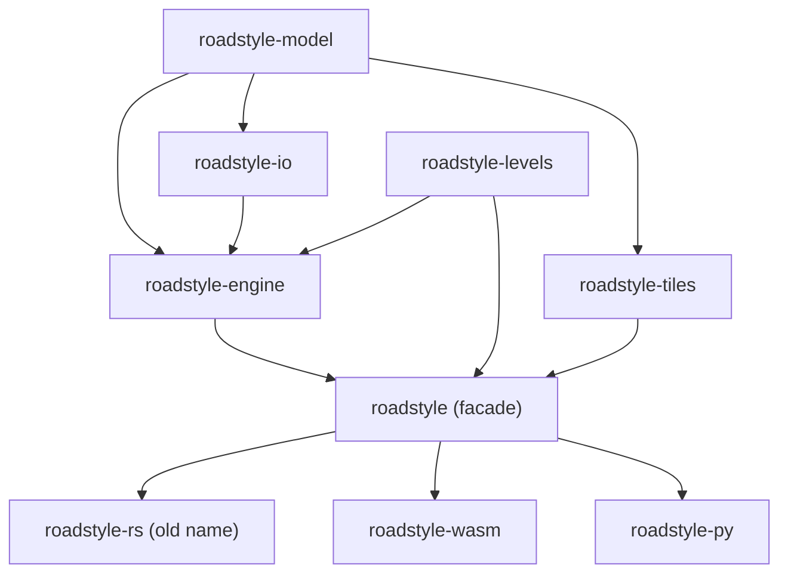

# The crates

The Rust engine is a Cargo workspace in <code>rust/</code>, with nine crates. This page tells what each crate is for.

*Each arrow points from a dependency to the crate that uses it. `roadstyle-levels` has no dependency on the other crates.*

| Crate | Type | What it is for | Main items |
|---|---|---|---|
| `roadstyle-model` | library | The road model: the roads as features with typed properties (one copy of each key name), and the geometry helpers (WKB, area, centroid) | `props`, `geom` |
| `roadstyle-io` | library | The reader: the roads and the other tables from GeoParquet (WKB lines, Snappy) | `read` |
| `roadstyle-levels` | library | The drawing levels: the tags rule and the solver (least span first, then a push-relabel minimum-cost flow). duckosm-rust uses this crate alone | `LevelEdges`, `compute`, `Method` |
| `roadstyle-engine` | library | The style of a map: the look (palette, profile, settings), the road layers of simple mode and of the full look, the data-driven paint and the legend data, the overlays and the items, the 3D bridge decks, the base-map layers, the interaction contract, `export_look` | `make_style`, `make_parts`, `look::make_look`, `export_look::export_look` |
| `roadstyle-tiles` | library | The vector tiles on request, with the rules of `tiles.py`, and the PMTiles writer | `Tiles`, `pmtiles` |
| `roadstyle` | library | The facade: the engine, the levels and the tiles in one crate, the tiled style and the page writer | `make_style`, `make_tiled`, `page::make_page`, `levels`, `tiles` |
| `roadstyle-rs` | library and program | The old name of the facade, kept for one version. Its program (`src/main.rs`) measures the time and the memory of each stage | |
| `roadstyle-wasm` | `cdylib` | The browser package: the functions of [Use roadstyle in the browser](browser.md#the-functions-of-the-package) through wasm-bindgen, and an allocator that grows the memory in large steps | `makeLook`, `makeStyle`, `Tiler`, `makePage`, `exportLook`, `memoryBytes` |
| `roadstyle-py` | `cdylib` (PyO3, abi3) | The Python module `roadstyle._rust`. Python calls it through `roadstyle._engine`; the GIL is free while Rust works | `make_look`, `make_style`, `Tiler`, `compute_levels`, `make_page`, `export_look` |

All crates have the version 0.0.1 and are not on crates.io. The crates read roadstyle's data (`src/roadstyle/data/`) and the page
files (`src/roadstyle/static/`) when they are built, so these files have one copy for both engines.

## The interface: JSON text and Parquet bytes

The functions of the facade take the roads as the bytes of a GeoParquet file and the look as JSON text, and they give the style
as JSON text. The look is the JSON that `make_look` makes from `render_edges`' palette, profile, settings and keywords. A typed,
versioned look with a JSON schema is planned ([the plan](../design/rust_library.md#the-typed-look)); it is not built.

Errors are text: `Result<_, String>` in Rust, a thrown `Error` in JavaScript, a `ValueError` in Python.

## The documentation of each crate

Make it from the source: `cargo doc --no-deps --open` in `rust/` ([Build from source](build.md#read-the-crate-documentation)).

**See also:** [How the engine is built](architecture.md) · [Keywords by engine](keywords.md)
