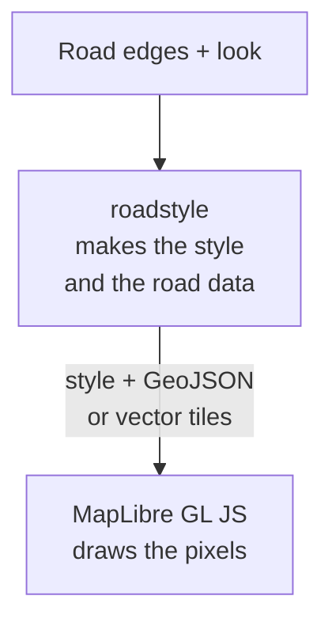

# How a map is drawn

<p class="lead">About what roadstyle makes, what MapLibre draws, the two forms of road data, and why the page uses one tile zoom.
This page is the same for the Python engine and the Rust engine.</p>

## roadstyle makes the map, MapLibre draws it

roadstyle does not draw pixels. It turns the road edges into a map **for one drawing library**, and that library draws. You
select the library with the keyword `backend` of `render_edges`:

| `backend` | The library that draws | What `render_edges` gives |
|---|---|---|
| `"web"` (the default) | MapLibre GL JS, in the browser | one HTML file |
| `"folium"` | Leaflet, in a notebook | a `folium.Map` |
| `"lonboard"` | deck.gl, in a notebook | a `lonboard.Map` |

The rest of this page is about `"web"`, the backend of almost all maps. The Rust engine makes only this backend.



The `"web"` backend makes:

1. **A MapLibre style:** the layers and their paint expressions (the widths for each zoom, the colors, the casing under the fill,
   the drawing order of bridges and tunnels), and the `roadstyle:*` metadata for the dashboard.
2. **The road data**, as GeoJSON or as vector tiles (the next section).
3. With `render_edges`: **one HTML page** that holds 1 and 2, MapLibre and the dashboard.

MapLibre reads the style and the data and draws them with WebGL. It draws a new frame each time that the view or a filter
changes.

## Three choices for the road data

MapLibre draws only from tiles: small squares of the map, one grid for each zoom. Three choices decide who makes these tiles and
how they get to the browser. Each choice comes after the one before it.

### Choice 1: GeoJSON or vector tiles

| | GeoJSON (the default) | Vector tiles (MVT) |
|---|---|---|
| Who cuts the roads into tiles | MapLibre, in the browser, for all roads when the page opens | roadstyle, before the browser |
| Calls | `render_edges(edges)`, `export_inline`, `makeStyle` | `tiles=True`, `export_style`, `Tiler` |
| Good for | up to about 10⁴ edges | about 10⁵ edges |

With GeoJSON, roadstyle makes no tiles. The page gives MapLibre all the roads, and MapLibre cuts them; `data_maxzoom` and
`data_tolerance` control that cut. Choices 2 and 3 do not apply.

After the cut, MapLibre does the same work with both forms: it turns each tile into shapes for the GPU and draws them. The map
looks the same, and the dashboard works on both.

### Choice 2: how the vector tiles get to the browser

| Way | Call | Where the tiles are | Server | What the browser loads |
|---|---|---|---|---|
| A. In one HTML file | `render_edges(edges, tiles=True)` | one PMTiles archive inside the page | not necessary: the file opens from disk | the whole file at the start, with all tiles; MapLibre decodes only the tiles in view |
| B. On a server | `export_style(...)` | files on a web server | necessary | `style.json`, then only the tiles in view, one request for each |
| C. Made in the browser | `new Tiler(...)` (WebAssembly) | nowhere: the engine makes each tile when MapLibre asks for it | only for the page and the roads file | the roads file one time; the tiles exist only in memory |

- **Way A** is one file for everything. Send it to a person or open it from disk.
- **Way B** is for a large area, and for other map apps (GeoLibre, QGIS) that open `style.json` by its URL.
- **Way C** is for a page that makes its maps itself, as duckosm-rust's page does.

### Choice 3: the tile files on the server (way B only)

| | XYZ folder (`format="xyz"`) | One PMTiles file (`format="pmtiles"`) |
|---|---|---|
| The files | one file for each tile: `tiles/<z>/<x>/<y>.pbf` | one file, `roads.pmtiles`; an index at its start tells where each tile is |
| How the map gets one tile | one request for that tile's file | one request for a part of the file (an HTTP range request) |

In both forms the map downloads only the tiles of its view. The difference is the number of files on the server.
[Make tiles and PMTiles](tiles.md) shows the calls.

## One tile zoom or several

When the map is flat, all tiles on the screen have the same zoom. When the map is tilted, MapLibre loads the near tiles at a
higher zoom than the far tiles, because the near part of the view is larger on the screen.

<div style="max-width:640px;margin:1em auto">
<svg viewBox="0 0 640 220" width="100%" role="img" aria-label="Left: a tilted view with zoom 15 tiles near and zoom 14 tiles far; the road changes width where they meet. Right: one tile zoom; the road has one width." style="display:block;font:13px sans-serif">
  <g fill="none" stroke="currentColor" stroke-opacity=".45">
    <path d="M70 30 H250 L300 190 H20 Z"/><path d="M45 110 H275"/>
    <path d="M160 30 V110"/><path d="M103 110 L90 190 M160 110 V190 M217 110 L230 190"/>
    <path d="M390 30 H570 L620 190 H340 Z"/><path d="M365 110 H595"/>
    <path d="M435 30 L425 110 M480 30 V110 M525 30 L535 110"/>
    <path d="M423 110 L410 190 M480 110 V190 M537 110 L550 190"/>
  </g>
  <path d="M160 30 V110" stroke="#ff6b35" stroke-width="6"/><path d="M160 110 V190" stroke="#ff6b35" stroke-width="14"/>
  <path d="M480 30 V190" stroke="#ff6b35" stroke-width="10"/>
  <g fill="currentColor">
    <text x="88" y="75">zoom 14</text><text x="180" y="75">zoom 14</text>
    <text x="40" y="160">15</text><text x="120" y="160">15</text><text x="180" y="160">15</text><text x="250" y="160">15</text>
    <text x="163" y="106" fill="#d9480f">a step</text>
    <text x="400" y="75">15</text><text x="450" y="75">15</text><text x="500" y="75">15</text><text x="550" y="75">15</text>
    <text x="370" y="160">15</text><text x="440" y="160">15</text><text x="500" y="160">15</text><text x="570" y="160">15</text>
    <text x="30" y="212">Several tile zooms: the road changes width</text>
    <text x="365" y="212">One tile zoom: the road has one width</text>
  </g>
</svg>
</div>

roadstyle bakes a road's width into each tile for the zoom of that tile. Where a near tile (zoom 15) meets a far tile (zoom 14),
the same road gets two widths, and the map shows a line across all roads at that place.

To stop this, the page makes MapLibre use **one tile zoom on the whole screen**. The page template sets it for each source that
is not a base map:

```js
source.calculateTileZoom = (z) => z;      // web_template.html, _flatTiles
```

The cost:

- Up to 60° of tilt, MapLibre already uses one tile zoom, so the rule changes nothing.
- Above 60°, the page loads 2 to 3.6 times as many tiles (66° to 70°).
- `max_pitch=60` keeps every view in the range where the rule costs nothing. The default is 70.

A page of your own that adds roadstyle's style to its own MapLibre map does not have this rule. Add the same line for each
roads source, as the tile example of [Use roadstyle in the browser](browser.md#add-roads-that-come-later-as-vector-tiles) does.

**See also:** [Big networks](../guides/big-networks.md) · [Make tiles and PMTiles](tiles.md) ·
[Architecture of the Rust version](architecture.md)
