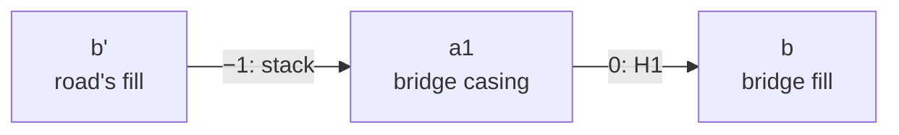

# How the levels are solved

<p class="lead">About the Rust solver of the drawing levels (the crate <code>roadstyle-levels</code>): what it decides, how its
rules become a graph, and how minimum-cost flows find the numbers.</p>

## What the solver decides

Each road gets four whole numbers, its positions in the drawing order. A higher number is drawn later, so it is on top:

| Number | In the code | What it places |
|---|---|---|
| the fill | `b` (`fill_level`) | the inside of the road |
| the start head of the casing | `a0` (`casing_start`) | the casing at the start of the road |
| the main part of the casing | `a1` (`casing_level`) | the casing between the heads |
| the end head of the casing | `a2` (`casing_end`) | the casing at the end of the road |

The level input (`level_input`) gives the solver the relations of the roads: which roads cross, which meet, and which one is
wanted on top. The solver reads only these tables, never the lines.

## The rules

**Hard rules** always hold:

- **H1.** A casing part is never over the fill of its own road: `a ≤ b`.
- **H2.** Where two roads meet, the head of each one is not over the fill of the other.
- **The box.** Every number is in a range of `2 × max_level / margin` steps: −20 to 20 with the defaults (inside the solver, 0 to
  40).
- **Fixed numbers.** A road that is fixed (for example a hand fix of the level editor) keeps its numbers.

**Soft rules** hold when they can. When they conflict, the solver breaks the fewest, in this order of priority:

1. **Stack.** A road that crosses over another road: the crossing part of its casing is at least one step over the fill of the
   lower road. This is a real bridge or tunnel.
2. **Crossing.** A path (footway, path, cycleway, steps, pedestrian, bridleway, corridor) at a node where a car road goes on (two
   car road ends or more), of the same band and of a lower priority than the road: the road's head there is at least one step over
   the path's fill, so the map draws the path under the road and the road keeps its outline (OSM-Carto's look). There is no meet
   between them. Before 2026-10-25 they were a meet: the road's head went under the path's fill, a notch in the road's outline and a
   step in its casing. A crossing comes after the stacks, so a bridge over the road outranks it (a footbridge shorter than its two
   heads can land on such a path).
3. **Order wish.** At a place where roads only meet, the fill of one road is over the fill of the other: a roundabout over a
   tunnel, a tunnel over a bridge, a higher class over a lower one.
4. **Near** (only with `near_rules=True`): a part that only comes near the lower road.

After these: **as few positions as possible** (the span of the numbers, with `min_positions`, the default), and then the casings as
close to their fills as possible.

## The words

The solver uses the words of graph theory. Each word, and what it means here:

| Word | Its meaning | In the solver |
|---|---|---|
| **graph** | a set of nodes, and arcs between them | all the numbers of all the roads, and all their rules |
| **node** | one point of the graph | one number of one road, for example the fill of road 7. There are 4 nodes for each road, and 3 more: `H` (the highest number), `L` (the lowest) and `0` (the zero) |
| **arc** | a connection from one node to another, with a direction (`i → j`). Graph books also call it an *edge*, but on this page an edge is always a road | one rule between two numbers |
| **cost** | a number on each arc | the constant `w` of the rule `x_i − x_j ≤ w`: 0, −1 or a number of steps |
| **loop** | arcs that go around and come back to the node where they start | rules that depend on each other in a ring |
| **negative loop** | a loop whose costs add up to less than 0 | rules that cannot all hold at the same time |
| **flow** | an amount that goes along the arcs, as water goes through pipes. At each node, the flow that comes in equals the flow that goes out (except at a node with a supply) | the twin of the rules: an arc with flow is a rule that is exactly at its limit, or broken |
| **capacity** | the most flow that one arc can carry | a hard rule: no limit; a soft rule of the stage: 1 unit; a rule of a later stage: not in the graph yet |
| **supply** | flow that a node must send out (or take in, when it is negative) | in the last stage: each casing part sends 1 unit to the fill of its road |
| **minimum-cost flow** | the flow whose cost (the sum of each arc's flow times its cost) is the least | the best answer of a stage |
| **shortest distance** | the least total cost of a path from one node to another | how the numbers are read back at the end |
| **potential** | a number for each node, which the flow algorithm keeps so that its searches see no negative costs | a help inside the flow algorithm; it is not a road's number |

## Every rule has one form

Each rule says: *this number is at most that number, plus a constant*:

```text
x_i − x_j ≤ w
```

| Rule | As `x_i − x_j ≤ w` |
|---|---|
| H1: a casing part not over its fill | `a − b ≤ 0` |
| Stack: the part `a` of the upper road one step over the fill `b'` of the lower road | `b' − a ≤ −1` |
| Crossing: the head `a` of the road one step over the fill `b'` of the path | `b' − a ≤ −1` |
| Order: the fill `b` over the fill `b'` | `b' − b ≤ −1` |
| The box: every number at most `steps` | `x − 0 ≤ steps` |

Rules of this form are a **graph**. Each number is a node, and each rule `x_i − x_j ≤ w` is an arc from `i` to `j` with the
cost `w`. A bridge whose main casing crosses over a road:



*The stack arc says `b' − a1 ≤ −1`, the H1 arc says `a1 − b ≤ 0`. A solution: `b' = 0`, `a1 = 1`, `b = 1`.*

The fact that makes the graph useful: **the rules can all hold at the same time when no loop of arcs has a negative total
cost.** A loop with the cost −3 means that, around that loop, the rules ask for 3 steps more than the numbers can give. For
example, three roads that meet in a ring, each one wished over the next one: three order arcs of −1 in a loop. At least one wish
must break, and the misses add up to 3 steps, however they are shared.

## Each stage is a minimum-cost flow

The question of a stage, "break the soft rules of this priority by as few steps as possible", has a twin problem in the graph
(the duality of linear programming): **send flow around the arcs at the least cost**, where

- a hard arc can carry any amount of flow;
- a soft arc of this stage can carry at most 1 unit;
- the soft arcs of the later stages are not in the graph yet.

Flow goes only around the loops whose cost is negative, because only there it lowers the cost. The least cost of the flow is minus
the fewest steps that must be broken. The flow also shows **which** rules break: the soft arcs that carry flow. With no
negative loop there is no flow, and nothing breaks.

The stages run in the order of priority: stack, then crossing, then order, then near. After each stage, the solver **locks** its result, so a
later stage cannot spoil it:

| After a stage, an arc | becomes | so that |
|---|---|---|
| soft, with flow (broken) | a hard rule the other way: `x_i − x_j ≥ w` | the later stages cannot repair it at the cost of this stage's best value |
| soft, with no flow (kept) | a hard rule | it stays kept |
| hard, with flow (tight) | also its reverse: `x_i − x_j = w` | the best value of this stage stays the best |

Then the next stage adds its own soft arcs to the graph and solves again.

## The last stage: fewest positions, then close casings

The last flow has a different goal: the casing parts as close to their fills as possible (the sum of `b − a` over all casing
parts), with a very large weight on the span (the highest number minus the lowest), so the span comes first.

1. **The least span.** Two extra nodes, `H` and `L`, hold the highest and the lowest number (every number between them). The least
   span is a shortest-path length from `L` to `H` in the graph of the hard rules. An arc `H − L ≤ span` keeps it.
2. **The closest casings.** Each casing part sends one unit of flow to the fill of its road. The cheapest flow that delivers all
   these units gives the least sum of `b − a`.

## From the flow back to the numbers

The flow does not give the numbers directly. It gives which rules are **tight** (the arcs with flow) and which have room. The
numbers are the shortest distances in the graph that the flow leaves: each arc with room keeps `x_i ≤ x_j + w`, and each arc
with flow also keeps `x_j ≤ x_i − w`. The distances satisfy every rule, with equality exactly where the flow runs, and this makes
them the best numbers. They are whole numbers. Then `compute_levels` moves them so that the most common casing position is 0 (the
ground).

## The flow algorithm

`roadstyle-levels::flow` is a minimum-cost flow with whole numbers, by the **primal-dual** method:

1. Each node has a potential. With it, every arc gets a reduced cost that is not negative.
2. A Dijkstra search on the reduced costs, from the nodes that still have flow to send, finds the cheapest paths.
3. A maximum flow along the arcs of reduced cost 0 sends as much as these paths can carry.
4. The potentials grow by the distances, and the method repeats until all flow is sent.

The costs of the levels are small (0, −1 and the span), so there are few rounds. When some numbers are fixed, their arcs have
negative costs, and a Bellman-Ford search gives the first potentials.

## The checks

- **The flow** is checked against its potentials (complementary slackness): the two agree only when the flow is the cheapest one.
- **The answer** is checked against every hard rule: each casing part not over its fill, the heads of roads that meet, the fixed
  numbers and the box. A failure is an error, never a quiet result.
- **A loop of hard rules** (a negative loop with no soft arc in it) has no solution. It is an error that names it.

The solver returns the numbers, the best value of each stage (the steps by which stack rules, crossings, order wishes and near
rules are broken, and the cost of the last stage), and the pairs that it did not keep. `compute_levels` gives these pairs as
`levels_given_up` (the stacks) and `levels_orders_not_kept` (the order wishes).

## Examples from the tests

| Test (`roadstyle-levels::solve`) | The rules | The result |
|---|---|---|
| `a_bridge_over_a_road` | one stack: the bridge's main casing over the road | the casing over the road's fill, the bridge's fill over its casing; nothing broken |
| `four_bands_in_three_numbers` | four roads that cross at one point, each over all below it, in a box of 3 numbers (0, 1, 2) | one stack pair gives way: the stack stage breaks 1 step |
| `a_ring_of_wishes_cannot_all_hold` | three roads in a ring, each wished over the next one | one wish breaks; the order stage breaks 3 steps |

**See also:** [Which road is on top](../guides/levels.md) (how to use the levels) ·
[Inputs and outputs](../reference/formats.md#the-level-data) (the level columns) ·
[Architecture of the Rust version](architecture.md)
