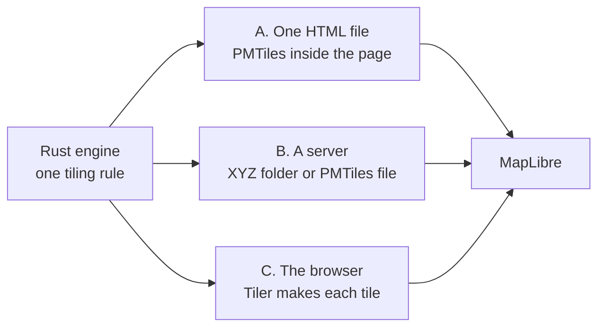

# Make tiles and PMTiles

<p class="lead">Make the roads as vector tiles with the Rust engine. The tiles go to the browser in one of three ways: in one
HTML file, on a server, or made in the browser.</p>

One tiling rule cuts the tiles for every way. The rule is in [Tiling: one algorithm and one protocol](https://github.com/Khoshkhah/roadstyle/blob/main/docs/design/tiling.md). The
way only moves the tiles to MapLibre. It never changes a tile. These settings are the same in every way:

| Setting | Value |
|---|---|
| Format | MLT (MapLibre Tile). MVT (Mapbox Vector Tile) when you ask for it with `tile_format="mvt"` |
| Zooms | 6 to 16. MapLibre scales the tiles of zoom 16 up, so the map is sharp at higher zooms |
| Source | One vector source `roads` |
| Buffer | The widest stroke of the style at each zoom sets it. Where the engine cannot find the width, it uses 80 px (`buffer_px`) |
| Road layer | One road layer for every zoom. It has no `minzoom` and no `maxzoom` (a zoom band leaves the map empty while the tiles of the new zoom load) |
| Keys | A road feature has only the keys of an allow-list, and no text except the street name of a name slot ([The keys of a tile](#the-keys-of-a-tile)) |



To choose a way, see [Three choices for the road data](drawing.md#three-choices-for-the-road-data). In short:

| Way | Use it for | Call |
|---|---|---|
| [A. In one HTML file](#a-put-the-tiles-in-one-html-file) | a file to send or to open from disk | `render_edges(edges)` (tiles are on by default) |
| [B. On a server](#b-put-the-tiles-on-a-server) | a large area, or another map app | `export_style(...)` |
| [C. Made in the browser](#c-make-the-tiles-in-the-browser) | a page that makes its maps itself | `new Tiler(...)` |

## A. Put the tiles in one HTML file

```python
rs.render_edges(edges).save("map.html")                       # tiles=True is the default
rs.render_edges(edges, tiles=False).save("geojson_map.html")  # the roads as GeoJSON
rs.render_edges(edges, tile_format="mvt").save("mvt_map.html")
```

The page has a PMTiles archive inside it. It opens from disk with no server. The browser loads the whole file with the page, and MapLibre decodes only the tiles in view. The engine writes the archive. The whole archive is one gzip stream (not one stream for each tile), and the page inflates it with `DecompressionStream`.

| Roads | Page with MLT tiles | Page with GeoJSON roads | Page with MVT tiles |
|---|---|---|---|
| Monaco (13,298 roads) | 3.8 MB | 3.9 MB | 4.3 MB |
| Nacka (22,191 roads) | 20.0 MB | 18.8 MB | |

At zoom 11 to 13, the GeoJSON page draws 2.4 to 2.6 times the triangles of the tiled page. Its pan and zoom stall about twice as long.

A page that has a palette in a view needs `tiles=False`. If you use both, the call stops with an error.

## B. Put the tiles on a server

`export_style` writes a folder:

| File | Content |
|---|---|
| `style.json` | the style. Every URL in it starts with `base_url` |
| the tiles | an XYZ folder or one PMTiles file |
| the sprite | the one-way arrow |
| `props.json` | the road table. A click reads it by the road's row |
| `popup.js`, `popup.css` | the road popup, for the plugin of an app |

Put the folder on a web server at `base_url`. A map app opens `style.json` by its URL, and the style leads it to the tiles and the sprite. The style has the roads only: the base map comes from the app.

The tiles can be in one of two forms. In both forms the map downloads only the tiles of its view.

### As a folder of XYZ tiles

```python
rs.export_style(edges, "monaco_xyz", base_url="https://example.org/monaco")
```

The tiles are one file each: `tiles/<z>/<x>/<y>.mlt`. The map gets each tile with one request for its file. Every web server and
every map app can use this form. The web server can compress the files.

### As one PMTiles file

```python
rs.export_style(edges, "monaco_pm", base_url="https://example.org/monaco", format="pmtiles")
```

All tiles are in one file, `roads.pmtiles`, with an index at its start. The map reads the index, then gets each tile with an HTTP range request. The server must answer range requests (most static servers and cloud storage do). The map page must load the [pmtiles](https://github.com/protomaps/PMTiles) library for the `pmtiles://` protocol. The tiles are gzipped one by one, because a range request reads one tile. The same map gives the same archive each time, because the gzip streams have no time in them.

On Monaco (13,298 roads), the XYZ form has 91 tile files (0.86 MB in all), and the PMTiles form is one file of 0.54 MB, because its
tiles are gzipped. With `tile_format="mvt"` the numbers are 2.0 MB and 0.90 MB.

### The tile format: MLT or MVT

A tile has one of two formats. **MLT** (MapLibre Tile) is the default for every way: the page's archive, the map worker of a browser page, `export_style` and `roadstyle tiles`. **MVT** is for an app that cannot read MLT. Ask for it with `tile_format="mvt"`. Both formats have the same layers, ids, order, properties and geometry.

```python
rs.export_style(edges, "monaco_mvt", base_url="https://example.org/monaco", tile_format="mvt")
```

With the default (`tile_format="mlt"`):

- the tile files end in `.mlt`, not `.pbf`;
- the vector source in `style.json` has `"encoding": "mlt"`;
- a PMTiles file has tile type 6 (MapLibre Vector Tile) in its header.

The map app must use MapLibre GL JS 5.12 or later. An app that does not know MLT shows no road. For such an app, use `tile_format="mvt"`.

#### Why MLT is the default

- An MLT tile has about 40 % of the bytes of an MVT tile, and about 60 % after gzip.
- MLT gives the same picture as MVT: 0 pixels differ.
- The worker of a browser page makes an MLT tile from the MVT cut in 1 to 6 ms. It keeps each tile in each format, so the cost is one time for each tile.
- MapLibre needs about the same time to read both formats. All measurements use one browser (Chromium with software rendering). The speed can be different in other browsers and on a phone. This is not yet measured.

#### Measured results

All numbers come from MapLibre GL JS 5.24.

| Test | MVT | MLT |
|---|---|---|
| Monaco test data, 468 tiles, bytes | 5.9 MB | 2.4 MB |
| The same tiles, after gzip | 2.3 MB | 1.4 MB |
| Burnaby, the largest tile of each zoom 9 to 15, after gzip | 70 to 495 KB | 43 to 288 KB (57 to 61 % of MVT) |
| Burnaby, MapLibre time to read and lay out the largest tile | base | +1 to +10 % (z9 to z13), -1 % (z14), +6 % (z15) |
| Pixels that differ from the MVT picture | - | 0 (Monaco, four views; Burnaby, 17 views) |

??? info "The tile of a Burnaby view in the browser"
    The page of duckosm-rust measured the tiles of a Burnaby view (driving) with the blank base map. Each row is the mean over the tiles of the view, in 2 runs for each format. "Cut" is the time that the map worker needs to make the tile. "Read" is the time that MapLibre needs to parse the tile and make its layout.

    | Zoom | Tiles | KB for each tile, MVT / MLT | Cut (ms), MVT / MLT | Read (ms), MVT / MLT |
    |---|---|---|---|---|
    | 11 | 14 | 113 / 45 | 0.4 / 5.3 | 128 / 122 |
    | 13 | 10 | 248 / 90 | 1.1 / 12.8 | 173 / 211 |
    | 15 | 9 | 113 / 49 | 0.6 / 7.2 | 133 / 103 |

    The read times are about the same. The difference is in the noise of the runs. The cut times come from a worker that made an MLT tile again at each request. The worker now keeps each tile, so an MLT tile costs 1 to 6 ms (Nacka, native), one time for each tile.

    The tests are `tests/test_mlt.py` (the pixels), `rust/roadstyle-rs/tests/tile_mlt.rs` (the features) and `rust/roadstyle-rs/tests/tile_budget.rs` (the size limits).

#### What is different in MLT

- A property has one type in a tile layer. When a key has two types in one layer, MLT writes its values as text. A style expression that reads such a key must work with text. The expressions of the roadstyle style do.
- The encoder does not use a shared dictionary (MapLibre GL JS 5.24 refuses it), FSST or FastPFOR (they give larger tiles after gzip).

### The input of `export_style`

`export_style` takes the keywords of `render_edges` that change the style. In place of a GeoDataFrame, it also takes the path of
a duckOSM GeoParquet export (`duckosm export-gis --format geoparquet`). That file must have the drawing levels, else the call
stops with an error that tells you how to save them.

## C. Make the tiles in the browser

`Tiler` in the WebAssembly package makes each tile when MapLibre asks for it. No tile, file or folder is written at the start:

1. `new Tiler(roads, look, features, name, prefix, keep)` makes the style and the pieces of the roads (the casings, the fills, the names and the arrows). It keeps them in memory with a spatial index. It makes no tile.
2. When MapLibre needs a tile, it asks for an address `rs://<generation>/roads/<z>/<x>/<y>`. The page answers with `tiler.tile("roads", z, x, y)`. The engine cuts the pieces in that square and encodes the tile.
3. The engine keeps each tile that it made, in each format that was asked for. MapLibre keeps the tiles in its own cache.

A new look gives a new `Tiler` and a new generation in the address. Then MapLibre does not mix old tiles with the new style.

`tiler.tile("roads", z, x, y, "mvt")` gives the tile in MVT. `tiler.style("mvt")` gives the style of the same format (the vector source has `"encoding": "mvt"`). Without the format, both use the format of the `Tiler`: MLT, or the `tile_format` of the look.

`tiler.archive(bounds, layers)` makes all tiles in the bounds at once, as one PMTiles archive in memory. Use it for a page that saves its map as a file. See [Use roadstyle in the browser](browser.md#add-roads-that-come-later-as-vector-tiles).

## The keys of a tile

A road feature in a tile has the geometry, the feature id (the road's row) and the keys that MapLibre must read. All other fields of a road are in the road table. The popup, the panel and the filters read the table by the row id.

- **An allow-list.** A key of a road feature is a mark (`Mark::ALL`) or one of `TILE_ROAD_KEYS` (`rust/roadstyle-model/src/mark.rs`). A data column is never a key of a road feature.
- **No text.** A road feature has no text value. The one exception is the street name of a name slot (`slots.name`, which `text-field` reads). The class is the number `__rs_ci`. The dash pattern and the end shape are numbers. The level `lvl` is there only when it is not 0.
- **One rule for every path.** The page's archive, the map worker, `export_style` and `roadstyle tiles` make their tiles with `TileOptions::rule`. The test `rust/roadstyle-rs/tests/tile_keys.rs` fails for another key, for a new text value, and for a difference between the paths that is not in the list of documented differences.

## The tile budget

The tile bytes only go down. The tests `rust/roadstyle-rs/tests/tile_budget.rs` and `tests/test_tile_budget.py` keep the limits in `rust/roadstyle-rs/tests/data/tile_budget.json`. Each limit is the measured number plus 2 %. The script `scripts/tile_budget.py` can only lower a limit. A raise needs `--raise --why` and the agreement of the maintainer.

??? info "What the test measures"
    The test measures fixed views of Monaco and Tartu, at zoom 9 to 15 (3 by 3 tiles around a fixed center). It limits:

    - for each view: the bytes of all its tiles, and the bytes and the features of its largest tile, in MVT and in MLT;
    - for each tile layer, in the largest tile: the keys, the values, the text values (`strings` and `string_bytes`), the keys that no style layer reads (`keys_unread`), the features with no id, the line segments under 1 px and the features under 1 px;
    - `property_bytes`: the bytes of the `tags` field of every feature in the largest tile. A key that a change adds to the features fails the test `a_key_added_to_the_tiles_is_over_the_property_budget`;
    - the size of the style expressions.

The reasons for each rule, the measurements and the keys of each layer are in [Tiling: one algorithm and one protocol](https://github.com/Khoshkhah/roadstyle/blob/main/docs/design/tiling.md).

**See also:** [How a map is drawn](drawing.md) · [Big networks](../guides/big-networks.md) ·
[On a website or in a map app](../guides/website.md)
