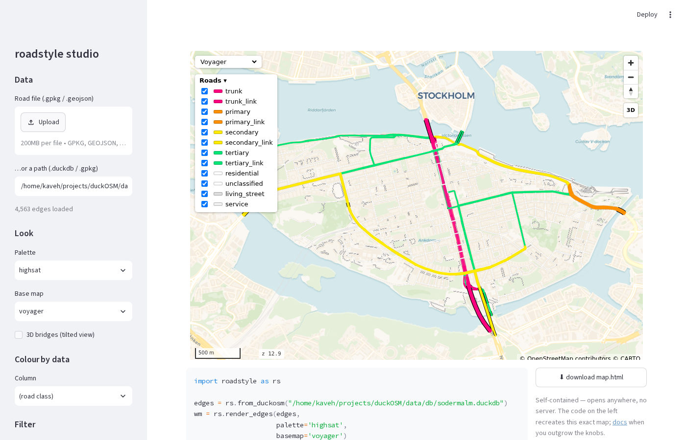

# Studio

<p class="lead">A no-code workbench: load a road file, turn the knobs, and see the live map next to the exact code that makes it.</p>

```bash
pip install "roadstyle[studio]"   # adds streamlit
roadstyle studio                  # Streamlit flags pass through: roadstyle studio --server.port 8502
```

You do not need a clone. The studio is in the package. The Södermalm sample networks (about 13 MB)
download on the first run. In a git checkout, the studio uses `ui/studio/samples/`.



## Two pages

| Page | Makes | Same as |
|---|---|---|
| **Map** | a map with its built-in controls | `rs.render_edges(edges, ...)` |
| **Dashboard** | the map and the toolbox. The panel has two demo parts: the query box and the road card | `rs.render_dashboard(edges, dashboard={"panel": {"sections": [...]}}, ...)` |

Each page has a download button for the self-contained HTML. It also shows the Python call.
Copy the call when you outgrow the knobs.

## The knobs

The Map page has all of these. The Dashboard page has Look, Colour by data, Hover tooltip, Decorations and Overlays.

- **Look**: palette, base map, 3D bridges, vector tiles (with the `tiles` extra).
- **Colour by data**: any column with a colour map.
- **Filter** (Map page): keep some road classes. Hide minor roads when zoomed out.
- **Decorations**: street labels, one-way arrows.
- **Popup & hover**: the click popup (curated, chosen columns, side panel, all, off) and a hover tooltip.
- **Overlays**: zones, points or lines as extra layers.

**See also:** [Dashboards](guides/dashboards.md) · [Every parameter](reference/parameters.md)
